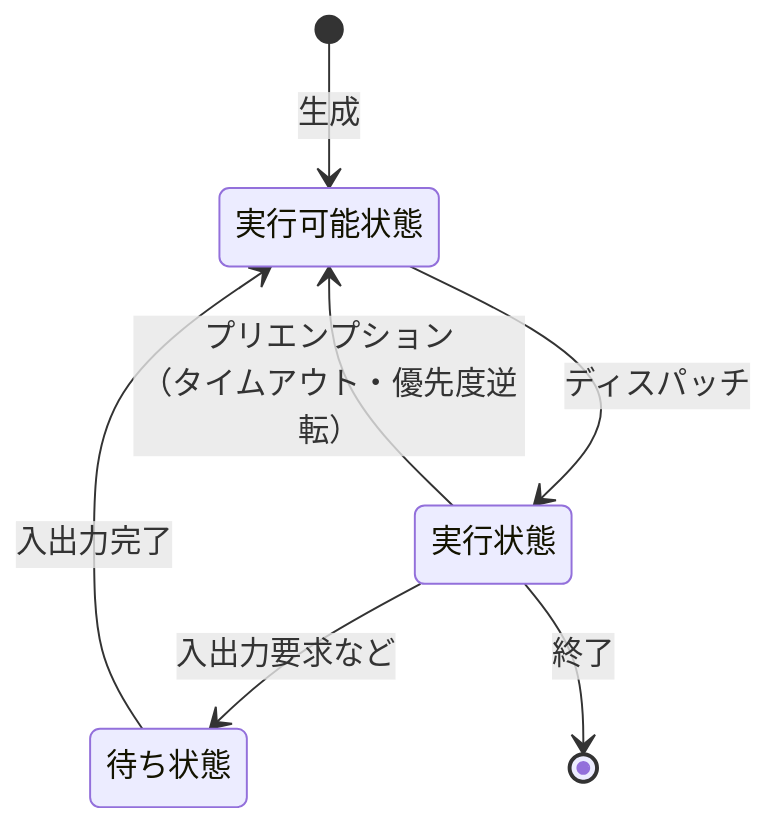

# 5-1 オペレーティングシステム

ハードウェアとアプリケーションの間に立ち、**資源を管理して割り振る**ソフトウェアがOSである。

OSが解決している問題は一貫している。**有限の資源（CPU、主記憶、入出力装置）を、複数のプログラムに、互いに邪魔させずに使わせる**ことである。CPUは1つしかないのに複数のプログラムを同時に動かしているように見せ、主記憶より大きなプログラムを動かし、同じ装置を取り合わないよう調停する。本章で扱うタスク管理・記憶管理・排他制御は、いずれもこの一点から説明がつく。

午前Iの問6前後から出題される。16年で17問と、分野5のなかで圧倒的に出題が多い。とりわけ**仮想記憶（ページング）**が繰り返し問われる。

## 目次

- [1. OSの役割と構成](#1-osの役割と構成)
- [2. タスク管理](#2-タスク管理)
- [3. 排他制御とデッドロック](#3-排他制御とデッドロック)
- [4. 主記憶管理](#4-主記憶管理)
- [5. 仮想記憶](#5-仮想記憶)
- [6. ジョブ管理](#6-ジョブ管理)

---

## 1. OSの役割と構成

### 1.1 カーネル

OSの中核部分を**カーネル**という。

> **Linuxカーネルは、プロセス管理やメモリ管理などの、アプリケーションが動作するための基本機能を提供する。**

誤答として並ぶ記述を確認すると、**カーネルの範囲**が明確になる。

| 記述 | なぜ誤りか |
| --- | --- |
| GUIが組み込まれていて、マウスを使った直感的な操作が可能である | **GUIはカーネルの外側**にあるソフトウェア（デスクトップ環境） |
| Webブラウザ、ワープロソフト、表計算ソフトなどが含まれている | **アプリケーションはカーネルに含まれない** |
| シェルと呼ばれるCUIが組み込まれていて、文字での操作が可能である | **シェルもカーネルの外側**のプログラムである |

**カーネルが提供するのは「基本機能」だけ**で、利用者が直接触れる部分（シェル、GUI、アプリケーション）はすべてその上に載る別のソフトウェアである。LinuxディストリビューションとLinuxカーネルが別物なのはこのためで、カーネルは共通でも、組み合わせるシェルやGUIやツール群の違いでディストリビューションが分かれる。

### 1.2 OSの主な機能

| 機能 | 内容 |
| --- | --- |
| タスク（プロセス）管理 | CPUをどのプログラムに割り当てるかを制御する |
| 記憶管理 | 主記憶の割当てと仮想記憶を管理する |
| 入出力管理 | 装置へのアクセスを調停する |
| ファイル管理 | ファイルシステムを提供する（→ [5-3 ファイルシステム](5-3-ファイルシステム.md)） |
| 利用者管理 | 利用者とアクセス権を管理する |

> **出題** Linuxカーネル: H26午前I問6

---

## 2. タスク管理

### 2.1 タスクの状態遷移

タスク（プロセス）は3つの状態を遷移する。

| 状態 | 意味 |
| --- | --- |
| **実行可能状態（レディ）** | CPUが割り当てられれば動ける。順番待ち |
| **実行状態（ラン）** | CPUが割り当てられて動いている |
| **待ち状態（ウェイト）** | 入出力の完了などを待っている。CPUを割り当てても動けない |

### 2.2 ディスパッチとプリエンプション

| 用語 | 意味 |
| --- | --- |
| **ディスパッチ** | **あるタスクの実行中に、別のタスクに切り替え、かつ実行権を渡すこと** |
| スケジューリング | **各タスクの実行順序を決定すること** |
| **プリエンプション** | 実行中のタスクからCPUを**強制的に取り上げる**こと |
| タスクコンテキスト | タスクの内部状態、置かれた状況、与えられた条件など、**タスクの実行に必要な各種情報** |
| マルチタスク | 複数のタスクを同時に実行しているかのように見せかけた状態 |

**ディスパッチは「渡す」、スケジューリングは「決める」**という役割の違いで区別する。スケジューラが「次はこのタスク」と決め、ディスパッチャが実際にCPUを渡す。

> リアルタイムOSにおいて、**実行中のタスクがプリエンプションによって遷移する状態**はどれか。

答えは**実行可能状態**である。

プリエンプションはCPUを取り上げるだけで、タスクそのものは**いつでも再開できる**。入出力を待っているわけではないので待ち状態ではないし、終わったわけでもない。だからCPUが空けばすぐ動ける**実行可能状態**に戻る。

タイムスライスを使い切ったとき、より優先度の高いタスクが実行可能になったときなどにプリエンプションが起きる。これによって、1つのタスクがCPUを独占するのを防いでいる。

### 2.3 スケジューリング方式

| 方式 | 内容 |
| --- | --- |
| 到着順（FCFS） | 到着した順に実行する |
| **ラウンドロビン** | 一定時間（タイムスライス）ごとに切り替える |
| 優先度順 | 優先度の高いタスクから実行する |
| 処理時間順（SPT） | 処理時間の短いタスクから実行する |

> **出題** ディスパッチ: H23午前I問7 ｜ プリエンプション: H29午前I問6

---

## 3. 排他制御とデッドロック

### 3.1 セマフォ

複数のタスクが同じ資源を同時に使うと、データが壊れたり装置が誤動作したりする。これを防ぐ仕組みが**排他制御**である。

> 一つの I²C バスに接続された二つのセンサがある。それぞれのセンサ値を読み込む二つのタスクで**排他的に制御したい**。利用するリアルタイムOSの機能として適切なものはどれか。

答えは**セマフォ**である。

セマフォは「使用中かどうか」を表すカウンタで、資源を使う前に獲得（P操作）し、使い終わったら解放（V操作）する。獲得できなければ待ち状態になる。これによって**同時に1つのタスクしか資源を使えない**ことを保証する。

誤答との区別も押さえる。

| 機能 | 用途 |
| --- | --- |
| **セマフォ** | **排他制御**（資源の占有を調停する） |
| キュー | タスク間のデータの受渡し（通信） |
| マルチスレッド | 1つのプロセス内で複数の処理を並行させる仕組み |
| ラウンドロビン | スケジューリング方式 |

I²Cバスのように**物理的に1つしかない装置**は、同時に2つのタスクが使えば通信が混線する。だから排他制御が必要になる。

### 3.2 デッドロック

複数のタスクが互いに相手の持つ資源の解放を待ち、永久に進まなくなる状態を**デッドロック**という。

> 三つの資源 X〜Z を占有して処理を行う四つのプロセス A〜D がある。各プロセスは表中の数値の順に資源を占有し、実行終了時に三つの資源を一括して解放する。**プロセスAと同時にもう一つプロセスを動かした場合にデッドロックを起こす可能性があるプロセス**はどれか。
>
> | プロセス | 資源X | 資源Y | 資源Z |
> | --- | --- | --- | --- |
> | A | 1 | 2 | 3 |
> | B | 1 | 2 | 3 |
> | C | 2 | 3 | 1 |
> | D | 3 | 2 | 1 |

**デッドロックが起きるのは、資源を獲得する順序が食い違っているとき**である。同じ順序なら、先に進んだほうが全部取れるので、後続は待つだけで済む。

各プロセスの獲得順序を並べ直す。

| プロセス | 獲得する順序 |
| --- | --- |
| A | **X → Y → Z** |
| B | **X → Y → Z**（Aと同じ） |
| C | **Z → X → Y**（Zが1番目、Xが2番目、Yが3番目） |
| D | **Z → Y → X** |

Aと比べる。

- **B**：Aと**完全に同じ順序**。先にXを取ったほうが勝ち、もう一方はXの解放を待つだけ。**デッドロックしない**
- **C**：AはXから、CはZから取り始める。AがXを持ったままYへ進み、CがZを持ったままXを要求すれば、互いに待ち合う。**デッドロックする**
- **D**：AはX→Y、DはZ→Y。AがXとYを持ち、DがZを持ってYを要求すると、DはYを待つ。一方AはZを要求してDの解放を待つ。**デッドロックする**

したがって答えは **C と D** である。

**デッドロックの予防策は、資源の獲得順序を全プロセスで統一する**ことである。Bのように全員が同じ順序で取れば、原理的に循環待ちが生じない。

> **出題** リアルタイムOSの排他制御: R4午前I問6 ｜ デッドロック: R6午前I問6

---

## 4. 主記憶管理

主記憶を使い回すうちに、**空き領域が細切れになって、合計では足りているのに連続した領域が確保できない**状態になる。これを**フラグメンテーション（断片化）**という。

| 用語 | 内容 |
| --- | --- |
| 可変区画方式 | プログラムの大きさに合わせて区画を割り当てる |
| **コンパクション（メモリコンパクション）** | **主記憶の空き領域を結合して一つの連続した領域にする** |
| **ガーベジコレクション** | **プログラムが使用しなくなったヒープ領域を回収して再度使用可能にする** |
| 動的再配置 | プログラムの実行中に主記憶内でモジュールの**格納位置を移動させる** |
| 動的リンキング | プログラムの実行中に必要になった時点でモジュールを**ロードする** |

**ガーベジコレクション**は、

> **記憶領域の動的な割当て及び解放を繰り返すことによって、どこからも利用できない記憶領域が発生することがある。このような記憶領域を再び利用可能にする機能**

である。プログラムが領域を確保したまま参照を失うと、その領域は使われないのに解放もされない（メモリリーク）。ガーベジコレクションは、**どこからも参照されていない領域を自動的に見つけて回収する**。JavaやPythonなど多くの言語処理系が備えている。

誤答では**用語の説明が入れ替えられる**。特に注意すべき組は次の2つである。

- **動的再配置は「移動させる」、動的リンキングは「ロードする」**。説明が入れ替わった選択肢が出る。
- **空き領域を結合するのはコンパクション**であって可変区画方式ではない。可変区画方式は「割当て方」の名前であり、断片化を解消する操作ではない。

> **出題** 主記憶管理: H24午前I問7、H28午前I問6 ｜ ガーベジコレクション: H25午前I問7

---

## 5. 仮想記憶

**仮想記憶**は、補助記憶を使って、**主記憶の物理容量を超えるメモリ空間をプログラムから利用可能にする**仕組みである。最も出題が多いテーマである。

### 5.1 ページング方式

プログラムとメモリを**ページ**という固定長の単位に分け、ページ単位で主記憶と補助記憶をやり取りする。

| 用語 | 意味 |
| --- | --- |
| **ページフォールト** | アクセスしたページが主記憶にないこと |
| **ページイン** | 必要なページを補助記憶から主記憶に読み込むこと |
| **ページアウト** | 主記憶のページを補助記憶に書き出すこと |
| ページ置換えアルゴリズム | どのページを追い出すかを決める方式（FIFO、**LRU**など） |
| **スラッシング** | ページフォールトが多発し、ページの入替えばかりで処理が進まない状態 |

### 5.2 フラグメンテーションの解決

> ページング方式の仮想記憶を用いることによって、**フラグメンテーションの問題を解決できる理由**はどれか。

答えは、

> **一連のプログラムやデータを、不連続な主記憶に割り付けることができる。**

フラグメンテーションが問題になるのは、**連続した領域を要求するから**である。ページング方式では、プログラムを固定長のページに分け、**ページ単位でバラバラの場所に置ける**。論理アドレスから物理アドレスへの変換はページテーブルが行うので、物理的に飛び飛びでもプログラムからは連続して見える。**連続性の要求そのものをなくした**のが解決の本質である。

### 5.3 事象の発生回数の関係

> ページング方式の仮想記憶において、ページアクセス時に発生する事象を**その回数の多い順**に並べたものはどれか。

答えは **ページフォールト $=$ ページイン $\geq$ ページアウト** である。

関係を順に確かめる。

- **ページフォールトが起きれば、必ずページインが行われる**。目的のページを読み込まなければ処理を続けられないので、両者の回数は**常に等しい**。
- **ページアウトは、主記憶に空きがないときだけ**必要になる。空きがあればページインするだけでページアウトは不要である。さらに、追い出すページが変更されていなければ（補助記憶の内容と同じなら）書き出す必要がない。

したがってページアウトの回数はページインの回数以下になる。この**「フォールトとインは常に同数、アウトはそれ以下」**という関係を押さえれば選べる。

### 5.4 デマンドページング

| 方式 | 読み込むタイミング |
| --- | --- |
| **デマンドページング** | **実際にアクセスが行われたときに読み込む** |
| プリページング | 将来必要になりそうなページを前もって読み込む |

> **デマンドページング方式による仮想記憶の利点**は、**実際にアクセスが行われたときにだけ主記憶にロードするので、無駄なページをロードしなくて済む**ことである。

プログラムには「起動時に一度しか通らない初期化処理」や「エラー時にしか使わない処理」が含まれる。これらを先に読み込むのは無駄であり、主記憶を圧迫する。**使われたものだけを読む**ことで、限られた主記憶を有効に使える。

誤答との区別も押さえる。

| 記述 | 誤りの理由 |
| --- | --- |
| 仮想記憶の容量比を大きくするほど、ページフォールトの発生頻度を低くできる | **逆**。仮想記憶が主記憶に比べて大きいほどページフォールトは増える |
| 必要とするページを前もってロードするので遅れを避けられる | **プリページング**の説明 |
| ページフォールトの発生頻度が極端に高くなってもスラッシングを回避できる | **回避できない**。頻度が高まればスラッシングに陥る |

### 5.5 ページサイズの影響

> ほとんどのプログラムの大きさが**ページサイズの半分以下**のシステムにおいて、**ページサイズを半分にした**ときに予想されるものはどれか。

答えは、

> **ページ内の無駄な空き領域が減少するので、主記憶不足が緩和される。**

プログラムがページサイズの半分以下なら、1ページ割り当てるたびに**半分以上が無駄になる**（内部断片化）。ページサイズを半分にすれば、この無駄が減り、同じ主記憶でより多くのプログラムを載せられる。設問で「主記憶が不足しがち」と断っているのは、この効果が効く状況だと示すためである。

誤答も確認する。「領域管理のオーバヘッドが減少する」は逆で、ページ数が増えればページテーブルが大きくなりオーバヘッドは**増える**。「ページ内に余裕がなくなる」「ページフォールトの回数が増加する」も、この条件下では主たる影響にならない。

**ページサイズの大小はトレードオフ**である。大きくすれば管理は楽だが内部断片化が増え、小さくすれば無駄は減るが管理のオーバヘッドが増える。どちらが有利かは、プログラムの大きさの分布で決まる。

### 5.6 ページフォールト処理時間の計算

> 1回のページフォールトの**平均処理時間は30ミリ秒**であった。ページアウトを伴わない場合のページインの処理時間は**20ミリ秒**、ページアウトを伴う場合の合計処理時間は**60ミリ秒**である。**ページアウトを伴わないページインだけの処理の割合**は幾らか。

ページアウトを伴わない割合を $p$ とすると、平均処理時間は

$$ 20p + 60(1-p) = 30 $$

$$ 60 - 40p = 30 \quad \Rightarrow \quad 40p = 30 \quad \Rightarrow \quad p = \mathbf{0.75} $$

**加重平均の式を立てて解く**だけの問題である。同じ形の計算は実効メモリアクセス時間（→ [3-2 メモリ](../03-computer-components/3-2-メモリ.md)）や平均CPI（→ [3-1 プロセッサ](../03-computer-components/3-1-プロセッサ.md)）にも現れる。

### 5.7 LRU方式のトレース

**LRU（Least Recently Used）**は、**最後に使われてから最も時間が経ったページ**を追い出す方式である。「しばらく使っていないページは、この先も使われないだろう」という局所性の仮定に基づく（→ [3-2 メモリ](../03-computer-components/3-2-メモリ.md)）。

> 主記憶のページ枠が 4000、5000、6000、7000番地の4ページ分で、参照するページ番号の順が
>
> $1 \to 2 \to 3 \to 4 \to 2 \to 5 \to 3 \to 1 \to 6 \to 5 \to 4$
>
> のとき、**最後の参照ページ4は何番地にページインされているか**。ここで、最初の $1 \to 2 \to 3 \to 4$ でそれぞれ 4000、5000、6000、7000番地にページインされる。

**表を作って追う**のが確実である。各番地にどのページがあるかと、最後に参照された時刻を記録する。

| 参照 | 4000 | 5000 | 6000 | 7000 | 動作 |
| --- | --- | --- | --- | --- | --- |
| 1 | **1** | — | — | — | ページイン |
| 2 | 1 | **2** | — | — | ページイン |
| 3 | 1 | 2 | **3** | — | ページイン |
| 4 | 1 | 2 | 3 | **4** | ページイン |
| 2 | 1 | **2** | 3 | 4 | ヒット |
| 5 | 1 | 2 | 3 | 4 → **5** | 最長未使用は4（枠は満杯）→ 7000を置換 |
| 3 | 1 | 2 | **3** | 5 | ヒット |
| 1 | **1** | 2 | 3 | 5 | ヒット |
| 6 | 1 | 2 → **6** | 3 | 5 | 最長未使用は2 → 5000を置換 |
| 5 | 1 | 6 | 3 | **5** | ヒット |
| **4** | 1 | 6 | 3 → **4** | 5 | 最長未使用は3 → **6000を置換** |

最後の参照ページ4は **6000番地**にページインされる。

**トレースのコツ**は、ヒットした場合も「最後に使った時刻」を更新することを忘れないことである。参照 `1` の直後は、古い順に 4（置換済み）、2、3、1 という状態になっているため、次に追い出されるのが2になる。

> **出題** ページサイズ: H22午前I問6 ｜ フラグメンテーションの解決: H24午前I問8 ｜ デマンドページング: H27午前I問6 ｜ ページフォールト処理時間: H30午前I問6 ｜ ページングの事象: R3午前I問6 ｜ LRU方式: R7午前I問6

---

## 6. ジョブ管理

### 6.1 ターンアラウンドタイムの計算

> ジョブの多重度が1で、到着順にジョブが実行されるシステムにおいて、**ジョブCが到着してから実行が終了するまでのターンアラウンドタイム**は何秒か。
>
> | ジョブ | 到着時刻 | 処理時間 |
> | --- | --- | --- |
> | A | 0 | 5 |
> | B | 2 | 6 |
> | C | 3 | 3 |

多重度1なので**1つずつ順に実行する**。時系列で追う。

| 時刻 | 出来事 |
| --- | --- |
| 0 | Aが到着、すぐ実行開始 |
| 2 | Bが到着（Aが実行中なので待ち） |
| 3 | **Cが到着**（待ち） |
| 5 | Aが終了。Bが実行開始 |
| 11 | Bが終了（$5 + 6$）。Cが実行開始 |
| 14 | Cが終了（$11 + 3$） |

ターンアラウンドタイムは**到着から終了まで**なので、

$$ 14 - 3 = \mathbf{11\ \text{秒}} $$

**処理時間（3秒）ではなく、待ち時間を含めた所要時間を答える**点が要点である。Cは3秒の処理のために8秒も待たされている。これが多重度1のシステムの性質であり、待ち行列理論（→ [4-2 システムの評価指標](../04-system-components/4-2-システムの評価指標.md)）が扱う現象そのものである。

### 6.2 ジョブネットと資源の計算

複数のジョブに依存関係（先行・後続）があるとき、その関係を**ジョブネット**という。実行多重度の制約下で、どのジョブがいつ走るかを追うと、**同時に必要になる資源の最大量**が求まる。

一時ファイルの所要容量を問う問題では、**「同時に存在する一時ファイルが最も多くなる瞬間」**を見つけ、その個数にファイルサイズを掛ける。ジョブの開始時に作られ、後続ジョブの終了時に削除される、という条件を時系列に沿って追うことになる。

> **出題** ジョブ管理とターンアラウンドタイム: H23午前I問5、R6午前II問23 ｜ ジョブ実行と一時ファイル容量: R1午前I問6

---

## この章のまとめ

- **カーネルはプロセス管理・メモリ管理などの基本機能だけ**を提供する。シェルもGUIもアプリケーションもカーネルの外側にある。
- **ディスパッチは実行権を渡すこと、スケジューリングは順序を決めること**。**プリエンプションで遷移するのは実行可能状態**（待ち状態ではない）。
- **排他制御にはセマフォ**を使う。**デッドロックは資源の獲得順序が食い違うと起きる**。順序を統一すれば予防できる。
- **ガーベジコレクションはどこからも参照されない領域を回収する**。動的再配置は「移動」、動的リンキングは「ロード」。
- **ページングがフラグメンテーションを解決するのは、不連続な主記憶に割り付けられるから**。
- **ページフォールト $=$ ページイン $\geq$ ページアウト**。ページアウトは空きがないときだけ発生する。
- **デマンドページングは実際にアクセスされたときだけロードする**。プログラムがページサイズより十分小さいなら、**ページサイズを小さくすると内部断片化が減って主記憶不足が緩和される**。
- **LRUは最後に使われてから最も時間が経ったページを追い出す**。トレースではヒット時も参照時刻を更新する。
- ターンアラウンドタイムは**到着から終了まで**。待ち時間を含める。
