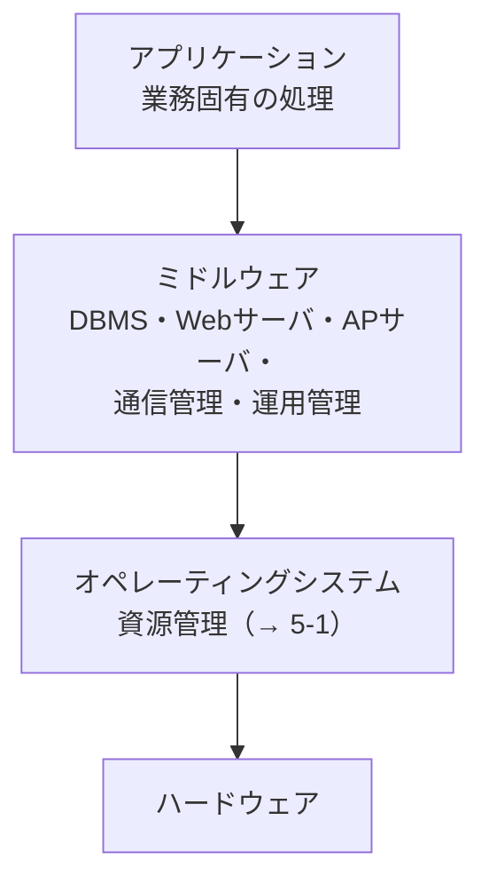

# 5-2 ミドルウェア

OSとアプリケーションの**間に立つソフトウェア**を扱う。

アプリケーションを作るたびに、データベースへのアクセス、トランザクション制御、通信、Webサーバの機能を一から書いていては際限がない。これらは多くのアプリケーションに共通して必要になる。**共通して必要なものを、OSの上・アプリケーションの下に層として切り出した**のがミドルウェアである。

H21〜R7の午前I・午前IIでは**この小分類からの直接の出題は見当たらなかった**。ただし、DBMS（→ [9-1 データベース方式](../09-database/9-1-データベース方式.md)）、Webサーバとプロキシ（→ [10-5 ネットワーク応用](../10-network/10-5-ネットワーク応用.md)）、APサーバの構成（→ [12-2 設計](../12-system-development/12-2-設計.md)）といった形で、個々のミドルウェアは他分野で繰り返し問われている。本章は**それらを「ミドルウェア」という層として俯瞰する**ための整理である。

## 目次

- [1. ミドルウェアの位置づけ](#1-ミドルウェアの位置づけ)
- [2. 主なミドルウェア](#2-主なミドルウェア)
- [3. API](#3-api)

---

## 1. ミドルウェアの位置づけ

ミドルウェアを置く利点は2つある。

- **アプリケーションの開発量が減る**。共通機能を作らなくてよい。
- **アプリケーションがOSやハードウェアの違いから切り離される**。ミドルウェアが差異を吸収するので、環境が変わってもアプリケーションの変更が少なくて済む。

2つ目は [12-2 設計](../12-system-development/12-2-設計.md) で見たMDA（プラットフォーム依存／非依存の分離）と同じ発想であり、層を切るという設計手法が別の場所で現れたものだと見ることができる。

---

## 2. 主なミドルウェア

| 種類 | 役割 | 参照 |
| --- | --- | --- |
| **DBMS** | データの格納・検索・更新と、トランザクション制御・同時実行制御・障害回復を提供する | [9-1 データベース方式](../09-database/9-1-データベース方式.md)、[9-4 トランザクション処理](../09-database/9-4-トランザクション処理.md) |
| **Webサーバ** | HTTPリクエストを受け付け、コンテンツを返す | [10-3 通信プロトコル](../10-network/10-3-通信プロトコル.md) |
| **アプリケーションサーバ（APサーバ）** | 業務ロジックの実行基盤を提供する。Webサーバとデータベースの間に位置する | [12-2 設計](../12-system-development/12-2-設計.md) |
| **TPモニタ** | トランザクション処理を管理する | [9-4](../09-database/9-4-トランザクション処理.md) |
| **MOM（メッセージ指向ミドルウェア）** | 非同期のメッセージ配送を担う。MQTTのブローカもこの一種 | [10-5 ネットワーク応用](../10-network/10-5-ネットワーク応用.md) |
| 運用管理ミドルウェア | ジョブ管理、監視、バックアップを提供する | [15-4 サービスの運用](../15-service-management/15-4-サービスの運用.md) |
| シェル | 利用者やスクリプトからOSを操作するインタフェース | [5-1 オペレーティングシステム](5-1-オペレーティングシステム.md) |

### 2.1 Web3層構成

Webシステムの典型的な構成では、ミドルウェアが明確に層をなす。

層を分ける理由は、**それぞれ増やしたい理由と増やしたい量が違う**からである。アクセスが増えればWebサーバを増やせばよく、業務処理が重ければAPサーバを増やせばよい。1台にすべて載せていると、どこがボトルネックでも全体を増やすしかない。

この構成を前提に、タイムアウトの設計（→ [12-2 設計](../12-system-development/12-2-設計.md)）やリバースプロキシによる保護（→ [11-4 情報セキュリティ対策](../11-security/11-4-情報セキュリティ対策.md)）が問われている。

---

## 3. API

**API（Application Programming Interface）**は、ソフトウェアの機能を外部から呼び出すための取り決めである。ミドルウェアはAPIを通じて機能を提供する。

| 種類 | 例 |
| --- | --- |
| システムコール | OSの機能を呼び出す |
| ライブラリAPI | ミドルウェアやライブラリの機能を呼び出す |
| **Web API** | HTTP経由で他システムの機能を呼び出す（REST、SOAP → [10-5 ネットワーク応用](../10-network/10-5-ネットワーク応用.md)） |

APIが重要なのは、**実装を隠して契約だけを見せる**からである。呼び出す側はAPIの仕様さえ知っていればよく、内部がどう作られているかを知る必要がない。これは [12-2 設計](../12-system-development/12-2-設計.md) で見た**モジュール結合度を下げる**原則そのものであり、公開されたAPIを組み合わせて新しいサービスを作る**マッシュアップ**（→ [10-5](../10-network/10-5-ネットワーク応用.md)）が成立する前提にもなっている。

---

## この章のまとめ

- **ミドルウェアはOSとアプリケーションの間の層**。共通機能を切り出して開発量を減らし、環境の違いを吸収する。
- 主なものは **DBMS、Webサーバ、APサーバ、TPモニタ、メッセージ指向ミドルウェア**。いずれも個別の分野で詳しく問われる。
- **Web3層構成（Web／AP／DB）は、層ごとに増強できる**ようにするための分割である。
- **APIは実装を隠して契約だけを見せる**。これが疎結合とマッシュアップを可能にしている。
