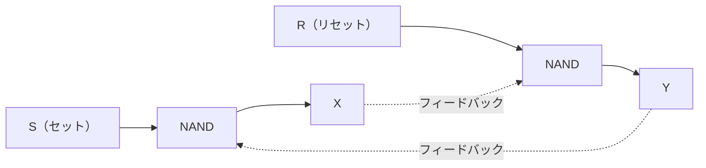
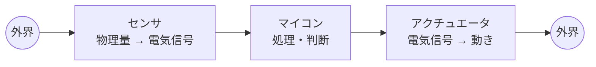

# 6-1 ハードウェア

論理回路、半導体、組込みシステムの構成要素を扱う。

[3章](../03-computer-components/3-1-プロセッサ.md) がコンピュータを「構成要素の組合せ」として見たのに対し、ここでは**その構成要素が何でできているか**まで降りる。論理回路は [1-1 離散数学](../01-basic-theory/1-1-離散数学.md) の論理演算を物理的に実現したものであり、センサとアクチュエータは [10-5 ネットワーク応用](../10-network/10-5-ネットワーク応用.md) のIoTの末端にあたる。本章は理論と応用をつなぐ位置にある。

午前Iの問7前後から出題される。16年で16問と、安定して出題が多い。とりわけ**論理回路**は毎年のように問われる。

## 目次

- [1. 論理回路](#1-論理回路)
- [2. 組合せ回路](#2-組合せ回路)
- [3. 順序回路](#3-順序回路)
- [4. 半導体メモリとマイコン](#4-半導体メモリとマイコン)
- [5. 組込みシステムの構成要素](#5-組込みシステムの構成要素)

---

## 1. 論理回路

### 1.1 基本素子

| 素子 | 記号の読み | 出力が1になる条件 |
| --- | --- | --- |
| AND | 論理積 | 両方の入力が1 |
| OR | 論理和 | 少なくとも一方が1 |
| NOT | 否定 | 入力が0 |
| **NAND** | 否定論理積 | ANDの否定（両方1のときだけ0） |
| **NOR** | 否定論理和 | ORの否定（両方0のときだけ1） |
| **XOR** | 排他的論理和 | **入力が異なるとき** |

**NANDとNORは「万能素子」**と呼ばれ、それぞれ単独ですべての論理回路を構成できる。実際の集積回路でNANDが多用されるのは、CMOSで最も少ないトランジスタ数で作れるためである。1種類の素子だけで済めば製造も設計も単純になる。

### 1.2 NAND素子による回路の解析

> NAND素子を用いた組合せ回路の出力 $Z$ を表す式はどれか。

NANDだけの回路を解析するときは、**ド・モルガンの法則で書き換える**（→ [1-1 離散数学](../01-basic-theory/1-1-離散数学.md)）のが定石である。

入力 $X$、$Y$ をそれぞれ単独でNANDに通すと（両入力に同じ信号を入れると）、

$$ \overline{X \cdot X} = \overline{X} $$

となり、**NANDはNOTとして使える**。この $\overline{X}$ と $\overline{Y}$ を次のNANDに入れると、

$$ \overline{\overline{X} \cdot \overline{Y}} = \overline{\overline{X}} + \overline{\overline{Y}} = X + Y $$

となり、**論理和（OR）**が得られる。ド・モルガンの法則「積の否定は否定の和」をそのまま使っている。

同様に、NANDの出力をもう一度NANDでNOTすれば **$X \cdot Y$（AND）**になる。**NANDをどう組むかでAND、OR、NOTのいずれにもなる**という関係を押さえておけば、回路図を見て式を導ける。

### 1.3 条件から回路を選ぶ

> **階段の上下にあるスイッチA又はBで、一つの照明を点灯・消灯する。すなわち、一方のスイッチの状態にかかわらず、他方のスイッチで照明を点灯・消灯できる。** この条件を満足する論理回路はどれか。

答えは **XOR**である。

真理値表で確かめる。照明が点灯を1とする。

| A | B | 出力 |
| --- | --- | --- |
| 0 | 0 | 0 |
| 0 | 1 | **1** |
| 1 | 0 | **1** |
| 1 | 1 | 0 |

**どちらか一方のスイッチだけを切り替えると、必ず出力が反転する**。これが「他方の状態にかかわらず、自分のスイッチで点灯・消灯できる」という条件の意味である。AとBが異なるとき1になる回路、すなわちXORがこれを満たす。

ANDでは「両方入れないと点かない」、ORでは「片方が入っていれば消せない」となり、条件を満たさない。

### 1.4 制御入力による回路

> 入力 $G = 0$ のときは $X = A$、$Y = B$ を出力し、$G = 1$ のときは $X = \overline{A}$、$Y = \overline{B}$ を出力する回路はどれか。

これも**XOR**で実現できる。XORの性質を使う。

$$ A \oplus 0 = A, \qquad A \oplus 1 = \overline{A} $$

つまり $X = A \oplus G$、$Y = B \oplus G$ とすれば条件を満たす。

**XORは「制御信号によって反転するかどうかを切り替えるスイッチ」として使える**。この性質は、ビット反転、パリティ計算、暗号化（→ [11-1 情報セキュリティ](../11-security/11-1-情報セキュリティ.md)）、ハミング符号（→ [1-3 情報に関する理論](../01-basic-theory/1-3-情報に関する理論.md)）など、あらゆる場面で利用されている。

### 1.5 タイムチャートからの判定

> 入力がAとB、出力がYの論理回路を動作させたとき、図のタイムチャートが得られた。この論理回路として適切なものはどれか。

**タイムチャートの各時点をスナップショットとして読み、真理値表を復元する**のが解き方である。

1. 時間軸をいくつかの区間に区切る
2. 各区間での A、B、Y の値を読み取る
3. (A, B) の組合せごとに Y がどうなるかを表にまとめる
4. 得られた真理値表と一致する素子を選ぶ

4通りの組合せがすべて現れていなくても、**選択肢を絞り込むのに十分な情報があれば足りる**。たとえば (1, 1) で出力が0になっていれば、AND と OR は除外できる。

> **出題** 論理回路の等価変換: H22午前I問8 ｜ 論理回路の設計: H28午前I問7 ｜ 論理回路の構成: H29午前I問7 ｜ NAND素子による組合せ回路: R5午前I問7 ｜ タイムチャート: R6午前I問7

---

## 2. 組合せ回路

**組合せ回路**は、**出力が現在の入力だけで決まる**回路である。過去の状態を覚えていない。

### 2.1 半加算器

> 1桁の2進数 A、B を加算し、X に**桁上がり**、Y に**桁上げなしの和**（和の1桁目）が得られる論理回路はどれか。

1桁の加算を真理値表にする。

| A | B | 桁上がり X | 和 Y |
| --- | --- | --- | --- |
| 0 | 0 | 0 | 0 |
| 0 | 1 | 0 | 1 |
| 1 | 0 | 0 | 1 |
| 1 | 1 | **1** | **0** |

それぞれの列を論理式にすると、

$$ X = A \cdot B \quad (\text{AND}), \qquad Y = A \oplus B \quad (\text{XOR}) $$

となる。この回路を**半加算器（ハーフアダー）**という。

**和がXORになる**のは、$1 + 1 = 10_{(2)}$ で1桁目が0に戻るからである。[1.3](#13-条件から回路を選ぶ) で見た「入力が異なるとき1」という性質が、ここでは「繰り上がりを除いた和」として現れている。

下位からの桁上がりも受け取れるようにしたものが**全加算器（フルアダー）**で、これを桁数分だけ連結すれば多桁の加算器になる。[1-1 離散数学](../01-basic-theory/1-1-離散数学.md) で見た「2の補数を使えば減算も加算器でできる」という話が、ここで物理的な回路につながる。

### 2.2 その他の組合せ回路

| 回路 | 機能 |
| --- | --- |
| エンコーダ | 複数の入力線のうち、どれが有効かを2進符号で出力する |
| デコーダ | 2進符号を解読して、対応する1本の出力線を有効にする |
| マルチプレクサ | 複数の入力から1つを選んで出力する |
| 加算器 | 加算を行う |

> **出題** 半加算器: H30午前I問7

---

## 3. 順序回路

**順序回路**は、**出力が現在の入力と過去の状態の両方で決まる**回路である。状態を記憶する素子として**フリップフロップ**を使う。

### 3.1 SRフリップフロップ

**SR（Set-Reset）フリップフロップ**は、1ビットを記憶する最も基本的な回路である。NAND（またはNOR）を2つたすきがけに接続して作る。

NAND型のSRフリップフロップ（入力が負論理）の動作は次のとおりである。

| S | R | 動作 |
| --- | --- | --- |
| 1 | 1 | **状態を保持する**（何も変わらない） |
| **0** | 1 | **セット**（$X = 1$、$Y = 0$ にする） |
| 1 | 0 | リセット（$X = 0$、$Y = 1$ にする） |
| 0 | 0 | 禁止（不定） |

> 図の論理回路において、$S=1$、$R=1$、$X=0$、$Y=1$ のとき、**$S$ をいったん 0 にした後、再び 1 に戻した**。この操作を行った後の $X$、$Y$ の値はどれか。

**3段階に分けて追う**。

| 段階 | S | R | 状態 |
| --- | --- | --- | --- |
| 初期 | 1 | 1 | $X=0$、$Y=1$（保持されている） |
| $S$ を 0 にする | **0** | 1 | **セットされる** → $X=1$、$Y=0$ |
| $S$ を 1 に戻す | 1 | 1 | **保持** → $X=1$、$Y=0$ のまま |

答えは **$X = 1$、$Y = 0$** である。

**この問題の要点は、$S=R=1$ が「保持」であって「初期化」ではない**ことである。$S$ を1に戻しても元の $X=0$ には戻らない。一瞬 $S$ を0にした影響が残り続ける──これこそが「記憶している」ということであり、フリップフロップが1ビットのメモリとして機能する理由である。

この記憶の仕組みが、SRAM（→ [3-2 メモリ](../03-computer-components/3-2-メモリ.md)）やレジスタ（→ [3-1 プロセッサ](../03-computer-components/3-1-プロセッサ.md)）の基礎になっている。

### 3.2 その他のフリップフロップ

| 種類 | 特徴 |
| --- | --- |
| D フリップフロップ | クロックの立上りで、入力Dの値をそのまま記憶する |
| T フリップフロップ | クロックごとに出力を反転する。分周回路に使う |
| JK フリップフロップ | SRの禁止状態をなくし、$J=K=1$ で反転するようにしたもの |

> **出題** SRフリップフロップ: H21午前I問8、H23午前I問8、H26午前I問7

---

## 4. 半導体メモリとマイコン

### 4.1 ワンチップマイコンのメモリ

> ワンチップマイコンの内蔵メモリとして**フラッシュメモリが採用されている理由**として適切なものはどれか。

答えは、

> **マイコン出荷後もソフトウェアの書換えが可能である。**

従来は**マスクROM**（製造時に内容を焼き込む読出し専用メモリ）が使われていた。大量生産では安価だが、**内容を変更できない**。不具合が見つかればチップごと作り直しになり、出荷後の修正は不可能である。

フラッシュメモリなら**出荷後でもファームウェアを更新できる**。機能追加や不具合修正、セキュリティパッチの適用が可能になる。IoT機器のように長期間使われ、脆弱性への対応が必要な製品では、この性質が決定的に重要になる（→ [11-4 情報セキュリティ対策](../11-security/11-4-情報セキュリティ対策.md)）。

誤答との区別も押さえる。「コードサイズを小さくできる」「処理性能が向上する」はメモリの種類とは関係がなく、「マスクROMよりも信頼性が向上する」も正しくない（書換え回数に上限があるぶん、むしろ不利な面もある）。**採用理由は「書換えができること」の一点**である。

### 4.2 クロックと分周器

マイコンは発振器から得たクロックを、**PLL**（逓倍：周波数を上げる）と**分周器**（周波数を下げる）で各部に供給する。

> 15 MHzの発振器と、内部のPLL1、PLL2及び分周器の組合せで、CPUに240 MHz、シリアル通信（SIO）に115 kHzのクロック信号を供給する場合の**分周器の値**は幾らか。ここで、シリアル通信のクロック精度は±5%以内に収まればよい。

**分周器への入力と、必要な出力の比**を求めるのが基本である。

CPUに240 MHzを供給しているので、PLLの出力は240 MHz（$15 \times 16$）である。ここから115 kHzを得るには、

$$ \frac{240 \times 10^6}{115 \times 10^3} \approx 2{,}087 $$

分の1にする必要がある。分周器の値は $1/2^n$ の形なので、$2^{11} = 2{,}048$ が最も近い。実際に得られる周波数は

$$ \frac{240 \times 10^6}{2{,}048} \approx 117.2\ \text{kHz} $$

で、115 kHzに対する誤差は約1.9%となり、±5%以内に収まる。

**精度に許容幅が設けられている**のがこの種の問題の特徴である。$2^n$ でぴったりの値は作れないので、「許容範囲に収まる最も近い $n$」を選ぶ。実際の設問では選択肢の値を順に当てはめ、**誤差が許容範囲内かを検算する**のが確実である。

> **出題** フラッシュメモリとワンチップマイコン: H22午前I問27 ｜ クロック発生器と分周器: H27午前I問7

---

## 5. 組込みシステムの構成要素

IoT機器や組込みシステムは、**外界の状態を取り込み、処理し、外界に働きかける**という構造をもつ。

| 構成要素 | 役割 |
| --- | --- |
| **センサ** | **位置、角度、速度、加速度、力、温度などを検出し、電気的な情報に変換する** |
| **アクチュエータ** | **エネルギー源からのパワーを、回転、直進などの動きに変換する** |
| 増幅器（アンプ） | マイクロフォン、センサなどが出力する微小な電気信号を増幅する |
| コントローラ | 与えられた目標量とセンサから得られた制御量を比較し、制御量を目標量に一致させるように操作量を出力する |

**センサとアクチュエータは入出力の向きが逆**である。センサは「物理量 → 電気信号」（入力）、アクチュエータは「電気信号 → 動き」（出力）。設問ではこの2つの説明を入れ替えてくるので、**向きで判別する**。

**コントローラ**の説明（目標量と制御量を比較して操作量を出力する）は**フィードバック制御**そのものである。センサで測り、目標とのずれを計算し、アクチュエータを動かす。このループが制御の基本形になる。

### 5.1 RFID

**RFID**は、電波を使ってタグの情報を非接触で読み取る技術である。バーコードと違って**直接見えなくても読める**、**複数を一括で読める**、**書換えができる**という特徴があり、物流・在庫管理・入退室管理で使われる。

電池を持たない**パッシブタグ**は、リーダからの電波を受けてコイルに発生する誘導起電力を電源にする。この原理は非接触型ICカード（→ [11-1 情報セキュリティ](../11-security/11-1-情報セキュリティ.md)）と同じである。

### 5.2 エネルギーハーベスティング

**エネルギーハーベスティング（環境発電）**は、

> **周囲の環境から振動、熱、光、電磁波などの微小なエネルギーを集めて電力に変換して、IoTデバイスに供給する技術**

である。

必要とされる理由は明快で、**無数のIoTデバイスの電池を人が交換して回るのは現実的でない**からである。橋梁やトンネルに埋め込んだセンサ、広大な農地に設置したセンサの電池を数年ごとに交換するコストは、センサ本体より高くつく。環境から電力を得られれば、**設置したら放置できる**。

誤答として並ぶ技術との区別を押さえる。

| 記述 | 実際は何か |
| --- | --- |
| 一定期間のエネルギー使用量や稼働状況を把握して、電力使用の最適化を図る | 電力管理（エネルギーマネジメント） |
| カテゴリ5以上のLANケーブルによってIoTデバイスに電力を供給する | **PoE**（→ [10-1 ネットワーク方式](../10-network/10-1-ネットワーク方式.md)） |
| 必要な時だけデバイスの電源をONにして通信を行い、省電力化を図る | 間欠動作 |

**「環境から集める」のがエネルギーハーベスティング**、「ケーブルで送る」のがPoE、「使う時間を減らす」のが間欠動作である。

### 5.3 間欠動作と平均消費電流

> IoTシステムにおいて、センサーノードの消費電流を抑えるため間欠動作を考える。**動作時間は10ミリ秒で、その間は平均10 mAの電流**が流れる。**待機中は常に0.1 μA**の電流が流れる。**間欠動作の平均電流を1 μA以下**にするための待機時間として、最も短いものはどれか。

1周期（動作時間＋待機時間）あたりの電荷量を考える。待機時間を $t$ 秒とする。

**動作中の電荷量**：

$$ 10\ \text{mA} \times 10\ \text{ms} = 10 \times 10^{-3}\ \text{A} \times 10 \times 10^{-3}\ \text{s} = 1 \times 10^{-4}\ \text{C} $$

**待機中の電荷量**：

$$ 0.1\ \mu\text{A} \times t = 1 \times 10^{-7} \times t\ \text{C} $$

**平均電流**は、1周期の総電荷量を周期で割ったものである。周期は $0.01 + t$ 秒。

$$ \frac{1 \times 10^{-4} + 1 \times 10^{-7}t}{0.01 + t} \leq 1 \times 10^{-6} $$

両辺に $(0.01 + t)$ を掛けて整理する。

$$ 1 \times 10^{-4} + 1 \times 10^{-7}t \leq 1 \times 10^{-8} + 1 \times 10^{-6}t $$

$$ 1 \times 10^{-4} - 1 \times 10^{-8} \leq (1 \times 10^{-6} - 1 \times 10^{-7})t $$

$$ t \geq \frac{9.999 \times 10^{-5}}{9 \times 10^{-7}} \approx 111.1\ \text{秒} $$

したがって**111.1秒**である。

**10ミリ秒だけ10 mAを流すために、111秒も待機しなければならない**という結果が、電池駆動IoTデバイスの設計の厳しさを物語っている。平均を1 μAに抑えるには、動作時の消費が待機時の10万倍である以上、動作時間の割合を極限まで下げるしかない。センサの測定間隔が「1分に1回」ではなく「数分に1回」になるのは、こうした計算の結果である。

> **出題** アクチュエータ: R4午前I問7 ｜ RFID: R3午前I問7 ｜ エネルギーハーベスティング: R1午前I問8、R5午前I問27 ｜ IoTセンサーノードの消費電流: R7午前I問7

---

## この章のまとめ

- **NANDとNORは万能素子**。NAND回路の解析は**ド・モルガンの法則で書き換える**。
- **XORは「入力が異なるとき1」**。階段スイッチも、制御信号による反転も、半加算器の和もXORで実現される。
- **半加算器は桁上がりがAND、和がXOR**。
- **SRフリップフロップの $S=R=1$ は「保持」**。一瞬セットした影響が残り続けることが「記憶」の実体であり、SRAMやレジスタの基礎になる。
- **ワンチップマイコンにフラッシュメモリを使う理由は、出荷後もソフトウェアを書き換えられるから**。
- **センサは物理量→電気信号、アクチュエータは電気信号→動き**。向きで判別する。
- **エネルギーハーベスティングは環境から微小なエネルギーを集めて電力にする**。PoE（ケーブルで送電）や間欠動作（使用時間を減らす）とは別物。
- 平均消費電流は**1周期の総電荷量 ÷ 周期**。動作時と待機時の消費差が大きいほど、長い待機時間が必要になる。
