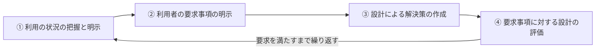

# 7-2 UX/UIデザイン

利用者の体験そのものを設計する観点を扱う。

[7-1 ユーザインタフェース](7-1-ユーザインタフェース.md) が「誰でも使えるか」という最低線の話だったのに対し、ここでは「**どう感じるか**」まで踏み込む。同じ機能でも、待たされ方や迷い方が違えば評価は変わる。UI（接点そのもの）とUX（接点を通じた体験全体）を分けて考えるのが出発点になる。

午前Iの問9前後から出題されるが、16年で1問と出題は少ない。

出題が少ない分野のため、本章では過去問で問われた内容に加えて、設計原則の整理を補っている。

## 目次

- [1. UIとUX](#1-uiとux)
- [2. ニールセンのユーザビリティヒューリスティックス](#2-ニールセンのユーザビリティヒューリスティックス)
- [3. 人間中心設計](#3-人間中心設計)

---

## 1. UIとUX

| 用語 | 対象 |
| --- | --- |
| **UI**（ユーザインタフェース） | 利用者とシステムの**接点そのもの**。画面、ボタン、操作体系 |
| **UX**（ユーザエクスペリエンス） | 利用者がシステムを通じて得る**体験全体**。使う前の期待から、使った後の印象まで |

UXがUIより広いのは、**利用者の評価が接点だけで決まらない**からである。画面が美しくても、申込みから利用開始まで1週間かかれば体験は悪い。逆に画面が素朴でも、必要なことがすぐ終われば満足度は高い。UXの設計は、**システムの外側で起きていることまで含めて考える**ことを求める。

---

## 2. ニールセンのユーザビリティヒューリスティックス

ヤコブ・ニールセンが提唱した**10か条のヒューリスティックス**は、ユーザビリティ評価の実践的な指針である。

| 原則 | 内容 |
| --- | --- |
| **システム状態の視認性** | **いま何が起きているかを、適切な時間内に利用者に知らせる** |
| 実世界との一致 | 利用者になじみのある言葉と概念を使う |
| 利用者の制御と自由 | 誤った操作から容易に抜け出せるようにする |
| 一貫性と標準 | 同じことは同じ言葉・同じ操作で表す |
| エラーの予防 | そもそも誤りが起きない設計にする |
| 記憶よりも認識 | 利用者に覚えさせず、見れば分かるようにする |
| 柔軟性と効率性 | 初心者にも熟練者にも適した操作手段を用意する |
| 美的で最小限のデザイン | 不要な情報を載せない |
| エラーからの回復支援 | 問題と対処を分かりやすく示す |
| ヘルプとドキュメント | 必要なときに参照できるようにする |

### 2.1 システム状態の視認性

> ヤコブ・ニールセンのユーザインタフェースに関する10か条のヒューリスティックスの一つである**「システム状態の視認性」**に該当するものはどれか。

答えは、

> **実行中に処理の進捗度を表示する。**

**「いま何が起きているか」を利用者に知らせる**のがこの原則である。進捗バーがその典型例になる。

進捗表示が重要なのは、**待ち時間そのものより「いつ終わるか分からないこと」が不安を生む**からである。同じ30秒でも、何も表示されなければ「固まったのではないか」と疑い、中断や再操作を招く。進捗が見えていれば待てる。**システムの内部状態を利用者と共有する**ことで、利用者は適切に判断できるようになる。

誤答として並ぶ記述は、いずれも**別のヒューリスティックス**に対応する。

| 記述 | 対応する原則 |
| --- | --- |
| 異なる画面間でも、操作は類似の手順で実行できる | **一貫性と標準** |
| 入力フォームの必須項目に印を付けて目立たせる | **エラーの予防**（または記憶よりも認識） |
| 表示する文字の大きさや色が適切で、効果的に画像も使用する | **美的で最小限のデザイン**（またはアクセシビリティ → [7-1](7-1-ユーザインタフェース.md)） |

**「状態を知らせる」という記述があるかどうか**が判別の決め手になる。

> **出題** ニールセンのヒューリスティックス: H22午前I問9

---

## 3. 人間中心設計

**人間中心設計（HCD、JIS Z 8530 / ISO 9241-210）**は、**利用者の要求を出発点に、評価と改善を繰り返して設計する**考え方である。

重要なのは**④ の評価が ① に戻る**点である。設計を一度で正解にできるとは考えず、**実際の利用者に使ってもらって評価し、その結果を次の設計に反映する**ことを前提にしている。

この反復の構造は、[13-1 開発プロセス・手法](../13-software-development-management/13-1-開発プロセス-手法.md) で見たアジャイル開発のイテレーションと同じ発想である。「要求は最初には分からない」「作ってみて初めてずれが見える」という認識が共通している。

### 3.1 評価の手法

| 手法 | 内容 |
| --- | --- |
| ユーザビリティテスト | 実際の利用者に操作してもらい、つまずく箇所を観察する |
| ヒューリスティック評価 | 専門家が [2. ニールセンのヒューリスティックス](#2-ニールセンのユーザビリティヒューリスティックス) などの指針に照らして評価する |
| 認知的ウォークスルー | 評価者が利用者になったつもりで操作手順をたどる |
| アイトラッキング | 視線の動きを測定し、どこを見ているかを分析する |

**ユーザビリティテストで分かることは、設計者の予想と大きく食い違うことが多い**。設計者はシステムの構造を知っているので、どこに何があるか迷わない。その状態で「分かりやすいはずだ」と判断しても当てにならない。**知らない人が実際に迷う場所**は、観察しなければ見つからない。

### 3.2 設計に使う道具

| 道具 | 内容 |
| --- | --- |
| ペルソナ | 典型的な利用者像を具体的な人物として設定する |
| カスタマージャーニーマップ | 利用者が目的を達成するまでの体験の流れを可視化する |
| プロトタイプ | 試作品を作って早期に確認する（→ [13-1](../13-software-development-management/13-1-開発プロセス-手法.md)） |

**ペルソナを「具体的な人物」として作る**のは、「利用者一般」という抽象的な想定では議論が収束しないからである。「35歳、事務職、PCは業務でしか使わない、スマートフォンは日常的に使う」と具体化すれば、「この人はこの操作で迷うか」を関係者が同じ前提で検討できる。

---

## この章のまとめ

- **UIは接点そのもの、UXは体験全体**。UXはシステムの外側で起きることまで含む。
- ニールセンの**「システム状態の視認性」は、いま何が起きているかを利用者に知らせる**こと。進捗表示が典型例で、待ち時間そのものより「見通しが立たないこと」が問題になる。
- **人間中心設計は、利用者の要求を出発点に、評価と改善を繰り返す**。一度で正解にできないという前提に立つ点で、アジャイル開発と同じ発想である。
- **設計者は迷わないので、実際の利用者に使ってもらわないと問題は見えない**。
