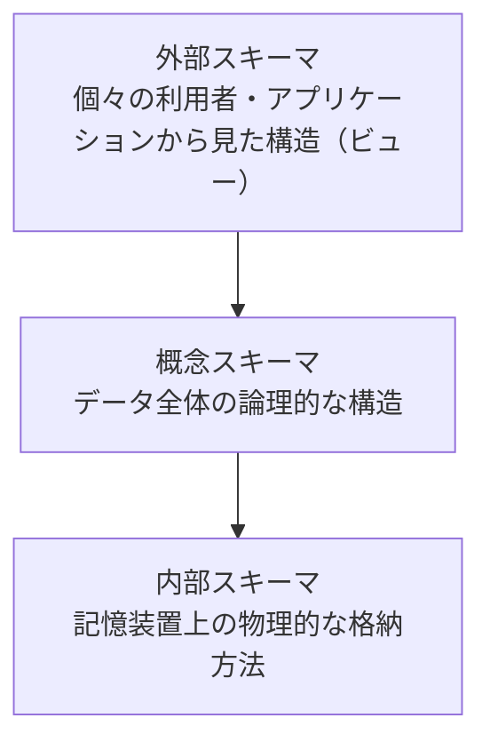

# 9-1 データベース方式

データベースの基本概念と、それを支える**体制と役割分担**を扱う。

データベースが単なるファイルの集まりと違うのは、**多数のアプリケーションと利用者が同じデータを共有する**点にある。共有するからこそ、データの意味を誰かが統一して定義し、整合性を守り、同時アクセスを調停する必要が生じる。本章で扱うDBMSの役割も、DAとDBAの分担も、この「共有」という性質から導かれる。

午前Iの問21前後から出題される。16年で1問と出題は少ない。

出題が少ない分野のため、本章では過去問で問われた内容に加えて、データベースの基礎概念の整理を補っている。

## 目次

- [1. データベースとDBMS](#1-データベースとdbms)
- [2. データモデル](#2-データモデル)
- [3. 3層スキーマ](#3-3層スキーマ)
- [4. データ管理者とデータベース管理者](#4-データ管理者とデータベース管理者)

---

## 1. データベースとDBMS

**DBMS（データベース管理システム）**は、データベースを管理するミドルウェアである（→ [5-2 ミドルウェア](../05-software/5-2-ミドルウェア.md)）。

| 機能 | 内容 |
| --- | --- |
| データ定義 | データの構造と制約を定義する（→ [9-2 データベース設計](9-2-データベース設計.md)） |
| データ操作 | 検索・挿入・更新・削除を提供する（→ [9-3 データ操作](9-3-データ操作.md)） |
| **同時実行制御** | 複数の利用者が同時にアクセスしても矛盾しないようにする（→ [9-4 トランザクション処理](9-4-トランザクション処理.md)） |
| **障害回復** | 障害が起きてもデータの整合性を保って復旧する（→ [9-4](9-4-トランザクション処理.md)） |
| セキュリティ管理 | アクセス権を管理する |

アプリケーションごとにファイルを持つ方式では、**同じデータが複数の場所に重複して存在し、更新のたびに食い違う**（データの冗長性と不整合）。DBMSはデータを一元管理することでこれを解消し、同時にアプリケーションをデータの物理的な格納方法から切り離す（データ独立性）。

---

## 2. データモデル

| モデル | 構造 |
| --- | --- |
| 階層モデル | データを木構造で表す |
| ネットワークモデル | データを網構造で表す |
| **関係モデル（リレーショナルモデル）** | データを**表（テーブル）**で表す。現在の主流 |
| NoSQL | キーバリュー型、ドキュメント型、グラフ型など。大規模・非定型データ向け |

関係モデルが主流になったのは、**数学的な基礎（関係代数）に裏打ちされていて、構造が単純で扱いやすい**からである。階層やネットワークのモデルでは、データの経路をプログラムが知っていなければならなかった。関係モデルでは「どういう条件のデータが欲しいか」だけを書けばよく、取り方はDBMSが決める。この分離がSQLという宣言的な言語を可能にした。

関係モデルの用語と、一般的な呼び方の対応を押さえておく。

| 関係モデル | 一般的な呼び方 |
| --- | --- |
| 関係（リレーション） | 表（テーブル） |
| 組（タプル） | 行（レコード） |
| 属性（アトリビュート） | 列（カラム、フィールド） |
| 定義域（ドメイン） | 属性がとりうる値の集合 |

---

## 3. 3層スキーマ

データベースの構造は3つの層で定義される。**変更の影響を層の中に閉じ込める**ための分割である。

| スキーマ | 定義するもの |
| --- | --- |
| **外部スキーマ** | 利用者ごとに見える範囲と形。ビューがこれにあたる |
| **概念スキーマ** | データ全体の論理構造。表と列、関連、制約 |
| **内部スキーマ** | ファイル編成、インデックス、格納位置 |

この分割によって2種類の独立性が得られる。

- **論理データ独立性**：外部スキーマと概念スキーマの分離により、**表に列を追加しても、既存のビューを使うアプリケーションは影響を受けない**。
- **物理データ独立性**：概念スキーマと内部スキーマの分離により、**インデックスを追加したりディスク配置を変えたりしても、アプリケーションを書き換えなくてよい**。

この構造は、[12-2 設計](../12-system-development/12-2-設計.md) で見た「層を切って結合度を下げる」という設計原則が、データベースに適用されたものである。

---

## 4. データ管理者とデータベース管理者

大規模なシステムでは、データに関する役割を2つに分ける。

| 役割 | 担当すること |
| --- | --- |
| **DA（データ管理者）** | **データそのもの**の管理。**論理データベース設計、データ項目の管理と標準化** |
| **DBA（データベース管理者）** | **データベースシステム**の管理。物理設計、性能、容量、バックアップ、障害回復 |

> 基幹業務システムの構築及び運用において、データ管理者（DA）とデータベース管理者（DBA）を別々に任命した場合の **DA の役割**として適切なものはどれか。

答えは、

> **システム開発の設計工程では、主に論理データベース設計を行い、データ項目を管理して標準化する。**

誤答はいずれも **DBA の役割**である。

| 記述 | 担当 |
| --- | --- |
| 業務データ量の増加傾向を把握し、ディスク装置の増設などを計画して実施する | **DBA**（容量管理） |
| システム開発のテスト工程では、主にパフォーマンスチューニングを担当する | **DBA**（性能管理） |
| システム障害が発生した場合には、データの復旧や整合性のチェックなどを行う | **DBA**（障害回復） |

**判別の軸は「論理か物理か」**である。DAは**「このデータは何を意味するか」「全社でどう呼ぶか」**という論理・意味の世界を扱い、DBAは**「どう格納し、どう速くし、どう守るか」**という物理・運用の世界を扱う。

役割を分ける理由は、**担当する範囲と時間軸が違う**からである。データ項目の標準化は全社・全システムにまたがり、長期にわたって維持される。「顧客コード」の定義が部門ごとにバラバラなら、システムを統合するたびに変換が必要になり、集計も合わない。これを防ぐには、個別システムの性能や運用とは切り離して、全社横断でデータの意味を統制する立場が要る。これがDAである。

一方DBAの仕事は、特定のデータベースの性能や可用性という、個別かつ日々の運用に密着したものになる。[4-2 システムの評価指標](../04-system-components/4-2-システムの評価指標.md) のキャパシティプランニングや、[9-4 トランザクション処理](9-4-トランザクション処理.md) の障害回復は、DBAの領域である。

> **出題** データ管理者とデータベース管理者: R4午前I問21

---

## この章のまとめ

- DBMSは**データの一元管理**によって冗長性と不整合を解消し、アプリケーションを物理的な格納方法から切り離す。
- **関係モデルが主流になったのは、構造が単純で、取り方をDBMSに任せられる**から。これがSQLを可能にした。
- **3層スキーマ（外部・概念・内部）は変更の影響を層内に閉じ込める**ための分割で、論理データ独立性と物理データ独立性を生む。
- **DAは論理（データの意味・標準化）、DBAは物理（性能・容量・障害回復）**。全社横断で長期的なのがDA、個別システムで日々の運用なのがDBAである。
