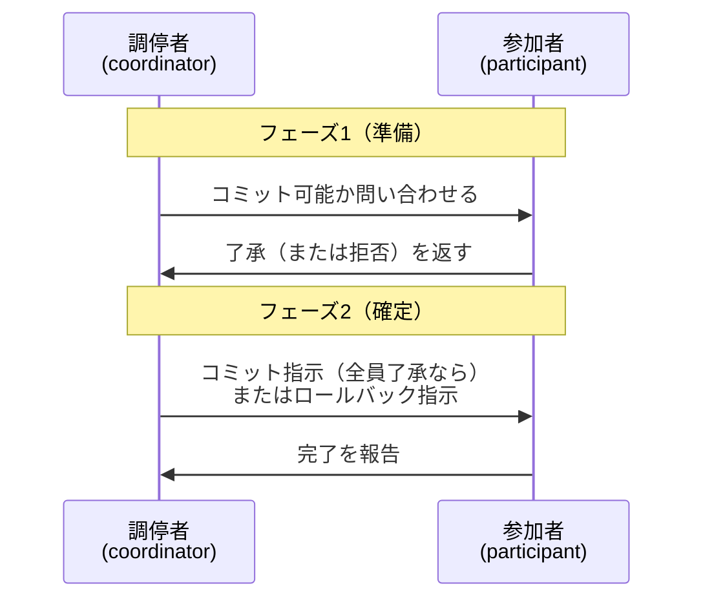

# 9-4 トランザクション処理

複数の処理が**同時に走っても矛盾せず、障害が起きても整合性を保つ**ための仕組みを扱う。

データベースが単なるファイルと決定的に違うのはこの点である。銀行の振込で「引き落としは成功したが入金が失敗した」状態が残ってはならない。複数の利用者が同じ在庫を同時に引き当ててはならない。電源が落ちても中途半端な状態で残ってはならない。**これらを保証するのがトランザクション処理**であり、本章の内容はすべてこの保証をどう実現するかの話である。

午前Iの問10〜12前後から出題される。16年で6問。

## 目次

- [1. トランザクションとACID特性](#1-トランザクションとacid特性)
- [2. 同時実行制御](#2-同時実行制御)
- [3. 障害回復](#3-障害回復)
- [4. 分散トランザクションと2相コミット](#4-分散トランザクションと2相コミット)

---

## 1. トランザクションとACID特性

**トランザクション**は、**分割できない一連の処理のまとまり**である。全部成功するか、全部なかったことになるか、どちらかしかない。

トランザクションが備えるべき性質を**ACID特性**という。

| 特性 | 内容 |
| --- | --- |
| **原子性** (Atomicity) | 全部実行されるか、全部実行されないかのどちらか |
| **一貫性** (Consistency) | 実行の前後でデータの整合性が保たれる |
| **独立性／隔離性** (Isolation) | 同時に実行される他のトランザクションの影響を受けない |
| **耐久性** (Durability) | 完了した結果は障害が起きても失われない |

**原子性と耐久性を支えるのがログと障害回復**（→ [3. 障害回復](#3-障害回復)）、**独立性を支えるのがロックによる同時実行制御**（→ [2. 同時実行制御](#2-同時実行制御)）である。

トランザクションの終了には2通りある。

- **コミット**：処理を確定する
- **ロールバック**：処理を取り消して開始前の状態に戻す

---

## 2. 同時実行制御

### 2.1 ロックの種類

複数のトランザクションが同じデータに同時にアクセスすると、読んでいる間に書き換えられるなどの不整合が起きる。これを防ぐのが**ロック**である。

| ロック | 別名 | 目的 |
| --- | --- | --- |
| **共用ロック（Sロック）** | 読取りロック | **読む**ときにかける |
| **専有ロック（Xロック）** | 書込みロック、排他ロック | **書く**ときにかける |

### 2.2 ロックの両立性

> データベースシステムにおいて、二つのプログラムが同一データへのアクセス要求を行うとき、**後続プログラムのアクセス要求に対する並行実行の可否**の組合せのうち適切なものはどれか。

正しい組合せは次のとおりである。○が並行実行可、×が待たされることを表す。

| 後続＼先行 | 共用 | 排他 |
| --- | --- | --- |
| **共用** | **○** | **×** |
| **排他** | **×** | **×** |

**並行して実行できるのは「共用と共用」の組合せだけ**である。

理由は単純で、**読むだけなら何人同時でも矛盾しない**が、**誰か1人でも書いているなら、他の誰も触ってはならない**からである。

- 読む × 読む → どちらもデータを変えないので問題ない → **○**
- 読む × 書く → 読んでいる最中に書き換われば、読んだ内容が信用できない → **×**
- 書く × 書く → 両方が書けばどちらかの結果が失われる（更新の喪失） → **×**

**「共用どうしだけが○」**という1点を覚えておけば、4通りの組合せをすべて再現できる。

### 2.3 デッドロック

2つのトランザクションが互いに相手のロックの解放を待つと**デッドロック**になる。原理と予防策は [5-1 オペレーティングシステム](../05-software/5-1-オペレーティングシステム.md) で扱ったものと同じで、**資源（データ）へのアクセス順序を統一する**ことが基本的な対策である。

DBMSはデッドロックを検出すると、いずれかのトランザクションを強制的にロールバックして解消する。

> **出題** ロックと並行実行: H30午前I問10

---

## 3. 障害回復

### 3.1 障害の種類と対処

| 障害 | 原因 | 対処 |
| --- | --- | --- |
| **トランザクション障害** | プログラムの異常終了、デッドロック | **ロールバック**（更新前情報を使う） |
| **システム障害** | 電源断、OSのダウン。**記憶媒体は無事** | 再起動時に**ロールフォワードとロールバック** |
| **媒体障害** | ディスクの故障。**データが失われる** | **バックアップをリストアしてからロールフォワード** |

### 3.2 ログファイルと2種類の情報

DBMSは更新のたびに**ログファイル（ジャーナルファイル）**に記録を残す。ログには2種類の情報が含まれる。

| 情報 | 内容 | 使い道 |
| --- | --- | --- |
| **更新前情報（before image）** | 更新する前の値 | **ロールバック**（取り消して元に戻す） |
| **更新後情報（after image）** | 更新した後の値 | **ロールフォワード**（再適用して進める） |

**どちらを使うかは「戻すのか、進めるのか」で決まる**。

- **ロールバック（後退復帰）**：未完了のトランザクションを**取り消す** → **更新前情報**を使う
- **ロールフォワード（前進復帰）**：完了したのに失われた更新を**やり直す** → **更新後情報**を使う

この対応を取り違えた選択肢が頻出する。

| 誤った記述 | 正しくは |
| --- | --- |
| 媒体障害に対して、バックアップをリストアした後、ログファイルの**更新前情報**を使用して回復する | **更新後情報**を使ってロールフォワードする |
| トランザクションが更新中に異常終了した場合、ログファイルの**更新後情報**を使用して回復する | **更新前情報**を使ってロールバックする |

### 3.3 チェックポイント

DBMSは性能のため、更新をすぐディスクに書かずメモリ上のバッファに溜める。しかしそのままでは、障害時にどこまでディスクに反映されているか分からない。

そこで定期的に**チェックポイント**を設け、その時点でバッファの内容をすべてディスクに書き出す。これにより、**チェックポイント以前の更新は確実にディスクに反映されている**ことが保証される。

> システムが媒体障害以外の原因によって停止した場合、**チェックポイントの取得以前に終了したトランザクションについての回復作業は不要である。**

チェックポイント前に完了したトランザクションは、チェックポイントでディスクに書き出されているので、何もしなくてよい。回復作業が必要なのは、**チェックポイント以降に動いていたトランザクション**だけである。

### 3.4 どちらの回復処理が必要かを判定する

チェックポイントと障害発生時点との関係で、各トランザクションの扱いが決まる。

```
         チェックポイント              障害発生
              │                          │
T1  ──────────┤ (コミット済み)           │   → 何もしない
T2  ──────┼───┼──────── commit ──────────┤   → ロールフォワード
T3  ──────┼───┼──────────────────────────┤   → ロールバック（未コミット）
T4        │   │   ─────── commit ────────┤   → ロールフォワード
T5        │   │        ──────────────────┤   → ロールバック（未コミット）
```

**判定の規則**は2つだけである。

| 条件 | 処理 |
| --- | --- |
| **チェックポイント以降にコミットされた** | **ロールフォワード**（更新後情報で再適用） |
| **障害発生時点でコミットされていない** | **ロールバック**（更新前情報で取消し） |
| チェックポイント以前にコミット済み | 何もしない |

重要な補足が2つある。

- **参照（Read）だけのトランザクションは、どちらの対象にもならない**。データを更新していないので、戻す必要も進める必要もない。設問で「Read 100回、Write 0回」といったトランザクションが混ざっていたら、それは回復対象外である。
- **チェックポイントをまたいで動いていて、その後コミットしたトランザクション**は、チェックポイント時点では未完了だったので、ロールフォワードが必要になる。

**「コミットしたか」と「チェックポイントの前後どちらか」の2軸で表を作る**のが確実な解き方である。

### 3.5 媒体障害の回復

媒体障害ではディスクそのものが失われるので、ログだけでは回復できない。

> データベースに**媒体障害**が発生したときの回復法は、**バックアップファイルをリストアした後、ログファイルの更新後情報を使用してロールフォワードする**ことである。

手順は2段階になる。

1. **バックアップをリストアする**（バックアップ取得時点の状態に戻す）
2. **バックアップ取得以降のログの更新後情報を使ってロールフォワードする**（障害直前まで進める）

バックアップだけでは取得時点までしか戻せず、それ以降の更新がすべて失われる。ログを併用することで障害直前まで回復できる。これが**バックアップとログの両方を取る理由**であり、[11-2 情報セキュリティ管理](../11-security/11-2-情報セキュリティ管理.md) のRPO（目標復旧時点）をどこまで短くできるかを決める要素でもある。

> **出題** データベースの障害回復: H21午前I問12 ｜ ロールフォワード: H27午前I問10 ｜ ロールフォワードとロールバック: H28午前I問10 ｜ 媒体障害の回復: R1午前I問9

---

## 4. 分散トランザクションと2相コミット

複数のデータベースにまたがる更新では、**全部成功か全部取消しか**を複数システム間で合わせる必要がある。これを実現するのが**2相コミットプロトコル**である。

### 4.1 2つのフェーズ



| フェーズ | 内容 |
| --- | --- |
| **フェーズ1（準備）** | 調停者が全参加者に「コミットできるか」を問い合わせ、各参加者が了承または拒否を返す |
| **フェーズ2（確定）** | **全員が了承**ならコミットを指示、**1つでも拒否または無応答**ならロールバックを指示 |

### 4.2 2相コミットの性質

> 2相コミットプロトコルに関する記述のうち適切なものはどれか。

正しいのは、

> **調停者に障害が発生するタイミングによっては、その回復処理が終わらない限り、参加者全員がコミットもロールバックも行えない事態が起こる。**

これが**2相コミットの本質的な弱点（ブロッキング問題）**である。

フェーズ1で了承を返した参加者は、**自分の判断で勝手に確定も取消しもできない**。他の参加者が拒否している可能性があるからである。だから調停者の指示を待つしかない。ところが、ちょうどこのタイミングで調停者が落ちると、**指示が永久に来ず、参加者はロックを握ったまま待ち続ける**。

誤答として並ぶ記述を確認すると、プロトコルの制約がはっきりする。

| 記述 | 誤りの理由 |
| --- | --- |
| 参加者は、フェーズ1で了承を返してしまえば、フェーズ2の要求を受信していなくてもローカルにコミット処理を進められる | **進められない**。他の参加者が拒否していればロールバックしなければならないので、指示を待つ必要がある |
| 一つの分散トランザクションに複数の調停者及び参加者が存在し得る。5個のシステムが関与する場合、調停者の数が2、参加者の数が3となり得る | **調停者は1つだけ**である。複数いれば指示が食い違いうる |
| フェーズ1で返答のない参加者が存在しても、調停者は強制的にコミットできる | **できない**。返答がない以上コミットできる保証がないので、**ロールバック**を選ぶしかない |

**「全員の了承がそろって初めてコミット」「調停者は1つ」「了承後は勝手に動けない」**という3点が、2相コミットを理解するうえでの要点である。

安全性（全部成功か全部取消しか）を確実にする代わりに、**可用性（調停者が落ちたら止まる）を犠牲にしている**。これが2相コミットの設計上の選択であり、分散システムで「一貫性と可用性は同時には満たせない」と言われる問題の一例になっている。

> **出題** 2相コミットプロトコル: H21午前I問11

---

## この章のまとめ

- トランザクションの**ACID特性**のうち、**原子性と耐久性はログと障害回復が、独立性はロックが支える**。
- ロックの両立性は**「共用と共用」だけが並行実行可**。読むだけなら何人でもよいが、1人でも書いているなら他は待つ。
- **ロールバックは更新前情報、ロールフォワードは更新後情報**を使う。「戻すのか進めるのか」で決まる。
- 回復の判定は**「コミットしたか」と「チェックポイントの前後」**の2軸。**チェックポイント前にコミット済みなら何もしない**。参照だけのトランザクションは対象外。
- **媒体障害はバックアップのリストア＋ログによるロールフォワード**。バックアップだけでは取得時点までしか戻せない。
- **2相コミットは全員の了承がそろって初めてコミットする**。**調停者は1つ**で、**了承後の参加者は勝手に確定できない**。調停者の障害で全員が止まるブロッキング問題を抱える。
