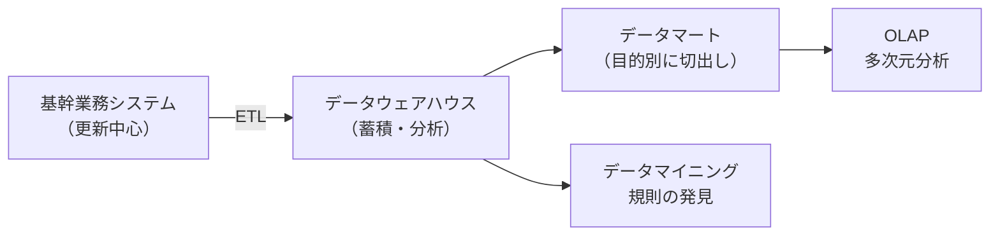

# 9-5 データベース応用

データベースを**業務システムの枠を越えて活用する**技術を扱う。分散データベース、データウェアハウス、ビッグデータ分析が主な題材である。

[9-1 データベース方式](9-1-データベース方式.md)〜[9-4 トランザクション処理](9-4-トランザクション処理.md) が扱ってきたのは、**日々の業務を正確に記録する**ためのデータベース（基幹系）である。本章で扱うのは、**蓄積された記録から知見を引き出す**ための仕組み（情報系）である。目的が違えば最適な構造も違う、というのがこの分野の出発点になる。

午前Iの問9・問10前後から出題される。16年で8問。**データマイニング**が繰り返し問われる。

## 目次

- [1. ストアドプロシージャ](#1-ストアドプロシージャ)
- [2. データベースの複製と分散](#2-データベースの複製と分散)
- [3. データウェアハウスとその周辺](#3-データウェアハウスとその周辺)
- [4. データマイニング](#4-データマイニング)
- [5. データレイク](#5-データレイク)

---

## 1. ストアドプロシージャ

**ストアドプロシージャ**は、一連のSQL文をまとめて**データベースサーバ側に格納しておき、名前で呼び出せるようにした**手続きである。

### 1.1 最大の利点

> **ストアドプロシージャの利点**はどれか。

答えは、

> **アプリケーションプログラムからネットワークを介してDBMSにアクセスする場合、両者間の通信量を減少させる。**

理由は、**何を送るかが変わる**からである。

```
【ストアドプロシージャなし】
  クライアント → SQL文① → サーバ
  クライアント ← 結果①  ← サーバ
  クライアント → SQL文② → サーバ    ← やり取りが何往復も発生
  クライアント ← 結果②  ← サーバ
        …

【ストアドプロシージャあり】
  クライアント → 「手続きXを実行せよ」 → サーバ
  クライアント ←     最終結果だけ     ← サーバ    ← 1往復で済む
```

10本のSQL文から成る処理なら、従来は10往復のやり取りが発生する。ストアドプロシージャなら**呼出し1回で済み、途中の中間結果もネットワークを流れない**。

誤答として並ぶ記述も確認する。

| 記述 | 誤りの理由 |
| --- | --- |
| 一連の要求を一括処理することで、DBMS内の**実行計画の数**を減少させる | 実行するSQL文の数は変わらないので、実行計画の数は減らない |
| 一連の要求を一括処理することで、DBMS内の**必要バッファ数**を減少させる | バッファの必要量は処理内容で決まり、呼び方では変わらない |
| **ディスク装置へのI/O回数**を減少させる | 減るのは**ネットワークの通信量**であって、ディスクI/Oではない |

**「減るのはネットワークの通信量」**という一点を押さえておけば判別できる。

### 1.2 その他の利点と注意点

| 利点 | 内容 |
| --- | --- |
| セキュリティの向上 | **機密性の高いデータへの処理を特定のプロシージャ呼出しに限定**できる。表への直接アクセスを禁じ、手続き経由だけを許せる |
| 処理の標準化 | **システム全体に共通な処理をプロシージャとして格納**しておけば、どのアプリケーションからも同じ処理が使える |
| 通信回数の削減 | 複数のSQL文を1回の呼出しで実行できる |

一方で、**誤りとして出題される記述**もある。

> **データベースへのアクセスを細かい単位でプロシージャ化することによって、処理性能（スループット）を向上させることができる。**

これは誤りである。**細かい単位でプロシージャ化すれば、呼出し回数が増えて通信往復も増える**。ストアドプロシージャの利点は「まとめて1回で呼ぶ」ことにあるので、細分化はその利点を打ち消す。**まとめるから速くなるのであって、プロシージャにすれば速くなるわけではない**。

> **出題** ストアドプロシージャ: H24午前I問9、H25午前I問9、R6午前I問9

---

## 2. データベースの複製と分散

### 2.1 レプリケーション

> **元のデータベースと同じ内容の複製データベースをあらかじめ用意しておき、元のデータベースの更新に対し、非同期にその内容を複製データベースに反映する手法**は **レプリケーション** である。

**「非同期に反映する」**という点が重要である。更新のたびに複製側の完了を待っていては、元のデータベースの性能が落ちる。非同期にすれば本体の性能は保たれるが、**複製側には一時的な遅れ（レプリケーションラグ）が生じる**。

この性質から用途が決まる。参照専用の処理（集計、レポート作成）を複製側に逃がせば本体の負荷を下げられるが、**最新の値が必要な処理には使えない**。

誤答として並ぶ技術との区別を押さえる。

| 技術 | 内容 |
| --- | --- |
| **レプリケーション** | **非同期に複製へ反映する** |
| **2相コミットメント** | 複数のデータベースを**同期的に**整合させる（→ [9-4 トランザクション処理](9-4-トランザクション処理.md)） |
| **ミラーリング** | **同期的に**2台のディスクへ同時に書き込む（RAID1 → [4-1 システムの構成](../04-system-components/4-1-システムの構成.md)） |
| クラスタリング | 複数のノードを1つのシステムとして動かす（→ [4-1](../04-system-components/4-1-システムの構成.md)） |

**同期か非同期か**が判別の軸になる。同期なら常に一致するが遅く、非同期なら速いが一時的にずれる。どちらを選ぶかは、「ずれが許されるか」で決まる。

> **出題** レプリケーション: H23午前I問11

---

## 3. データウェアハウスとその周辺

業務システムのデータベース（基幹系）は、**日々の取引を正確に記録する**ために最適化されている。[9-2 データベース設計](9-2-データベース設計.md) で見た正規化も、更新時の不整合を防ぐためのものだった。

しかし**分析には向かない**。正規化された表を何十も結合しなければ集計できず、しかも集計の重い問合せが日常業務の性能を圧迫する。そこで、**分析専用のデータベースを別に用意する**という発想が生まれた。

| 用語 | 内容 |
| --- | --- |
| **データウェアハウス (DWH)** | **基幹業務のデータベースとは別に作成され、更新処理をしない集計データの分析を主目的とする**。時系列に蓄積する |
| **データマート** | **データウェアハウスに格納されたデータから特定の用途や部門用に切り出して構築する**。個人別・部門別・サマリデータなど、**分析の目的別に切り出され、カスタマイズされたデータ** |
| **ETLツール** | **データウェアハウスに業務データを取り込むとき、データを抽出（Extract）して加工（Transform）し、データベースに書き出す（Load）ツール** |
| **OLAP** | **スライシング、ダイシング、ドリルダウンなどのインタラクティブな操作によって多次元分析を行い、意思決定を支援する** |

### 3.1 全体の流れ



**ETLが「取り込む」、DWHが「貯める」、データマートが「切り出す」、OLAPが「対話的に分析する」、データマイニングが「規則を見つける」**という役割分担になっている。設問ではこれらの説明が入れ替えられるので、**動詞で区別する**とよい。

### 3.2 OLAPの操作

| 操作 | 内容 |
| --- | --- |
| スライシング | 多次元データを特定の断面で切り取る（「2024年の」データだけ見る） |
| ダイシング | 分析の軸を切り替える（「地域×商品」から「期間×商品」へ） |
| ドリルダウン | より詳細な階層へ降りる（「年」から「月」へ） |
| ロールアップ | より大きな階層へ上がる（「月」から「年」へ） |

OLAPが**「インタラクティブな操作」**を特徴とするのは、分析が**仮説と確認の繰り返し**だからである。「売上が落ちているのはどの地域か」「その地域のどの商品か」「その商品はどの月から落ちたか」と、見るたびに次の疑問が出る。その都度プログラムを書いていては追いつかないので、対話的に切り口を変えられる仕組みが要る。

> **出題** ETLツール: H24午前I問10

---

## 4. データマイニング

> **データマイニング**は、**ニューラルネットワークや統計解析などの手法を使って、大量に蓄積されているデータから、特徴あるパターンを探し出す**。

> ビッグデータの利用における**データマイニング**は、**蓄積されたデータを分析し、単なる検索だけでは分からない隠れた規則や相関関係を見つけ出すこと**である。

**OLAPとデータマイニングの違い**が、この分野の最重要の区別である。

| | OLAP | データマイニング |
| --- | --- | --- |
| 出発点 | **仮説がある** | **仮説がない** |
| やること | 「売上は地域によって違うはずだ」と考え、**確かめる** | **データ自身に語らせ、規則を発見する** |
| 手法 | 集計、切り口の変更 | 統計解析、機械学習、ニューラルネットワーク |

典型例として語られるのが「紙おむつとビールが一緒に買われる」という相関である。こうした組合せは、人が仮説として思いつくものではない。**大量のデータを機械的に探索して初めて見つかる**。これがデータマイニングの価値である。

誤答として並ぶ説明との対応を整理する。

| 記述 | 実際は何か |
| --- | --- |
| 基幹業務のデータベースとは別に作成され、更新処理をしない集計データの分析を主目的とする | **データウェアハウス** |
| 個人別データ、部門別データ、サマリデータなど、分析の目的別に切り出されカスタマイズされたデータを分析する | **データマート** |
| スライシング、ダイシング、ドリルダウンなどのインタラクティブな操作によって多次元分析を行う | **OLAP** |
| データウェアハウスに格納されたデータの一部を特定の用途や部門用に切り出してデータベースに格納する | **データマート** |
| データを複数のサーバに複製し、性能と可用性を向上させる | **レプリケーション**（→ [2. データベースの複製と分散](#2-データベースの複製と分散)） |

データマイニングで使われる機械学習の手法（クラスタリング、分類、回帰）は [1-3 情報に関する理論](../01-basic-theory/1-3-情報に関する理論.md)、経営における活用は [22-2 業務分析・データ利活用](../22-corporate-activities/22-2-業務分析-データ利活用.md) で扱う。

> **出題** データマイニング: H29午前I問10、R4午前I問9

---

## 5. データレイク

> **データレイク**の特徴は、**必要に応じて加工するために、データを発生したままの形で格納する**ことである。

データウェアハウスとの違いは、**加工のタイミング**にある。

| | データウェアハウス | データレイク |
| --- | --- | --- |
| 格納するもの | **加工・整形済み**の構造化データ | **発生したままの形**（生データ） |
| 加工のタイミング | **格納する前**（ETLで変換してから入れる） | **使うときに**必要に応じて |
| 扱うデータ | 構造化データ中心 | 構造化・半構造化・非構造化（ログ、画像、音声、センサデータ） |

この違いが生まれたのは、**ビッグデータの時代に「何に使うか分からないデータ」が大量に発生するようになった**からである。

従来のDWHは「こういう分析をする」と決めてから、それに合う形に加工して格納していた。しかし、IoTのセンサデータやアクセスログのようなデータは、**いま何の役に立つか分からないが、後から価値が見つかるかもしれない**。加工してから入れる方式では、**加工の段階で捨てた情報は二度と戻らない**。

データレイクは「**とりあえず全部そのまま貯めておき、使い道が決まったときに加工する**」という逆の方針をとる。記憶装置が安価になったことで現実的になった考え方である。

誤答として並ぶ記述も確認しておく。「隠れた規則や相関関係を見つけ出す」はデータマイニング、「データウェアハウスから特定用途のデータを取り出して構築する」はデータマート、「データウェアハウスやデータマートからデータを取り出して多次元分析を行う」はOLAPである。

**「発生したままの形で格納する」**という表現がデータレイクの決め手になる。

> **出題** データレイク: R3午前I問9

---

## この章のまとめ

- **ストアドプロシージャが減らすのはネットワークの通信量**。ディスクI/Oや実行計画の数は減らない。**細かい単位にプロシージャ化すると逆効果**になる。
- **レプリケーションは非同期に複製へ反映する**。2相コミットやミラーリングは同期的であり、「速いがずれる」か「遅いが一致する」かの違いになる。
- 情報系の役割分担は**ETLが取り込む、DWHが貯める、データマートが切り出す、OLAPが対話的に分析する、データマイニングが規則を見つける**。
- **OLAPは仮説を確かめる、データマイニングは仮説なしに規則を発見する**。
- **データレイクは発生したままの形で格納し、使うときに加工する**。「何に使うか分からないデータ」を捨てずに残すための考え方である。
