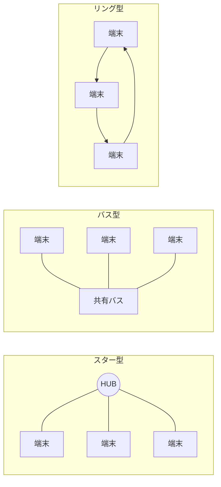
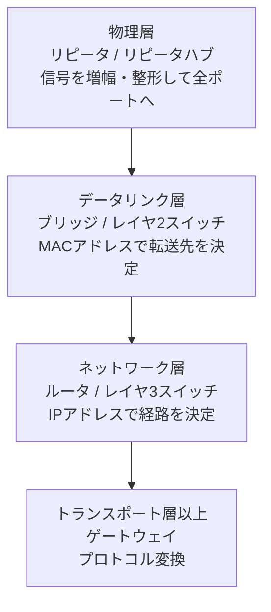
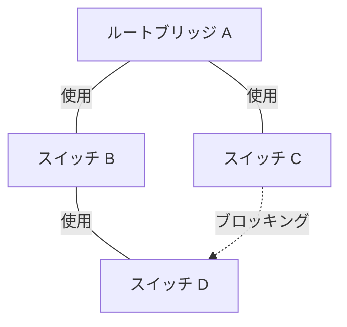
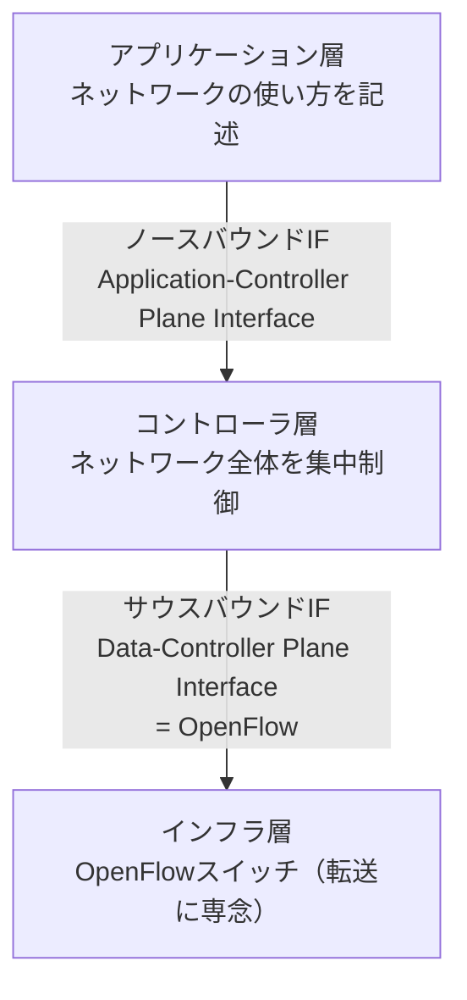

# 10-1 ネットワーク方式

ネットワークを「どう組み立てるか」を扱う分野である。ケーブルや電波といった物理的な伝送媒体から始まり、イーサネットというLANの標準方式、ネットワーク機器の役割分担、VLANによる論理分割、冗長化と帯域集約、無線LAN、そしてネットワークそのものをソフトウェアで制御するSDNまでを順に見ていく。

ここで扱うのは主に**物理層とデータリンク層の「作り」**である。同じデータリンク層でも、アクセス制御（CSMA/CDなど）や誤り制御といった「動かし方」は [10-2 データ通信と制御](10-2-データ通信と制御.md)、IPから上のプロトコル仕様は [10-3 通信プロトコル](10-3-通信プロトコル.md) で扱う。伝送速度・呼量などの計算理論は [1-4 通信に関する理論](../01-basic-theory/1-4-通信に関する理論.md) にまとめた。

ネットワークスペシャリスト試験では、この分野から**16年で38問**が出題されている。午前IIを中心に**年2〜3問が目安**で、多い年は4〜5問に達する。特に**無線LAN規格の周波数帯**、**スパニングツリー**、**SDN/OpenFlow** は繰り返し問われる定番である。

## 目次

- [1. ネットワークの分類](#1-ネットワークの分類)
- [2. 伝送媒体](#2-伝送媒体)
- [3. イーサネット](#3-イーサネット)
- [4. LAN間接続装置](#4-lan間接続装置)
- [5. VLAN](#5-vlan)
- [6. 冗長化と帯域集約](#6-冗長化と帯域集約)
- [7. 無線LAN](#7-無線lan)
- [8. WANとアクセス回線](#8-wanとアクセス回線)
- [9. SDN](#9-sdn)

---

## 1. ネットワークの分類

### 1.1 規模による分類

ネットワークは、カバーする地理的な範囲によって呼び分けられる。

| 名称 | 範囲 | 典型例 |
| --- | --- | --- |
| PAN (Personal Area Network) | 身の回り数m | Bluetooth、ZigBee |
| LAN (Local Area Network) | 建物・構内 | イーサネット、無線LAN |
| WAN (Wide Area Network) | 拠点間・広域 | 専用線、IP-VPN、広域イーサネット |

この区別が重要なのは、**誰が設備を所有するか**が変わるからである。LANは自分で敷設し自分で管理するので、速度も構成も自由に決められる。一方WANは通信事業者の設備を借りるため、速度は契約で決まり、コストは距離と帯域に比例する。「LANは広帯域で安く、WANは狭帯域で高い」という非対称性が、拠点間システムの設計を支配する。キャッシュやデータ圧縮、拠点内での処理完結といった工夫は、すべてこの非対称性に由来している。

### 1.2 トポロジ（接続形態）

ノード同士をどうつなぐかの形を**トポロジ**という。

初期のイーサネット（10BASE5 / 10BASE2）は1本の同軸ケーブルを共有する**バス型**だった。1台が送信すると全員に届くため、同時に送ると衝突する。これがCSMA/CDというアクセス制御を必要とした理由である（→ [10-2](10-2-データ通信と制御.md)）。

現在のイーサネットは**スター型**で、中心にスイッチを置く。ただし見た目がスター型でも、中心がリピータハブなら内部は依然としてバス型と同じ（全ポートが1つの衝突ドメイン）に振る舞う。**物理的な形と論理的な動作は別物**だという点が、ネットワークを理解するうえでの最初の関門である。

メッシュ型は任意のノード間を直接結ぶ形で、WANのバックボーンや無線メッシュネットワークで使われる。経路が複数あるため耐障害性が高い代わりに、リンク数が $n(n-1)/2$ で増えるためコストがかさむ。

---

## 2. 伝送媒体

### 2.1 ツイストペアケーブル

LAN配線の主役は**ツイストペアケーブル（より対線）**である。2本の導線をより合わせた「対（ペア）」を、4対まとめて1本のケーブルにしている。

なぜより合わせるのか。信号は2本の導線の**電位差**で伝えられる（平衡伝送）。外来ノイズは2本の導線にほぼ等しく乗るので、受信側で差をとればノイズは打ち消される。より合わせることで2本の導線が空間的にほぼ同じ位置を通るようになり、「ほぼ等しくノイズが乗る」状態が作りやすくなる。つまり**より合わせはノイズを等しく乗せるための工夫**であって、ノイズそのものを遮断しているわけではない。

重要なのは、**4対それぞれのよりのピッチ（間隔）は意図的に変えてある**という点である。すべて同じピッチにすると隣接する対同士が規則的に並走してしまい、対から対へノイズが漏れる**漏話（クロストーク）**が増える。ピッチをずらせば対同士の位置関係が常に変化し、漏話が打ち消し合う。「全ての対のピッチは均一の方が効果が高い」という記述は誤りである。

また、対線に乗る外来ノイズの大きさは2本の導線の間隔に**比例**する。間隔が広いほど2本の導線が作るループの面積が大きくなり、それだけ多くの誘導を拾うためである。「間隔に反比例する」も定番の誤答である。

シールドの有無で2種類ある。

| 種類 | 構造 | 特徴 |
| --- | --- | --- |
| UTP (Unshielded Twisted Pair) | シールドなし | 安価・柔軟。LANの標準 |
| STP (Shielded Twisted Pair) | 金属箔などで遮へい | ノイズに強いが高価、アース処理が必要 |

UTPは伝送性能によって**カテゴリ**に分類される。どのカテゴリでも**2本の導線が4対（計8芯）**収められている点は共通である。

| カテゴリ | 帯域 | 主な用途 |
| --- | --- | --- |
| カテゴリ5 | 100 MHz | 100BASE-TX |
| カテゴリ5e | 100 MHz | 1000BASE-T |
| カテゴリ6 | 250 MHz | 1000BASE-TX、10GBASE-T（55 mまで） |
| カテゴリ6A | 500 MHz | 10GBASE-T（100 m） |
| カテゴリ7 | 600 MHz | 10GBASE-T（シールド付き） |

**10GBASE-T のケーブル長は頻出**である。カテゴリ6Aなら100 m、カテゴリ6では漏話の影響で55 mに制限される。10 Gビット/秒という高い周波数では漏話が深刻になるため、より高い帯域をもつカテゴリ6A以上が求められる、という因果で覚えるとよい。

### 2.2 光ファイバ

光ファイバはガラスやプラスチックの芯（コア）に光を閉じ込めて伝送する。電磁ノイズの影響を受けず、長距離・広帯域に優れる。

| 種類 | コア径 | 特徴 |
| --- | --- | --- |
| シングルモード (SMF) | 約 9 μm | 光の伝わり方（モード）が1つだけ。**伝送速度も伝送距離も優れる**。長距離基幹向け |
| マルチモード (MMF) | 50 / 62.5 μm | 複数のモードが同時に伝わる。安価だが**モード分散**で性能が劣る |

マルチモードが劣る理由は**モード分散**にある。コアが太いと、まっすぐ進む光と壁で反射しながらジグザグに進む光ができ、同時に出発しても到着時刻がずれる。その結果パルスが時間方向に広がり、速度を上げると隣のパルスと重なって識別できなくなる。距離が長いほどこの広がりは累積するので、マルチモードは**速度も距離も**シングルモードに及ばない。「速度は速いが距離は短い」といった中途半端な選択肢は誤りである。

### 2.3 PoE（Power over Ethernet）

**PoE** は、LANケーブル（ツイストペア）でデータと同時に**電力も供給する**仕組みである。IEEE 802.3af（15.4 W）に始まり、802.3at（PoE+、30 W）、802.3bt（PoE++、最大90 W）と拡張されてきた。

無線LANアクセスポイント、IP電話機、ネットワークカメラのように「天井や壁など電源コンセントのない場所に置きたい装置」で威力を発揮する。LANケーブル1本で済むので工事費が下がり、給電元のスイッチにUPSを付ければ端末側も無停電化できる。

混同しやすい用語として、**PLC（Power Line Communication）**は逆に**電力線を通信回線として使う**技術である。「LANケーブルで給電」がPoE、「電力線で通信」がPLCと、向きが反対だと整理しておく。

> **出題** 光ファイバ: R4午前II問2 ｜ LANケーブル: H23午前II問1、H25午前II問1 ｜ 10GBASE-Tのケーブル長: R7午前II問4 ｜ PoE: R7午前I問11 ｜ PLC: H26午前II問2

---

## 3. イーサネット

### 3.1 規格の読み方

イーサネットの規格名は `10GBASE-T` のように **［速度］BASE［媒体］** の構成になっている。`BASE` はベースバンド伝送（搬送波に乗せず信号をそのまま流す方式）を意味する。

| 規格 | 速度 | 媒体 | 最大距離 |
| --- | --- | --- | --- |
| 10BASE-T | 10 Mbps | UTP カテゴリ3以上（2対） | 100 m |
| 100BASE-TX | 100 Mbps | UTP カテゴリ5以上（2対） | 100 m |
| 1000BASE-T | 1 Gbps | UTP カテゴリ5e以上（**4対**） | 100 m |
| 1000BASE-TX | 1 Gbps | UTP カテゴリ6（4対） | 100 m |
| 1000BASE-SX | 1 Gbps | マルチモード光ファイバ | 550 m |
| 1000BASE-LX | 1 Gbps | シングルモード光ファイバ | 5 km |
| 10GBASE-T | 10 Gbps | UTP カテゴリ6A（4対） | 100 m |

**1000BASE-T と 1000BASE-TX の違い**は紛らわしいので整理しておく。

- **1000BASE-T**：4対すべてを**双方向**に使う。1対あたり250 Mbps、4対で1 Gbps。同じ対で送信と受信を同時に行うため、自分の送信信号を受信信号から差し引く**エコーキャンセラ**が要る。回路は複雑だがカテゴリ5eで動くので広く普及した。
- **1000BASE-TX**：送信に2対、受信に2対と役割を分ける。1対あたり500 Mbpsとなり、より高い帯域が要るのでカテゴリ6が必須。回路は単純だがケーブルの要求が厳しく、ほとんど普及しなかった。

「1対で250 Mビット/秒を上り下り同時に送り、4対合計で1 Gビット/秒の全二重」という説明は**1000BASE-T**のものであり、1000BASE-TXの説明として出された場合は誤りになる。

### 3.2 フレーム形式

イーサネットが扱うデータの単位を**フレーム**という。IEEE 802.3 のベーシックフレームは次の構造をもつ。

| 項目 | 長さ（オクテット） | 役割 |
| --- | --- | --- |
| プリアンブル | 7 | `10101010` の繰り返し。受信側のクロック同期をとる |
| SFD (Start Frame Delimiter) | 1 | `10101011`。ここからフレーム本体が始まる合図 |
| 宛先MACアドレス | 6 | 受信先の識別 |
| 送信元MACアドレス | 6 | 送信元の識別 |
| タイプ / 長さ | 2 | 上位プロトコルの種別（IPv4 = 0x0800 など）または長さ |
| データ（MACクライアントデータ） | 46〜1500 | ペイロード。46未満ならパディングで埋める |
| FCS (Frame Check Sequence) | 4 | CRCによる誤り検出符号 |

**プリアンブルは「同期用の信号としてフレームの先頭に置かれる」**。誤り検出はFCSの役目でフレームの最後にある。この2つを入れ替えた選択肢がよく出る。

プリアンブルとSFDは物理層が付加するもので、**「フレーム」として数えるのは宛先MACアドレスからFCSまで**である。したがって

$$ \text{フレーム長} = 6 + 6 + 2 + (\text{データ長}) + 4 = \text{データ長} + 18 $$

となる。MACクライアントデータが1,400オクテットなら $1400 + 18 = 1418$ オクテットである。最小は $46+18=64$、最大は $1500+18=1518$ オクテットになる。

最小フレーム長が64オクテットと決まっているのは、CSMA/CDで衝突を確実に検出するためである（→ [10-2](10-2-データ通信と制御.md)）。またフレームとフレームの間には**IFG（Inter Frame Gap、96ビット時間＝12オクテット相当）**の間隔が置かれるが、これはフレーム長には含まれない。

### 3.3 Automatic MDI/MDI-X とオートネゴシエーション

PC側のポート（MDI）とハブ側のポート（MDI-X）では送信ピンと受信ピンが入れ替わっている。そのため「PC—ハブ」はストレートケーブル、「PC—PC」や「ハブ—ハブ」はクロスケーブル、という使い分けが必要だった。

**Automatic MDI/MDI-X** は、接続相手の**ピン割当てを自動判別**して自分のピン割当てを切り替える機能である。これによりストレートでもクロスでも接続できる。現在のスイッチにはほぼ標準搭載されている。

似た名前の自動機能と混同しないこと。何を自動判別するのかで区別する。

| 機能 | 自動判別する対象 |
| --- | --- |
| **Automatic MDI/MDI-X** | **ピン割当て**（ストレート／クロス） |
| オートネゴシエーション | 通信速度と全二重／半二重 |
| フロー制御 (IEEE 802.3x) | 受信バッファのあふれ。PAUSEフレームで送信の一時中断を要求 |

> **出題** フレーム長: R7午前II問2 ｜ プリアンブル: H23午前II問8 ｜ 1000BASE-T: H22午前II問4 ｜ Automatic MDI/MDI-X: H28午前II問1、R3午前II問1

---

## 4. LAN間接続装置

ネットワーク機器は**OSI基本参照モデルの何層で中継するか**で分類される。これがこの分野の背骨になる考え方である。

### 4.1 各装置の役割

**リピータ / リピータハブ（物理層）**
受け取った信号を増幅・整形して、受信ポート以外の**全ポートに送り出す**。中身を一切解釈しないので、衝突によって生じた不完全なフレームもそのまま流してしまう。接続した全ポートが1つの衝突ドメインになる。

**ブリッジ / レイヤ2スイッチ（データリンク層）**
フレームを**いったん蓄積して（ストアアンドフォワード）**、宛先MACアドレスを見て必要なポートだけに転送する。MACアドレステーブル（学習テーブル）をもち、受信フレームの送信元MACアドレスから「どのポートの先にどの機器がいるか」を自動学習する。

ブリッジとレイヤ2スイッチは、**同じデータリンク層で動作する同等の装置**である。スイッチングハブは多ポート化・ハードウェア化したブリッジだと考えてよい。この等価性はそのまま出題される。

ブリッジの中継動作で押さえるべきは次の2点である。

- **ブロードキャストフレームは中継する**。宛先MACアドレスが `FF:FF:FF:FF:FF:FF` のフレームは全ポートへ転送される。したがってブリッジ／L2スイッチは**衝突ドメインは分割するが、ブロードキャストドメインは分割しない**。
- **衝突によってできた不完全フレームは中継しない**。フレーム全体を受信してFCSを検査してから転送するので、壊れたフレーム（ランツフレーム）は破棄される。リピータとの決定的な違いがここにある。

**ルータ / レイヤ3スイッチ（ネットワーク層）**
**IPアドレス**を見て転送経路を決定する。伝送媒体やアクセス制御方式が異なるネットワーク同士（たとえばイーサネットとWAN回線）も接続できる。ブロードキャストドメインを分割するのはルータの役目である。レイヤ3スイッチはルーティング処理をハードウェア（ASIC）で行い、LAN内の高速なルーティングに特化したものである。

**ゲートウェイ（トランスポート層以上）**
異なるプロトコル体系の間でプロトコル変換を行う。メールゲートウェイやVoIPゲートウェイなどが該当する。

### 4.2 ドメインの分割

| 装置 | 衝突ドメイン | ブロードキャストドメイン |
| --- | --- | --- |
| リピータハブ | 分割しない | 分割しない |
| ブリッジ / L2スイッチ | **分割する** | 分割しない |
| ルータ / L3スイッチ | 分割する | **分割する** |

「L2スイッチをいくら増やしてもブロードキャストは減らない」という事実が、次節のVLANが必要とされる理由につながる。

> **出題** ブリッジの中継動作: H21午前II問2 ｜ ルータの機能: H23午前I問12 ｜ L2スイッチとブリッジの等価性: H30午前I問11

---

## 5. VLAN

### 5.1 なぜVLANが必要か

L2スイッチだけで構成したネットワークは、物理的につながっている限り1つのブロードキャストドメインになる。端末が増えるとARPなどのブロードキャストが全端末に届き、帯域とCPUを浪費する。また部署が違っても同じセグメントにいるため、互いに通信できてしまう。

従来これを分けるには、物理的に別のスイッチを用意してルータでつなぐしかなかった。**VLAN（Virtual LAN）**は、これを**1台のスイッチの中で論理的に**実現する。ポートをグループ分けすれば、同じスイッチに挿さっていてもグループが違えば直接通信できず、ブロードキャストも届かない。

グループ間で通信したいときはルータまたはレイヤ3スイッチを経由させる。経由点でアクセス制御をかけられるので、VLANはセキュリティ対策としても機能する（→ [11-4 情報セキュリティ対策](../11-security/11-4-情報セキュリティ対策.md)）。

### 5.2 タグVLAN（IEEE 802.1Q）

ポート単位でグループ分けする**ポートVLAN**は1台のスイッチの中では十分だが、スイッチ間をまたぐとVLANの数だけケーブルが必要になってしまう。

これを解決するのが**タグVLAN（IEEE 802.1Q）**である。フレームに「このフレームはどのVLANのものか」を示す**VLANタグ**を埋め込み、1本のケーブル（トランクポート）に複数VLANのフレームを混載する。

VLANタグは4オクテットで、**送信元MACアドレスの直後、タイプ／長さフィールドの前**に挿入される。

| プリアンブル | SFD | 宛先MAC | 送信元MAC | ← **ここに挿入** | タイプ/長さ | データ | FCS |
| --- | --- | --- | --- | --- | --- | --- | --- |

タグの中の **VID（VLAN Identifier）は12ビット**である。$2^{12} = 4096$ 通りだが、0と4095は予約されているため、実際に使えるVLAN番号は**1〜4094**となる。この「12ビット」は繰り返し問われている。

タグを挿入する分フレームは4オクテット長くなるので、タグVLANを使う区間では最大フレーム長が1518から1522オクテットに拡張される。

> **出題** VIDのビット長: H29午前II問4 ｜ VLANタグの挿入位置: R5午前II問11（この設問はOCRで「IEEE 802.10」と読まれているが、正しくは **IEEE 802.1Q** である）

---

## 6. 冗長化と帯域集約

### 6.1 スパニングツリープロトコル（STP）

スイッチ間を複数の経路で結ぶと耐障害性は上がるが、そのままでは**ループ**ができてしまう。L2にはIPのTTLのような生存時間の仕組みがないため、ブロードキャストフレームがループ内を無限に回り続け、スイッチで複製されて増殖し、ネットワークを飽和させる（**ブロードキャストストーム**）。

**スパニングツリープロトコル（IEEE 802.1D）**は、物理的にはループのある構成から、論理的にループのない木構造（スパニングツリー）を自動的に作り出す。余分な経路のポートをブロッキング状態にして使わず、障害が起きたらそのポートを開放して迂回する。

ここで誤解しやすいのが次の2点である。

- **STPはデータリンク層のプロトコル**であり、ネットワーク層ではない。
- STPは「複数経路で**同時に**フレーム転送できるようにする」ものではない。むしろ**同時に使える経路を1つに絞る**のがSTPである。帯域を増やしたいならリンクアグリゲーションを使う。

動作の流れは次のとおり。

1. スイッチ同士が **BPDU（Bridge Protocol Data Unit）** という制御フレームを交換する。
2. **ルートブリッジ**（木の根）を1台選ぶ。選出には**ブリッジID**を使い、ブリッジIDは「**ブリッジプライオリティ（優先順位）＋ MACアドレス**」で構成される。値が最小のものがルートになる。プライオリティが同じならMACアドレスの小さいほうが勝つ。
3. 各スイッチは、ルートブリッジまでの**パスコストが最小**になるポートを**ルートポート**として選ぶ。
4. 各セグメントで、ルートに最も近いスイッチ側のポートを**指定ポート**とする。
5. 残ったポートを**ブロッキング**する。

パスコストはリンク速度が速いほど小さい値が割り当てられる。「**ルートブリッジからの累積コストが小さい経路を残す**」という原理を押さえれば、経路図とコストを与えられて隣接関係を問う計算問題にも対応できる。

STPには改良版がある。

| プロトコル | 規格 | 特徴 |
| --- | --- | --- |
| STP | IEEE 802.1D | 基本形。障害時の収束に30〜50秒かかる |
| RSTP (Rapid STP) | IEEE 802.1w | 収束を数秒に短縮 |
| **MSTP** (Multiple STP) | IEEE 802.1s | **複数のVLANを一つにまとめた単位（インスタンス）ごとに**スパニングツリーを構成する。インスタンスごとに異なる木を作れるので、あるVLANでブロックされている経路を別のVLANでは使え、帯域を有効活用できる |

### 6.2 リンクアグリゲーション

**リンクアグリゲーション（IEEE 802.3ad、現 IEEE 802.1AX）**は、**複数の物理回線を束ねて論理的に1本の回線として扱う**技術である。スイッチ間、あるいはコンピュータとスイッチの間で使う。

目的は2つある。**帯域の拡大**（1 Gbps × 4本で4 Gbps相当）と**冗長化**（1本切れても残りで通信継続）である。束ねたリンクはSTPから見ても1本の論理リンクなので、ブロックされずに全本数を使える点がSTPとの決定的な違いになる。束ねる相手の決定とリンク状態の監視には**LACP（Link Aggregation Control Protocol）**が使われる。

### 6.3 NICチーミング

**チーミング（ボンディング）**は、サーバ側で**一つのIPアドレスに複数のNICを割り当てて**、負荷分散・帯域の有効活用・耐障害性向上を図る技術である。考え方はリンクアグリゲーションと同じだが、こちらは**サーバのOS／ドライバが主体**になる点が異なる。

似た語との区別を整理しておく。

| 用語 | 内容 |
| --- | --- |
| **チーミング** | 複数の**物理NIC**に一つのIPアドレスを割り当て、負荷分散・冗長化する |
| 仮想NIC | ソフトウェアでNICをエミュレートし、物理NIC数以上のインタフェースを作る |
| フロー制御 | 受信バッファがあふれそうなとき、送信の一時中断を要求する |
| オートネゴシエーション | 通信規格・モードを自動認識して最適速度で通信する |

> **出題** スパニングツリー: H26午前II問5、H29午前II問5、R1午前II問4、R4午前II問4（計4回） ｜ スパニングツリーの構築計算: R6午前II問5 ｜ MSTP: R5午前II問10 ｜ リンクアグリゲーション: H22午前II問7、H25午前II問5 ｜ NICチーミング: H30午前II問22

---

## 7. 無線LAN

### 7.1 規格の系譜

無線LANはIEEE 802.11として標準化されている。**使用する周波数帯**、**最大速度**、**変調／アンテナ技術**の3点で整理するとよい。

| 規格 | 通称 | 周波数帯 | 最大速度 | 主な技術 |
| --- | --- | --- | --- | --- |
| 802.11b | — | **2.4 GHz** | 11 Mbps | DSSS / CCK |
| 802.11a | — | **5 GHz** | 54 Mbps | OFDM |
| 802.11g | — | **2.4 GHz** | 54 Mbps | OFDM |
| 802.11n | Wi-Fi 4 | **2.4 GHz と 5 GHz** | 600 Mbps | MIMO、チャネル幅 **20 / 40 MHz** |
| 802.11ac | Wi-Fi 5 | **5 GHz のみ** | 6.9 Gbps | MU-MIMO、チャネル幅 20/40/80/160 MHz |
| 802.11ax | Wi-Fi 6 | 2.4 GHz と 5 GHz | 9.6 Gbps | OFDMA |

試験で最もよく問われるのが **n と ac の周波数帯の違い**である。

- **802.11n は 2.4 GHz と 5 GHz の両方**
- **802.11ac は 5 GHz のみ**

この組合せは3年にわたって同一の設問が出題されている。あわせて「**2.4 GHz帯を使用しない規格は 802.11ac**」という問い方もされる。

技術用語の対応も押さえておく。

- **OFDM**（直交周波数分割多重）：データを多数のサブキャリアに分割し、互いに干渉しないよう直交配置する多重化方式。802.11a/g以降で採用されている（原理は [10-2](10-2-データ通信と制御.md)）。802.11b は OFDM ではなく CCK を使う。
- **MIMO**（Multiple Input Multiple Output）：送受信に複数アンテナを使って空間的に多重化する。**802.11n で導入**されたもので、802.11g には規定がない。
- **チャネル幅**：802.11n で 20 MHz に加えて 40 MHz が規定された。帯域を2倍にすれば速度も上がるという素直な発想である。

### 7.2 2.4 GHz帯の混雑

2.4 GHz帯は**ISMバンド**（産業・科学・医療用に免許不要で開放された帯域）であり、多くの機器が共用している。

- IEEE 802.11b / g / n の無線LAN
- **Bluetooth**
- ZigBee
- 電子レンジ、コードレス電話

このため**Bluetooth と 2.4 GHz帯の無線LANは割り当てられた周波数帯が重複**し、互いに干渉しうる。一方、GPS（約1.2 / 1.5 GHz帯）や第3世代携帯電話（800 MHz / 2 GHz帯）は無線LANと重複しない。

5 GHz帯は比較的空いているが、屋外利用に制限があったり、気象レーダーとの干渉を避けるため**DFS（動的周波数選択）**でチャネル変更を強いられたりする。「速いが使える場所に制約がある5 GHz」「遅いが届きやすく混雑している2.4 GHz」という使い分けになる。

無線LANの認証・暗号化（WPA2 / WPA3、IEEE 802.1X）は [11-5 セキュリティ実装技術](../11-security/11-5-セキュリティ実装技術.md)、アクセス制御方式のCSMA/CAは [10-2](10-2-データ通信と制御.md) で扱う。

> **出題** n/acの周波数帯: R3午前II問15、R5午前II問15、R7午前II問15（計3回） ｜ 無線LAN標準規格: H25午前II問3 ｜ 2.4 GHzを使わない規格: H30午前II問12 ｜ 周波数帯の重複: H23午前II問4

---

## 8. WANとアクセス回線

### 8.1 ADSL

**ADSL（Asymmetric Digital Subscriber Line）**は既設の電話用メタル回線で高速デジタル通信を行う技術である。名前のとおり**上り（ユーザ→局）より下り（局→ユーザ）が速い非対称**な方式になっている。

なぜ非対称なのか。ADSLは電話の音声が使う低い周波数帯（〜4 kHz）を避け、その上の帯域を上り用と下り用に分割して使う。このとき**上りに割り当てる変調周波数帯域を、下りに比べて狭く**している。使える帯域幅が狭ければ、そこに載せられる情報量も少ない。これが上りが遅い直接の理由である。

帯域配分をこうした背景には、Webの閲覧やファイルのダウンロードなど一般利用者のトラフィックが下り偏重だという事情がある。また上り信号は多数の加入者宅から局舎に向かって集まるため、ケーブル束の中での漏話が問題になりやすく、上りを抑えるほうが全体として安定するという技術的理由もある。

「ISDNとの干渉を防ぐため」「ATMセル仕様による制限」「事業者がセキュリティチェックを行うため」といった説明はいずれも誤りである。

### 8.2 その他のアクセス回線

| 方式 | 内容 |
| --- | --- |
| 専用線 | 2地点を固定的に結ぶ。帯域を占有でき品質は安定するが高価 |
| FTTH | 光ファイバを宅内まで引き込む。PON方式では1本の光ファイバを分岐して複数加入者で共有する |
| 広域イーサネット | 拠点間をレイヤ2でつなぐ。VLANで利用者を分離。ルーティングプロトコルを自由に選べる |
| IP-VPN | 事業者のIP網をレイヤ3で共用。MPLSで利用者を分離する（→ [10-2](10-2-データ通信と制御.md)） |
| PLC | 電力線を通信回線として利用する |

VPNの方式とトンネリングプロトコルは [10-5 ネットワーク応用](10-5-ネットワーク応用.md) で扱う。

> **出題** ADSLの非対称性: H24午前II問5

---

## 9. SDN

### 9.1 発想の転換

従来のネットワーク機器は、**経路を決める頭脳（コントロールプレーン）**と**実際にパケットを転送する手足（データプレーン）**を1台の中に併せもっていた。ルータ同士がルーティングプロトコルで情報を交換し、各自が自律的に経路表を作る。この自律分散方式はインターネットの規模拡大を支えた一方で、「ネットワーク全体をこう振る舞わせたい」という意図を反映させるには機器を1台ずつ設定して回る必要があった。

**SDN（Software-Defined Networking）**はこの構造を変える。**ネットワーク制御機能とデータ転送機能を論理的に分離し**、制御機能を**コントローラ**と呼ばれるソフトウェアに集約する。ネットワーク機器は転送に徹し、「どう転送するか」の指示はコントローラから受け取る。ネットワーク全体を一つのプログラムで操作できるようにするのが狙いである。

### 9.2 ONFのアーキテクチャ

ONF（Open Networking Foundation）が定義する3階層モデルは次のようになる。

インタフェースの向きが頻出ポイントである。

- **ノースバウンドインタフェース**（Application-Controller Plane Interface）：**アプリケーション ↔ コントローラ**。アプリケーションはここを介してコントローラに指示を出す。ネットワーク機器に直接指示を出すわけではない。
- **サウスバウンドインタフェース**（Data-Controller Plane Interface）：**コントローラ ↔ ネットワーク機器**。ここで使われる代表的なプロトコルが**OpenFlow**である。

「アプリケーションがサウスバウンドインタフェースを介してコントローラに指示を出す」という選択肢は、インタフェースの向きを入れ替えた誤りである。

### 9.3 OpenFlow

**OpenFlow** は、コントローラがOpenFlowスイッチを制御するためのプロトコルである。スイッチは**フローテーブル**をもち、「この条件に合致したパケットはこう処理する」というフローエントリに従ってパケットを扱う。この**フローテーブルの情報をコントローラが提供する**点がOpenFlowの本質である。

通信路（**OpenFlowチャネル**）には**TCP、またはTLSで保護したTCP**を使う。制御情報は確実に届かなければならず、改ざんされればネットワーク全体が乗っ取られるため、信頼性と安全性が優先される。「オーバヘッドを避けてIPを直接使う」「リアルタイム性のためUDPを使う」という選択肢は誤りである。

主なメッセージは次のとおり。

| メッセージ | 方向 | 役割 |
| --- | --- | --- |
| **Packet-In** | **スイッチ → コントローラ** | フローテーブルに合致しないパケットを受信したとき、判断を仰ぐために送る |
| **Packet-Out** | コントローラ → スイッチ | スイッチに特定のパケットを送出させる |
| **Flow-Mod** | コントローラ → スイッチ | フローエントリの追加・変更・削除 |
| Echo | 双方向 | 死活監視・遅延測定 |

典型的な流れは「未知のパケット到着 → **Packet-In** でコントローラへ → コントローラが判断 → **Flow-Mod** でルールを書き込み、**Packet-Out** で当該パケットを処理」となる。以降の同種パケットはスイッチ単独で高速に処理される。

### 9.4 紛らわしい技術との区別

SDNの説明を問う設問では、次のような他技術が誤答選択肢に並ぶ。

| 技術 | 内容 |
| --- | --- |
| SNMP | 管理マネージャが機器のMIBを取得して稼働監視・性能管理を行う（→ [10-4](10-4-ネットワーク管理.md)） |
| sFlow / NetFlow | フロー（IPアドレスやポート番号の組合せ）ごとの統計情報を機器がコレクタに送り、トラフィックを分析する |
| スパニングツリー | レイヤ2のループ検知と障害時の迂回経路決定 |
| 従来のルーティング | 機器同士が経路情報を交換し、各自が経路を決定する |
| NFV | ネットワーク機能をソフトウェアとして仮想環境で動かす。SDNとは別概念 |

> **出題** SDN / OpenFlowの説明: H29午前II問13、H30午前II問13、R3午前I問11、R4午前I問11 ｜ OpenFlowチャネル: R1午前II問12 ｜ OpenFlowメッセージ: R7午前II問13

---

## この章のまとめ

- 伝送媒体は**より対線（カテゴリで性能が決まる）**と**光ファイバ（シングルモードが速く遠い）**が柱。10GBASE-Tはカテゴリ6Aで100 m、カテゴリ6では55 m。
- イーサネットフレームは**宛先MACからFCSまでで「データ長＋18」オクテット**。プリアンブルは同期用で先頭、FCSは誤り検出で末尾。
- 機器の分類は**何層で中継するか**。L2スイッチ＝ブリッジは衝突ドメインのみ分割し、ルータがブロードキャストドメインを分割する。
- **VLANのVIDは12ビット**、タグは送信元MACアドレスの直後に入る。
- **STPはループを防ぐためにあえて経路を1本に絞る**。ルートブリッジはブリッジプライオリティとMACアドレスで決まる。帯域を増やしたいならリンクアグリゲーション。
- 無線LANは**802.11nが2.4/5 GHz両対応、802.11acは5 GHzのみ**。2.4 GHz帯はBluetoothと重複する。
- **SDNは制御と転送の分離**。コントローラがフローテーブルを配り、OpenFlowチャネルはTCP/TLS。Packet-Inはスイッチからコントローラへ。
