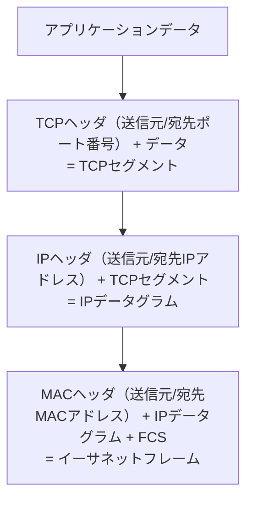
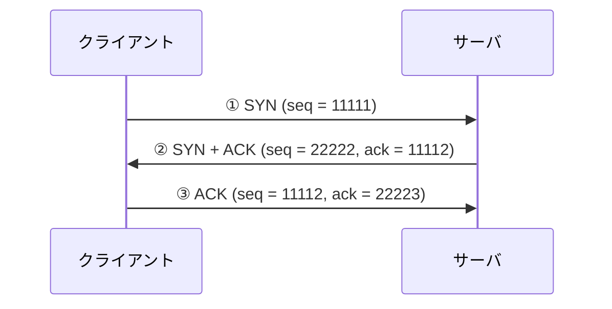
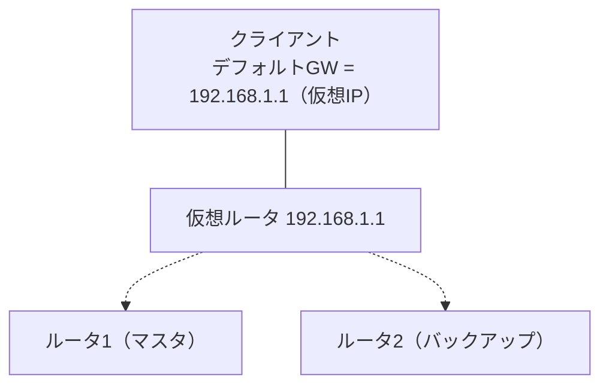
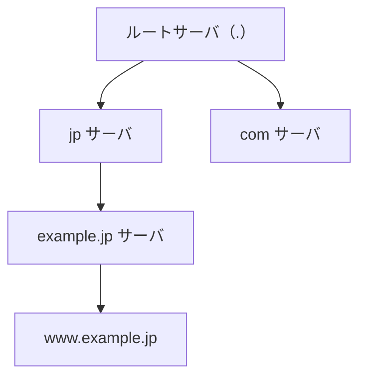

# 10-3 通信プロトコル

TCP/IPプロトコル群を扱う。午前IIの**最大の得点源**であり、16年分で124問（83の設問パターン）が出題されている。分野10全体のおよそ半分がここに集中する。

扱う範囲は広いが、骨格は単純である。**IPが「どこへ」を担い、TCP/UDPが「どのアプリケーションへ、どう確実に」を担い、その上に個々のアプリケーションプロトコルが載る**。そして、IPアドレスとMACアドレス、ドメイン名とIPアドレスという**2つの名前解決**（ARPとDNS）が全体を接着している。この構図を頭に置いて読み進めてほしい。

物理層・データリンク層の作りは [10-1](10-1-ネットワーク方式.md)、アクセス制御や経路制御アルゴリズムは [10-2](10-2-データ通信と制御.md) を参照。

## 目次

- [1. TCP/IPの階層とカプセル化](#1-tcpipの階層とカプセル化)
- [2. IPv4](#2-ipv4)
- [3. IPアドレスの設計計算](#3-ipアドレスの設計計算)
- [4. アドレス解決 — ARPとその仲間](#4-アドレス解決--arpとその仲間)
- [5. ICMP](#5-icmp)
- [6. マルチキャストとIGMP](#6-マルチキャストとigmp)
- [7. TCP](#7-tcp)
- [8. UDP](#8-udp)
- [9. NATとNAPT](#9-natとnapt)
- [10. VRRP](#10-vrrp)
- [11. DHCP](#11-dhcp)
- [12. DNS](#12-dns)
- [13. アプリケーション層プロトコル](#13-アプリケーション層プロトコル)
- [14. IPv6](#14-ipv6)

---

## 1. TCP/IPの階層とカプセル化

送信側では、アプリケーションのデータに下位層のヘッダが次々と付け加えられていく。これを**カプセル化**という。



この積み重ね順から、**フレームが線上に送り出される順序**がわかる。外側のヘッダほど先に送出されるので、宛先情報は

**宛先MACアドレス → 宛先IPアドレス → 宛先ポート番号**

の順に現れる。「MACが先」と覚えておけばよい。受信側の機器は、外側のヘッダから順に読んで自分が処理すべきかを判断していく。L2スイッチならMACヘッダまで、ルータならIPヘッダまで読めば仕事ができる、という構造になっている。

**上位プロトコルの識別**も各層のヘッダが担っている。

| 層 | 識別フィールド | 例 |
| --- | --- | --- |
| データリンク層 | イーサネットフレームの**タイプ** | IPv4 = 0x0800、IPv6 = 0x86DD、ARP = 0x0806 |
| ネットワーク層 | IPヘッダの**プロトコル番号** | ICMP = 1、TCP = 6、UDP = 17 |
| トランスポート層 | TCP/UDPヘッダの**ポート番号** | HTTP = 80、SMTP = 25 |

**「IPパケットで送られているデータがICMPメッセージであることを識別できるのは、IPヘッダのプロトコル番号」**である。MACヘッダのタイプ値ではIPv4かIPv6かまでしかわからない。

同じ理由で、**IPv4とIPv6でイーサネットフレームの何が変わるか**という問いの答えは**タイプの値**（0x0800 と 0x86DD）になる。SFDの値もMACアドレスの長さもデータの最大長も変わらない。

### 1.1 宛先の二重性

ホストAからルータ経由でホストBにパケットを送るとき、**IPデータグラムの宛先IPアドレスは最終目的地のホストBのまま変わらない**が、**イーサネットフレームの宛先MACアドレスは次に渡す相手（ルータのインタフェース）**になる。

```
[ホストA] --LAN1--> [ルータ] --LAN2--> [ホストB]

LAN1 を流れるフレーム:
  宛先MACアドレス = ルータのLAN1側インタフェース
  宛先IPアドレス  = ホストB
```

MACアドレスは**隣の相手**を指し、IPアドレスは**最終的な相手**を指す。ルータを越えるたびにMACアドレスは書き換えられ、IPアドレスは保たれる。この違いが理解できていれば、「LAN1におけるフレームの宛先とデータグラムの宛先の組合せ」を問う設問は迷わない。

> **出題** 宛先情報の送出順序: R5午前I問10 ｜ IPヘッダのプロトコル番号: R7午前II問7 ｜ IPv4とIPv6のパケット差異: R4午前II問10 ｜ フレームとデータグラムのあて先: H22午前I問12

---

## 2. IPv4

### 2.1 IPヘッダの要点

IPv4ヘッダは通常20オクテットで、試験で問われるフィールドは限られている。

| フィールド | 役割 |
| --- | --- |
| バージョン | 4 |
| ヘッダ長 | オプションがなければ20オクテット |
| TTL (Time To Live) | ルータを通過するたびに1減り、0になると破棄される。ループ防止 |
| **プロトコル番号** | 上位プロトコルの識別（ICMP=1、TCP=6、UDP=17） |
| **ヘッダチェックサム** | **ヘッダ部分だけ**が対象。データ部は対象外 |
| 送信元 / 宛先IPアドレス | 各32ビット |

**チェックサムの対象範囲**は繰り返し問われる。

| | 計算 | 対象範囲 |
| --- | --- | --- |
| IPヘッダ | 必須 | **ヘッダ部分だけ** |
| TCPヘッダ | **必須** | **データ部分も含む**（＋擬似ヘッダ） |
| UDPヘッダ | IPv4では省略可（0を指定）、IPv6では必須 | **データ部分も含む**（＋擬似ヘッダ） |

IPがヘッダしか検査しないのは、**IPの仕事は「正しく届けること」であって「中身の正しさ」は上位層の責任**だという役割分担による。宛先アドレスさえ壊れていなければIPとしては職務を果たせる。データの完全性はTCP/UDPのチェックサムが面倒を見る。

### 2.2 MTUとフラグメント

**MTU（Maximum Transmission Unit）**は、データリンクが一度に運べる**IPデータグラムの最大長**である。イーサネットでは1,500オクテット。

重要なのは**どこからどこまでがMTUか**である。MTUは**IPヘッダ＋上位層ヘッダ＋データ**であり、MACヘッダもFCSもプリアンブルも含まない。MACフレームのペイロード部分の上限、と考えればよい。

この定義から、送信できるデータ長が計算できる。TCPを使うとき、フラグメント化されずに送れるデータの最大長は

$$ 1500 - (\text{IPヘッダ } 20) - (\text{TCPヘッダ } 20) = 1460 \ \text{オクテット} $$

となる。この値を **MSS（Maximum Segment Size）**という。MACヘッダ14オクテットやFCS 4オクテットを引いてしまうのが典型的な誤りである。

MTUを超えるIPデータグラムは**フラグメント（分割）**される。分割されたパケットは最終宛先ホストで再組立てされるが、1つでも欠けると全体が失われるうえ、再組立てのバッファも消費する。そのためTCPは最初からMSS以下で送るよう調整する。

> **出題** MTUの範囲: H30午前II問4 ｜ 送信可能データ長: R3午前II問7、R5午前II問5 ｜ チェックサム: H23午前II問14

### 2.3 アドレス体系

IPv4アドレスは32ビットで、**ネットワーク部**と**ホスト部**に分かれる。かつては先頭ビットで固定的に区切る**クラス**方式だった。

| クラス | 先頭ビット | 第1オクテット | 既定のネットワーク部 | 用途 |
| --- | --- | --- | --- | --- |
| A | 0 | 0〜127 | 8ビット | 大規模（ホスト約1,677万） |
| B | 10 | 128〜191 | 16ビット | 中規模（ホスト約6万5千） |
| C | 110 | 192〜223 | 24ビット | 小規模（ホスト254） |
| **D** | **1110** | **224〜239** | — | **マルチキャスト** |
| E | 1111 | 240〜255 | — | 実験用 |

**クラスDはマルチキャストアドレス**である。「端末数250台程度の小規模」はクラスC、「65,000台程度の中規模」はクラスBで、これらと取り違えさせる選択肢が頻出する。

特殊なアドレスも押さえておく。これらは**ホストに割り当てられない**。

| アドレス | 意味 |
| --- | --- |
| ホスト部が全0 | ネットワークアドレス（そのネットワーク自体を指す） |
| ホスト部が全1 | ブロードキャストアドレス |
| 127.0.0.0/8 | ループバック（127.0.0.1 など） |
| 224.0.0.0/4 | マルチキャスト（クラスD） |
| 10.0.0.0/8、172.16.0.0/12、192.168.0.0/16 | プライベートアドレス |

「ホストのIPアドレスとして用いることができるもの」を選ぶ設問では、この表を順に当てはめる。たとえば `172.16.10.255/16` は、プレフィックスが /16 なのでブロードキャストは `172.16.255.255` であり、`172.16.10.255` は**普通のホストアドレスとして使える**。「末尾が255だからブロードキャスト」と早合点してはいけない。一方 `192.168.255.255/24` は /24 のブロードキャスト、`127.16.10.255/8` はループバック、`224.168.10.255/8` はクラスDなので、いずれも使えない。

### 2.4 CIDR

クラス方式では割当ての粒度が粗すぎて、アドレスが大量に無駄になった。これを解決したのが **CIDR（Classless Inter-Domain Routing）**である。

> **クラスA〜Cといった区分にとらわれずに、ネットワークアドレス部とホストアドレス部を任意のブロック単位に区切り、IPアドレスを無駄なく効率的に割り当てる方式**

`192.168.1.0/24` のように、ネットワーク部のビット数（プレフィックス長）を明示する記法を使う。

**サブネットマスク**は、ネットワーク部を1、ホスト部を0としたビット列である。**1は必ず左詰めで連続していなければならない**。したがって `255.255.255.128`（下位8ビットが `10000000`）は正しいマスクだが、`255.255.255.1`（`00000001`）、`255.255.255.32`（`00100000`）、`255.255.255.64`（`01000000`）はいずれも1が連続していないため不正である。

ネットワーク部の長さをネットワークごとに変えられる仕組みを**VLSM（可変長サブネットマスク）**という。端末が多いセグメントには広いブロックを、ルータ間接続のような2アドレスしか要らない区間には `/30` を、というように**必要な大きさに応じて割り当てられる**。VLSMを活かすにはルーティングプロトコルがサブネットマスク情報を運べる必要があり、これがRIP-1を使えない理由になる（→ [10-2](10-2-データ通信と制御.md)）。

> **出題** CIDR: R1午前II問6 ｜ 可変長サブネットマスクの形式: H25午前I問11 ｜ VLSMのアドレス設計: H26午前II問10、R3午前II問10、R7午前II問8 ｜ クラスDアドレス: H22午前II問12、H25午前II問10、H28午前II問8 ｜ ホストに使えるIPアドレス: R4午前II問12、R6午前II問13

---

## 3. IPアドレスの設計計算

計算問題は毎年のように出る。**ビット演算に落とし込む**のが確実な解き方である。

### 3.1 4つの基本演算

IPアドレスを $a$、サブネットマスクを $m$ とすると、

| 求めるもの | 式 | 意味 |
| --- | --- | --- |
| ネットワークアドレス | `a & m` | マスクが1の部分だけを残す |
| **ホストアドレス** | **`a & ~m`** | マスクが0の部分だけを残す |
| ブロードキャストアドレス | `a \| ~m` | ホスト部を全部1にする |
| 利用可能ホスト数 | $2^{(\text{ホスト部ビット数})} - 2$ | 全0と全1を除く |

**ホストアドレスを求める式は `a & ~m`** である。`~` はビット反転なので、`~m` はホスト部だけが1のマスクになる。これと論理積をとればホスト部が取り出せる。

### 3.2 計算例

**例1：ホストアドレスを求める**
IPアドレス `212.62.31.90`、サブネットマスク `255.255.255.224`（/27）。
第4オクテットだけを考えればよい。マスクの下位8ビットは `11100000` なので、ホスト部は下位5ビット。

$90 = 01011010_{(2)}$ の下位5ビットは $11010_{(2)} = 26$。

別の見方をすると、/27 はホスト部32個ごとの区切りなので、$90$ の直前の32の倍数は $64$、したがって $90 - 64 = 26$ である。

**例2：サブネットワークアドレスを求める**
IPアドレス `172.30.123.45`、サブネットマスク `255.255.252.0`（/22）。
第3オクテットで切れる。$123 = 01111011_{(2)}$、マスク $252 = 11111100_{(2)}$ なので論理積は $01111000_{(2)} = 120$。
よって `172.30.120.0`。

**例3：ブロードキャストアドレスを求める**
ネットワークアドレス `192.168.10.192/28`。
/28 なのでホスト部は4ビット、ブロック幅は16。範囲は `192.168.10.192`〜`192.168.10.207` であり、ブロードキャストは末尾の **`192.168.10.207`**。

**例4：利用可能ホスト数を求める**
クラスBのアドレスで、サブネットマスクが16進数 `FFFFFF80`。
`FFFFFF80` = `255.255.255.128` = /25 なのでホスト部は7ビット。

$$ 2^7 - 2 = 126 $$

全0（ネットワークアドレス）と全1（ブロードキャストアドレス）を引くのを忘れないこと。127ではなく **126** である。

**例5：必要なサブネット数からマスクを決める**
クラスCのアドレスを分割して、同じ大きさのサブネットを10個作りたい。ホスト数が最も多くなる分割は？

10個を表すには $2^3 = 8 < 10 \leq 2^4 = 16$ よりホスト部から**4ビット**借りる。クラスCは既定で/24だから、$24 + 4 = 28$ ビットとなり、マスクは **`255.255.255.240`**。借りるビットは必要最小限にするとホスト部が最大になる。

### 3.3 経路集約とスーパーネット化

複数の連続したネットワークを1つのより短いプレフィックスにまとめることを**経路集約**（**スーパーネット化**）という。ルーティングテーブルのエントリ数を削減できる。

**考え方**：対象アドレスを2進数で並べ、**先頭から何ビットまで全部一致しているか**を数える。その一致部分がプレフィックスになる。

**例1**：`192.168.32.0/24`、`192.168.33.0/24`、`192.168.34.0/24`、`192.168.35.0/24` の4つを集約する。
第3オクテットだけ異なるので、そこを2進数で書く。

| | 第3オクテット |
| --- | --- |
| 32 | `001000`**`00`** |
| 33 | `001000`**`01`** |
| 34 | `001000`**`10`** |
| 35 | `001000`**`11`** |

上位6ビットが共通なので、プレフィックス長は $16 + 6 = 22$。マスクは **`255.255.252.0`**、ネットワーク番号は最小の **`192.168.32.0`** である。

ちなみに「4つ＝$2^2$ 個を集約するからマスクを2ビット短くする」と考えても同じ結果になる。

**例2**：`192.168.1.0/24`〜`192.168.15.0/24` の15個を集約する。
第3オクテットの範囲は1〜15。4ビット（$2^4 = 16$）あれば0〜15を表せるので、上位4ビットが共通となりプレフィックス長は $16 + 4 = 20$。よって **`192.168.0.0/20`**（範囲は `192.168.0.0`〜`192.168.15.255`）。

**例3**：`192.168.10.0/24`〜`192.168.58.0/24` を集約するとき、**ネットワークアドレスのビット数が最も多くなる**（＝範囲が最も狭い）ものを選ぶ。
第3オクテットの範囲は10〜58。

- `/19` → 第3オクテット 0〜31 までしかカバーできず、58が入らない。
- `/18` → 0〜63 をカバーし、10〜58 が収まる。

したがって **`192.168.0.0/18`**。「すべてを含む」かつ「最も長いプレフィックス」を選ぶのがポイントである。

**例4**：`10.8.64.0/20`、`10.8.80.0/20`、`10.8.96.0/20`、`10.8.112.0/20` を集約し、**最も集約範囲が狭い**ものを選ぶ。
全体の範囲は `10.8.64.0`〜`10.8.127.255`。第3オクテットは64〜127の64個分なので6ビット、プレフィックス長は $16 + (8-6) = 18$。よって **`10.8.64.0/18`**。`/19` では64〜95までしか届かない。

> **出題** スーパーネット化: H21午前II問14、H23午前II問13、H27午前II問14、R6午前II問12（計4回） ｜ 経路集約: H24午前II問16、H28午前II問11、R4午前II問9（計3回） ｜ 集約範囲: R5午前II問12 ｜ ホストアドレスの算出: H21午前II問13、H27午前II問13、R3午前I問10、R6午前II問11 ｜ サブネットワークアドレス: H26午前I問11 ｜ ブロードキャストアドレス: H29午前II問12、R3午前II問14 ｜ 利用可能ホスト数: H26午前II問13、H30午前II問10 ｜ サブネット分割: H22午前II問15 ｜ サブネットの集約: H25午前II問14

---

## 4. アドレス解決 — ARPとその仲間

IPアドレスがわかっても、同じLAN上でフレームを届けるにはMACアドレスが要る。この変換を担うのが**ARP**である。

| プロトコル | 変換の向き | 動作 |
| --- | --- | --- |
| **ARP** | **IPアドレス → MACアドレス** | 「このIPアドレスの人、MACアドレスを教えて」とブロードキャストで問い合わせ、該当ホストがユニキャストで答える |
| **RARP** | **MACアドレス → IPアドレス** | 自分のMACアドレスから自分のIPアドレスを知る |
| DNS | ドメイン名 → IPアドレス | → [12. DNS](#12-dns) |

**RARP（Reverse ARP）**は、**電源オフ時にIPアドレスを保持できない装置**（ディスクレス端末など）が、**電源オン時に自装置のMACアドレスから自装置に割り当てられているIPアドレスを知る**ために使う、**データリンク層のプロトコル**である。問合せには**ブロードキャスト**を使う。現在ではDHCPに置き換えられているが、「ARPの逆」という対比で出題され続けている。

### 4.1 Gratuitous ARP

**Gratuitous ARP（GARP、無償ARP）**は、**ターゲットIPアドレスフィールドに自端末が使用するIPアドレスを入れて**MACアドレスを問い合わせる、特殊なARP要求である。

自分のアドレスを自分で問い合わせるのだから、本来答えは返ってこないはずである。その「返ってこないこと」自体に意味がある。

- **IPアドレスの重複検出**：もし応答が返ってきたら、そのIPアドレスを既に誰かが使っている。
- **周囲のARPテーブルの更新**：ブロードキャストで送られるので、受け取った機器は「このIPアドレスはこのMACアドレスだ」と学習し直す。VRRPでマスタが切り替わったときや、サーバのフェイルオーバ時に、新しい機器が自分の存在を周知するために使う。

通常のARP要求はターゲットIPアドレスに**通信したい相手**のIPアドレスを入れる。ここが唯一の違いである。

### 4.2 誰がARPを行うのか

**ARPは同じセグメント内でしか使えない**。ブロードキャストがルータを越えないからである。これを踏まえると「誰が誰のMACアドレスを解決するのか」が決まる。

```
[端末A] --- (L2SW X) --- [ルータ Z] --- (L2SW Y) --- [端末C]
   セグメント1                              セグメント2
```

端末Aから端末Cに通信するとき、

1. 端末Aは宛先IPアドレス（端末C）が別セグメントだと判断し、**デフォルトゲートウェイであるルータZのMACアドレス**をARPで解決してフレームを送る。
2. ルータZはパケットを受け取り、セグメント2側で**端末CのIPアドレスに対するMACアドレスをARPで解決**する。
3. L2スイッチXとYはMACアドレスで転送するだけで、IPアドレスとMACアドレスの対応付けには関与しない。

したがって、**端末CのIPアドレスとMACアドレスを対応付けるのはルータZ**である。端末Aは端末CのMACアドレスを知る必要すらない。なお**プロキシARP**（ルータが他のセグメントのホストに代わってARP応答を返す機能）が設定されている場合は話が変わるので、設問では「プロキシARPは設定されていない」と断り書きが付く。

> **出題** ARP: H21午前II問7、H28午前I問11 ｜ RARP: H21午前II問11、H23午前II問11、H25午前II問12（計3回） ｜ Gratuitous ARP: H28午前II問6 ｜ ARPの主体: H30午前II問6

---

## 5. ICMP

**ICMP（Internet Control Message Protocol）**は、IPの配送に関するエラー通知や状態問合せを行うプロトコルである。IPヘッダのプロトコル番号は1。`ping` や `traceroute` の土台でもある。

主なメッセージの対応を正確に覚えることが問われる。

| メッセージ | いつ送られるか |
| --- | --- |
| Echo Request / **Echo Reply** | 到達確認（ping）の要求と応答 |
| **Redirect** | **転送されてきたデータグラムを受信したルータが、そのネットワークのより最適なルータを送信元に通知して経路の変更を要請する** |
| Destination Unreachable | 宛先に到達できない。ソースルーティングの失敗もこれ（Source Route Failed） |
| **Time Exceeded** | TTLが0になった場合、または**フラグメントの再組立て中にタイムアウトが発生した場合** |
| Parameter Problem | IPヘッダのパラメタに誤りがある |
| Source Quench | 受信側のバッファがあふれ、送信の抑制を促す（現在は非推奨） |

誤答選択肢は組合せを入れ替えてくる。

- ソースルーティング失敗に **Echo Reply** を返す → 誤り（Destination Unreachable）
- 再組立てタイムアウトに **Parameter Problem** を返す → 誤り（Time Exceeded）
- バッファあふれに **Time Exceeded** を送る → 誤り（Source Quench）

**Redirect の方向**も重要である。ルータが**送信元ホストに対して**「もっと良いルータがいるよ」と教える。ルータ同士の経路交換ではない。

> **出題** ICMPメッセージ: H24午前II問10、H27午前II問7、H29午前II問7、R4午前II問6（計4回）

---

## 6. マルチキャストとIGMP

**マルチキャスト**は、1つのパケットを**特定のグループに属する複数のホスト**に配送する方式である。ユニキャスト（1対1）とブロードキャスト（1対全）の中間にあたり、動画配信やルーティングプロトコルの更新で使われる。

IPv4では**クラスD（224.0.0.0〜239.255.255.255）**をマルチキャストアドレスに使う。

- 先頭4ビットは **`1110`** である（`1111` ではない。`1111` はクラスEの実験用）。
- **先頭4ビットを除いた残り28ビットが、受信するホストのグループを識別する**ために使われる。
- 用途が**あらかじめ固定的に決められているのは一部だけ**である。たとえば 224.0.0.5 はOSPFルータ、224.0.0.9 はRIP-2用に予約されているが、239.0.0.0/8 は組織内で自由に使える。
- **TTL値によって配送範囲が制限される**。TTLを1にすれば同一セグメント内に留まる（TTLスコーピング）。「TTL値に関係なく中継される」は誤り。
- マルチキャストパケットは**NICのフィルタ機能で不要なものが落とされる**。「ネットワーク上の全てのホストが受信して上位層で判断する」というのはブロードキャストに近い説明であり、誤りである。

**IGMP（Internet Group Management Protocol）**は、**IPv4ネットワークのマルチキャスト通信で、ローカルセグメントにおいて配信を受けるホストのグループを管理する**プロトコルである。

- ホストが「このグループに参加したい／離脱したい」とルータに通知する。
- ルータが「このグループに参加しているホストはいるか」を定期的に確認する。

参加者がいなくなればルータはそのセグメントへの配信を止める。無駄なトラフィックを流さないための仕組みである。IPv6では**MLD（Multicast Listener Discovery）**が同じ役割を担う。

> **出題** IPv4マルチキャスト: H26午前II問4、H30午前II問11、R4午前II問13（計3回） ｜ マルチキャストアドレスの構造: R6午前II問7 ｜ IGMP: H24午前II問11、H27午前II問8、H30午前II問8、R4午前II問7（計4回）

---

## 7. TCP

**TCP（Transmission Control Protocol）**は、信頼性のあるコネクション型のトランスポートプロトコルである。順序制御、再送制御、フロー制御、輻輳制御をまとめて提供する。

### 7.1 3ウェイハンドシェイクとシーケンス番号

コネクション確立は3回のやり取りで行う。



**シーケンス番号**は送信するデータの位置を示し、**確認応答番号（受信確認番号）**は**次に受け取りたいデータの位置**を示す。ここがポイントで、「受け取ったシーケンス番号をそのまま返す」のではない。

- ①でクライアントが `seq = 11111` のSYNを送る。SYNは1オクテット分を消費する扱いなので、サーバが次に期待するのは `11112`。
- ②でサーバは自分の初期シーケンス番号 `22222` を送り、確認応答番号に `11112` を入れる。
- ③でクライアントは `seq = 11112`、確認応答番号に `22223`（サーバのSYNの次）を入れる。

③の値から逆算すれば②の値が決まる、という形で出題される。**確認応答番号 = 受け取ったシーケンス番号 + 受け取ったデータ長（SYN/FINは1として数える）**という関係を押さえておけばよい。

データ転送中も同じ原則で動く。応答を待たずに続けて送る場合、**次のシーケンス番号は「直前に送信したセグメントのシーケンス番号 ＋ そのセグメントの送信データのオクテット数」**になる。シーケンス番号は32ビットで、初期値はセキュリティのためランダムに選ばれる（0から始まるわけでも、65,535で折り返すわけでもない）。

### 7.2 状態遷移

サーバとクライアントはそれぞれ状態を遷移していく。

| 状態 | 意味 |
| --- | --- |
| CLOSED | 閉じている |
| **LISTEN** | **サーバが接続要求（SYN）を待ち受けている**。ここでSYNを受け付ける |
| SYN-SENT | クライアントがSYNを送り、応答を待っている |
| SYN-RECEIVED | サーバがSYNを受け取り、SYN+ACKを送って最後のACKを待っている |
| ESTABLISHED | コネクション確立済み |
| TIME-WAIT | 切断後、遅れて届くパケットのために一定時間待つ |

**サーバがSYNフラグの付いたパケットを受け付けるのは LISTEN 状態のとき**である。SYN-RECEIVEDは既にSYNを受け取った後の状態なので、取り違えないこと。

### 7.3 ウィンドウサイズと輻輳制御

TCPヘッダの**ウィンドウサイズ**は、**受信側からの確認応答を待たずにデータを続けて送信できるかどうかの判断に使用される**。受信側が「あと何オクテット受け取れるか」を広告し、送信側はその範囲内で応答を待たずに送る（→ スライディングウィンドウの原理は [10-2](10-2-データ通信と制御.md)）。

よくある誤答は次のとおりである。

- 「送信側が再送に備えて保持しているデータのサイズを知らせる」→ 誤り。広告するのは受信側の空き容量。
- 「接続開始時のハンドシェイクで最適なバッファサイズを決定する」→ 誤り。ウィンドウサイズは通信中に動的に変化する。
- 「後続するセグメント数を知らせる」→ 誤り。単位はセグメント数ではなくオクテット数。

受信側の都合で決まるウィンドウ（受信ウィンドウ）とは別に、**網の混雑具合から送信側が自分で決める輻輳ウィンドウ**がある。実際に送れる量は両者の小さいほうになる。輻輳ウィンドウを制御するアルゴリズムには次のようなものがある。

| アルゴリズム | 考え方 |
| --- | --- |
| スロースタート / 輻輳回避 | 小さく始めて指数的に増やし、一定を超えたら線形に増やす |
| Reno / NewReno | パケット損失を輻輳の合図とみなし、ウィンドウを半減させる |
| CUBIC | 損失ベース。高速・長距離回線向けに増加曲線を改良 |
| **BBR**（Bottleneck Bandwidth and Round-trip propagation time） | **損失ではなく、ボトルネック帯域と往復伝搬時間を推定して送信レートを決める** |

**TCPの輻輳制御アルゴリズムとして出題されるのはBBR**である。誤答に並ぶ HMAC（メッセージ認証符号）、RSA（公開鍵暗号）、SPF（OSPFの最短経路計算）はいずれも輻輳制御とは無関係である。

> **出題** 3ウェイハンドシェイク: H22午前II問14、H25午前II問13 ｜ シーケンス番号と確認応答番号: H23午前II問12、R6午前II問9 ｜ TCPの状態遷移: R7午前II問11 ｜ ウィンドウサイズ: H28午前II問12 ｜ 輻輳制御アルゴリズム: R5午前II問4

---

## 8. UDP

**UDP（User Datagram Protocol）**は、**IPの上位階層のプロトコルとして、コネクションレスのデータグラム通信を実現し、信頼性のための確認応答や順序制御などの機能をもたない**プロトコルである。

機能を削ったことが欠点ではなく目的である。コネクション確立の往復が不要なので**速く始められ**、再送しないので**遅延が一定**になり、1対多の配信もできる。「多少落ちても困らないが遅れては困る」通信、あるいは「問合せと応答が1往復で終わる」通信に向く。

| | TCP | UDP |
| --- | --- | --- |
| 接続 | コネクション型（3ウェイハンドシェイク） | コネクションレス |
| 信頼性 | 確認応答・再送・順序制御あり | なし |
| 制御 | フロー制御・輻輳制御あり | なし |
| ヘッダ長 | 20オクテット以上 | 8オクテット |
| 1対多 | 不可 | 可（ブロードキャスト・マルチキャスト） |

**TCPとUDPの両方のヘッダに存在するもの**を問う設問が3回出ている。答えは**送信元ポート番号**（および宛先ポート番号、チェックサム、データ長に相当する情報）である。宛先IPアドレスとTTLはIPヘッダ、宛先MACアドレスはMACヘッダにあり、トランスポート層のヘッダには含まれない。

**UDPを使う代表的なプロトコル**も頻出である。

| UDPを使う | TCPを使う |
| --- | --- |
| **DHCP**、**NTP**、SNMP、TFTP、RIP、**DNS**（通常の問合せ）、RTP | FTP、HTTP、SMTP、POP3、IMAP4、TELNET、SSH、BGP、LDAP、**DNS**（ゾーン転送や大きな応答） |

DNSは問合せ応答にUDP（512オクテットを超える応答やゾーン転送ではTCP）を使う点が例外的である。「UDPを使用するプロトカルはどれか」でDHCP、「UDPを使用しているものはどれか」でNTPが答えになった実績がある。

> **出題** UDP: H26午前I問10 ｜ トランスポート層のプロトコル: H25午前I問12 ｜ UDPを使うプロトコル: H27午前II問11、H29午前II問10、R4午前I問10 ｜ TCPとUDPの共通ヘッダ項目: H28午前II問10、R3午前II問13、R6午前II問10（計3回）

---

## 9. NATとNAPT

**NAT（Network Address Translation）**はプライベートアドレスとグローバルアドレスを1対1で変換する。**NAPT（Network Address Port Translation、IPマスカレード）**は**ポート番号も併せて変換**することで、1つのグローバルアドレスを複数の内部ホストで共有できるようにする。

```
内部 192.168.1.10:51000 ┐                          ┌→ 外部サーバ
内部 192.168.1.11:49200 ┼→ [NAPT] 203.0.113.5:xxxx ┤
内部 192.168.1.12:52300 ┘   変換表で対応を記憶      └→
```

NAPTには副次的な**セキュリティ上の効果**がある。変換表は内部からの通信をきっかけに作られるため、**外部から内部ホストを名指しで呼び出すことができない**。つまり**内部ネットワークからインターネットにアクセスする利用者PCについて、インターネットからの不正アクセスを困難にできる**。

ただしこれは「ついでの効果」であって、ファイアウォールの代わりにはならない。NAPTは次のことはできない。

- DMZ上の公開Webサーバの脆弱性を悪用する攻撃の防御（外部から到達できるサーバが対象なので無関係）
- 侵入検知と遮断（それはIDS/IPSの仕事 → [11-4](../11-security/11-4-情報セキュリティ対策.md)）
- 特定のWebサービスを利用するHTTP通信の検知・遮断（それはプロキシやURLフィルタの仕事）

> **出題** NAPT: R1午前I問12

---

## 10. VRRP

**VRRP（Virtual Router Redundancy Protocol）**は、**同一のLANに接続された複数のルータを、仮想的に1台のルータとして見えるようにして冗長構成を実現する**プロトコルである。

クライアントのデフォルトゲートウェイは1つしか設定できないので、そのルータが故障すると外部と通信できなくなる。VRRPは複数の物理ルータに**仮想IPアドレスと仮想MACアドレス**を共有させ、クライアントにはその仮想アドレスをデフォルトゲートウェイとして設定させる。通常はマスタルータが応答し、マスタが故障するとバックアップルータが仮想アドレスを引き継ぐ。



ポイントは**クライアントの設定を変えることなくデフォルトゲートウェイの障害を回避できる**点にある。切替時にはGratuitous ARPを送ってスイッチのMACアドレステーブルを更新させる。

紛らわしい略語との区別：RARP（MACからIPを得る）、RSTP（レイヤ2のループ防止 → [10-1](10-1-ネットワーク方式.md)）、RTSP（ストリーミングの遠隔制御）。

> **出題** VRRP: H21午前II問16、H27午前II問12、R1午前II問10

---

## 11. DHCP

**DHCP（Dynamic Host Configuration Protocol）**は、端末にIPアドレス・サブネットマスク・デフォルトゲートウェイ・DNSサーバアドレスなどを自動的に配布するプロトコルである。UDP（サーバ67、クライアント68）を使う。

端末はまだIPアドレスを持っていないので、最初の要求（DHCPDISCOVER）は**ブロードキャスト**で送るほかない。ここに問題がある。**ブロードキャストはルータを越えない**ため、DHCPサーバが別のセグメントにあると要求が届かないのである。

これを解決するのが**DHCPリレーエージェント**である。ルータ（またはL3スイッチ）がブロードキャストのDHCP要求を受け取り、**ユニキャストに変換して別セグメントのDHCPサーバへ転送**する。応答も逆方向に中継する。

したがって、**DHCPリレーエージェントが必要になるのは、ネットワークが「ルータ」で接続されている場合**である。スイッチングハブ、ブリッジ、リピータはいずれもブロードキャストを透過させるので、リレーエージェントは不要である。この設問は2回出題されており、**「ブロードキャストドメインを分割するのはルータだけ」**（→ [10-1](10-1-ネットワーク方式.md)）という知識がそのまま答えになる。

> **出題** DHCPリレーエージェント: H21午前II問8、R1午前II問7

---

## 12. DNS

### 12.1 階層構造と名前解決

**DNS（Domain Name System）**はドメイン名とIPアドレスを対応付ける分散データベースである。世界中の情報を1台で持つのは不可能なので、ドメイン名を階層化し、各階層の管理者が自分の範囲だけを責任をもって管理する。



**インターネット上のDNSサーバは階層化されており、ある名前に対して情報がない場合は上位のDNSサーバに問い合わせる。**これがDNSの基本である。

サーバとクライアントの役割を正確に区別する。

| 用語 | 役割 |
| --- | --- |
| **権威DNSサーバ** | 自分が管理するゾーンの情報を保持し、問合せに権威をもって答える |
| **キャッシュDNSサーバ（フルサービスリゾルバ）** | クライアントに代わってルートから順に問い合わせ、結果をキャッシュする |
| **ネームリゾルバ（スタブリゾルバ）** | **クライアント側で動作し、DNSサーバに問合せを行う**プログラム |

**ネームリゾルバは「問い合わせる側」**である。「クライアントからの要求に応答し、データベースを使用してIPアドレスを返すプログラム」という説明はDNSサーバのものであり、誤りである。

**プライマリサーバとセカンダリサーバ**は冗長化のための構成である。セカンダリはプライマリから**ゾーン転送**によってゾーン情報の複製を受け取るので、**プライマリと同じ内容のデータベースを保持する**。「異なる内容のデータベースを保持している」は誤りである。

また、**リソースレコードは構築後も更新できる**。「DNSサーバの構築時に登録され、更新することができない」も誤り。

### 12.2 名前とアドレスの対応関係

**一つのホスト名に複数のIPアドレスを対応させることも、複数のホスト名に同一のIPアドレスを対応させることもできる。**つまり多対多の対応が可能である。

- 1つの名前に複数アドレス：DNSラウンドロビンによる簡易な負荷分散
- 複数の名前に1つのアドレス：1台のサーバで複数のWebサイトを運用する（バーチャルホスト）

この自由度の高さが前提となって、CDNや負荷分散の仕組みが成り立っている（→ [10-5](10-5-ネットワーク応用.md)）。

### 12.3 リソースレコード

ゾーンファイルに書く1行1行を**リソースレコード（RR）**という。種類ごとの役割を正確に覚えることが繰り返し問われる。

| レコード | 役割 |
| --- | --- |
| **A** | **ホスト名からIPv4アドレスへの対応**を示す |
| **AAAA** | ホスト名から**IPv6アドレス**への対応を示す |
| **CNAME** | ホスト名に**別名**を付ける |
| **MX** | **ドメイン宛の電子メールを受け付けるメールサーバ**を指定する |
| **NS** | **そのゾーン自身や下位ドメインに関するDNSサーバのホスト名**を指定する |
| **PTR** | IPアドレスから名前への対応（**逆引き**） |
| **SOA** | ゾーンの管理情報。**他のDNSサーバのキャッシュに情報を残す許可時間や、ゾーン情報の更新をチェックする間隔**などを指定する。ゾーン内の登録データの開始マーク |

誤答はレコードの役割を入れ替えてくるので、次の点に注意する。

- **PTRは「IPアドレス → 名前」**。「名前に対応するIPアドレスを指定する」のはAレコードである。
- **MXはメールサーバを「ホスト名」で指定する**。IPアドレスでは指定できない。
- **MXのプリファレンス値は小さいほうが優先度が高い**。大きいほうが高いというのは誤り。
- **MXレコードの先頭フィールド（NAMEフィールド）にはメールアドレスのドメイン名**を記述する。
- **MXレコードにメールサーバの別名は記述できない**（正規のホスト名を書く）。NSレコードも同様で、RDATAには正規のホスト名を書き、別名は使えない。
- **NSレコードは権限委譲に使う**。ゾーンを分割してサブドメインを別のサーバに管理させる場合、そのネームサーバをNSレコードで指定する。NSレコードの先頭フィールドにはゾーンのドメイン名、RDATAにはネームサーバのホスト名を書く。
- **電子メールの送信だけに利用されるリソースレコードはMX**である。NS・PTR・SOAはメール以外でも使われる。

### 12.4 国際化ドメイン名（IDN）

**IDN（Internationalized Domain Name）**は、漢字やアラビア文字などASCII以外の文字を含むドメイン名である。

DNSのプロトコル自体はASCIIしか扱えないため、**通信する際に、漢字やアラビア文字などのドメイン名を、ASCII文字だけから成る文字列のドメイン名に一定の規則で変換する**。この変換規則が**Punycode**で、変換後は `xn--` で始まる文字列になる。

なお、IDNは「`.com` や `.net` のようなトップレベルドメイン」のことでも、「`.jp` や `.uk` のような国別トップレベルドメイン」のことでもない。また、全角英数字は正規化によって半角英数字と同一に扱われるため、「異なるドメイン名として扱われる」という記述も誤りである。

> **出題** DNSの階層構造: H21午前II問9 ｜ 名前とIPの対応: H22午前II問10、H26午前II問8、H30午前II問7、R3午前II問9（計4回） ｜ Aレコード: H24午前II問9 ｜ AAAAレコード: H26午前II問6 ｜ リソースレコード全般: H27午前II問1 ｜ MXレコード: H29午前II問6、R3午前II問2、R4午前II問5 ｜ NSレコード: R1午前II問8 ｜ IDN: H26午前II問15

---

## 13. アプリケーション層プロトコル

### 13.1 ポート番号

サーバ側のポート番号（ウェルノウンポート）は暗記事項である。

| ポート | プロトコル | ポート | プロトコル |
| --- | --- | --- | --- |
| 20 / 21 | FTP（データ / 制御） | 123 | NTP |
| 22 | SSH | 143 | IMAP4 |
| 23 | TELNET | 161 / 162 | SNMP / SNMP Trap |
| 25 | SMTP | 179 | BGP |
| 53 | DNS | 389 | LDAP |
| 67 / 68 | DHCP（サーバ / クライアント） | **443** | **HTTPS** |
| 69 | TFTP | 514 | syslog |
| **80** | **HTTP** | 520 | RIP |
| 110 | POP3 | **587** | **サブミッションポート** |

URLのスキームからポート番号を読み取る設問が3回出ている。たとえば

```
https://ftp.example.jp/index.cgi?port=123
```

でブラウザが接続するポートは、**スキームが `https` なので 443** である。ホスト名の `ftp` もクエリ文字列の `port=123` も**ひっかけ**であり、接続先ポートを決めるのはスキームだけである（ポートを明示したい場合は `https://host:8443/` のようにホスト名の後ろにコロンで書く）。

### 13.2 HTTP

HTTPリクエストメッセージは **リクエスト行 → ヘッダー → メッセージボディ** の順に構成される。

HTMLフォームのデータがどこに入るかはメソッドで変わる。

| メソッド | データの場所 |
| --- | --- |
| **GET** | **リクエスト行**（URLの後ろにクエリ文字列として付く） |
| **POST** | **メッセージボディ** |

GETはURLに現れるのでブックマークでき、キャッシュもされるが、長さに制限があり、ログに残るため秘密情報には向かない。POSTはボディに入るのでこれらの制約がない。この違いが「検索はGET、登録はPOST」という使い分けの根拠になっている。

HTTP/1.1 では **GET と HEAD の実装が必須**で、**POSTはオプション**である。「GETはサーバへの送信、POSTはサーバからの応答」（どちらもクライアントからの要求）、「POSTはCGIを起動できるがGETはできない」（どちらも起動できる）といった選択肢は誤りである。

**HTTP認証**には2方式がある。

| 方式 | クライアントの処理 |
| --- | --- |
| **ベーシック認証** | **利用者IDとパスワードを「:」で連結したものをBASE64でエンコードし、Authorizationヘッダで指定する** |
| ダイジェスト認証 | サーバから受け取ったnonceと利用者ID・パスワードからハッシュ値（MD5など）を計算し、Authorizationヘッダで指定する |

**BASE64は暗号化ではなく符号化**である。誰でも元に戻せるので、ベーシック認証は必ずTLSと併用する必要がある。ダイジェスト認証はチャレンジレスポンス方式（→ [10-2](10-2-データ通信と制御.md)）を使うのでパスワードそのものは流れないが、「IDとパスワードを連結したものをMD5でエンコードする」という単純な処理ではない。

### 13.3 WebDAV と WebSocket

**WebDAV（Web-based Distributed Authoring and Versioning）**は、**HTTPを使ってWebサーバのコンテンツのアップロードや更新を可能にするプロトコル**である。より正確には、**HTTPを拡張したプロトコルを使って、サーバ上のファイルの参照や作成、削除及びバージョン管理が行える**。HTTPにPROPFIND、MKCOL、COPY、MOVE、LOCKといったメソッドを追加して実現している。

**WebSocket**は、**Webブラウザとサーバ間でリアルタイム性の高い双方向通信**を行うためのプロトコルである。

- **通信はHTTPのGETメソッドで始まる**。クライアントが `Upgrade: websocket` ヘッダを付けたHTTPリクエストを送り、サーバが応じるとプロトコルが切り替わる（ハンドシェイク）。
- 以後はHTTPのリクエスト／レスポンスの枠を外れ、どちらからでも任意のタイミングでデータを送れる。
- **接続開始を要求できるのはクライアント側だけ**である。サーバから接続を開始することはできない。
- URIのスキームは **`ws://` / `wss://`** である（`http` / `https` ではない）。ただしポート番号は80 / 443を使う。
- データ形式はXMLに限定されない。

従来、ブラウザからサーバへの非同期通信には **XMLHttpRequest**（Ajaxの基盤 → [10-5](10-5-ネットワーク応用.md)）が使われたが、これはクライアントからの要求が起点になるためサーバ発の通知ができない。WebSocketはこの制約を取り払うために作られた。

### 13.4 電子メール

メールの配送は**送信系（SMTP）**と**受信系（POP3 / IMAP4）**に分かれる。


**SMTPのコマンド**の順序と役割が問われる。

| コマンド | 役割 |
| --- | --- |
| HELO / **EHLO** | **セッションの開始**。EHLOはESMTP（拡張SMTP）用で、**サーバは利用できる拡張機能の一覧を応答する** |
| **MAIL FROM** | **差出人**のメールアドレスを指定 |
| **RCPT TO** | **宛先**のメールアドレスを指定。宛先が複数ある場合は**RCPTコマンドを宛先の数だけ繰り返す** |
| DATA | ここからメール本文を送る |
| QUIT | セッション終了 |

誤りやすい点を整理する。

- **拡張機能の一覧を応答するのはEHLOに対して**であり、HELOに対してではない。
- **宛先が複数あっても、1つのRCPTコマンドにまとめて指定することはできない**。
- **差出人はMAIL FROMコマンドで指定する**。DATAコマンドではない（DATA以降のヘッダにもFrom:は書かれるが、配送に使われるのはMAIL FROMのほうである）。
- **迷惑メール防止のため、メールクライアントからの送信とサーバ間の転送で異なるポート番号を利用できる**。クライアントからの送信には**サブミッションポート587**、サーバ間転送には25を使う。これはOP25Bと組み合わせたスパム対策の基盤になっている（→ [11-4](../11-security/11-4-情報セキュリティ対策.md)）。

**MIME（Multipurpose Internet Mail Extensions）**は、ASCII以外の文字や添付ファイルをメールで送るための拡張である。日本語のヘッダは `=?文字コード?エンコード方式?符号化文字列?=` の形式（MIMEエンコードワード）で表される。

From フィールドで表示名とアドレスを両方指定する書式は、**表示名が先、メールアドレスを山括弧で囲んで後ろ**に置く。

```
From: =?ISO-2022-JP?B?GyRCPnBKc0JATzobKEI=?= <taro@example.jp>
```

### 13.5 FTP

**FTP（File Transfer Protocol）**は、1回のファイル転送に**2つのコネクション**を使う点が特徴である。

> **二つのコネクションはデータ転送用と制御用に分かれており、データ転送中でも制御コマンドを送信することが可能である。**

制御用（ポート21）は接続中ずっと維持され、データ用は転送のたびに作られる。制御を分離したことで、巨大なファイルの転送中でも中断（ABOR）などの指示を送れる。

データ用コネクションの張り方には2つのモードがある。

| モード | データ用コネクションの向き |
| --- | --- |
| アクティブモード | **サーバからクライアントへ**接続する。クライアントがPORTコマンドで自分のポートを通知する |
| **パッシブモード** | **クライアントからサーバへ**接続する。クライアントが**PASVコマンド**でサーバ側のデータ転送ポートを要求する |

**パッシブモードでは、制御用もデータ用も、どちらのコネクションの確立もクライアントからサーバに対して行う。**

アクティブモードが問題を起こすのは、クライアントがファイアウォールやNAPTの内側にいる場合である。サーバからクライアントへの内向き接続は通常ブロックされてしまう。パッシブモードはすべてクライアント発信になるのでこの問題が起きない。現在のWebブラウザやFTPクライアントが既定でパッシブモードを使うのはこのためである。

**PASVコマンド**は「**データ転送用コネクションをクライアント側から接続するために、サーバ側のデータ転送ポートを要求する**」コマンドである。対になるPORTコマンドはアクティブモードで**クライアント側**のポートを通知するものなので、向きが逆である。

### 13.6 LDAP

**LDAP（Lightweight Directory Access Protocol）**は、利用者情報や組織情報をツリー構造で管理するディレクトリサービスにアクセスするプロトコルである。

- OSIのディレクトリサービス **X.500** を簡略化して作られた。**X.500のプロトコルを包含しているわけではなく、機能を絞った軽量版**である。「機能を追加して作成され、X.500シリーズのプロトコルを包含している」は誤り。
- **ディレクトリツリーへのアクセス手順や、データ交換フォーマット（LDIF）が規定されている**。
- **TCP（ポート389、TLS版は636）を使う**。「TCPは使わずUDPで通信し、信頼性はLDAP自身で確保する」は誤り。
- ルートDSE（DSA-Specific Entry）は**各サーバが持つ自分自身の情報**であり、「インターネット上のLDAPサーバの最上位サーバ」ではない。DNSのような世界規模の階層は構成しない。

> **出題** URLとポート番号: H23午前II問17、H25午前II問15、H30午前II問14（計3回） ｜ HTTPのGET/POST: H21午前II問10、R7午前II問6 ｜ HTTP認証: H24午前II問17 ｜ WebDAV: H21午前II問12、H24午前II問18、R1午前II問14、H28午前II問14、R5午前II問13 ｜ WebSocket: H28午前II問15、H30午前II問15 ｜ SMTP: H29午前II問9、R1午前II問9、R4午前II問8 ｜ MIME: H25午前II問16 ｜ FTP: H25午前II問8、H29午前II問14、R1午前II問13、R7午前II問14 ｜ LDAP: H30午前II問9

---

## 14. IPv6

### 14.1 IPv4からの変更点

IPv6はアドレス枯渇への対応として作られたが、変更点はアドレス長だけではない。

| 項目 | IPv4 | IPv6 |
| --- | --- | --- |
| アドレス長 | 32ビット | **128ビット** |
| 表記 | 10進数 | **16進数**（`2001:db8::1` のようにコロン区切り） |
| ヘッダ | 可変長（オプションあり） | 固定40オクテット＋拡張ヘッダ |
| **ヘッダチェックサム** | あり | **廃止** |
| フラグメント | ルータでも可能 | 送信元ホストのみ |
| IPsec | オプション | **サポートが必須とされた**（RFC 4294）。のちにRFC 6434で推奨（SHOULD）に緩和 |
| ブロードキャスト | あり | **なし**（マルチキャストで代替） |
| エニーキャスト | 標準にはない | **あり** |
| フローラベル | なし | **あり** |
| アドレス自動設定 | DHCPが必要 | **ルータからの情報で自動設定できる（SLAAC）** |

**IPv4とIPv6の両方にある機能はマルチキャスト**である。フローラベルとエニーキャストはIPv6のみ、ヘッダチェックサムはIPv4のみ、という切り分けがそのまま出題される。

ヘッダチェックサムが廃止されたのは、**データリンク層（イーサネットのFCS）と上位層（TCP/UDPのチェックサム）で二重三重に検査されており、ルータが1ホップごとに再計算するコストに見合わないと判断された**ためである。この簡素化によって**ルータでの中継処理はむしろ軽くなる**。「アドレスフィールドが拡張されたので中継処理の遅延が増加する」というのは誤りである。

IPv6の仕様変更として出題されたのは「**IPレベルのセキュリティ機能（IPsec）である認証と改ざん検出機能がサポート必須となり、パケットを暗号化したり送信元を認証したりすることができる**」である。なお、アドレス空間は32ビットから**128ビット**（64ビットではない）への拡張であり、チェックサムフィールドは追加ではなく廃止された点にも注意する。

### 14.2 アドレスの種類

先頭のビットパターンでアドレスの用途が決まる。

| プレフィックス | 種類 |
| --- | --- |
| `2000::/3` | グローバルユニキャストアドレス |
| `FC00::/7` | ユニークローカルアドレス（IPv4のプライベートアドレス相当） |
| **`FE80::/10`** | **リンクローカルユニキャストアドレス** |
| **`FF00::/8`** | **マルチキャストアドレス** |
| `::1/128` | ループバック |

**リンクローカルユニキャストアドレス**（`fe80::` で始まる）は、**そのアドレスをもつネットワークインタフェースから、ルータを介さずに直接接続できる相手との通信にだけ使用できるアドレス**である。同一リンク内で完結し、ルータを越えない。

誤答として並ぶ説明を区別しておく。

- 「下位のビットにIPv4アドレスを埋め込む」→ IPv4射影アドレス（`::ffff:0:0/96`。上位80ビットが0、続く16ビットが1であり、「上位96ビットを全て1」ではない）
- 「グローバルアドレスが取得できなかったときだけ有効」→ 誤り。リンクローカルアドレスはグローバルアドレスの有無にかかわらず**常に自動生成され併存する**
- 「自分自身のPC内で動作しているプログラムとだけ通信できる」→ ループバックアドレス `::1`

### 14.3 プレフィックス長の判定

IPv6アドレスは16ビットごとにコロンで区切るので、**プレフィックス長をコロンの区切りに換算する**と判定しやすい。

`2001:db8:100:1000::/56` の場合、48ビットまでが `2001:db8:100`、残り8ビットは4番目のグループ `1000` の**上位8ビット（`10`）**までである。したがって同じサブネットに属するには、4番目のグループが `10xx` の形をしていればよい。

- `2001:db8:100:1010::` と `2001:db8:100:1020::` → どちらも `10` で始まる → **同じ/56サブネット**
- `2001:db8:100:1100::` と `2001:db8:100:1200::` → `11`、`12` なので異なる
- `2001:db8:100:1000::` と `2001:db8:100:2000::` → `10`、`20` なので異なる

`::` は「0が連続する部分の省略」を意味するので、`2001:db8:100::aa:bb` は4番目のグループが `0000` であることに注意する。

### 14.4 ICMPv6と近隣探索

IPv6にはARPがない。**IPv4におけるARPのMACアドレス解決機能を、IPv6では ICMPv6 が実現する**。具体的には ICMPv6 の**近隣探索（NDP: Neighbor Discovery Protocol）**メッセージが担う。

近隣探索は、ARPの機能に加えていくつもの役割を一手に引き受けている。

| 機能 | 内容 |
| --- | --- |
| アドレス解決 | IPv6アドレスからMACアドレスを求める（ARP相当） |
| **重複アドレス検出（DAD）** | **自分が使おうとするIPv6アドレスが他のノードと重複していないかを検出する** |
| ルータ探索 / プレフィックス通知 | ルータ広告（RA）でプレフィックスを配り、ホストのアドレス自動設定（SLAAC）を可能にする |
| 到達性確認 | 近隣ノードが生きているかを確認する |

近隣探索メッセージの使われ方として出題されたのは**重複アドレス検出**である。誤答との区別は次のとおり。

- パスMTUの決定 → ICMPv6の **Packet Too Big** メッセージによるパスMTU探索であり、近隣探索メッセージではない。
- DHCPv6サーバのアドレス取得 → 近隣探索は行わない。ルータ広告のフラグでDHCPv6を使うべきことを示すだけである。
- リンクローカルアドレスのプレフィックス取得 → `fe80::/10` と決まっているので取得の必要がない。

### 14.5 IPv4との共存技術

IPv4とIPv6は直接には通信できないため、移行期を支える技術が用意されている。

| 技術 | 内容 |
| --- | --- |
| デュアルスタック | 1台のホストが両方のスタックをもつ。最も素直だが両方のアドレスが要る |
| トンネリング（**6to4**、**Teredo**） | **IPv6パケットをIPv4パケットで包んで**IPv4網を通す。両端はIPv6同士 |
| **IPv4/IPv6トランスレーション** | **プロトコルを変換する**。IPv6しか話せないホストとIPv4しか話せないホストを仲介できる |

**「IPv6プロトコルスタックしかもたないホストと、IPv4プロトコルスタックしかもたないホストとの間で通信する技術」はトランスレーション**である。6to4やTeredoは**IPv6同士をIPv4網越しに結ぶ**トンネリング技術なので、両端が異なるプロトコルの場合には使えない。キャリアグレードNATはIPv4アドレスを節約するための大規模NATであり、IPv6とは関係がない。

> **出題** IPv6の仕様変更: H22午前II問11、H27午前II問9 ｜ IPv4とIPv6の共通機能: H24午前II問13 ｜ IPv6アドレスの仕様: H29午前II問8 ｜ リンクローカルアドレス: H26午前II問1 ｜ IPv6マルチキャストアドレス: H23午前II問10 ｜ プレフィックス長: H24午前II問14 ｜ ICMPv6によるアドレス解決: H26午前II問9、R6午前II問6、R5午前II問1 ｜ 近隣探索メッセージ: R7午前II問12 ｜ 移行技術: H25午前II問9

---

## この章のまとめ

- カプセル化の順から、宛先情報は**MAC → IP → ポート番号**の順に送出される。上位プロトコルの識別はタイプ値・プロトコル番号・ポート番号が担う。
- **MTUはIPヘッダ＋上位ヘッダ＋データ**。イーサネットでMSSは $1500-20-20=1460$。
- IPアドレス計算は **`a & m`（ネットワーク）／`a & ~m`（ホスト）／`a | ~m`（ブロードキャスト）／$2^h-2$（ホスト数）** の4式に帰着する。経路集約は**共通する先頭ビット数**を数える。
- **ARPはIP→MAC、RARPはMAC→IP**。Gratuitous ARPは自分のIPアドレスを自分で問い合わせ、重複検出とARPテーブル更新に使う。ARPはセグメントを越えないので、別セグメント宛の解決はルータが行う。
- ICMPの **Redirect はルータから送信元ホストへの経路変更要請**。TTL切れと再組立てタイムアウトは **Time Exceeded**。
- マルチキャストは**クラスD（先頭4ビット `1110`）**、グループ管理は**IGMP**。
- TCPの**確認応答番号は「次に欲しい位置」**。SYNを受け付ける状態は **LISTEN**。ウィンドウサイズは**応答を待たずに送れる量**。輻輳制御アルゴリズムの新顔が **BBR**。
- UDPは**コネクションレスで確認応答も順序制御もない**。TCPとUDPの共通項は**ポート番号**。DHCP・NTP・SNMPはUDP。
- DNSは**階層構造＋上位への委譲**。**Aは名前→IPv4、AAAAは名前→IPv6、PTRはIP→名前、MXはメールサーバ（ホスト名・値が小さいほど優先）、NSは権限委譲、SOAはゾーン管理情報**。
- HTTPは**GETがリクエスト行、POSTがメッセージボディ**。ベーシック認証は**BASE64**（暗号化ではない）。WebSocketは**GETで始まるハンドシェイク**。
- FTPは**制御用とデータ用の2コネクション**。パッシブモードでは**両方ともクライアントから**張る。
- IPv6は**128ビット・チェックサム廃止・ブロードキャストなし**。ARPの代わりは**ICMPv6の近隣探索**で、重複アドレス検出も担う。異種スタック間の通信は**トランスレーション**。
