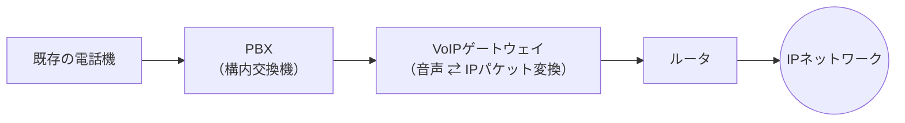
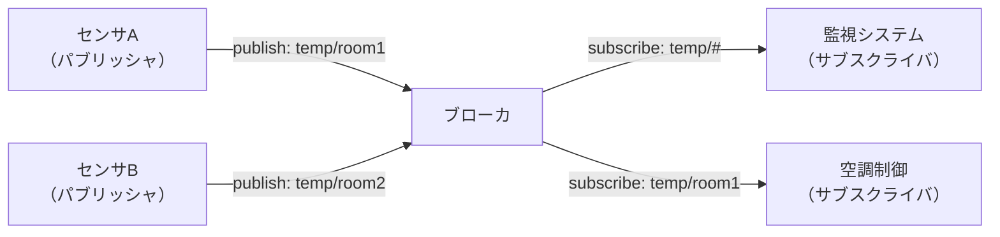

# 10-5 ネットワーク応用

ここまでの章で組み上げたネットワークの上で、実際に動くサービスと応用技術を扱う。Webの周辺技術、IP電話（VoIP）、VPN、モバイル通信、そしてIoT向けの通信である。

共通するのは、**「汎用のIPネットワークに、用途ごとの要求を後付けでどう満たすか」**という問題意識である。音声は遅延に厳しい、VPNは盗聴されたくない、IoT機器は電池で何年も動かしたい。それぞれの制約が技術の形を決めている。

**16年で29問**が出題されている。年による波が大きく、3〜4問出る年もあれば1問も出ない年もある。特に**IP電話の品質指標（R値）**は5回出題された最頻出テーマであり、近年は**IoT向け通信プロトコル**の出題が増えている。

## 目次

- [1. Webの応用技術](#1-webの応用技術)
- [2. VoIPとIP電話](#2-voipとip電話)
- [3. VPN](#3-vpn)
- [4. モバイル通信](#4-モバイル通信)
- [5. IoT向けの通信](#5-iot向けの通信)

---

## 1. Webの応用技術

### 1.1 プロキシ

**プロキシ（代理サーバ）**は、クライアントとサーバの間に立って通信を中継する。**どちらの代理をするか**で2種類に分かれ、この区別がそのまま出題される。

| 種類 | 誰の代理か | 置かれる場所 |
| --- | --- | --- |
| **フォワードプロキシ** | **Webブラウザ（クライアント）の代理**として、Webサーバに対するリクエストを送信する | 通常は利用者側の組織内 |
| **リバースプロキシ** | **Webサーバの代理**として、インターネットから受け取ったリクエストをWebサーバに中継する | Webサーバ側の組織内（DMZなど） |

フォワードプロキシは、アクセス制御・URLフィルタリング・キャッシュ・ログ取得のために置かれる。社内から外へ出る通信を一か所に集めて管理できるのが利点である。**ブラウザと同一の組織内になければならないという決まりはなく**、組織外の公開プロキシを使うこともできる（そのため、プロキシ経由のアクセスを装う攻撃者もいる）。

リバースプロキシは、負荷分散・TLS終端・キャッシュ・Webサーバの隠蔽のために置かれる。外部からはリバースプロキシしか見えないので、Webサーバそのものを直接攻撃されにくくなる。シングルサインオンの実装点としても使われる（→ [11-5 セキュリティ実装技術](../11-security/11-5-セキュリティ実装技術.md)）。

まぎらわしい用語に**プロキシARP**（ルータが他セグメントのホストに代わってARP応答を返す機能 → [10-3](10-3-通信プロトコル.md)）や **DMZ**（外部に公開するサーバを置く緩衝地帯 → [11-4](../11-security/11-4-情報セキュリティ対策.md)）があるが、いずれも別物である。

### 1.2 負荷分散装置とマルチホーミング

**負荷分散装置（ロードバランサ）**は、複数のサーバや回線に通信を振り分ける装置である。

出題されたのは、**複数のISP回線（ルータ1とルータ2）を使い分ける「マルチホーミング」**の構成である。クライアントから外部サーバ宛のパケットが負荷分散装置を通るとき、装置はどう処理するか。

答えは「**あて先IPアドレスはそのままで、あて先MACアドレスをルータ1又はルータ2のMACアドレスに置き換える**」である。

理由は [10-3](10-3-通信プロトコル.md) で見た**宛先の二重性**で説明できる。最終的な行き先である外部サーバのIPアドレスを書き換えてしまっては、パケットは目的地に届かない。一方、**次にどの機器へ渡すか**を決めているのはMACアドレスである。したがって振り分けとは「次ホップのMACアドレスをどちらのルータにするか選ぶこと」に他ならない。これは**ルータが行う転送処理そのもの**であり、負荷分散装置はその選択に分散のロジックを持ち込んでいるにすぎない。

### 1.3 CDN

**CDN（Content Delivery Network）**は、コンテンツの複製を世界各地のキャッシュサーバ（エッジサーバ）に配置し、利用者から最も近いサーバに応答させる仕組みである。配信元サーバの負荷と、利用者までの遅延を同時に下げられる。

副次的な効果として、**DDoS攻撃の影響を軽減できる**。攻撃トラフィックが世界中のエッジサーバに分散して吸収されるため、オリジンサーバに到達する量が減る。またエッジサーバ群の総帯域は単一サーバよりはるかに大きい。

ただし「副次的に」という点が重要で、CDNはセキュリティ製品ではない。**Man-in-the-Browser攻撃**（利用者のブラウザに感染したマルウェアによる改ざん）、**パスワードリスト攻撃**、**リバースブルートフォース攻撃**はいずれも利用者側や認証の問題であり、CDNでは軽減できない（→ [11-1 情報セキュリティ](../11-security/11-1-情報セキュリティ.md)）。

### 1.4 Webサービスの連携技術

| 技術 | 内容 |
| --- | --- |
| **SOAP** | **ほかのコンピュータ上にあるデータやサービスを呼び出すためのプロトコル**で、**メッセージ記述がXMLのヘッダとボディで構成されている** |
| **Ajax** | **JavaScriptなどのスクリプト言語を使って、Webブラウザに組み込まれているサーバとの非同期通信機能（XMLHttpRequest）を利用する技術**。地図の高速なスクロールや、キーボード入力に合わせた検索候補の逐次表示を実現する |
| **マッシュアップ** | **公開されている複数のサービスを利用して、新たなサービスを提供する**こと |
| REST | HTTPのメソッドとURIでリソースを操作する設計様式。SOAPより軽量で現在の主流 |

**マッシュアップ**は「組み合わせて新しいものを作る」点が本質で、**既存サービス（他者が公開しているAPI）を組み合わせる**ところに特徴がある。地図サービスと物件情報を組み合わせた不動産検索サイトが典型例である。

誤答として並ぶ似た概念と区別しておく。

- 既存のプログラムから仕様を導き出す → **リバースエンジニアリング**（→ [12-6 保守・廃棄](../12-system-development/12-6-保守-廃棄.md)）
- 既存のプログラムを部品化して組み合わせる → **コンポーネントベース開発**
- クラスライブラリを利用して開発する → 通常のライブラリ利用

Ajaxの非同期通信はクライアント発信が前提なのでサーバ発の通知ができない。この制約を解消したのがWebSocketである（→ [10-3](10-3-通信プロトコル.md)）。

> **出題** リバースプロキシ: H21午前II問17 ｜ フォワードプロキシ: R1午前I問11 ｜ 負荷分散装置とマルチホーミング: H21午前II問6、H23午前II問9 ｜ CDN: R6午前II問16 ｜ SOAP: H22午前I問13 ｜ マッシュアップ: H22午前I問16、R5午前II問25 ｜ Ajax: H24午前I問11

---

## 2. VoIPとIP電話

### 2.1 構成要素

**VoIP（Voice over IP）**は音声をIPパケットで運ぶ技術である。既存の電話設備をIPネットワークに統合する場合、次のように機器が並ぶ。

アナログの電話機から見ていくと役割分担が理解できる。既存の電話機はアナログ信号を出すので、まず**PBX（構内交換機）**がそれを収容して内線交換を行う。次に**VoIPゲートウェイ**が音声信号とIPパケットの相互変換を担う。最後に**ルータ**がIPネットワークへ送り出す。「電話の世界 → 変換 → IPの世界」という順番になる。

### 2.2 プロトコルの役割分担

VoIPでは、**呼の制御**と**音声データの運搬**が別のプロトコルに分かれている。

| プロトコル | 役割 |
| --- | --- |
| **SIP** (Session Initiation Protocol) | **ユーザエージェント相互間で、音声や映像などのマルチメディア通信のセッションの確立、変更、切断を行う** |
| **SDP** (Session Description Protocol) | **音声、映像などのメディアの種類、データ通信のためのプロトコル、使用するポート番号などを記述する** |
| **RTP** (Real-time Transport Protocol) | **音声情報をリアルタイムストリームとしてIPネットワークに送り出す際の、ペイロード種別、シーケンス番号、タイムスタンプを記述する** |
| **RTCP** (RTP Control Protocol) | **パケットの欠落数やパケット到着間隔のばらつきなどの統計値のやり取りに使用する** |

この4つは互いの説明文を入れ替えた選択肢で出題されるので、**一語で言える特徴**を結び付けておく。

- SIP → **セッションの確立・変更・切断**
- SDP → **メディアの種類とポート番号の記述**（SIPメッセージの中に載る）
- RTP → **タイムスタンプとシーケンス番号**（音声そのものを運ぶ）
- RTCP → **統計値のやり取り**（品質のフィードバック）

SDPが独立しているのは、「誰と話すか」（SIP）と「何をどう送るか」（SDP）を分離したほうが、音声・映像・画面共有など多様なメディアに対応しやすいからである。

### 2.3 音声符号化とペイロード長の計算

アナログ音声をデジタル化する方式を**音声符号化（コーデック）**という。

| 方式 | ビットレート | 特徴 |
| --- | --- | --- |
| G.711（PCM） | 64 kビット/秒 | 固定電話品質。処理が軽い |
| **G.729（CS-ACELP）** | **8 kビット/秒** | 圧縮率が高く、帯域の狭い回線向け |

**1パケットに含まれる音声ペイロード長**の計算は2回出題されている。考え方は単純で、**ビットレート × パケット生成周期**である。

G.729（8 kビット/秒）でパケット生成周期が20ミリ秒のとき、

$$ 8{,}000\ [\text{ビット/秒}] \times 0.020\ [\text{秒}] = 160\ [\text{ビット}] = \mathbf{20\ [\text{バイト}]} $$

単位をビットからバイトに直すのを忘れないこと。160はビット数であって、バイト数は20である。

ここには**遅延とオーバヘッドのトレードオフ**がある。周期を長くすればペイロードが大きくなりヘッダの割合が減って効率はよいが、その分だけパケット化のための待ち時間（パケッタイゼーション遅延）が増える。20ミリ秒前後という値は、この両者の折り合いとして選ばれている。

### 2.4 音声品質の指標

**最頻出テーマ（5回出題）**である。4つの指標を正確に区別する。

| 指標 | 内容 |
| --- | --- |
| **R値** | **ノイズ、エコー、遅延などから算出される**総合的な品質指標。ITU-T勧告 G.107 のE-modelによる**計算値**で、0〜100で表す |
| MOS値 | 実際に人が聞いて5段階（1〜5）で評価した**主観評価値** |
| ジッタ | パケットの**到着間隔のゆらぎ** |
| パケット損失率 | 失われたパケットの割合 |

**「ノイズ、エコー、遅延などから算出される」のはR値**である。ジッタとパケット損失率は品質を左右する個別の要因にすぎず、総合指標ではない。MOS値は人間の主観評価なので「算出される」ものではない。

R値とMOS値は対応関係があり、R値から推定MOS値を導ける。R値が使われるのは、実際に人を集めて評価してもらわなくても、**測定可能な物理量から品質を予測できる**からである。設計段階で「この遅延なら通話品質はこの程度」と見積もれるのが実務上の価値になる。

遅延とジッタが品質を左右するため、VoIPではQoSによる優先制御が欠かせない（→ [10-2](10-2-データ通信と制御.md)）。

> **出題** R値: H23午前II問16、H27午前II問15、H29午前II問15、R4午前II問15、R6午前II問15（計5回） ｜ VoIPペイロード長: H24午前II問3、R6午前II問2 ｜ SDP: H22午前II問16 ｜ PBXのIP統合: H21午前I問13

---

## 3. VPN

**VPN（Virtual Private Network）**は、公衆網の上に仮想的な専用線を構成する技術である。中核にあるのは**トンネリング**、すなわち**あるプロトコルのパケットを別のプロトコルのパケットで包んで運ぶ**仕組みである。

### 3.1 どの層でトンネルを掘るか

VPNプロトコルは**OSI基本参照モデルのどの層で動作するか**で整理できる。これがそのまま出題される。

| プロトコル | 動作する層 | カプセル化の対象 |
| --- | --- | --- |
| **L2TP**（PPTPも同様） | **データリンク層** | PPPフレーム（レイヤ2のフレーム） |
| **IPsec** | **ネットワーク層** | **IPパケット** |
| **TLS** | トランスポート層より上（セッション層相当） | アプリケーションのデータ |

相対的な位置関係は下から **L2TP → IPsec → TLS** の順になる。

**「ネットワーク層のパケットを対象としてIPパケットでカプセル化し、トンネリングを行えるプロトコル」はIPsec**である。L2TPとPPTPはいずれもPPPフレーム（データリンク層）を包むプロトコルなので対象が異なる。RSTPはスパニングツリーの改良版でVPNとは無関係である（→ [10-1](10-1-ネットワーク方式.md)）。

層が違うと使い勝手が変わる。

- **IPsec** はIP層で動くので、上位のアプリケーションを問わずすべての通信を保護できる。拠点間VPNの定番。ただし端末側に設定が要る。
- **TLS** はアプリケーションごとの保護になるが、ブラウザさえあれば使えるので、リモートアクセスVPN（SSL-VPN）として普及した。

IPsecの内部構造（AH、ESP、IKE、トランスポートモードとトンネルモード）とTLSの詳細は [11-5 セキュリティ実装技術](../11-security/11-5-セキュリティ実装技術.md) で扱う。

### 3.2 事業者が提供するVPN

利用者が自分でトンネルを張るインターネットVPNのほかに、通信事業者の網を使うVPNがある。

| 方式 | 分離の仕組み |
| --- | --- |
| IP-VPN | 事業者のIP網を **MPLS** で論理分離する（→ [10-2](10-2-データ通信と制御.md)） |
| 広域イーサネット | レイヤ2で接続し、**VLAN** で論理分離する（→ [10-1](10-1-ネットワーク方式.md)） |

インターネットVPNは安価だが品質は保証されない。事業者VPNは品質を保証できるが高価である。この選択は [10-1](10-1-ネットワーク方式.md) で触れたWANのコスト構造の問題そのものである。

> **出題** トンネリングプロトコル: R1午前II問1 ｜ VPNプロトコルのOSI階層: R7午前I問15

---

## 4. モバイル通信

### 4.1 端末の移動に伴う用語

移動体通信には、似ているが意味の違う用語が並ぶ。

| 用語 | 意味 |
| --- | --- |
| **ハンドオーバ** | **移動中の端末が通信相手との接続を維持したまま、ある基地局経由から別の基地局経由の通信へ切り替えること** |
| ローミング | 契約している事業者のサービスエリア外で、提携事業者の設備を使って通信すること |
| テザリング | スマートフォンなどをアクセスポイントにして、他の機器をインターネットに接続させること |
| フォールバック | 障害時などに、より低速・低機能な方式に切り替えて通信を継続すること |

**ハンドオーバは「基地局の切替え」、ローミングは「事業者の切替え」**と覚えると区別できる。ハンドオーバで肝心なのは**接続を維持したまま**という点で、通話が途切れずに移動できるのはこの仕組みによる。

### 4.2 ローカル5G

**ローカル5G**は、5G移動無線サービスの技術や機器を利用して、**地域や建物の中に自前の5Gネットワークを構築する**仕組みである。

最大の特徴は制度面にある。**土地や建物の所有者は、電気通信事業者ではない場合でも、免許を取得すればローカル5Gシステムを構築できる**。工場・農場・スタジアムなど、特定の場所に特化した高品質な無線環境を、携帯電話事業者に依存せず自前で持てる点に意義がある。

誤答として並ぶ説明との区別も押さえる。

- 「電波が届かない場所に小型無線設備を置いて事業者のエリアを拡大する」→ レピータやフェムトセルの説明
- 「ビームアンテナの指向性を利用して特定エリアにサービスを提供する」→ ビームフォーミングの説明
- 「5 GHz帯を用いた新しい高速無線LAN」→ IEEE 802.11ac などの無線LAN（→ [10-1](10-1-ネットワーク方式.md)）

> **出題** ハンドオーバ: R5午前I問11 ｜ ローカル5G: R5午前II問14

---

## 5. IoT向けの通信

IoT機器の通信には、オフィスのネットワークとは違う制約がある。**電池で何年も動く必要があり**、**計算能力もメモリも小さく**、**電波が届きにくい場所にも置かれる**。扱うデータ量は小さいことが多い。したがって「速さ」より「低消費電力」「到達性」「軽さ」が優先される。

### 5.1 近距離無線の規格

| 規格 | 周波数帯 | 特徴 |
| --- | --- | --- |
| **Bluetooth** | 2.4 GHz | **一つのマスタと最大七つのスレーブから成るスター型ネットワーク**（ピコネット）を構成する |
| **BLE** (Bluetooth Low Energy) | **2.4 GHz** | 従来のBluetoothとの互換性を保ちつつ低消費電力化。ボタン電池で長期間動作する |
| **ZigBee** | 2.4 GHz | **下位層にIEEE 802.15.4を使用する低消費電力の無線通信方式**であり、**センサネットワークやスマートメータなどへの応用**が進む。メッシュ型を組めて多数ノードを収容できる |
| **Wi-SUN** | 920 MHz | **マルチホップを使用して500 mを超える通信が可能**。スマートメータで採用 |
| DSRC | 5.8 GHz | 近距離の無線通信方式で、**有料道路の料金所のETC**などで利用される |
| UWB | 広帯域 | 広い周波数帯にデータを拡散して高速伝送する。近距離での映像・音楽配信に利用 |

**ZigBeeとBluetoothの取り違え**が繰り返し狙われる。

- **「一つのマスタと最大七つのスレーブのスター型」はBluetooth**であって、ZigBeeではない。ZigBeeは最大65,000台規模を収容でき、メッシュ型も構成できる。
- **ZigBeeの説明は「IEEE 802.15.4 を下位層に使う低消費電力方式」**である。

その他の誤りやすい点も挙げておく。

- **BLEは2.4 GHz帯**を使う。5 GHz帯を使う拡張ではない。
- **920 MHz帯がIoT向けに割り当てられているのは IEEE 802.11ah**（および Wi-SUN、LPWA）であり、IEEE 802.11ac ではない。802.11ac は5 GHz帯専用である（→ [10-1](10-1-ネットワーク方式.md)）。

**LPWA（Low Power Wide Area）**は、低消費電力で数km規模の広域をカバーする通信方式の総称で、LoRaWAN、Sigfox、NB-IoTなどが含まれる。Wi-SUNもこの系統に位置づけられる。

### 5.2 IoT向けのプロトコル

| プロトコル | 層 | 特徴 |
| --- | --- | --- |
| **MQTT** | アプリケーション層 | **パブリッシュ／サブスクライブ（Publish/Subscribe）型のモデル**を採用。TCP上で動作 |
| **CoAP** (Constrained Application Protocol) | アプリケーション層 | **パケット損失が発生しやすいネットワーク環境での、小電力デバイスの通信に向いている**。UDP上で動作し、HTTPに似たRESTfulな操作体系をもつ |
| 6LoWPAN | 適応層 | IEEE 802.15.4 の小さなフレームでIPv6を運ぶための圧縮・分割の仕組み |

**MQTTのパブリッシュ／サブスクライブ型**とは、送信者（パブリッシャ）と受信者（サブスクライバ）が互いを直接知らず、**ブローカを介してトピック単位でメッセージをやり取りする**モデルである。

このモデルがIoTに向くのは、**送信側が受信側の存在や数を知らなくてよい**からである。センサは「温度はこれです」とブローカに投げるだけでよく、それを誰が何台で使うかを意識しない。受信側を追加・削除してもセンサ側の変更は不要で、間欠的にしか起動しないデバイスでも成立する。

**CoAPはUDPベース**である点が本質的で、TCPのコネクション確立に伴う往復と状態保持を省けるため、**電力と処理能力が限られたデバイス**、そして**パケット損失が起こりやすい無線環境**に適している。必要な信頼性はCoAP自身の確認応答機構で補う。HTTPの考え方（GET/POST/PUT/DELETEに相当する操作）をそのまま小さく実装し直したもの、と理解するとよい。

CoAPの誤答選択肢との区別も押さえる。「信頼性よりリアルタイム性が要求される音声や映像の通信」はRTP、「大容量で高い信頼性が要求されるデータの通信」はTCP/HTTPの領分である。

> **出題** ZigBee: H22午前II問1、H27午前II問2、H29午前II問1 ｜ IoT向け小電力無線: R1午前II問15 ｜ MQTT: R3午前II問12 ｜ CoAP: R5午前II問8、R7午前II問5

---

## この章のまとめ

- **フォワードプロキシはクライアントの代理、リバースプロキシはサーバの代理**。負荷分散装置が振り分けるのは**次ホップのMACアドレス**であり、宛先IPアドレスは変えない。
- **CDNはDDoS攻撃の影響を副次的に軽減**できるが、利用者側や認証を狙う攻撃には効かない。
- VoIPのプロトコルは **SIP＝セッション制御、SDP＝メディア記述、RTP＝音声の運搬、RTCP＝統計のフィードバック**。
- 音声ペイロード長は **ビットレート × 周期**（G.729で20 msなら20バイト）。
- 音声品質で**「ノイズ・エコー・遅延から算出される」のはR値**。MOS値は主観評価、ジッタとパケット損失率は個別要因。
- VPNの階層は下から **L2TP（データリンク層）→ IPsec（ネットワーク層）→ TLS（トランスポート層より上）**。IPパケットをIPパケットで包むのがIPsec。
- **ハンドオーバは基地局の切替え、ローミングは事業者の切替え**。ローカル5Gは**事業者でなくても免許を取れば構築できる**。
- IoT無線は**「1マスタ＋最大7スレーブのスター型」がBluetooth、「IEEE 802.15.4ベースの低消費電力」がZigBee、「マルチホップで500m超」がWi-SUN**。
- IoTプロトコルは **MQTT＝パブリッシュ／サブスクライブ型（TCP）、CoAP＝損失の多い環境の小電力デバイス向け（UDP）**。
