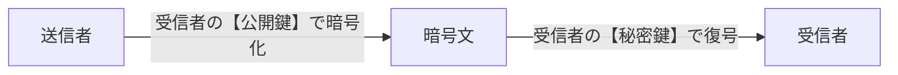
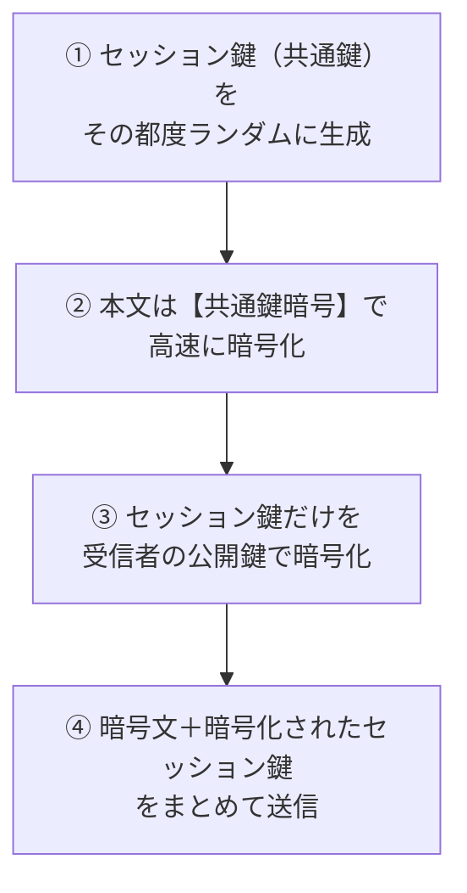
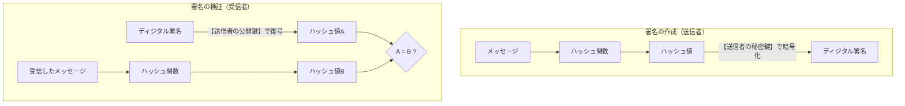
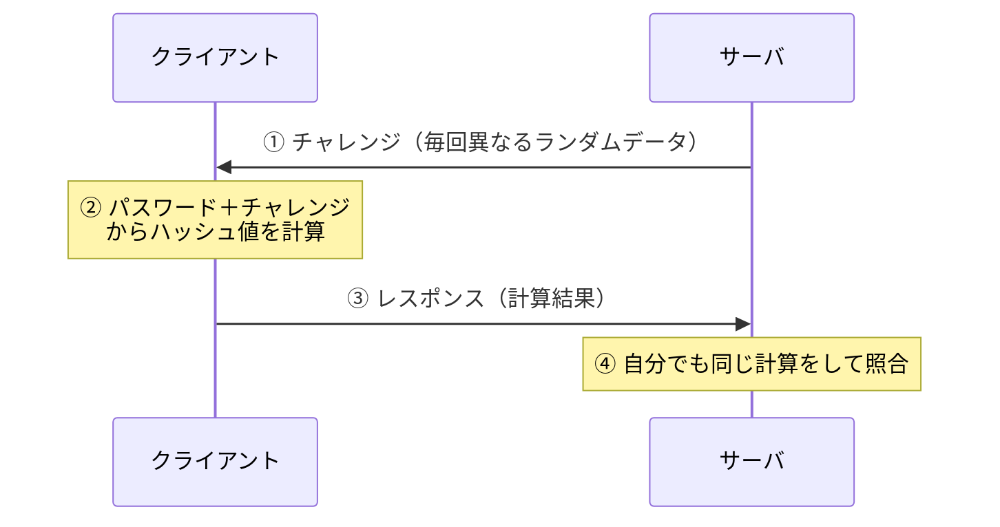
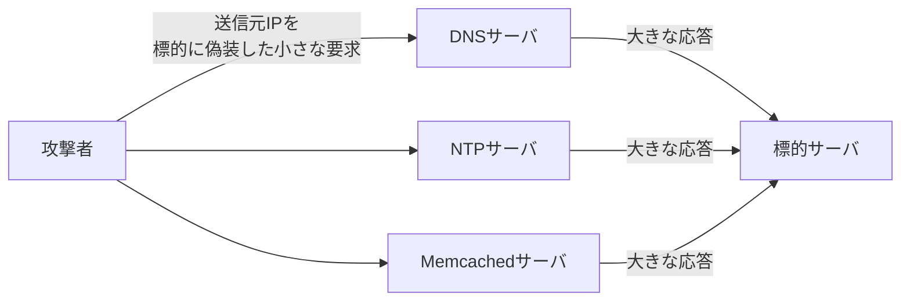
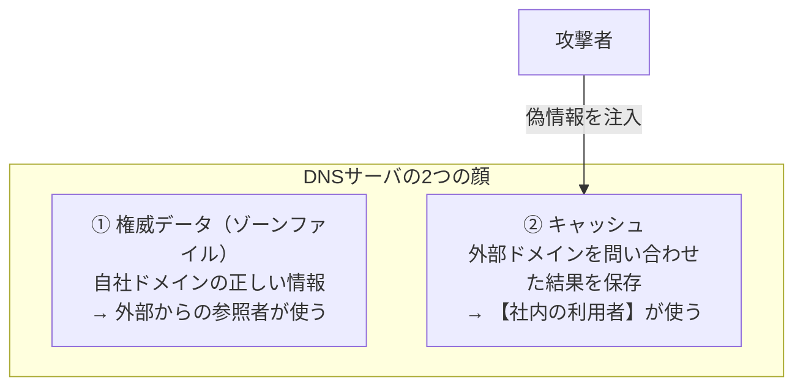

# 11-1 情報セキュリティ

セキュリティ分野の土台となる章である。**暗号技術**、**認証技術**、**攻撃手法**という3本の柱を扱う。

この3つは独立した知識ではない。攻撃手法を知らなければ、なぜその暗号方式や認証方式が必要なのかがわからない。逆に暗号の仕組みを理解していなければ、攻撃がなぜ成立するのかもわからない。本章では「どういう脅威があり、それに対してどういう技術が答えになっているか」という順序で整理していく。

具体的な防御製品（ファイアウォール、IDS/IPSなど）は [11-4 情報セキュリティ対策](11-4-情報セキュリティ対策.md)、プロトコルへの組込み（TLS、IPsec、無線LANセキュリティ）は [11-5 セキュリティ実装技術](11-5-セキュリティ実装技術.md)、組織的な管理は [11-2 情報セキュリティ管理](11-2-情報セキュリティ管理.md) で扱う。

**セキュリティはどの試験区分でも午前I・午前IIを通じて頻出**であり、ネットワークスペシャリスト午前IIではネットワークに次ぐ出題数になる。

## 目次

- [1. 情報セキュリティの目標](#1-情報セキュリティの目標)
- [2. 暗号技術](#2-暗号技術)
- [3. ハッシュ関数とメッセージ認証](#3-ハッシュ関数とメッセージ認証)
- [4. ディジタル署名とPKI](#4-ディジタル署名とpki)
- [5. 認証技術](#5-認証技術)
- [6. マルウェア](#6-マルウェア)
- [7. パスワードと認証への攻撃](#7-パスワードと認証への攻撃)
- [8. Webアプリケーションへの攻撃](#8-webアプリケーションへの攻撃)
- [9. サービス妨害攻撃](#9-サービス妨害攻撃)
- [10. その他の攻撃手法](#10-その他の攻撃手法)

---

## 1. 情報セキュリティの目標

情報セキュリティは**CIAの3要素**を守ることと定義される。

| 要素 | 内容 | 失われる例 |
| --- | --- | --- |
| **機密性** (Confidentiality) | 認可された者だけがアクセスできる | 情報漏えい、盗聴 |
| **完全性** (Integrity) | 情報が正確で改ざんされていない | 改ざん、誤った更新 |
| **可用性** (Availability) | 必要なときに使える | サービス妨害攻撃、障害 |

これに**真正性**（なりすましでないこと）、**責任追跡性**（誰が何をしたか追えること）、**否認防止**（後から「やっていない」と言えないこと）、**信頼性**を加えて7要素とする場合もある。

この分類が実用的なのは、**どの技術がどの要素を守るのかが整理できる**からである。暗号化は機密性、ハッシュとMACは完全性、ディジタル署名は完全性＋真正性＋否認防止、冗長化とDDoS対策は可用性、といった具合に対応が付く。

---

## 2. 暗号技術

### 2.1 共通鍵暗号方式

**暗号化と復号に使用する鍵が同一**である方式。**対称鍵暗号**ともいう。

- 代表例：**AES**（現在の標準）、DES / 3DES（旧世代）、KCipher-2（ストリーム暗号）
- 処理が高速で、大量のデータの暗号化に向く
- 問題は**鍵配送**。通信相手に安全に鍵を渡す手段が別途必要になる

**鍵の数**が計算問題になる。$n$ 人が相互に暗号化通信を行う場合、すべてのペアごとに異なる鍵が要るので、

$$ \text{必要な鍵数} = \frac{n(n-1)}{2} $$

100人なら $\dfrac{100 \times 99}{2} = \mathbf{4{,}950}$ 個である。人数の2乗に比例して増えるため、大規模な集団では鍵の管理が破綻する。これが公開鍵暗号を必要とした動機である。

### 2.2 公開鍵暗号方式

**暗号化と復号に異なる鍵を使う**方式。**非対称鍵暗号**ともいう。各人が「公開鍵」と「秘密鍵」の対をもつ。

- 代表例：**RSA**、楕円曲線暗号（ECC）、DSA
- **秘匿（機密性）に使う場合は、受信者の公開鍵で暗号化し、受信者の秘密鍵で復号する**

「暗号化に使用する鍵を秘密にして、復号に使用する鍵を公開する」というのは**逆**である。公開するのは暗号化用の鍵でなければ、誰でもその人に秘密を送れるという利点が成立しない。

**鍵の数**は、各人が公開鍵と秘密鍵を1つずつ持てばよいので、

$$ \text{必要な鍵数} = 2n $$

共通鍵の $n(n-1)/2$ と比べると、人数が増えたときの差は決定的である。100人なら共通鍵4,950個に対し、公開鍵方式は200個で済む。

### 2.3 両者の比較とハイブリッド暗号

| | 共通鍵暗号 | 公開鍵暗号 |
| --- | --- | --- |
| 鍵 | 暗号化と復号が**同一** | **異なる**（公開鍵と秘密鍵の対） |
| 処理速度 | 高速 | 低速（数百〜数千倍遅い） |
| 鍵の数（n人） | $n(n-1)/2$ | $2n$ |
| 鍵配送 | 困難 | 容易（公開鍵は公開してよい） |
| 代表 | AES、KCipher-2 | RSA、楕円曲線暗号 |

よくある誤りとして「**AESは公開鍵暗号方式、RSAは共通鍵暗号方式**」という逆転がある。また「ディジタル署名に公開鍵暗号方式が使用されることはない」も誤りで、むしろ署名は公開鍵暗号の主要な用途である。

それぞれの長所を組み合わせたのが**ハイブリッド暗号方式**である。**OpenPGPやS/MIMEで用いられ、公開鍵暗号方式と共通鍵暗号方式を組み合わせることによって鍵管理コストと処理性能の両立を図る**。

本文（長い）は速い共通鍵暗号で、鍵（短い）は遅いが鍵配送に強い公開鍵暗号で、と役割を分ける。鍵配送問題を公開鍵暗号が解き、速度を共通鍵暗号が稼ぐ、という理想的な分業になっている。

### 2.4 前方秘匿性

**前方秘匿性（Forward Secrecy、PFS）**とは、**鍵交換に使った秘密鍵が漏えいしたとしても、過去の暗号文は解読されない**という性質である。

通常のRSA鍵交換では、サーバの秘密鍵が漏れると、過去に記録されていた全通信を遡って復号できてしまう。これを防ぐため、**通信のたびに使い捨ての鍵ペアを生成して鍵交換を行う**（DHE、ECDHEなどの一時鍵方式）。使い捨ての鍵は通信終了後に破棄されるので、長期鍵が漏れても過去の通信は守られる。

誤答として並ぶ他の性質と区別しておく。

- 「時系列データをチェーンの形で結び複数ノードで共有する」→ ブロックチェーン
- 「片方の鍵で暗号化したデータはもう片方の鍵でだけ復号できる」→ 公開鍵暗号の基本的性質
- 「ハッシュ値から元のデータを推測できない」→ ハッシュ関数の一方向性

### 2.5 CRYPTREC暗号リスト

**CRYPTREC**は、電子政府で利用すべき暗号技術を評価・監視するための日本のプロジェクトである。デジタル庁・総務省・経済産業省が策定する「電子政府における調達のために参照すべき暗号のリスト」は3つのリストから成る。

| リスト | 内容 |
| --- | --- |
| **電子政府推奨暗号リスト** | **CRYPTRECによって安全性及び実装性能が確認された暗号技術のうち、市場における利用実績が十分であるか今後の普及が見込まれると判断され、当該技術の利用を推奨するもの**のリスト |
| 推奨候補暗号リスト | 安全性・実装性能は確認されたが、利用実績や普及見込みの点で推奨段階には至っていないもののリスト |
| 運用監視暗号リスト | 推奨段階から格下げされ、互換性維持目的でのみ利用を認めるもののリスト |

**「利用を推奨する」のが電子政府推奨暗号リスト**、**「互換性維持目的」が運用監視暗号リスト**である。推奨候補暗号リストはその中間であり、「互換性維持目的で利用する暗号技術のリスト」ではない。

> **出題** 共通鍵の鍵数: H23午前II問18、H25午前II問18 ｜ 公開鍵の鍵数: H22午前I問14、R6午前I問13 ｜ 暗号方式の比較: H24午前I問14、H29午前I問13 ｜ 公開鍵暗号アルゴリズム: H27午前I問12 ｜ ハイブリッド暗号: H28午前I問15 ｜ 前方秘匿性: R3午前II問18 ｜ CRYPTREC: R7午前I問12

---

## 3. ハッシュ関数とメッセージ認証

### 3.1 暗号学的ハッシュ関数

**ハッシュ関数**は、任意長のデータから固定長の値（**ハッシュ値、メッセージダイジェスト**）を計算する一方向の関数である。代表例はSHA-256、SHA-3。MD5やSHA-1は衝突が見つかっており、現在は使うべきでない。

暗号用途で求められる性質は3つある。

| 性質 | 内容 |
| --- | --- |
| **原像計算困難性（一方向性）** | **あるハッシュ値が与えられたとき、そのハッシュ値を出力するメッセージを見つけることが計算量的に困難** |
| 第二原像計算困難性 | あるメッセージと同じハッシュ値をもつ別のメッセージを見つけることが困難 |
| **衝突困難性** | **ハッシュ値が一致する二つの相異なるメッセージを見つけることが計算量的に困難** |

**一方向性（原像計算困難性）と衝突困難性は別の性質**である。前者は「ハッシュ値 → 元のデータ」を求める困難さ、後者は「同じハッシュ値になる2つのデータの組」を見つける困難さを指す。設問ではこの2つを入れ替えてくる。

なお「入力された可変長のメッセージに対して固定長のハッシュ値を生成できる」のはハッシュ関数の**定義そのもの**であって、困難性の性質ではない。

### 3.2 メッセージ認証符号（MAC）

**MAC（Message Authentication Code）**は、送受信者が**共有している鍵**とメッセージからハッシュ値に似た符号を生成するものである。代表例は**HMAC**。

受信者は、受け取ったメッセージから同じ鍵でMACを計算し、送られてきたMACと一致するかを確かめる。これによって**メッセージの改ざんがないことを判定できる**。

できることとできないことを正確に区別する。

| | MACでできるか |
| --- | --- |
| **メッセージの改ざんがないことの判定** | **できる** |
| 伝送誤りの訂正 | できない（検出はできるが訂正はできない） |
| メッセージの複製の有無の検知 | できない |
| メッセージの盗聴の有無の検知 | できない（そもそも盗聴は痕跡を残さない） |

単なるハッシュ値だけを添えても、攻撃者がメッセージとハッシュ値の両方を作り直せば改ざんを見破れない。**鍵を知らないとMACを計算できない**ので、鍵を共有している相手からのメッセージであることと、改ざんされていないことが同時に保証される。

ただしMACは**共有鍵**を使うので、送信者と受信者の双方が同じMACを作れる。したがって**否認防止はできない**（「受信者が自分で作った」可能性を排除できない）。これを解決するのが次のディジタル署名である。

> **出題** ハッシュ関数の一方向性: R3午前I問12 ｜ メッセージ認証符号: H27午前II問16

---

## 4. ディジタル署名とPKI

### 4.1 ディジタル署名の仕組み

**ディジタル署名**は、公開鍵暗号を「逆向き」に使うことで、作成者の証明と改ざん検知を実現する。

**使う鍵の向き**が最重要である。

- **署名の作成には、発信者（送信者）の秘密鍵を使う**
- **署名の検証には、発信者（送信者）の公開鍵を使う**

秘密鍵は本人しか持っていないので、その鍵で作られた署名は本人にしか作れない。一方、公開鍵は誰でも入手できるので、誰でも検証できる。これにより**真正性**（本人が作った）、**完全性**（改ざんされていない）、**否認防止**（後から否定できない）が同時に成立する。

秘匿に使う場合（受信者の公開鍵で暗号化）と鍵の向きが逆になる点に注意する。目的で覚えるとよい。

| 目的 | 暗号化／署名に使う鍵 | 復号／検証に使う鍵 |
| --- | --- | --- |
| **秘匿**（機密性） | **受信者の公開鍵** | 受信者の秘密鍵 |
| **署名**（真正性） | **送信者の秘密鍵** | 送信者の公開鍵 |

メッセージそのものではなく**ハッシュ値に対して署名する**のは、公開鍵暗号の処理が遅いからである。長いメッセージ全体を秘密鍵で暗号化するのは非現実的なので、固定長のハッシュ値に縮めてから署名する。

なお、署名鍵（秘密鍵）でメッセージを暗号化しても**秘匿にはならない**。公開鍵は誰でも持っているので、誰でも復号できてしまう。「送信者が署名鍵でメッセージを暗号化することで内容が関係者以外に分からないようになる」という選択肢は誤りである。

### 4.2 PKIとディジタル証明書

ディジタル署名が成立するには「この公開鍵が確かにその人のものだ」という保証が要る。偽の公開鍵をつかまされれば、攻撃者の署名を本人のものと誤認してしまう。この保証を与える仕組みが **PKI（公開鍵基盤）**であり、中心にいるのが**認証局（CA）**である。

**ディジタル証明書**は、**申請者の公開鍵に対して認証局がディジタル署名したもの**である。「申請者の**秘密鍵**に対して署名したもの」は誤り。秘密鍵は本人以外に渡してはならないものであり、認証局に提出することもない。

同様に、**ルート認証局は、下位の認証局の公開鍵に対して、ルート認証局の秘密鍵でディジタル署名した証明書を発行する**。「ルート認証局の公開鍵で署名」は誤りで、署名には常に署名者の秘密鍵を使う。

ディジタル証明書の規格は **ITU-T X.509** である。X.400 はメッセージ通信の規格で、証明書とは関係がない。

証明書の用途としては、**SSL/TLSプロトコルにおいて通信データの暗号化のための鍵交換や通信相手の認証に利用される**（→ [11-5](11-5-セキュリティ実装技術.md)）。

### 4.3 CRL

証明書には有効期限があるが、期限前でも秘密鍵の漏えいなどで無効にしたい場合がある。これを**失効**という。

**CRL（Certificate Revocation List、証明書失効リスト）**は、**有効期限内に失効したディジタル証明書のシリアル番号のリスト**である。

ここで2か所の引っかけがある。

- **「有効期限切れ」ではなく「有効期限内に失効した」もの**を載せる。期限切れの証明書は期限を見れば無効とわかるので、わざわざリストに載せる必要がない。
- **「公開鍵」ではなく「シリアル番号」**のリストである。公開鍵は長いデータであり、識別には証明書を一意に特定するシリアル番号で足りる。

CRLは定期的に配布されるため反映に遅れが生じる。これを改善したのが、個々の証明書の失効状態をその場で問い合わせる **OCSP（Online Certificate Status Protocol）**である。

> **出題** ディジタル署名の鍵: H21午前I問14、H23午前I問14、H25午前I問13 ｜ 署名鍵の使用: R4午前I問12 ｜ ディジタル証明書: H26午前II問17 ｜ CRL: H24午前II問19

---

## 5. 認証技術

### 5.1 認証の3要素

| 要素 | 根拠 | 例 |
| --- | --- | --- |
| 知識情報（What you know） | 本人だけが知っていること | パスワード、暗証番号 |
| 所持情報（What you have） | 本人だけが持っているもの | ICカード、トークン、スマートフォン |
| 生体情報（What you are） | 本人の身体的・行動的特徴 | 指紋、虹彩、声紋 |

**多要素認証**は、この異なる要素を2つ以上組み合わせるものである。パスワードを2つ使っても要素は1つなので多要素にはならない。

### 5.2 チャレンジレスポンス認証

**最頻出の認証方式**である（4回以上出題）。定義を正確に覚える。

> **利用者が入力したパスワードと、サーバから送られたランダムなデータ（チャレンジ）とをクライアント側で演算し、その結果（レスポンス）を認証用データとしてサーバに送信する。**

この方式の利点は2つある。

- **パスワードそのものがネットワークを流れない**ので、盗聴されても漏れない。
- **チャレンジが毎回変わるのでレスポンスも毎回変わる**。盗聴した値をそのまま送り返す**リプレイ攻撃（再生攻撃）**が成立しない。

PPPの**CHAP**（→ [10-2](../10-network/10-2-データ通信と制御.md)）やHTTPの**ダイジェスト認証**（→ [10-3](../10-network/10-3-通信プロトコル.md)）がこの方式である。

誤答として並ぶ他方式と区別しておく。

| 選択肢の記述 | 実際は何か |
| --- | --- |
| SSL/TLSによってクライアント側で固定パスワードを暗号化して送信する | 単なるパスワード認証の暗号化（チャレンジがない） |
| トークンという装置が自動的に表示する、認証のたびに異なるデータをパスワードとして送信する | **ワンタイムパスワード**（時刻同期方式） |
| クライアント側で端末のシリアル番号を秘密鍵で暗号化して送信する | 機器認証に近いが、チャレンジを使っていない |
| 任意長のデータを入力として固定長のハッシュ値を出力する | ハッシュ関数の説明 |

**トークンが表示する値を送るのはワンタイムパスワード**である。チャレンジレスポンスとの違いは、**サーバからチャレンジが送られるかどうか**にある。

### 5.3 生体認証

生体認証では、**他人受入率（FAR）**と**本人拒否率（FRR）**がトレードオフになる。判定を厳しくすれば他人は入りにくくなるが本人も弾かれやすくなる。

**虹彩認証**の特徴が繰り返し問われる。

- **成人には虹彩の経年変化がなく、認証デバイスでのパターン更新がほとんど不要**である。顔や声は加齢で変化するため再登録が要るが、虹彩は安定している。
- **他人受入率を顔認証と比べて低くすることが可能**である。虹彩の模様は個人差が極めて大きく、情報量が多い。
- 赤外線カメラを使うが、**照度を高くすれば目に負担がかかる**。「照度を高くするほど目に負担を掛けることなく精度が向上する」は誤り。
- **遺留物から偽造できるのは指紋**であって虹彩ではない。虹彩は接触しないので遺留物が残らない。

### 5.4 認証デバイス

| デバイス | 特徴 |
| --- | --- |
| **接触型ICカード** | 端子に直接接触して給電・通信する |
| **非接触型ICカード** | **カード内のコイルの誘導起電力を利用**して給電する。電池が不要 |
| USBトークン | ディジタル証明書や秘密鍵を格納する。**利用するPCのMACアドレスを組み込む必要はない** |
| 指紋認証（静電容量方式） | 指の凹凸による静電容量の差を読む。**光を使わないのでLED照明の影響を受けない**（光学式なら影響しうる） |

**誘導起電力を使うのは非接触型**であって接触型ではない。この取り違えが出題されている。

### 5.5 リスクベース認証と3Dセキュア2.0

**3Dセキュア2.0（EMV 3-Dセキュア）**は、オンラインショッピングのクレジットカード決済における本人認証サービスである。

旧来の3Dセキュア1.0は、決済のたびに必ずパスワード入力を求めたため、利用者の離脱（かご落ち）を招いていた。2.0の特徴は**リスクベース認証**を取り入れた点にある。

> **利用者の過去の取引履歴や決済に用いているデバイスの情報から不正利用や高リスクと判断される場合に、カード会社が追加の本人認証を行う。**

いつもの端末からいつもの額を買うなら追加認証なしで通し、見慣れない端末や高額取引のときだけ追加認証を求める。**安全性と利便性のバランスを動的に取る**という考え方であり、「履歴にかかわらず常にパスワードと生体認証を併用する」のとは対照的である。

> **出題** チャレンジレスポンス認証: H21午前II問18、H24午前II問20、H28午前I問13、R1午前I問13 ｜ 認証デバイス: H28午前I問14 ｜ 虹彩認証: R1午前I問15 ｜ 3Dセキュア2.0: R6午前I問12

---

## 6. マルウェア

### 6.1 分類

| 種類 | 特徴 |
| --- | --- |
| ウイルス | 他のプログラムに寄生して感染・増殖する |
| ワーム | 単独で動作し、ネットワーク経由で自己増殖する |
| トロイの木馬 | 正規のプログラムを装って侵入し、裏で不正動作する |
| ランサムウェア | **ファイルを勝手に暗号化して、復号と引換えに金銭を要求する** |
| スパイウェア | 情報を収集して外部に送信する。キーロガーもこの一種 |
| **ボット** | 攻撃者から**遠隔操作**される。多数が束ねられて**ボットネット**を形成する |
| **ルートキット** | **OSなどに不正に組み込んだツールを隠蔽する** |

**ルートキット**は、それ自体が破壊活動をするのではなく、**侵入の痕跡と他のマルウェアを隠す**ためのツール群である。OSのシステムコールやコマンドを改変し、不正なプロセスやファイルを一覧に表示させないようにする。「カーネルの脆弱性を分析する」「ウイルス感染をチェックする」「通信ポートを調査する」はいずれも別物である。

### 6.2 ボットネットとC&Cサーバ

**ボットネット**は、ボットに感染した多数の端末を攻撃者が束ねたネットワークである。その指令塔が **C&Cサーバ（Command and Control サーバ）**で、役割は

> **遠隔操作が可能なマルウェアに、情報収集及び攻撃活動を指示する**

ことである。DDoS攻撃やスパム送信、情報窃取がここから指示される。防御側から見ると、**C&Cサーバとの通信を検知・遮断することが有効な対策**になる。感染そのものを完全に防ぐのが難しい以上、「指令を受け取らせない」ことが次善の策になる。

### 6.3 ポリモーフィック型マルウェア

パターンマッチングによるウイルス検出を回避するため、**感染ごとに姿を変える**マルウェアがある。

> **ポリモーフィック型マルウェア：感染ごとにマルウェアのコードを異なる鍵で暗号化するなどの手法によって、過去に発見されたマルウェアのパターンでは検知されないようにする。**

本体を暗号化し、復号ルーチンだけを平文で置く。鍵を毎回変えれば暗号化された本体のバイト列は毎回異なるので、シグネチャが一致しない。さらに復号ルーチン自体も書き換える**メタモーフィック型**もある。

このようなマルウェアには、パターンに頼らず**実際の挙動を観察して判定するビヘイビア法**が有効になる（→ [11-4](11-4-情報セキュリティ対策.md)）。

誤答との区別も整理しておく。

- 「インターネットを介して攻撃者から遠隔操作される」→ ボット
- 「複数のOS上で動作する」→ マルチプラットフォーム型
- 「ルートキットを利用して隠蔽し、感染していないように見せかける」→ ステルス型／ルートキット

### 6.4 感染経路

| 手口 | 内容 |
| --- | --- |
| **ドライブバイダウンロード** | **利用者がWebサイトを閲覧したとき、利用者に気付かれないように、利用者のPCに不正プログラムを転送させる** |
| 水飲み場型攻撃 | 標的が頻繁に訪れるWebサイトを改ざんし、そこを訪れた標的だけを感染させる |
| 標的型攻撃メール | 業務に関係するように見せかけたメールで添付ファイルを開かせる |
| USB経由 | USBメモリの自動実行機能などを利用して感染させる |

ドライブバイダウンロードは**利用者が何もクリックしなくても感染する**点が特徴である。Webブラウザやプラグインの脆弱性を突くため、閲覧しただけで成立する。「USBメモリの自動実行」「ファイルを暗号化して金銭要求（ランサムウェア）」「無線LANの電波を傍受して脆弱なAPを探す（ウォードライビング）」は別の手口である。

> **出題** ルートキット: R1午前II問20 ｜ ポリモーフィック型マルウェア: R3午前II問16、R5午前II問16 ｜ C&Cサーバ: R5午前I問12 ｜ ドライブバイダウンロード: H29午前I問12

---

## 7. パスワードと認証への攻撃

| 攻撃 | 内容 |
| --- | --- |
| **ブルートフォース攻撃**（総当たり攻撃） | **使用可能な文字のあらゆる組合せをそれぞれパスワードとして、繰り返しログインを試みる** |
| リバースブルートフォース攻撃 | パスワードを固定し、利用者IDのほうを次々に変えて試す。アカウントロックを回避できる |
| 辞書攻撃 | よく使われる単語のリストを使って試す |
| パスワードリスト攻撃 | 他サイトから漏えいしたID・パスワードの組を使い回して試す |
| レインボーテーブル攻撃 | ハッシュ値から元のパスワードを高速に逆引きする事前計算表を使う |
| リプレイ攻撃（再生攻撃） | 正当な利用者のログインシーケンスを盗聴者がそのまま記録し、後でサーバに送信する |
| セッションハイジャック | 認証成功後のセッション情報（Cookieなど）を盗んで乗っ取る |
| キーロガー | コンピュータへのキー入力を全て記録して外部に送信する |

**ブルートフォース攻撃は「あらゆる組合せを試す」**。誤答にはセッションハイジャック、キーロガー、リプレイ攻撃が並ぶので、「組合せを試す」かどうかで判別する。

対策としては、**アカウントロック**（一定回数失敗したら凍結）、**パスワードの長さと文字種の確保**、**多要素認証**、**ハッシュ保存時のソルトとストレッチング**（レインボーテーブル対策）がある。ただしリバースブルートフォース攻撃やパスワードリスト攻撃はアカウントロックで防ぎにくいため、多要素認証やリスクベース認証が必要になる。

> **出題** ブルートフォース攻撃: H27午前I問14、H30午前I問14

---

## 8. Webアプリケーションへの攻撃

Webアプリケーションへの攻撃は、**利用者の入力がプログラムの一部として解釈されてしまう**という共通の構造をもつ。「どこに注入されるか」で名前が変わる。

| 攻撃 | 注入先 | 手口 |
| --- | --- | --- |
| **クロスサイトスクリプティング (XSS)** | **他の利用者のブラウザ** | **Webアプリケーションに用意された入力フィールドに、悪意のあるJavaScriptコードを含んだデータを入力する** |
| SQLインジェクション | データベースへのSQL文 | 入力値にSQLの断片を混ぜ、意図しない問合せを実行させる |
| **OSコマンドインジェクション** | **OSのシェル** | **Webページ上で入力した文字列が Perl の system 関数や PHP の exec 関数などに渡されることを利用し、不正にシェルスクリプトや実行形式のファイルを実行させる** |
| HTTPヘッダインジェクション | HTTPレスポンスヘッダ | 改行コードを注入してヘッダを偽造する |
| ディレクトリトラバーサル | ファイルパス | `../` などを使って想定外のファイルを読み出す |
| **クロスサイトリクエストフォージェリ (CSRF)** | 被害者のブラウザからの正規リクエスト | ログイン中の利用者に意図しない操作を実行させる |

**OSコマンドインジェクションの決め手は「`system` 関数や `exec` 関数」といった外部コマンド実行の記述**である。これが出てきたらOSコマンドインジェクションを選べばよい。

XSSは「他の利用者のブラウザ上でスクリプトを実行させる」点が本質である。誤答に並ぶ「サーバに不正アクセスしてデータを改ざんする」（単なる不正アクセス）、「大量のデータでバッファをあふれさせる」（バッファオーバフロー）、「パス名を推定して認証後のページに直接ジャンプする」（強制ブラウジング）と区別する。

対策はいずれも**入力の検証と出力時のエスケープ**が基本になる。詳細は [11-5 セキュリティ実装技術](11-5-セキュリティ実装技術.md) で扱う。

> **出題** クロスサイトスクリプティング: H25午前I問15 ｜ OSコマンドインジェクション: H27午前II問20、R3午前II問21

---

## 9. サービス妨害攻撃

**DoS攻撃（Denial of Service）**は可用性を狙う攻撃である。多数の端末から同時に行うものを **DDoS攻撃（Distributed DoS）**という。

### 9.1 手口の分類

| 攻撃 | 手口 |
| --- | --- |
| **SYN Flood攻撃** | **コネクション開始要求に当たるSYNパケットを大量に送ることによって、接続要求ごとに応答を返すための過大な負荷を掛ける**。半開きコネクションでメモリを枯渇させる |
| **ICMP Flood攻撃** | **pingコマンドを用いて大量の要求パケットを発信することによって、攻撃対象のサーバに至るまでの回線を過負荷にしてアクセスを妨害する** |
| HTTP GET Flood攻撃 | **HTTP GETリクエストを繰り返し送ることによって、攻撃対象のサーバにコンテンツ送信の負荷を掛ける** |
| Slow HTTP DoS攻撃 | **大量のTCPコネクションを確立し、攻撃対象のサーバに接続を維持させ続けることによって、リソースを枯渇させる**。少ない通信量で成立する |

4つは「何を枯渇させるか」が異なる。SYN Floodは**接続管理テーブル**、ICMP Floodは**回線帯域**、GET Floodは**サーバの処理能力**、Slow HTTP DoSは**同時接続数**を狙う。ICMP Floodだけが「サーバに至るまでの回線」を狙う点が特徴的である。

### 9.2 リフレクタ攻撃とDRDoS

攻撃者が自分の帯域以上の攻撃を仕掛けるために、第三者のサーバを「反射板」として使う手口がある。

**DRDoS攻撃（Distributed Reflection DoS）**は、

> **多数のDNSサーバに対して送信元のIPアドレスを標的のIPアドレスに偽装したリクエストを送信し、それらのサーバの応答パケットによって、標的のサーバのリソースを枯渇させ、利用を妨害する。**

この手口が強力なのは2点による。

- **攻撃元が隠れる**。標的から見れば、攻撃してきているのは正規のDNSサーバやNTPサーバである。
- **増幅（アンプ）される**。小さな要求に対して大きな応答が返るサービスを選べば、攻撃者の送信量の数十〜数万倍のトラフィックを標的に浴びせられる。

**リフレクタ攻撃に悪用されることの多いサービスは DNS、Memcached、NTP** である。いずれも**UDPを使い**（送信元IPの偽装が容易）、**小さな要求に大きな応答を返す**という共通点がある。DKIM・DNSSEC・SPFはなりすましメール対策、FTP・L2TP・Telnet、IPsec・SSL・TLSはいずれも増幅率が低く、この攻撃には向かない。

対策は「踏み台にされない」ことであり、DNSのオープンリゾルバ対策、NTPのmonlist無効化などが該当する（→ [11-4](11-4-情報セキュリティ対策.md)）。

### 9.3 ダークネット観測

**ダークネット**とは、割り当てられてはいるが**未使用のIPアドレス空間**である。本来そこに届く通信はないはずなので、観測されたパケットはすべて不審な通信とみなせる。

観測結果から攻撃の種類を推定する設問が出ている。

> 送信元IPアドレスが A、送信元ポート番号が 80/tcp の **SYN/ACK パケット**を受信した場合に想定できる攻撃は？

考え方はこうである。SYN/ACK は**SYNを受け取ったサーバが返す応答**である。つまりサーバA（ポート80で稼働するWebサーバ）は、どこかからSYNを受け取って応答している。ところがその応答がダークネットに届いているということは、**元のSYNパケットの送信元IPアドレスがダークネットのアドレスに偽装されていた**ことを意味する。

送信元を偽装して大量のSYNをAに送る行為は、**Aを攻撃先とするサービス妨害攻撃（SYN Flood）**である。偽装された送信元に返る応答を**バックスキャッタ**といい、ダークネット観測はこれを捉えることで世界中のDoS攻撃を間接的に検知している。

したがって答えは「**IPアドレスAを攻撃先とするサービス妨害攻撃**」となる。Aは被害者であって攻撃元ではない。

> **出題** ICMP Flood攻撃: H30午前II問16 ｜ DRDoS攻撃: R7午前II問18 ｜ リフレクタ攻撃: R3午前II問17 ｜ ダークネット観測: H29午前II問17、R1午前II問18

---

## 10. その他の攻撃手法

### 10.1 DNSキャッシュポイズニング

**DNSキャッシュポイズニング**は、DNSサーバのキャッシュに偽の情報を注入し、利用者を偽サイトへ誘導する攻撃である。

ここで重要なのは、**汚染されるのは「キャッシュ」である**という点である。企業のDMZ上で1台のDNSサーバをインターネット公開用と社内用で共用している場合、この攻撃を受けると何が起きるか。

> **社内の利用者が、インターネット上の特定のWebサーバを参照する場合に、本来とは異なるWebサーバに誘導される。**

DNSサーバは**権威データ**（自社ドメインの正しい情報）と**キャッシュ**（外部に問い合わせた結果）の2つを持っている。キャッシュポイズニングが汚すのは後者だけである。

したがって、

- **外部からの参照者**は自社の権威データを見るので、**影響を受けない**。「自社の公開WebサーバのFQDN情報が書き換えられ、外部からの参照者が異なるWebサーバに誘導される」は誤り。
- **社内の利用者**は汚染されたキャッシュを使って外部サイトの名前解決をするので、**偽サイトに誘導される**。

「DNSサーバのメモリ上にワームが常駐する」（これはワーム感染）、「メールサーバが不正中継の踏み台にされる」（これはオープンリレー）も無関係である。

対策としてDNSSECがある（→ [11-4](11-4-情報セキュリティ対策.md)）。また、そもそも**公開用と社内用のDNSサーバを分離する**ことが根本的な対策になる。

### 10.2 ゼロデイ攻撃

**ゼロデイ攻撃**は、**セキュリティパッチが提供される前に、パッチが対象とする脆弱性を攻撃する**ものである。

「修正が存在しない期間を狙う」のが本質なので、パッチ適用の運用をどれだけ徹底しても防げない。だからこそ、**多層防御**（WAF、IPS、振る舞い検知、権限の最小化）やネットワーク分離といった、脆弱性そのものに依存しない対策が重要になる。

### 10.3 サイドチャネル攻撃

**サイドチャネル攻撃**は、**暗号化装置における暗号化処理時の消費電力を測定するなどして、当該装置内部の秘密情報を推定する**攻撃である。

暗号アルゴリズムそのものを数学的に破るのではなく、**実装から漏れ出る物理的な副次情報**を使う。消費電力のほか、処理時間、電磁波、動作音、発熱などが手がかりになる。鍵のビットが0か1かで計算の経路が変わると処理時間や消費電力に差が出る、という性質を突く。

対策は、**処理時間や消費電力が秘密情報に依存しないように実装する**（定数時間実装、ダミー演算の挿入、ノイズの付加）ことである。アルゴリズムが安全でも実装が安全とは限らない、という教訓がここにある。

誤答と区別しておく。キーロガー（キー入力の記録）、スミッシング（SMSを使ったフィッシング）、中間者攻撃（通信に割り込んで盗聴・改ざん）はいずれも物理的な副次情報を使わない。

### 10.4 RLOを利用した偽装

**RLO（Right-to-Left Override）**は、アラビア語やヘブライ語のように右から左へ書く言語のために用意された Unicode の制御文字である。これを悪用すると、**文字の表示順を変えてファイル名の拡張子を偽装できる**。

たとえば `abcRLOcod.exe` のように実行ファイルの途中にRLOを挿入すると、画面上では `abcexe.doc` のように表示される。利用者は文書ファイルだと思って開いてしまうが、実体は実行ファイルである。

誤答に並ぶ手口との区別も押さえる。

- 「偽の警告を出して脅し、対策ソフトの購入を迫る」→ **偽セキュリティ対策ソフト型のマルウェア（ランサムウェア／スケアウェア）**
- 「脆弱性があるホストをあえて公開し、攻撃の内容を観察する」→ **ハニーポット**
- 「MIB情報の変化をSNMPマネージャに通知させる」→ SNMPのtrap（→ [10-4](../10-network/10-4-ネットワーク管理.md)）

> **出題** DNSキャッシュポイズニング: H21午前II問19、H26午前I問13 ｜ ゼロデイ攻撃: H27午前I問13 ｜ サイドチャネル攻撃: R4午前II問17、R6午前II問18 ｜ RLOを利用した手口: R4午前II問16、R6午前II問17

---

## この章のまとめ

- 暗号方式は**共通鍵（AES、鍵数 $n(n-1)/2$、高速）**と**公開鍵（RSA、鍵数 $2n$、鍵配送に強い）**。両者を組み合わせるのが**ハイブリッド暗号**。
- 鍵の向きは目的で決まる。**秘匿は受信者の公開鍵で暗号化、署名は送信者の秘密鍵で作成**。
- ハッシュの**一方向性（ハッシュ値から元を求められない）**と**衝突困難性（同じ値になる2つを見つけられない）**は別の性質。**MACは共有鍵を使い、改ざんの有無を判定できる**が否認防止はできない。
- **ディジタル証明書は申請者の「公開鍵」にCAが署名したもの**。**CRLは「有効期限内に失効した」証明書の「シリアル番号」のリスト**。
- **チャレンジレスポンスはサーバからのランダムデータとパスワードを演算して結果を送る**。トークンの表示値を送るのはワンタイムパスワード。
- **ルートキットは隠蔽、ポリモーフィック型は感染ごとに暗号化して姿を変える**。C&Cサーバはボットへの指令塔。
- Web攻撃は**どこに注入されるか**で区別する。`system` / `exec` が出てきたら**OSコマンドインジェクション**。
- DoSは**何を枯渇させるか**で区別する。**ICMP Floodは回線帯域**。**DRDoSは送信元を偽装してDNS・NTP・Memcachedに反射させる**。
- **DNSキャッシュポイズニングで被害を受けるのはキャッシュを使う社内利用者**。外部からの参照者は権威データを見るので影響しない。
- **サイドチャネル攻撃は消費電力などの物理的な副次情報から秘密情報を推定する**。
