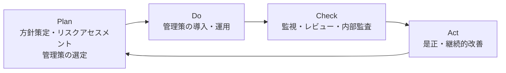

# 11-2 情報セキュリティ管理

[11-1](11-1-情報セキュリティ.md) が技術の話だったのに対し、この章は**組織としてセキュリティをどう回すか**を扱う。

技術だけではセキュリティは成り立たない。どれほど強固な暗号を使っても、運用する人がパスワードを付箋に書けば意味がない。脆弱性が公表されても、誰が判断して誰が対処するかが決まっていなければ動けない。そこで、**リスクを体系的に評価し、方針を定め、組織を作り、事故が起きたら対応する**という枠組みが必要になる。本章はその枠組みの話である。

**16年で11問**と出題数は多くない。午前Iからおおむね1〜2年に1問、午前IIからも断続的に出題される。**組織・機関の名前とその役割**を問う設問が多いのが特徴で、似た略語の区別が勝負になる。

## 目次

- [1. 情報セキュリティマネジメント](#1-情報セキュリティマネジメント)
- [2. リスクマネジメント](#2-リスクマネジメント)
- [3. 事業継続計画（BCP）](#3-事業継続計画bcp)
- [4. インシデント対応組織](#4-インシデント対応組織)
- [5. ディジタルフォレンジックス](#5-ディジタルフォレンジックス)
- [6. ガイドラインと関連機関](#6-ガイドラインと関連機関)

---

## 1. 情報セキュリティマネジメント

### 1.1 ISMS

**ISMS（Information Security Management System、情報セキュリティマネジメントシステム）**は、組織の情報セキュリティを継続的に維持・改善する仕組みである。規格は **JIS Q 27001（ISO/IEC 27001）**。

PDCAサイクルを回すことが基本になっている。

一度作って終わりではなく回し続けるのは、**ビジネス環境も技術も脅威も変化する**からである。この「変化するから見直す」という前提が、次の基本方針の性質にも関わってくる。

### 1.2 情報セキュリティ基本方針

ISMSで定義が求められる文書は階層構造になっている。

| 階層 | 内容 |
| --- | --- |
| **情報セキュリティ基本方針（ポリシ）** | **情報セキュリティのための経営陣の方向性及び支持を規定する** |
| 対策基準（スタンダード） | 基本方針を実現するために守るべき規則 |
| 実施手順（プロシージャ） | 具体的な手順書・マニュアル |

**基本方針の本質は「経営陣の意思表明」**である。技術的な詳細ではなく、「当社は情報セキュリティにこう取り組む」という方向性と、経営陣がそれを支持することを示す文書である。

誤答として出される記述と、その誤りを押さえる。

- 「重要な基本方針を定めた機密文書であり、社内の関係者以外の目に触れないようにする」→ **誤り**。基本方針はむしろ**公開するのが一般的**である。顧客や取引先に自社の姿勢を示す意味があり、隠すものではない。
- 「ビジネス環境や技術が変化しても変更してはならない」→ **誤り**。環境が変われば見直すのがPDCAの前提である。
- 「特定のシステムについてリスク分析を行い、そのセキュリティ対策とシステム運用の詳細を記述する」→ **誤り**。それは下位の対策基準・実施手順の役割である。

> **出題** 情報セキュリティ基本方針: H25午前I問14

---

## 2. リスクマネジメント

### 2.1 リスクの算定

リスクアセスメントは「**リスク特定 → リスク分析 → リスク評価**」の順に進む。このうちリスク分析でリスクの大きさを算定する。

**定量的評価**では、リスクを金額などの数値で表す。JIS Q 2001 に規定されたリスク算定の定量的評価では、

> **被害が発生する確率と被害額で評価する**

という考え方をとる。式で書けば

$$ \text{リスクの大きさ} = (\text{被害が発生する確率}) \times (\text{被害額}) $$

となり、**年間予想損失額（ALE）**として表される。

定量化の価値は**対策の優先度を比較できる**点にある。「年間1,000万円の損失が見込まれるリスクに、年間100万円の対策を打つ」という判断は、数値があって初めて成立する。確率も被害額も推定値にすぎないが、推定でも共通の尺度があれば議論ができる。

誤答に並ぶ「対策の難易度」「被害の顕在性」「攻撃元の特定可否」「攻撃手法の新しさ」は、いずれも定量的評価の2軸ではない。**「確率 × 被害額」**という組合せで覚える。

一方、数値化が難しい場合は**定性的評価**（高・中・低などの段階で評価）を用いる。

### 2.2 リスク対応

| 対応 | 内容 |
| --- | --- |
| リスク回避 | リスクの原因となる活動自体をやめる |
| **リスク低減（軽減）** | 対策を講じて発生確率や被害額を下げる |
| **リスク移転（共有）** | **保険やアウトソースによって他者に移す** |
| リスク保有（受容） | 対策せずに受け入れる。残留リスク |

対策コストが被害想定を上回るなら、あえて保有するのが合理的な判断になる。「すべてのリスクをゼロにする」ことは目的ではない。

リスク移転はプロジェクトマネジメントでも同じ分類で登場する（→ [14-8 プロジェクトのリスク](../14-project-management/14-8-プロジェクトのリスク.md)）。

> **出題** リスク算定の定量的評価: H21午前I問15

---

## 3. 事業継続計画（BCP）

**BCP（Business Continuity Plan、事業継続計画）**とは、

> **事業の中断・阻害に対応し、事業を復旧し、再開し、あらかじめ定められたレベルに回復するように組織を導く手順を文書化したもの**

である。災害・大規模障害・サイバー攻撃などで事業が止まったときに、**何を優先して、いつまでに、どのレベルまで戻すか**を事前に決めておく。

重要な指標が2つある。

| 指標 | 意味 |
| --- | --- |
| **RTO**（目標復旧時間） | いつまでに復旧させるか |
| **RPO**（目標復旧時点） | どの時点のデータまで戻せればよいか |

RPOを24時間と定めるなら、バックアップは1日1回で足りる。RPOを1時間にするなら、1時間ごとのバックアップかレプリケーションが要る。**目標値が投資額を決める**という関係にある（RPOの具体例は [15-2 サービスマネジメントシステムの計画及び運用](../15-service-management/15-2-サービスマネジメントシステムの計画及び運用.md) でも扱う）。

BCPを策定し、訓練・見直しまで含めて継続的に運用する活動全体を **BCM（事業継続管理）**という。

誤答として並ぶ他の経営手法と区別しておく。

- 「財務、顧客、内部ビジネスプロセス、学習と成長の4つの視点」→ **バランススコアカード**（→ [19-1 経営戦略手法](../19-business-strategy-management/19-1-経営戦略手法.md)）
- 「業務内容や業務の流れを可視化し、継続的に業務プロセスを改善する」→ **BPM**（→ [17-2 業務プロセス](../17-system-strategy/17-2-業務プロセス.md)）
- 「業務プロセスを対象としてアウトソースを実施する」→ **BPO**（→ [17-2](../17-system-strategy/17-2-業務プロセス.md)）

> **出題** BCP: R1午前I問23

---

## 4. インシデント対応組織

**名前の似た組織が多数出題される**。「誰を守るのか」で整理すると区別しやすい。

| 組織 | 守る対象 | 役割 |
| --- | --- | --- |
| **CSIRT** | **自組織の情報システム** | **企業・組織内や政府機関に設置され、コンピュータセキュリティインシデントに関する報告を受け取り、調査し、対応活動を行う組織の総称** |
| **PSIRT** | **自社製品の利用者** | **自社製品の脆弱性に起因するリスクに対応する**社内機能 |
| **SOC** (Security Operation Center) | 自組織のネットワーク | 機器やログを**常時監視**して攻撃を検知する。検知が主、対応はCSIRTに引き継ぐ |

**CSIRT と PSIRT の違い**が R6 で問われた。

- **CSIRT** は「自分たちが攻撃されたとき」に動く。社内システムへの侵入やマルウェア感染が対象。
- **PSIRT** は「自分たちが作った製品に脆弱性が見つかったとき」に動く。脆弱性情報の受付、影響調査、修正版の提供、利用者への告知が仕事になる。

製品を出荷する企業にとって、自社の脆弱性は顧客全体のリスクになる。だから社内システム担当のCSIRTとは別に、製品担当の窓口が要る、というのがPSIRTの存在理由である。

**SOC** は監視に特化した機能で、「見つける」役割である。見つけた後に「どうするか」を決めて動くのがCSIRTという分担になる。

誤答に並ぶ組織の説明も整理しておく。

| 説明 | 組織 |
| --- | --- |
| IPアドレスの割当て方針の決定、DNSルートサーバの運用監視、DNS管理に関する調整を世界規模で行う | **ICANN** |
| インターネットに関する技術文書を作成し、標準化のための検討を行う | **IETF** |
| 情報技術を利用し、宗教的又は政治的な目標を達成する目的をもった人や組織 | **ハクティビスト** |

> **出題** CSIRT: H26午前II問19 ｜ PSIRT: R6午前I問14

---

## 5. ディジタルフォレンジックス

**ディジタルフォレンジックス（デジタル鑑識）**とは、

> **犯罪に関する証拠となり得るデータを保全し、その後の訴訟などに備える**

ことである。手順は **収集 → 検査 → 分析 → 報告** から成る。

典型的な作業は、**サーバのハードディスクを解析し、削除されたログファイルを復元することによって、不正アクセスの痕跡を発見する**といったものである。

この分野の肝は**証拠能力の維持**にある。調査のためにシステムを操作すれば、タイムスタンプが更新され、メモリの内容は失われ、「証拠が改変された」と主張されかねない。そのため、

- 調査前にディスクの**イメージコピー**を作り、原本には触れない
- 取得したデータの**ハッシュ値**を記録して同一性を証明する
- 誰がいつ何を扱ったかの**管理の連鎖（Chain of Custody）**を記録する

といった手続きが重視される。技術というより**手続きの厳密さ**が本質である。

誤答として並ぶ他の技術と区別する。

| 記述 | 実際は何か |
| --- | --- |
| 画像や音楽などのディジタルコンテンツに著作権者などの情報を埋め込む | **電子透かし** |
| システムを実際に攻撃して侵入を試みるテスト手法 | **ペネトレーションテスト**（→ [11-3](11-3-セキュリティ技術評価.md)） |
| 巧みな話術や盗み聞き、盗み見によって重要情報を入手する | **ソーシャルエンジニアリング** |
| ログを集約してリアルタイムに相関分析し、不正アクセスを検出する | **SIEM** |
| 送信時に本文と添付ファイルを暗号化して情報漏えいを防ぐ | メールの暗号化（S/MIMEなど → [11-5](11-5-セキュリティ実装技術.md)） |
| プログラムのハッシュ値と脅威情報を突き合わせてマルウェアかを検査する | パターンマッチングによるマルウェア検査（→ [11-4](11-4-情報セキュリティ対策.md)） |

ポイントは**「事後」「証拠」「訴訟」**というキーワードである。ディジタルフォレンジックスは予防ではなく**事後の調査**であり、目的は**法的手続きに耐える証拠を残すこと**にある。SIEMによるリアルタイム検知とは時間軸が逆だと理解しておけば取り違えない。

> **出題** ディジタルフォレンジックス: H29午前II問18、R4午前II問20、R5午前I問13

---

## 6. ガイドラインと関連機関

### 6.1 サイバーセキュリティ経営ガイドライン

経済産業省とIPAが策定したもので、

> **企業がIT活用を推進していく中で、サイバー攻撃から企業を守る観点で経営者が認識すべき3原則と、サイバーセキュリティ対策を実施する上での責任者となる担当幹部に、経営者が指示すべき重要10項目をまとめたもの**

である。キーワードは**「経営者」「3原則」「重要10項目」**。セキュリティを情報システム部門の技術課題ではなく**経営課題**として位置づけた点に意義がある。

誤答に並ぶものとの区別は次のとおり。

| 説明 | 実際は何か |
| --- | --- |
| マネジメントシステムの要求事項を定め、情報資産をCIAの観点から維持管理し、継続的に見直すプロセス及び管理策を体系的に規定したもの | **ISMS（JIS Q 27001）** |
| ITガバナンスとITマネジメントに分割し、具体的な目標と工程として40のプロセスを定義したもの | **COBIT** |
| サイバーセキュリティに関する国の責務を定めたもの | **サイバーセキュリティ基本法**（→ [23-2 セキュリティ関連法規](../23-legal-affairs/23-2-セキュリティ関連法規.md)） |

### 6.2 JPCERT/CC

**JPCERTコーディネーションセンター（JPCERT/CC）**は、

> **特定の政府機関や企業から独立した組織であり、国内のコンピュータセキュリティインシデントに関する報告の受付、対応の支援、発生状況の把握、手口の分析、再発防止策の検討や助言を行っている。**

ポイントは**「独立した組織」**と**「国内のインシデント報告の窓口・調整役」**である。日本全体のCSIRTの連絡調整役（コーディネーションセンター）という位置づけになる。

誤答との区別も押さえる。

| 説明 | 実際は何か |
| --- | --- |
| 産業標準化法に基づく審議会であり、産業標準化全般の調査・審議を行う | **日本産業標準調査会（JISC）** |
| 電子政府推奨暗号の安全性を評価・監視し、実装法・運用法を調査検討するプロジェクト | **CRYPTREC**（→ [11-1](11-1-情報セキュリティ.md)） |
| 内閣官房に設置され、サイバー攻撃から防衛するための司令塔機能を担う | **NISC（内閣サイバーセキュリティセンター）** |

### 6.3 J-CRAT（サイバーレスキュー隊）

IPAに設置された**サイバーレスキュー隊（J-CRAT）**の役割は、

> **標的型サイバー攻撃を受けた組織や個人から提供された情報を分析し、社会や産業に重大な被害を及ぼしかねない標的型サイバー攻撃の把握、被害の分析、対策の早期着手の支援を行う。**

キーワードは**「標的型攻撃」「レスキュー（支援）」**。攻撃を受けた組織が自力で対応しきれない場合に、外から支援に入る仕組みである。

類似の施策との区別を整理しておく。

| 説明 | 実際は何か |
| --- | --- |
| 政府横断的な情報収集や監視機能を整備し、政府機関の緊急対応能力強化を図る | **GSOC**（政府機関情報セキュリティ横断監視・即応調整チーム） |
| 重要インフラ業界の参加組織と秘密保持契約を結び、標的型攻撃の情報を分析・加工して参加組織間で共有する | **J-CSIP**（サイバー情報共有イニシアティブ） |
| セキュリティオペレーション技術の向上と人材育成、組織間連携を推進する | **ISOG-J**（日本セキュリティオペレーション事業者協議会） |

**J-CRATは「救援」、J-CSIPは「共有」**と対にして覚えると区別しやすい。どちらもIPAが関わる標的型攻撃対策の施策だが、前者は被害組織への個別支援、後者は参加組織間の情報共有が目的である。

> **出題** サイバーセキュリティ経営ガイドライン: R3午前I問13 ｜ JPCERT/CC: R3午前I問14 ｜ J-CRAT: H29午前I問14

---

## この章のまとめ

- **情報セキュリティ基本方針は「経営陣の方向性及び支持」を示す文書**。公開するのが通例であり、環境の変化に応じて見直す。
- **定量的なリスク算定は「被害が発生する確率 × 被害額」**。数値化することで対策の優先度を比較できる。
- **BCPは事業を定められたレベルまで回復させる手順を文書化したもの**。RTO（時間）とRPO（時点）が投資額を決める。
- 対応組織は守る対象で区別する。**CSIRT＝自組織のシステム、PSIRT＝自社製品の脆弱性、SOC＝常時監視**。
- **ディジタルフォレンジックスは「事後」に「訴訟に備えて」証拠を保全・分析する**。電子透かし・ペネトレーションテスト・SIEMとは目的が違う。
- **サイバーセキュリティ経営ガイドラインは経営者向けの3原則と重要10項目**。**JPCERT/CCは国内インシデントの独立した調整役**、**J-CRATは標的型攻撃を受けた組織への支援**。
