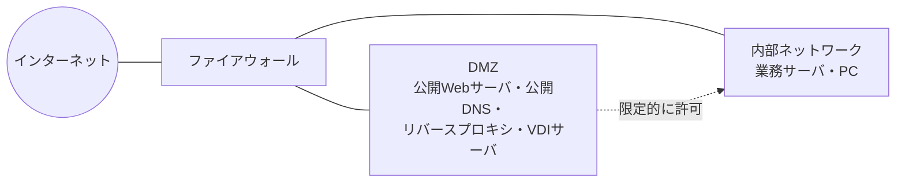
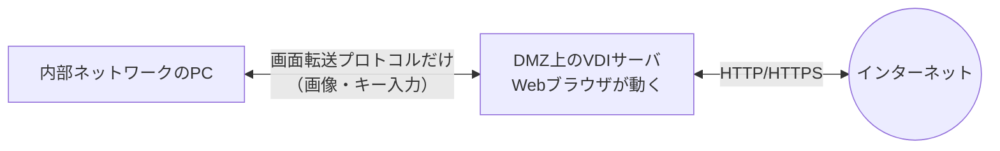
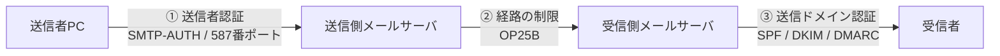

# 11-4 情報セキュリティ対策

[11-1](11-1-情報セキュリティ.md) で見た脅威に対して、**具体的にどう守るか**を扱う章である。ファイアウォール、IDS/IPS、WAF、マルウェア対策、ネットワーク分離、そしてDNSとメールの運用対策が主題になる。

全体を貫く考え方は**多層防御**である。単一の対策で防ぎきれる攻撃はほとんどない。だから「入口で止める」「入られても広がらせない」「出ていくのを止める」「痕跡を記録する」と層を重ねる。本章の各技術は、この層のどこを担っているのかという観点で位置づけると整理しやすい。

ネットワークスペシャリスト午前IIでは**この分野が最多クラスの出題数**である（16年で42問）。なかでも**DNS amp対策**、**OP25B**、**DNSSEC**、**ビヘイビア法**は繰り返し出題される定番である。

## 目次

- [1. ネットワークの構成による防御](#1-ネットワークの構成による防御)
- [2. ファイアウォール](#2-ファイアウォール)
- [3. IDS・IPS・WAF](#3-idsipswaf)
- [4. マルウェア対策](#4-マルウェア対策)
- [5. ネットワーク分離とアクセス制御](#5-ネットワーク分離とアクセス制御)
- [6. DNSのセキュリティ対策](#6-dnsのセキュリティ対策)
- [7. メールのセキュリティ対策](#7-メールのセキュリティ対策)
- [8. 踏み台化の防止](#8-踏み台化の防止)
- [9. 物理的・その他の対策](#9-物理的その他の対策)

---

## 1. ネットワークの構成による防御

### 1.1 DMZ

**DMZ（DeMilitarized Zone、非武装地帯）**は、インターネットと内部ネットワークの間に設ける緩衝領域である。外部に公開する必要のあるサーバ（Webサーバ、公開DNSサーバ、メール中継サーバなど）をここに置く。

DMZを設ける理由は、**公開サーバは必ず攻撃されるという前提**に立つからである。外部から到達できるサーバは、どれほど堅牢に作っても侵入される可能性が残る。そのとき**侵入が内部ネットワークまで広がらないように**、あらかじめ別の区画に隔離しておく。「落ちる前提で、落ちても被害が限定されるように配置する」という設計思想である。

### 1.2 リバースプロキシによるWebサーバの隠蔽

公開WebサーバをさらにDMZの奥へ隠す構成がある。

> **DMZ上の公開用WebサーバとしてリバースプロキシサーバをDMZに設置し、その参照先のWebサーバを、外部からアクセスできない別のDMZに移設することによって、外部から直接Webサーバのコンテンツが改ざんされることを防ぐ。**

外部からはリバースプロキシしか見えず、実体のWebサーバには直接到達できない。そのため**コンテンツの改ざんを狙った直接攻撃を防げる**（リバースプロキシの一般的な役割は → [10-5 ネットワーク応用](../10-network/10-5-ネットワーク応用.md)）。

ただしプロキシで**防げないもの**を区別しておく必要がある。

| 期待される効果 | 実際に得られるか |
| --- | --- |
| 外部からWebサーバのコンテンツを直接改ざんされるのを防ぐ | **得られる**（リバースプロキシ構成） |
| インターネット上での通信の盗聴を防ぐ | 得られない。盗聴を防ぐのは**暗号化（TLS）**の役目 |
| インターネット上でのコンテンツの改ざんを防ぐ | 得られない。経路上の改ざんを防ぐのも**TLS**の役目 |

プロキシは**サーバの位置を隠す**だけで、**通信路そのものは守らない**。経路上の盗聴・改ざんはTLSで守る（→ [11-5](11-5-セキュリティ実装技術.md)）。この役割分担の違いが設問の分かれ目になる。

> **出題** プロキシ・リバースプロキシのセキュリティ効果: H27午前II問18

---

## 2. ファイアウォール

### 2.1 方式の分類

| 方式 | 判断の材料 | 特徴 |
| --- | --- | --- |
| **パケットフィルタリング型（静的）** | 送信元・宛先のIPアドレスとポート番号、プロトコル | 高速。1パケットずつ独立に判断する |
| **ステートフルインスペクション型** | 上記＋**コネクションの状態** | 「内部から始まった通信への応答」を自動的に許可できる |
| アプリケーションゲートウェイ型（プロキシ型） | アプリケーション層の内容 | 細かく制御できるが遅い |

### 2.2 フィルタリングルールの設計

**計算問題として2回出題されている**。考え方は単純で、**クライアントは1024以上のランダムなポート（エフェメラルポート）から、サーバのウェルノウンポートに向かって接続する**という原則だけである。

社内のPCからインターネット上のSMTPサーバに電子メールを送信する場合、

| 向き | 送信元 | 宛先 | 送信元ポート | 宛先ポート |
| --- | --- | --- | --- | --- |
| **発信** | PC | SMTPサーバ | **1024以上** | **25** |
| **応答** | SMTPサーバ | PC | **25** | **1024以上** |

となる。**宛先ポート25（SMTP）に向かうのが発信、送信元ポート25から返るのが応答**である。110（POP3）は受信用なので送信には関係ない。ポート番号の対応は [10-3](../10-network/10-3-通信プロトコル.md) を参照。

ここで**ステートフルインスペクション機能の有無**が効いてくる。

- **ステートフルインスペクションがある**場合、「PC → SMTPサーバ（宛先25）」の発信だけを許可すれば、その応答は自動的に通る。コネクションの状態を覚えているからである。
- **ステートフルインスペクションがない静的フィルタリング**の場合、**応答の向きも明示的に許可ルールとして書かなければならない**。だから上の表のように2行が必要になる。

H28の設問が「ステートフルインスペクション機能をもっていない、静的なパケットフィルタリング型」と明示しているのは、まさに応答方向のルールも必要だと言わせるためである。

### 2.3 パケットフィルタリングで防げるもの・防げないもの

パケットフィルタリング型ファイアウォールのルールで、**本来必要なサービスに影響を及ぼすことなく防げるのは「外部に公開していないサービスへのアクセス」**である。

| 脅威 | パケットフィルタリングで防げるか | 理由 |
| --- | --- | --- |
| **外部に公開していないサービスへのアクセス** | **防げる** | そのポートを閉じればよい。必要なサービスに影響しない |
| サーバで動作するソフトウェアの脆弱性を突く攻撃 | 防げない | 公開しているポートを通って届くため。中身を見ないと判別できない |
| 電子メールに添付されたマクロウイルスの侵入 | 防げない | 正規のメール通信として25番ポートを通る |
| 電子メール爆弾などのDoS攻撃 | 防げない | 正規のポートに大量に来る。遮断すればメールそのものが使えなくなる |

ポイントは**「本来必要なサービスに影響を及ぼすことなく」**という条件である。25番ポートを閉じればメール爆弾は止まるが、同時に正規のメールも止まる。つまり「影響を及ぼさずに防げる」とは言えない。**ポート番号とアドレスだけで識別できる脅威しか防げない**のがパケットフィルタリングの限界であり、だからこそ上位層を見るIDS/IPSやWAFが必要になる。

### 2.4 IPスプーフィング対策

**IPスプーフィング**は送信元IPアドレスを偽装する攻撃である。これに有効な対策は、

> **外部から入るパケットの送信元IPアドレスが自ネットワークのものであれば、そのパケットを阻止する。**

論理が明快である。**自ネットワークのアドレスを送信元とするパケットが、外部から入ってくることは本来ありえない**。内部のホストが送ったパケットなら内側から出ていくはずで、外から入ってくるのは偽装以外に説明がつかない。この種のフィルタリングを**イングレスフィルタリング**という。

誤答として並ぶ対策との区別を押さえる。

- 「外部から入るTCPコネクション確立要求パケットのうち必要なもの以外を阻止」→ 一般的なアクセス制御。偽装そのものを見分けていない
- 「外部から入るUDPパケットのうち必要なもの以外を阻止」→ 同様
- 「宛先IPアドレスが、インターネットと直接通信すべきでない自ネットワークのホストのものなら阻止」→ 内部ホストの保護だが、送信元の偽装は見ていない

**着目するのが「送信元」か「宛先」か**が判別の鍵になる。スプーフィングは送信元の偽装なので、送信元を見る対策が正解である。

> **出題** パケットフィルタリングで防げるもの: H21午前II問20、H23午前I問15 ｜ フィルタリングルールの設計: H22午前II問19、H28午前II問20 ｜ IPスプーフィング対策: H22午前II問20

---

## 3. IDS・IPS・WAF

### 3.1 IDSとIPS

| 製品 | 役割 |
| --- | --- |
| **IDS** (Intrusion Detection System) | 侵入を**検知**して管理者に通知する |
| **IPS** (Intrusion Prevention System) | 侵入を検知して**遮断**する |

**NIDS（ネットワーク型IDS）を導入する目的**は、

> **管理下のネットワーク内への不正侵入の試みを検知し、管理者に通知する**

ことである。「検知して通知する」までが仕事であり、遮断はしない点に注意する。

設置対象による分類も押さえる。

| 種類 | 監視対象 |
| --- | --- |
| **NIDS**（ネットワーク型） | ネットワークを流れるパケット |
| **HIDS**（ホスト型） | 特定ホストのログ、ファイルの改ざん |

誤答として並ぶ記述と区別する。

- 「**サーバ上のファイルが改ざんされたかどうかを判定する**」→ HIDS／改ざん検知
- 「実際にネットワークを介してサイトを攻撃し、不正に侵入できるかどうかを検査する」→ **ペネトレーションテスト**（→ [11-3](11-3-セキュリティ技術評価.md)）
- 「ネットワークからの攻撃が防御できないときの損害の大きさを判定する」→ リスク評価（→ [11-2](11-2-情報セキュリティ管理.md)）

### 3.2 設置形態と検知方式

IDS/IPSは**2つの軸**で分類される。この2軸を組み合わせた設問が出ている。

**軸1：設置形態**

| 形態 | 接続 | できること |
| --- | --- | --- |
| **インラインモード** | **監視対象の通信を通過させるように通信経路上に設置** | 不正な通信を**遮断**できる |
| パッシブモード（ミラーポート） | 通信経路上のスイッチの**ミラーポートに接続**し、経路外からパケットをキャプチャ | 検知はできるが遮断はできない |

**軸2：検知方式**

| 方式 | 判断基準 |
| --- | --- |
| **シグネチャ型**（不正検出型） | **定義した異常な通信と合致する通信を不正と判断** |
| アノマリ型（異常検出型） | **通常時の通信から外れた通信を不正と判断** |

したがって「**インラインモードで動作するシグネチャ型IPS**」の特徴は、

> **IPSが監視対象の通信を通過させるように通信経路上に設置され、定義した異常な通信と合致する通信を不正と判断して遮断する。**

となる。**「経路上に設置」＋「定義と合致」**の組合せを選べばよい。「ミラーポートに接続」が入っていればパッシブ（＝IPSではなくIDS相当）、「通常時から外れた」が入っていればアノマリ型なので、いずれも誤りになる。

シグネチャ型は既知の攻撃を正確に検知できるが未知の攻撃には無力で、アノマリ型は未知の攻撃を捉えうるが誤検知が多い、というトレードオフがある。

### 3.3 WAF

**WAF（Web Application Firewall）**は、**Webアプリケーションへの攻撃を監視し阻止する**。

通常のファイアウォールがIPアドレスとポート番号で判断するのに対し、WAFは**HTTPリクエストの中身**を解析する。SQLインジェクションやクロスサイトスクリプティングは、80番/443番ポートを通る正規のHTTPリクエストの形で届くため、パケットフィルタリングでは止められない（→ [11-1](11-1-情報セキュリティ.md)）。この隙間を埋めるのがWAFである。

誤答との区別も押さえる。

- 「Webブラウザの通信内容を改ざんする攻撃をPC内で監視し検出する」→ エンドポイント側の対策
- 「サーバのOSへの不正なログインを監視する」→ HIDS／ログ監視
- 「ファイルのマルウェア感染を監視し検出する」→ マルウェア対策ソフト

防御の層が「ネットワーク（FW）→ 通信内容（IDS/IPS）→ Webアプリ（WAF）→ 端末（マルウェア対策）」と重なっている構造を意識すると位置づけが整理できる。

> **出題** NIDS: H23午前II問20 ｜ シグネチャ型IPS: R5午前II問18 ｜ WAF: H29午前I問15

---

## 4. マルウェア対策

### 4.1 検出手法

マルウェアの検出手法は4つに分類される。**最頻出テーマ（ビヘイビア法が3回）**なので、4つの定義を正確に区別する。

| 手法 | 判定の方法 |
| --- | --- |
| **パターンマッチング法**（シグネチャ法） | **あらかじめ特徴的なコードをパターンとして登録したマルウェア定義ファイルを用いて検査対象と比較し、同じパターンがあれば検出する** |
| **ビヘイビア法**（動的ヒューリスティック法） | **検査対象を動作させてその挙動を観察し、マルウェアへの感染によって生じるデータの読込み・書込みの動作や通信などを監視して検出する** |
| **インテグリティチェック法**（チェックサム法） | **マルウェアに感染していないことを保証する情報（チェックサム値など）をあらかじめ検査対象に付加しておき、検査時に不整合があれば検出する** |
| **コンペア法** | **検査対象のハッシュ値と、安全な場所に保管されている原本のハッシュ値を比較し、異なっていれば検出する** |

**ビヘイビア法の決め手は「動作させて挙動を観察する」「動作を監視する」**という記述である。他の3つはいずれも**静的な比較**（パターンとの比較、付加情報との整合、原本との比較）であり、実行しない。

ビヘイビア法が必要とされる理由は、**パターンマッチングが原理的に未知のマルウェアを検出できない**ことにある。定義ファイルに載っていないものは見つからず、[11-1](11-1-情報セキュリティ.md) で見たポリモーフィック型マルウェアのように感染ごとに姿を変えるものにも無力である。一方、どんなに姿を変えても「システムファイルを書き換える」「大量に外部接続する」といった**目的に基づく振る舞い**は変えにくい。そこを見るのがビヘイビア法である。

代償として、実行してみるまで判定できないので時間がかかり、正規のプログラムを誤検知することもある。実際の製品は**サンドボックス**（隔離された仮想環境）内で実行して観察する形で実装している。

> **出題** ビヘイビア法: H26午前II問20、H29午前II問16、R6午前II問20（計3回）

---

## 5. ネットワーク分離とアクセス制御

### 5.1 VLANによるセグメント分離

VLAN機能をもつスイッチでポートをグループ化し、複数のセグメントに分けると、どんなセキュリティ効果が得られるか。

> **スイッチが、PCからのブロードキャストパケットの到達範囲を制限するので、アドレス情報の不要な流出のリスクを低減できる。**

VLANの本質は**ブロードキャストドメインの分割**である（→ [10-1](../10-network/10-1-ネットワーク方式.md)）。ARP要求のようなブロードキャストは、同じセグメント内の全端末に届く。そこにはIPアドレスとMACアドレスの対応が含まれるので、セグメントが大きいほど**他部署の端末構成が見えてしまう**。VLANで分ければこの流出範囲が狭まる。

VLANが**できないこと**も区別しておく。

| 期待される効果 | 実際はどうか |
| --- | --- |
| **ブロードキャストの到達範囲を制限する** | **できる**。VLANの本来の機能 |
| ICMPパケットを全て遮断する | できない。VLANはプロトコル種別で遮断する機能ではない |
| MACアドレスから接続可否を判別する | できない。それは**MACアドレスフィルタリング**や**認証VLAN**の機能 |
| 物理ポートごとに決まったIPアドレスのPCだけを許可する | できない。VLANはポートをグループ分けするだけで、IPアドレスを検査しない |

### 5.2 認証VLAN

**認証VLAN（動的VLAN）**は、**レイヤ2スイッチや無線LANアクセスポイントで接続を許可する仕組み**である。利用者や端末を認証し、その結果に応じて**所属させるVLANを動的に切り替える**。

これが有効な典型的な場面がR5で出題された。

> フリーアドレス制で席が日によって変わり、各席の有線LANポートにPCを接続する環境で、**幹部のPCにだけ特定のIPセグメントのIPアドレスを動的に割り当て**、一部のサーバへのアクセスをそのセグメントからだけ許可したい。

ポート単位で固定的に割り当てる**スタティックVLAN**では、席が変わると設定が合わなくなるので使えない。「どの席に座っても、認証結果に応じて正しいVLANに入る」ことが要件であり、これを満たすのが**認証VLAN**である。IEEE 802.1X と RADIUS を組み合わせて実装する（→ [11-5](11-5-セキュリティ実装技術.md)）。

誤答との区別も押さえる。IDSは検知するだけで接続を制御しない。IPマスカレード（NAPT）はアドレス変換であり認証機能をもたない（→ [10-3](../10-network/10-3-通信プロトコル.md)）。

### 5.3 プライバシセパレータ

無線LANアクセスポイントの**プライバシセパレータ機能（アクセスポイントアイソレーション）**は、

> **同じ無線LANのアクセスポイントに接続している機器同士の直接通信を禁止する。**

公衆無線LANで重要な機能である。同じアクセスポイントに見知らぬ他人の端末がつながっている状況で、端末同士が通信できてしまえば、ファイル共有の覗き見やマルウェア感染の経路になる。インターネットへは通すが端末間は遮断する、というのがこの機能である。

無線LANの他の機能と区別する。

| 機能 | 内容 |
| --- | --- |
| **プライバシセパレータ** | **接続機器同士の直接通信を禁止** |
| SSIDステルス | アクセスポイントの識別子を知っている利用者だけに接続を許可する |
| MACアドレスフィルタリング | 事前に登録されたMACアドレスの機器だけに接続を許可する |
| 電波出力の調整・遮へい | 建物外への電波の漏れを防ぐ |

### 5.4 VDIによるインターネット分離

**VDI（Virtual Desktop Infrastructure）**を使った**インターネット分離**は、近年の重要な対策である。

内部ネットワークのPCからインターネットを直接見るのをやめ、**DMZ上のVDIサーバにログインして、その上のWebブラウザを使う**。PCとVDIサーバの間でやり取りするのは**画面の画像とキーボード・マウス操作だけ**にする。

効果を生み出す動作の特徴は、

> **Webサイトからの受信データを受信処理した後、生成したデスクトップ画面の画像データだけをPCに送信する。**

そして、効果があるための条件は、

> **PCとVDIサーバ間は、VDIの画面転送プロトコルだけを利用する。**

なぜ「画像だけ」が決定的なのか。マルウェアは**実行可能なデータ**として運ばれる。画面の画像データはPC上で実行されないので、**どんなマルウェアがVDIサーバ上のブラウザに侵入しても、PCには画像しか届かない**。逆方向も同様で、PC上のファイルはVDIサーバに渡らないため、データ流出も防げる。

したがって**ファイル転送を併用すると効果が崩れる**。画面転送に加えてファイル転送を許せば、そこがマルウェアとデータの通り道になってしまう。「PCとVDIサーバ間は画面転送プロトコル及びファイル転送を利用する」という選択肢が誤りなのはこのためである。

また「VDIサーバがプロキシサーバとしてHTTP通信を中継する」のも誤りである。中継してしまえば、受信データがそのままPCに届く。VDIの価値は**中継しないこと**、つまり**データを画像に変換して渡すこと**にある。

実行ファイルを削除する方式（サニタイズ）や不正なコード列を検知する方式（パターンマッチング）は、いずれも**既知のものしか対処できない**ため、「未知のマルウェアを防ぐ」という要件には足りない。

> **出題** VLANによるセグメント分離: H25午前II問20、R4午前II問19 ｜ 認証VLAN: H21午前II問21、R5午前I問15 ｜ プライバシセパレータ: H28午前II問21 ｜ VDIによるインターネット分離: H29午前II問20、R4午前I問14

---

## 6. DNSのセキュリティ対策

DNSは**攻撃の標的にも踏み台にもなる**という、ネットワークの要所である。対策も複数の観点に分かれる。

### 6.1 DNS amp攻撃の踏み台にされないための対策

**DNS amp（DNS増幅）攻撃**は、送信元を偽装した問合せをDNSサーバに送り、その応答で標的を攻撃する手口である（DRDoSの一種 → [11-1](11-1-情報セキュリティ.md)）。

**4回出題された**対策は次のものである。

> **キャッシュサーバとコンテンツサーバに分離し、インターネット側からキャッシュサーバに問合せできないようにする。**

論理を追うと明快である。DNS ampに悪用されるのは**再帰的な問合せ**（「知らないなら代わりに調べてきて」という依頼）であり、これを受け付けるのは**キャッシュサーバ**の機能である。一方、インターネットからの問合せに答える必要があるのは**コンテンツサーバ（権威サーバ）**であり、こちらは再帰的問合せを受け付ける必要がない。

つまり、

| サーバ | 誰からの問合せを受けるべきか |
| --- | --- |
| **コンテンツサーバ（権威サーバ）** | インターネットから。自ドメインの情報を答えるだけ |
| **キャッシュサーバ** | **自組織内からのみ**。再帰問合せを代行する |

1台で兼用していると、インターネット側から再帰問合せを受け付けてしまう（**オープンリゾルバ**）。これを分離し、キャッシュサーバを内部専用にすれば踏み台にされない。

誤答として並ぶ対策との区別も押さえる。

- 「問合せがあったドメインをWhoisデータベースで確認する」→ 対策として機能しない
- 「一つのDNSレコードに複数のIPアドレスを割り当てて分散させる」→ **DNSラウンドロビン**（負荷分散、→ [10-3](../10-network/10-3-通信プロトコル.md)）
- 「対応情報の信頼性をディジタル署名で確認する」→ **DNSSEC**（次項。キャッシュポイズニング対策であり、amp攻撃の踏み台化を防ぐものではない）

### 6.2 DNSSEC

**DNSSEC（DNS Security Extensions）**の機能は、

> **DNSサーバから受け取るリソースレコードに対するディジタル署名を利用して、リソースレコードの送信者の正当性とデータの完全性を検証する。**

守るのは**キャッシュポイズニング**である（→ [11-1](11-1-情報セキュリティ.md)）。DNSの応答に署名を付けておけば、偽の応答を注入されても署名が検証できないので弾ける。守っているのは**真正性と完全性**であって、機密性ではない（DNSの内容は公開情報なので暗号化はしない）。

誤答との区別を押さえる。

- 「再帰的な問合せの受付範囲が最大になるようにする」→ **逆**。オープンリゾルバになってしまう
- 「セカンダリDNSサーバで二重化して可用性を高める」→ 可用性の対策であり、DNSSECの機能ではない
- 「共通鍵暗号技術とハッシュ関数を利用して、DNS更新要求が許可されているエンドポイントを特定し認証する」→ **TSIG**（ゾーン転送や動的更新の認証）。DNSSECは**公開鍵暗号によるディジタル署名**を使う点が違う

### 6.3 ゾーン転送の制限

> **DNSサーバで管理されるネットワーク情報の中で、外部に公開する必要がない情報が攻撃者によって読み出されることを防止するための、プライマリDNSサーバの設定は、「ゾーン転送を許可するIPアドレスを限定する」ことである。**

**ゾーン転送**は、プライマリからセカンダリへゾーン情報を丸ごと複製する仕組みである（→ [10-3](../10-network/10-3-通信プロトコル.md)）。これを誰にでも許していると、攻撃者がゾーン転送を要求するだけで**組織内のホスト名とIPアドレスの一覧が丸ごと手に入る**。内部システムの命名規則やサーバ構成が露呈し、攻撃対象の洗い出し（偵察）に使われてしまう。

したがって、**ゾーン転送を許可する相手を正規のセカンダリDNSサーバのIPアドレスだけに限定する**のが対策になる。

誤答との区別も押さえる。SOAレコードのシリアル番号の更新はゾーン情報の変更をセカンダリに知らせるためのもの、キャッシュ時間（TTL）の短縮は情報の反映を早めるためのもの、ラウンドロビンは負荷分散のためのものであり、いずれも情報の読み出し防止とは関係がない。

> **出題** DNS amp対策: H25午前II問21、H29午前II問21、R1午前II問21、R4午前II問21（計4回） ｜ DNSSEC: H26午前II問16、H29午前II問19、R7午前II問20（計3回） ｜ ゾーン転送の制限: R4午前II問18

---

## 7. メールのセキュリティ対策

メールのセキュリティ対策は**「送信者を名乗る権利があるか」をどこで確かめるか**で整理できる。

### 7.1 送信者認証

| 仕組み | 内容 |
| --- | --- |
| **SMTP-AUTH** | **SMTPサーバは、クライアントがアクセスしてきた場合に利用者認証を行い、認証が成功したとき電子メールを受け付ける** |
| **POP before SMTP** | **利用者が別の機能（POPによる受信）によって認証された後、一定時間に限ってメールの送信を許可する仕組み** |
| **サブミッションポート（587番）** | クライアントからの送信専用ポート。**SMTP-AUTHを使用してメール送信者を認証する**ことが目的 |

**POP before SMTP** は「POPで認証が通ったIPアドレスから、一定時間だけ送信を許す」という間接的な方式である。実装が容易だったため普及したが、同じIPアドレスを共有する別の利用者も送信できてしまうという弱点があり、現在はSMTP-AUTHが標準になっている。

**サブミッションポート587番**を使う理由は、**クライアントからの送信（認証必須）とサーバ間の転送（認証なし）を別のポートに分離する**ことにある。これによって次のOP25Bが成立する。

### 7.2 OP25B

**OP25B（Outbound Port 25 Blocking）**は**3回以上出題されている**重要テーマである。定義を正確に押さえる。

> **ISP管理下の動的IPアドレスを割り当てたネットワークから、ISP管理外のネットワークへの（宛先ポート25番への）直接の通信を遮断する。**

狙いは**ISP管理下から外部へ送信されるスパムメールを制限する**ことである。

| 観点 | OP25B |
| --- | --- |
| 方向 | **Outbound**（自ネットワークから外へ出ていく通信） |
| 対象 | **動的IPアドレス**を割り当てたネットワークからの通信 |
| 遮断するもの | 宛先ポート**25番への直接の通信** |
| 目的 | **自ISPから外部へ出ていくスパムを止める** |

なぜ「動的IPアドレス」に限るのか。ボットに感染した家庭用PCは、ISPのメールサーバを経由せず、宛先のメールサーバへ直接25番ポートで接続してスパムを送る。固定IPアドレスを契約して自前のメールサーバを運用している利用者を巻き込まないよう、動的IPアドレスの範囲に限定して遮断するわけである。

したがって、**ISP "A" の動的IPアドレスから、ISP "A" のメールサーバを経由せずに送信される電子メール**が遮断される。ISPのメールサーバを経由する（＝587番ポートでSMTP-AUTHを通す）正規の送信は影響を受けない。だからOP25Bとサブミッションポートは必ずセットで導入される。

方向を間違えないこと。OP25Bは**自分のところから出ていく通信**を止めるもので、「ISP管理外から管理下に向けて送信されるスパムを制限する」のでも、「ICMPによるDDoS攻撃を遮断する」のでもない。

なお「IP25B」という架空の略語が誤答として出されることがあるが、OP25Bは**送信側ISPが自ネットワークの動的IPアドレスからの外向き25番ポート通信をブロックする**ものであって、「自社の受信メールサーバから他社ISPの動的IPアドレスの25番ポートへの接続をブロックする」というものではない。

その他の誤答との区別も押さえる。

- 「スパムメールのシグネチャに合致するものを遮断する」→ コンテンツフィルタ
- 「送信元メールサーバのDNS逆引きができない場合に遮断する」→ 逆引きチェック
- 「メール不正中継の脆弱性をもつメールサーバからの通信を遮断する」→ オープンリレー対策

### 7.3 送信ドメイン認証

受信側が「このメールは本当にそのドメインから送られたか」を検証する仕組みである。

| 仕組み | 検証の方法 |
| --- | --- |
| **SPF** (Sender Policy Framework) | **ドメインのDNSに、そのドメインを送信元とする電子メールの送信に用いてもよいメールサーバのIPアドレスをSPFレコードにあらかじめ記述しておく**。受信側は **SMTP通信中にやり取りされる MAIL FROM コマンドで与えられた送信ドメインと、送信サーバのIPアドレスの適合性を検証する** |
| **DKIM** (DomainKeys Identified Mail) | 送信側がメールに**ディジタル署名**を付加し、受信側がDNSで公開鍵を取得して**署名を検証**する |
| **DMARC** | SPFとDKIMの結果を踏まえ、**認証に失敗したメールをどう扱うか**（何もしない／隔離する／拒否する）を**ドメイン所有者がポリシとして宣言**し、結果をレポートさせる |

3つは補完関係にある。**SPFは「どのサーバから送られたか」を、DKIMは「内容が改ざんされていないか」を検証する**。SPFはメール転送（フォワード）で送信サーバが変わると失敗するという弱点があり、DKIMは署名が残るので転送に強い。そして**どちらも「失敗したらどうするか」を決めていない**ため、受信側の判断に委ねられていた。それを送信ドメイン側が指定できるようにしたのがDMARCである。

誤りやすい点を整理する。

- **DMARCのポリシには「送信元メールサーバに当該メールを送り返す」という選択肢はない**。指定できるのは `none`（何もしない）、`quarantine`（隔離）、`reject`（拒否）である。
- **SPFが検証するのは MAIL FROM（エンベロープの送信元）**であって、メールヘッダの `From:` や `Sender:` ではない。「Resent-Sender:、Resent-From:、Sender:、From: などのメールヘッダ情報の送信者メールアドレスを基に検証する」のは **Sender ID** の説明である。
- **ディジタル署名を検証するのはDKIM**であり、SPFはIPアドレスの照合しか行わない。
- **S/MIME**では、送信者は**自身の秘密鍵**で署名を生成し、受信者は**送信者の公開鍵**で検証する。「自身の公開鍵で署名を生成し、送信者の秘密鍵で検証する」は鍵の向きが逆である（→ [11-1](11-1-情報セキュリティ.md)）。

> **出題** SMTP-AUTH: H26午前I問12 ｜ POP before SMTP: H26午前II問21 ｜ サブミッションポート: R5午前I問14 ｜ OP25B: H25午前II問17、H27午前II問19、R3午前II問20、R5午前II問20、R7午前II問21 ｜ SPF: H22午前II問21 ｜ なりすましメール対策（SPF・DKIM・DMARC）: R6午前II問19

---

## 8. 踏み台化の防止

自分が攻撃されるのを防ぐだけでなく、**自分のサーバが他者への攻撃に使われないようにする**ことも対策の一部である。[11-1](11-1-情報セキュリティ.md) で見たリフレクタ攻撃・増幅攻撃に悪用されるサービスには、それぞれ固有の対策がある。

| サービス | 踏み台化を防ぐ対策 |
| --- | --- |
| **DNS** | キャッシュサーバとコンテンツサーバを分離し、外部からの再帰問合せを受け付けない（オープンリゾルバ対策） |
| **NTP** | **NTPサーバの設定変更によって、NTPサーバの状態確認機能（monlist）を無効にする** |
| Memcached | インターネットから到達できない位置に置く、UDPを無効にする |
| SMTP | 第三者中継（オープンリレー）を禁止する |

**NTPのmonlist**は「このNTPサーバと最近通信したクライアント600件を返す」という診断機能である。**要求がわずか数十バイトなのに応答が数百倍にもなる**ため、増幅攻撃の格好の道具になった。運用に必須の機能でもないので、**無効化するのが正解**である。

誤答として並ぶ対策との区別を押さえる。

- 「自ネットワーク外のNTPサーバへの時刻問合せができないようにする」→ 自分が問い合わせる側の制限であり、踏み台化は防げない
- 「ブロードキャストアドレス宛てのパケットを拒否する」→ Smurf攻撃対策であってNTP増幅とは別
- 「自ネットワーク外からのNTP以外のUDPサービスへのアクセスを拒否する」→ NTP自体は開いたままなので踏み台化を防げない

**「踏み台にされることを防ぐ」という問いでは、自サーバが外部に返す応答を抑える対策を選ぶ**のが原則である。自分が外に出す通信を制限する対策は答えにならない。

> **出題** NTP増幅型DDoS対策: H28午前II問18、R5午前II問17

---

## 9. 物理的・その他の対策

### 9.1 テンペスト

**テンペスト（TEMPEST）**は、

> **ディスプレイなどから放射される電磁波を傍受し、表示内容を解析する**

技術・攻撃である。対策は**電磁波を遮へいする**ことであり、シールドルーム、電磁シールドフィルム、低放射ディスプレイの採用などが該当する。

重要なのは、**ネットワークを一切通らない情報漏えい経路である**という点である。暗号化もファイアウォールも無意味で、物理的な遮へいでしか防げない。[11-1](11-1-情報セキュリティ.md) のサイドチャネル攻撃と同じく、「論理的に守っても物理が漏れる」類型の脅威である。

誤答として並ぶものと区別する。

| 記述 | 実際は何か |
| --- | --- |
| 通信路の途中でパケットの内容を改ざんする／パケットを横取りして改ざんする | **中間者攻撃**。対策はディジタル署名による改ざん検知 |
| マクロウイルス（マクロマルウェア）を使う攻撃 | マルウェア。対策は対策ソフトと定義ファイルの更新 |
| 無線LANの信号を傍受して通信内容を解析する | 無線の盗聴。対策はパケットの暗号化（→ [11-5](11-5-セキュリティ実装技術.md)） |

**「電磁波」という語が出てきたらテンペスト**と判断できる。

### 9.2 SBOM

**SBOM（Software Bill Of Materials、ソフトウェア部品表）**は、ソフトウェアに含まれるコンポーネント（ライブラリ、OSS、依存パッケージ）とそのバージョン、ライセンスを一覧化したものである。

SBOM管理ツールを用いることができるのは、**ソフトウェアについての脆弱性管理**である。

現代のソフトウェアは大量のOSSを取り込んで成り立っている。あるライブラリに重大な脆弱性が公表されたとき、問題は「自社の製品のどれが、そのライブラリのどのバージョンを使っているか」が即座にわからないことである。調査に数日かかれば、その間は無防備なまま放置される。SBOMがあれば**該当するコンポーネントを使っている製品を即座に特定できる**。

誤答との区別も押さえる。アカウントの一元管理はID管理（IAM）、ソースコードのバージョン管理・アクセス制御はバージョン管理システム（→ [13-4 構成管理・変更管理](../13-software-development-management/13-4-構成管理-変更管理.md)）、バックアップは運用管理の話であり、いずれもSBOMの用途ではない。**SBOMは「部品表」なので、部品に起因する脆弱性の管理に使う**と覚えればよい。

> **出題** テンペスト: H28午前II問19、R7午前II問17 ｜ SBOM: R7午前I問13

---

## この章のまとめ

- **DMZは「公開サーバは攻撃される前提」で隔離する区画**。リバースプロキシはWebサーバを隠して直接の改ざんを防ぐが、経路上の盗聴・改ざんはTLSの役目。
- フィルタリングルールは**クライアントは1024以上から、サーバのウェルノウンポートへ**。静的フィルタリングでは応答方向のルールも明示する。
- **パケットフィルタリングで防げるのは「公開していないサービスへのアクセス」だけ**。脆弱性攻撃・ウイルス・DoSは正規ポートを通るので防げない。
- **IPスプーフィング対策は「送信元」に着目**。外部から来るのに送信元が自ネットワークのものなら偽装である。
- IDS/IPSは2軸で整理する。**インライン＝遮断可、ミラーポート＝検知のみ**／**シグネチャ型＝定義と合致、アノマリ型＝通常から外れる**。
- マルウェア検出4手法のうち、**ビヘイビア法だけが「動作させて挙動を監視する」**。他は静的な比較。
- **VLANはブロードキャストの到達範囲を制限する**。席が変わる環境で動的に割り当てるなら**認証VLAN**。**プライバシセパレータは同じAP配下の端末同士の通信を禁止**。
- **VDIが効くのは「画面の画像データだけをPCに送る」から**。ファイル転送を併用すると効果が崩れる。
- **DNS amp対策はキャッシュサーバとコンテンツサーバの分離**、**DNSSECは署名による真正性・完全性の検証**、**ゾーン転送の制限は内部情報の露出防止**。目的が全部違う。
- **OP25Bは「動的IPアドレスから外部の25番ポートへの直接通信を遮断」**。サブミッションポート587とSMTP-AUTHが対になる。
- 送信ドメイン認証は **SPF＝送信元IPの照合（MAIL FROM）、DKIM＝ディジタル署名、DMARC＝失敗時の扱いの宣言**。
- **踏み台化を防ぐ問いでは「外に返す応答を抑える」対策を選ぶ**。NTPならmonlistの無効化。
- **「電磁波」が出てきたらテンペスト**、対策は物理的な遮へい。**SBOMは部品表なので脆弱性管理に使う**。
