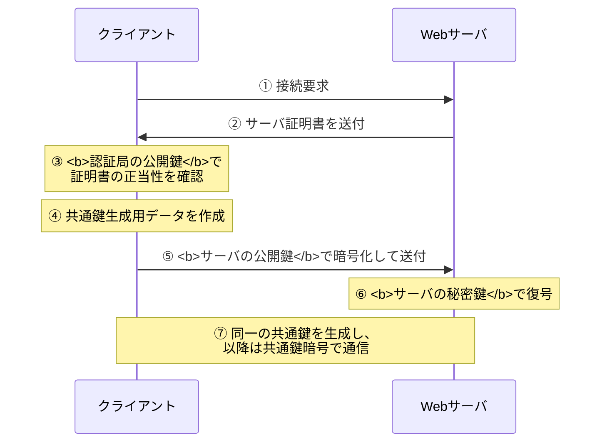
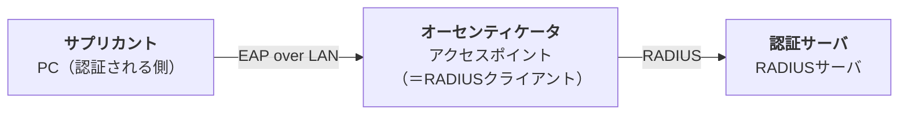
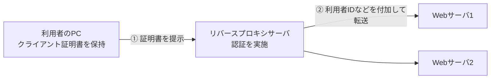

# 11-5 セキュリティ実装技術

[11-1](11-1-情報セキュリティ.md) の暗号・認証技術を、**実際のプロトコルや仕組みとしてどう実装するか**を扱う章である。TLS、IPsec、無線LANセキュリティ、認証連携（シングルサインオン）、そしてWebアプリケーションのセキュア実装が主題になる。

ネットワークスペシャリスト試験では、**TLS、IPsec、IEEE 802.1X/RADIUS、WPA** の4つが繰り返し問われる。いずれも「どの層で、何を、どの鍵を使って守るか」が設問の核になるので、構造を押さえれば確実に得点できる。

## 目次

- [1. TLS](#1-tls)
- [2. IPsec](#2-ipsec)
- [3. 電子メールのセキュア化](#3-電子メールのセキュア化)
- [4. 無線LANのセキュリティ](#4-無線lanのセキュリティ)
- [5. 認証連携とシングルサインオン](#5-認証連携とシングルサインオン)
- [6. Webアプリケーションのセキュア実装](#6-webアプリケーションのセキュア実装)

---

## 1. TLS

**TLS（Transport Layer Security）**は、SSLの後継として標準化された、アプリケーション層の通信を保護するプロトコルである。HTTPと組み合わせたものがHTTPSで、443番ポートを使う（→ [10-3](../10-network/10-3-通信プロトコル.md)）。

### 1.1 ハンドシェイクの流れ

TLSは**公開鍵暗号で共通鍵を安全に配送し、以降は共通鍵暗号で高速に通信する**という、ハイブリッド暗号方式の典型例である（→ [11-1](11-1-情報セキュリティ.md)）。

**どの鍵をどこで使うか**が出題される。

| 段階 | 使う鍵 | 理由 |
| --- | --- | --- |
| ③ サーバ証明書の正当性確認 | **認証局（CA）の公開鍵** | 証明書はCAの秘密鍵で署名されているので、検証にはCAの公開鍵を使う |
| ⑤ 共通鍵生成用データの暗号化 | **Webサーバの公開鍵** | サーバだけが復号できるようにする |
| ⑥ 復号 | Webサーバの秘密鍵 | — |

クライアントの公開鍵・秘密鍵は（クライアント認証を行わない限り）登場しない。「クライアントの公開鍵で証明書を確認する」「Webサーバの秘密鍵で暗号化して送る」といった選択肢は誤りである。

### 1.2 TLSに関する誤解

TLSの設問は**誤った思い込みを否定させる**形で出題される。正しいのは次の記述である。

> **TLSで使用する個人認証用のディジタル証明書は、ICカードなどにも格納することができ、利用するPCを特定のPCに限定する必要はない。**

証明書を可搬媒体に入れられるので、どのPCからでも本人として認証を受けられる。これが「PCに縛られない個人認証」を可能にしている。

誤りとして出される記述を整理する。

| 記述 | なぜ誤りか |
| --- | --- |
| サーバ証明書にはIPアドレスの組込みが必須で、IPアドレスを変更したら再取得が必要 | **証明書が結び付けるのはIPアドレスではなくホスト名（FQDN）**である。IPアドレスを変えても証明書はそのまま使える |
| 共通鍵の長さは128ビット未満で任意に指定する／日本国内では128ビット未満に制限されている | そのような制限はない。128ビット以上が一般的である |
| Webサーバと特定の利用者が通信するためのプロトコルであり、事前の利用者登録が不可欠 | **不特定多数の利用者が事前登録なしに使える**のがTLSの要点。だからこそ一般のWebサイトで普及した |

証明書がFQDNに紐づくという性質は、1つのIPアドレスで複数のサイトをホストする運用（SNI）や、CDNの利用を可能にしている（→ [10-5](../10-network/10-5-ネットワーク応用.md)）。

### 1.3 クライアント証明書による利用者認証

通常のTLSはサーバだけが証明書を提示する（サーバ認証）。これに加えて**クライアントも証明書を提示する**構成を**クライアント認証**という。

インターネット上のPCからDMZ上の公開Webサイトにアクセスし、入力した個人情報が内部のDBサーバに蓄積されるシステムで、**利用者個人のディジタル証明書を用いたTLS通信**を行うと何が期待できるか。

> **PCとWebサーバ間の通信データを暗号化するとともに、利用者を認証することができるようになる。**

2点に注意する。

- **保護される区間はPCとWebサーバの間だけ**である。Webサーバから先（DBサーバまで）はTLSの外なので、「PCとDBサーバ間の通信データを暗号化する」ことにはならない。TLSが守るのは**端点どうしの区間**であり、途中でアプリケーションが終端すればそこで保護は切れる。
- **クライアント証明書で認証されるのは「利用者」**である。サーバ証明書による「正当なサーバであることの検証」とは向きが逆である。

### 1.4 ダウングレード攻撃

**SSL/TLSのダウングレード攻撃**とは、

> **暗号化通信を確立するとき、弱い暗号スイートの使用を強制することによって、解読しやすい暗号化通信を行わせる**

攻撃である。

TLSのハンドシェイクでは、クライアントとサーバが「お互いが使える暗号方式の一覧」を交換して、共通して使えるものを選ぶ。この折衝に割り込んで、「クライアントは弱い方式しか使えない」と偽ることで、脆弱な暗号方式を選ばせる。古い環境との互換性を保つという親切な設計が、そのまま攻撃面になっている例である。

対策は**弱い暗号スイートを無効化し、古いプロトコルバージョンを受け付けないこと**に尽きる。互換性を捨てる判断が必要になる。

誤答との区別も押さえる。「暗号鍵候補を総当たりで試す」のはブルートフォース攻撃、「証明書を強制的に失効させる」「Webブラウザを古いバージョンにする」のは、いずれもダウングレード攻撃の説明ではない。**ダウングレードされるのは「暗号スイート」であって、ブラウザのバージョンではない**。

> **出題** SSLの通信手順: H24午前I問12 ｜ TLS: H27午前II問21、H30午前II問20、R7午前II問16 ｜ クライアント証明書とTLS: H30午前I問12 ｜ ダウングレード攻撃: R1午前II問16

---

## 2. IPsec

**IPsec**は**ネットワーク層（IP）で**通信を保護するプロトコル群である。上位のアプリケーションを問わずすべての通信を保護できるのが特徴で、拠点間VPNの定番になっている（→ [10-5](../10-network/10-5-ネットワーク応用.md)）。

**IPv6では拡張ヘッダを利用して暗号化機能を実現する**。IPv6でネットワーク層の暗号化を行うなら、答えはIPsecである（PPPはデータリンク層、SSHとTLSはより上位 → [10-3](../10-network/10-3-通信プロトコル.md)）。

### 2.1 3つの構成要素

| 要素 | 役割 |
| --- | --- |
| **AH** (Authentication Header) | **データの暗号化は行わず、SPI、シーケンス番号、認証データを用いて、完全性の確保と認証を行う** |
| **ESP** (Encapsulating Security Payload) | **暗号化**＋認証を行う。暗号化する対象部分によってトランスポートモードとトンネルモードがある |
| **IKE** (Internet Key Exchange) | **暗号化アルゴリズムを決定し、暗号化鍵を動的に生成する鍵交換プロトコル**。UDPの**500番**ポートを使う |

**AHは暗号化しない**のが最大のポイントである。改ざん検知と送信元認証だけを行う。暗号化が要らず完全性だけ保証したい場合や、暗号輸出規制が厳しかった時代に意味があった。現在はESPが認証機能も持つため、ESPだけで足りることが多い。

**SA（Security Association）**は、「暗号化アルゴリズムや暗号化鍵のライフタイムが設定される管理テーブル」で、期間を過ぎると新しいデータに更新される。SPI（Security Parameter Index）はこのSAを識別する番号である。

誤りやすい点を整理する。

| 記述 | 正しくは |
| --- | --- |
| IKEは鍵交換のためのプロトコルであり、ポート番号80が使用される | **UDP 500番**。80番はHTTP |
| 暗号化アルゴリズムとして HMAC-SHA1 が使用される | **HMAC-SHA1 は認証（メッセージ認証符号）のアルゴリズム**であり、暗号化アルゴリズムではない（→ [11-1](11-1-情報セキュリティ.md)）。暗号化にはAESなどを使う |
| 認証や暗号化アルゴリズムを両者で決めるためにAHヘッダを使用する | アルゴリズムの折衝は**IKE**が行う。AHでもESPでもない |

### 2.2 トランスポートモードとトンネルモード

| モード | カプセル化 | 用途 |
| --- | --- | --- |
| トランスポートモード | 元のIPヘッダはそのまま残し、**ペイロードだけ**を保護する | ホスト間の直接通信 |
| **トンネルモード** | **元のIPパケット全体を新しいIPパケットで包む** | 拠点間VPN。ゲートウェイ同士で張る |

**ESPトンネルモードの暗号化範囲**が3回出題されている。データ形式は次のとおりである。

| 並び順 | フィールド | 暗号化 | 認証（完全性保護） |
| --- | --- | --- | --- |
| 1 | 新IPヘッダ | × | × |
| 2 | ESPヘッダ（SPI・シーケンス番号） | × | **○** |
| 3 | **オリジナルIPヘッダ** | **○** | ○ |
| 4 | TCPヘッダ | ○ | ○ |
| 5 | データ | ○ | ○ |
| 6 | **ESPトレーラ**（パディング・次ヘッダ） | **○** | ○ |
| 7 | ESP認証データ（ICV） | × | × |

**暗号化されるのは「オリジナルIPヘッダからESPトレーラまで」**である。

範囲の両端を論理で確認する。

- **新IPヘッダは暗号化できない**。これは経路上のルータが転送に使うヘッダなので、暗号化してしまうと配送できない。
- **ESPヘッダも暗号化されない**。受信側が「どのSAで復号すればよいか」をSPIから知る必要があるため、平文で置く。
- **オリジナルIPヘッダは暗号化される**。ここがトンネルモードの価値である。元の送信元・宛先が隠れるので、**内部ネットワークの構成を外部から見えなくできる**。
- **ESP認証データは暗号化の対象外**である。暗号化された結果に対して計算する認証値なので、それ自体を暗号化することはできない。

したがって「**ESPのトンネルモードを使用すると、暗号化通信の区間において、エンドツーエンドの通信で用いる元のIPヘッダを含めて暗号化できる**」という記述が正しい。

> **出題** IPsec AH: H23午前II問21 ｜ ESPトンネルモードの暗号化範囲: H24午前II問12、H28午前II問7、R5午前II問9（計3回） ｜ IPsec全般: H30午前II問19、R6午前II問21 ｜ IPv6拡張ヘッダ: H28午前I問12 ｜ IPv6での暗号化: R6午前I問15

---

## 3. 電子メールのセキュア化

**S/MIME（Secure/Multipurpose Internet Mail Extensions）**は、**電子メールの内容の機密性を高めるために用いられるプロトコル**である。メール本文そのものを暗号化し、ディジタル署名を付加する。

IMAP4・POP3は受信用、SMTPは送信用のプロトコルであり、いずれも**メールの内容を保護する機能はもたない**（→ [10-3](../10-network/10-3-通信プロトコル.md)）。

S/MIMEでは [11-1](11-1-情報セキュリティ.md) の鍵の向きがそのまま適用される。

| 操作 | 使う鍵 |
| --- | --- |
| 署名の生成（送信者） | **送信者の秘密鍵** |
| 署名の検証（受信者） | **送信者の公開鍵** |
| 本文の暗号化（送信者） | 受信者の公開鍵 |
| 本文の復号（受信者） | 受信者の秘密鍵 |

ここでも「自身の公開鍵で署名を生成し、送信者の秘密鍵で検証する」といった鍵の向きを逆にした選択肢が出る（→ [11-4](11-4-情報セキュリティ対策.md)）。

S/MIMEが守るのは**メール本文のエンドツーエンドの機密性・真正性**である。一方 [11-4](11-4-情報セキュリティ対策.md) で見たSPF・DKIM・DMARCは**ドメイン単位の送信元詐称対策**であり、守る対象が異なる。両者は併用できる。

> **出題** S/MIME: H23午前I問13

---

## 4. 無線LANのセキュリティ

無線は電波が届く範囲なら誰でも受信できるので、有線以上に**認証**と**暗号化**が重要になる。規格の系譜は [10-1](../10-network/10-1-ネットワーク方式.md) を参照。

### 4.1 暗号化方式の変遷

| 方式 | 暗号化アルゴリズム | 問題点 |
| --- | --- | --- |
| WEP | **RC4**。利用者が設定する秘密鍵と、製品で生成するIV（Initialization Vector）とを連結した数字を基に、データをフレームごとに暗号化する | IVが短く再利用されるため、通信を集めれば鍵が解析できる。**解読済み** |
| WPA | TKIP（RC4を使いつつ鍵を定期的に更新） | WEPの暫定的な改良。現在は非推奨 |
| **WPA2** | **AESを採用した CCMP（Counter-mode with CBC-MAC Protocol）** | 長く標準として使われた |
| WPA3 | AES（GCMPなど）。SAEによる鍵交換で辞書攻撃に強い | 現行の最新規格 |

**WPA2の特徴は「暗号化アルゴリズムにAESを採用したCCMPを使用する」**ことである。無線LANでWPA2を選択したときに利用される暗号化アルゴリズムは **AES** である（ECC・RC4・RSAではない）。

誤答として並ぶ記述との区別も押さえる。

- 「AHとESPの機能によって認証と暗号化を実現する」→ **IPsec**の説明
- 「SSL Handshake Protocolを使用して相手を認証する」→ **TLS**の説明
- 「秘密鍵とIVを連結した数字を基にRC4で暗号化する」→ **WEP**の説明

### 4.2 パーソナルモードとエンタープライズモード

WPA2 / WPA3 には2つの運用形態がある。

| モード | 認証方法 | 用途 |
| --- | --- | --- |
| パーソナル（PSK） | 事前共有鍵（パスフレーズ）を全員で共有 | 家庭・小規模 |
| **エンタープライズ** | **IEEE 802.1X による利用者ごとの認証**。認証サーバ（RADIUS）を使う | 企業 |

**WPA3-Enterprise**（およびWPA2-Enterprise）は、

> **IEEE 802.1X の規格に沿った利用者認証及び動的に更新（共有）される暗号鍵を用いた暗号化通信を実装するための規格**

である。利用者ごとに認証し、**鍵も利用者ごと・セッションごとに動的に生成される**ので、1人の端末が漏えいしても他の利用者の通信は守られる。全員で同じ鍵を共有するパーソナルモードとの決定的な違いがここにある。

関連用語の誤りも押さえておく。

| 誤った記述 | 正しくは |
| --- | --- |
| EAPは、あらかじめ登録した共通鍵による暗号化通信を実現する規格 | **EAPは認証の枠組み（フレームワーク）**であり、暗号化方式ではない |
| RADIUSは、クライアントPCとアクセスポイントの間で公開鍵暗号方式による暗号化通信を実現する | **RADIUSは認証サーバとのプロトコル**であり、PC-AP間の暗号化を行うものではない |
| SSIDは、クライアントPCごとの秘密鍵を定めたもの | **SSIDは無線LANの識別子（ネットワーク名）**であり、鍵ではない |

### 4.3 IEEE 802.1XとRADIUS

**IEEE 802.1X** が定めているのは、

> **アクセスポイントが EAP を使用して、利用者を認証する枠組み**

である。無線LAN専用の規格ではなく、有線LANのポート単位認証にも使われる（認証VLANの基盤 → [11-4](11-4-情報セキュリティ対策.md)）。

登場人物は3者で、**どの役割がどの機器に実装されるか**が繰り返し問われる。

| 役割 | 実装される機器 |
| --- | --- |
| **サプリカント**（認証を要求する側） | **PC** |
| **オーセンティケータ**（認証を仲介し、ポートの開閉を制御する） | **アクセスポイント**。このときアクセスポイントは **RADIUSクライアント**の機能をもつ |
| **認証サーバ** | **RADIUSサーバ** |

したがって正しい実装は、

> **アクセスポイントには IEEE 802.1X のオーセンティケータを実装し、かつ、RADIUSクライアントの機能をもたせる。**

となる。アクセスポイントが**RADIUS「クライアント」**である点が引っかけになりやすい。アクセスポイントはPCから見れば認証の窓口だが、RADIUSサーバから見れば問い合わせてくる側、つまりクライアントである。**立場は相手によって変わる**と理解すればよい。

**RADIUS** 自体は、**リモートアクセス環境において、認証情報やアカウンティング情報をやり取りするプロトコル**である。Authentication（認証）、Authorization（認可）、Accounting（課金・記録）の3つを扱うので **AAAプロトコル**と呼ばれる。CHAP・PAPはPPPの認証プロトコル（→ [10-2](../10-network/10-2-データ通信と制御.md)）、PPTPはトンネリングプロトコルであり、いずれもRADIUSとは別物である。

### 4.4 EAPの種類

**EAP（Extensible Authentication Protocol）**は認証方式を差し替えられる枠組みなので、具体的な方式がいくつもある。

| 方式 | 認証の方法 |
| --- | --- |
| **EAP-TLS** | **クライアント証明書**とサーバ証明書による相互認証 |
| EAP-TTLS | サーバ証明書でトンネルを張り、その中でID/パスワードなどを使う |
| EAP-PEAP | EAP-TTLSと同様にトンネル内で認証する |
| EAP-MD5 | ID/パスワードのチャレンジレスポンス。サーバ認証がなく脆弱 |
| EAP-FAST | PACという共有情報を使ってトンネルを張る |

**認証にクライアント証明書を用いるのは EAP-TLS** である。クライアント側にも証明書が必要になるため導入の手間はかかるが、パスワードを使わないので盗まれる心配がなく、最も安全とされる。

> **出題** WPA2・CCMP: H25午前II問19、H27午前II問17 ｜ WPA2とAES: H26午前I問15 ｜ 無線LANセキュリティ: H24午前II問21、R7午前II問19 ｜ IEEE 802.1X: H28午前II問17、R3午前II問19、R5午前II問21（計3回） ｜ 802.1XとRADIUSの実装: H23午前II問19、H26午前II問18、H30午前II問21 ｜ RADIUS: R6午前II問8 ｜ EAP-TLS: H30午前II問17、R5午前II問19

---

## 5. 認証連携とシングルサインオン

### 5.1 シングルサインオン

**シングルサインオン（SSO）**は、一度の認証で複数のシステムを利用できるようにする仕組みである。実装方式がいくつかある。

| 方式 | 仕組み | 制約 |
| --- | --- | --- |
| **Cookie型** | 認証情報を含むCookieをブラウザに持たせ、各サーバがそれを検証する | Cookieはドメインを越えないので、**認証対象の各サーバを同一ドメインに配置する必要がある** |
| **リバースプロキシ型** | すべてのアクセスをリバースプロキシに通し、そこで認証する | **各Webサーバのドメインが異なっていてもよい** |
| フェデレーション型（SAMLなど） | 認証結果を標準化された形式で伝達する | 組織を越えて連携できる |

**リバースプロキシを使ったシングルサインオン**については、

> **利用者認証においてパスワードの代わりにディジタル証明書を用いることができる。**

リバースプロキシが認証を一手に引き受けるので、そこにクライアント証明書による認証を導入すれば、背後のWebサーバを改修せずに強い認証を導入できる。

**ドメインの制約**の向きに注意する。Cookie型は**同一ドメインでなければならない**（Cookieは発行元ドメインにしか送られないため）。リバースプロキシ型には**その制約がない**。「クッキーを使ったSSOでは各サーバを異なるドメインに配置する必要がある」「リバースプロキシを使ったSSOでは各サーバを異なるドメインに配置する必要がある」は、いずれも誤りである。

また、Cookie型で「サーバごとの認証情報を含んだクッキーを**クライアントで生成**し、各サーバ上で保存・管理する」というのも誤りである。Cookieを**生成するのはサーバ側**で、**保存するのはクライアント側**である。生成と保存の主体が逆になっている。

### 5.2 リバースプロキシ型SSOの情報の流れ

クライアント証明書で利用者を認証するリバースプロキシサーバを用いたSSOでは、情報の流れが問われる。

正しいのは、

> **利用者IDなどの情報をWebサーバに送信するのは、利用者のPCではなく、リバースプロキシサーバである。**

リバースプロキシが認証を済ませたうえで、「この要求は誰のものか」をHTTPヘッダなどに付加して背後のWebサーバへ渡す。背後のWebサーバは自分で認証せず、リバースプロキシを信頼する。これによって各Webサーバから認証機能を取り除ける、というのがこの方式の価値である。

なお**クライアント証明書は、利用者が事前に認証局から取得して自分のPCに導入しておくもの**であり、リバースプロキシサーバやWebサーバが配布するものではない。

### 5.3 SAML

**SAML（Security Assertion Markup Language）**は、

> **認証情報に加え、属性情報とアクセス制御情報を、異なるドメインに伝達するためのWebサービスの仕様**

である。

キーワードは**「異なるドメインに伝達する」**である。Cookieもリバースプロキシも、基本的には一つの組織の中で完結する仕組みだった。SAMLは**組織を越えた認証連携（フェデレーション）**を可能にする。自社で認証した結果を、XMLベースの「アサーション」という形式でクラウドサービス事業者に渡し、相手はそれを信頼してログインを許可する、という使い方になる。

誤答として並ぶ仕様との区別も押さえる。

| 記述 | 実際は何か |
| --- | --- |
| Webサービスに関する情報を公開し、機能を検索可能にする仕様 | **UDDI** |
| 権限がない利用者による傍受・読取り・改ざんから電子メールを保護する仕様 | **S/MIME** |
| ディジタル署名に使われる鍵情報を効率よく管理するWebサービスの仕様 | XKMS |

> **出題** シングルサインオン: H22午前II問18、H24午前I問13 ｜ リバースプロキシ型SSO: R4午前I問13 ｜ SAML: H28午前II問16

---

## 6. Webアプリケーションのセキュア実装

[11-1](11-1-情報セキュリティ.md) で見たWeb攻撃に対して、**実装レベルで何をすべきか**を整理する。攻撃と対策の正しい組合せを選ばせる形式が頻出である。

### 6.1 攻撃と対策の対応

| 攻撃 | 正しい対策 |
| --- | --- |
| **SQLインジェクション** | **SQL文の組立てに静的プレースホルダ（バインド機構）を使用する** |
| **クロスサイトスクリプティング (XSS)** | **Webページに入力されたデータの出力データが、HTMLタグとして解釈されないように処理する**（出力時のエスケープ） |
| **OSコマンドインジェクション** | **シェルを起動する言語機能を利用した実装を避ける** |
| クロスサイトリクエストフォージェリ (CSRF) | リクエストに推測困難なトークンを埋め込んで検証する |
| セッションハイジャック | セッションIDを推測困難なものにし、ログイン後に再発行する |
| ディレクトリトラバーサル | 外部から渡す入力データをファイル名として直接指定しない |
| バッファオーバフロー | 直接メモリにアクセスできる言語機能を避ける／境界チェックを行う |

**この対応表の「ずらし」が誤答になる**。たとえば「OSコマンドインジェクションを防ぐためにセッションIDを推測困難にする」「クロスサイトスクリプティングを防ぐために入力データをファイル名として直接指定しない（これはディレクトリトラバーサル対策）」「セッションハイジャックを防ぐためにシェルを起動できないようにする（これはOSコマンドインジェクション対策）」といった具合である。**攻撃の原理から対策を導けるようにしておく**のが確実な対処になる。

明確に誤りとされる対策も押さえておく。

- XSS対策として「任意の外部サイトのスタイルシートを取り込めるようにする」→ **逆に危険**
- CSRF対策として「リクエストにGETメソッドを使用する」→ **逆に危険**（GETはURLで誘発しやすい）
- セッションハイジャック対策として「利用者ごとに固定のセッションIDを使用する」→ **逆に危険**（固定なら盗めば永久に使える）

**SQLインジェクション対策の「静的プレースホルダ」**は、SQL文の構造をあらかじめデータベース側で確定させ、後から値だけを当てはめる方式である。値がどんな文字列でもSQL文の構造を変えられないので、原理的に注入が成立しない。文字列のエスケープによる対策より確実とされる。

### 6.2 セッション管理

**セッションの乗っ取りの機会を減らすために、利用者のログアウト時に行うべき処理**は、

> **WebサーバにおいてセッションIDを無効にする。**

重要なのは**サーバ側で無効化する**という点である。ブラウザ側でCookieを消しても、**サーバがそのセッションIDを有効と認識し続けている限り**、過去に盗まれたIDで再びアクセスできてしまう。セッションの有効・無効を決める権限はサーバにしかない。

誤答との区別も押さえる。「セッションIDを内蔵ストレージに格納する」はサーバ側でもブラウザ側でも**むしろ危険**である（残れば盗まれる）。ブラウザのキャッシュのクリアは情報漏えい対策としては意味があるが、**セッションの乗っ取りそのものは防げない**。

### 6.3 Cookieの属性

Cookieには、セキュリティを高める属性が用意されている。

| 属性 | 効果 |
| --- | --- |
| **Secure** | **URL内のスキームが https のときだけ、WebブラウザからCookieが送出される** |
| HttpOnly | JavaScriptからのCookieの読出しを禁止する |
| Domain / Path | 送出先のドメイン・パスを限定する |
| Expires / Max-Age | 有効期間を設定する |
| SameSite | 他サイトからのリクエストでの送出を制限する（CSRF対策） |

**Secure属性は「httpsのときだけ送る」**。これがないと、何かの拍子に `http://` でアクセスしたときにCookieが平文で流れ、盗聴される。4つの属性はそれぞれ役割が明確に違うので、取り違えないよう対応を覚える。特に**Secure（通信路の限定）とHttpOnly（JavaScriptからの保護）**は混同しやすい。

### 6.4 セキュリティ関連のHTTPレスポンスヘッダ

| ヘッダ | 役割 |
| --- | --- |
| **Strict-Transport-Security（HSTS）** | **Webサイトが Webブラウザに対して、指定された期間において、当該Webサイトへのアクセスを https で行うように指示する** |
| Content-Security-Policy | 読み込んでよいスクリプトや画像の配信元を制限する（XSS対策） |
| X-Content-Type-Options | ブラウザによるコンテンツ種別の推測（MIMEスニッフィング）を抑止する |
| X-XSS-Protection | ブラウザのXSSフィルタを制御する（現在は非推奨） |

**HSTS**が解決するのは、「最初の1回だけ `http://` でアクセスしてしまう」という隙間である。そこで中間者に割り込まれればHTTPSへの誘導を妨害できてしまう（SSLストリッピング）。HSTSを一度受け取ったブラウザは、指定期間中は**そのサイトへのアクセスを必ずhttpsに切り替える**ので、この隙間がなくなる。

> **出題** 攻撃と対策の組合せ: H24午前I問15、H26午前I問14 ｜ XSS対策: H30午前I問13 ｜ OSコマンドインジェクション対策: R7午前I問14 ｜ セッション管理: R3午前I問15 ｜ Cookie Secure属性: R1午前II問17 ｜ HSTS: H30午前II問18

---

## この章のまとめ

- TLSのハンドシェイクでは、**証明書の検証に認証局の公開鍵**、**共通鍵生成用データの暗号化にサーバの公開鍵**を使う。証明書が結び付くのは**FQDNであってIPアドレスではない**。
- **クライアント証明書によるTLSは「PCとWebサーバ間の暗号化」＋「利用者の認証」**。守られるのは端点どうしの区間だけ。
- **ダウングレード攻撃は弱い暗号スイートを強制する**攻撃。
- IPsecは **AH＝暗号化しない認証、ESP＝暗号化＋認証、IKE＝鍵交換（UDP 500）**。**ESPトンネルモードの暗号化範囲はオリジナルIPヘッダからESPトレーラまで**。
- 無線LANは **WPA2＝AESのCCMP、WEP＝RC4とIV**。**エンタープライズモードはIEEE 802.1Xで利用者ごとに認証し、鍵も動的に生成される**。
- 802.1Xの役割分担は **PC＝サプリカント、アクセスポイント＝オーセンティケータかつRADIUSクライアント、認証サーバ＝RADIUSサーバ**。**クライアント証明書を使うEAPはEAP-TLS**。
- SSOは **Cookie型＝同一ドメイン必須、リバースプロキシ型＝ドメインが異なってよい**。リバースプロキシが**利用者IDをWebサーバに渡す**。**SAMLは異なるドメインへ認証・属性・アクセス制御情報を伝達する**。
- Web実装対策は攻撃ごとに対応が決まっている。**SQLi＝静的プレースホルダ、XSS＝出力時のエスケープ、OSコマンド＝シェルを起動しない**。
- **ログアウト時はサーバ側でセッションIDを無効にする**。**Cookieの Secure 属性は https のときだけ送出する**。**HSTSはhttpsでのアクセスをブラウザに指示する**。
