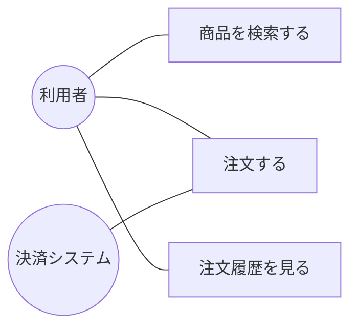

# 12-1 システム・ソフトウェア要件定義

システム開発の最初の工程、**「何を作るのか」を決める**段階を扱う。

要件定義の失敗は、後工程のすべてに波及する。設計やプログラミングのミスは該当箇所を直せば済むが、「作るべきものが違っていた」と気づくのは受入れテストや稼働後になりがちで、そのときの手戻りは比較にならない。だからこの工程では、**曖昧さを残さず、関係者の間で同じ理解を共有する**ことに技法が費やされる。本章で扱うDFD・決定表・ユースケース図は、いずれもそのための道具である。

午前Iの問16前後から出題される。16年で5問。

## 目次

- [1. 要件定義の位置づけ](#1-要件定義の位置づけ)
- [2. 分析・設計の技法](#2-分析設計の技法)
- [3. DFD](#3-dfd)
- [4. UMLユースケース図](#4-umlユースケース図)
- [5. ソフトウェアの品質特性](#5-ソフトウェアの品質特性)

---

## 1. 要件定義の位置づけ

共通フレームでは、開発の工程が次のように並ぶ（→ [13-1 開発プロセス・手法](../13-software-development-management/13-1-開発プロセス-手法.md)）。

**要件定義は「What（何を）」、設計は「How（どうやって）」**を決める工程である。要件定義でHowに踏み込みすぎると実現手段を縛ってしまい、設計でWhatを決め直すと関係者の合意が崩れる。この境界を保つことが工程分割の意味である。

要件は**機能要件**（システムが何をするか）と**非機能要件**（性能・可用性・セキュリティなど、どの程度の品質で動くか）に分かれる（→ [18-2 要件定義](../18-system-planning/18-2-要件定義.md)）。

---

## 2. 分析・設計の技法

要件を表現する技法は、**何に着目するか**で使い分ける。

| 技法 | 着目するもの | 有効な場面 |
| --- | --- | --- |
| **DFD**（データフローダイアグラム） | **データの流れ** | 業務システム内のデータの流れを表現する |
| **決定表（デシジョンテーブル）** | **条件と処理の対応** | **複雑な条件判定を伴う要件定義の記述** |
| **状態遷移図** | 状態と遷移 | 制御系・通信プロトコルの記述（→ [12-2 設計](12-2-設計.md)） |
| 制御フロー図 | 制御の流れ | **DFDに「コントロール変換とコントロールフロー」を付加**したもの。制御系システムに特有な処理を表現する |
| 構造化チャート | モジュールの階層構造 | プログラムの構造を表現する |

**決定表**は、条件の組合せを列挙して、それぞれに対する処理を表の形で示す。

| 条件 | 規則1 | 規則2 | 規則3 | 規則4 |
| --- | --- | --- | --- | --- |
| 会員である | Y | Y | N | N |
| 購入額が1万円以上 | Y | N | Y | N |
| **処理** | | | | |
| 10%割引 | X | | | |
| 5%割引 | | X | X | |
| 割引なし | | | | X |

条件が増えると組合せは指数的に増えるが、**表にすれば抜けや重複が一目でわかる**。文章で「会員でかつ1万円以上なら…ただし…」と書くと必ず曖昧さと漏れが生じる。この「網羅性を機械的に担保する」ところが決定表の価値である。そのままテストケースにもなる（→ [12-4 統合・テスト](12-4-統合-テスト.md)）。

設問では**技法の説明が互いに入れ替えられる**。「構造化チャートは状態の種別と遷移要因の関係を表現する」（これは状態遷移図）、「状態遷移図はDFDにコントロール変換とコントロールフローを付加したもの」（これは制御フロー図）、「制御フロー図はデータの源泉・吸収・流れ・処理・格納を基本要素とする」（これはDFD）といった具合である。

> **出題** 分析・設計の技法: H24午前I問16

---

## 3. DFD

**DFD（Data Flow Diagram）**は、システム内の**データの流れ**を4つの基本要素で表す。

| 要素 | 記号 | 意味 |
| --- | --- | --- |
| 源泉・吸収（外部実体） | 四角 | システムの外にあるデータの発生元・行き先 |
| プロセス（処理） | 円・丸角四角 | データを変換する処理 |
| **データストア** | 二重線 | データの蓄積場所 |
| データフロー | 矢印 | データの流れ |

### 3.1 データストアの性質

**データストアの性質**として出題されたのは、

> **他のデータストアと直接にデータフローで結ばれることはなく、処理が介在する。**

DFDの規則は単純で、**データが動くには必ず処理が必要**である。データストアからデータストアへ、何の処理もなしにデータが移ることはありえない。「在庫ファイルから発注ファイルへ」とデータが移るなら、その間に「発注データを作成する」という処理があるはずで、それを明示させるのがDFDの狙いである。

同じ理由から、**源泉・吸収どうしが直接結ばれることもない**（それはシステムの外で起きていることなので、このシステムの関心事ではない）。

誤答として並ぶ記述も、この規則から誤りだとわかる。

| 記述 | 誤りの理由 |
| --- | --- |
| 最終的には、開発されたシステムの物理ファイルとなる | DFDは**論理モデル**であり、実装方法を規定しない。データストアが複数のテーブルになることも、1つのテーブルに統合されることもある |
| データストア自体が、データを作成したり変更したりすることがある | **データストアは置き場所であって、能動的に何かをしない**。作成・変更は処理の役目 |
| データストアに入ったデータが出て行くときは、データフロー以外のものを通ることがある | DFDで**データが通るのはデータフローだけ**である |

> **出題** DFDのデータストア: H27午前I問16

---

## 4. UMLユースケース図

**UML（Unified Modeling Language）**はオブジェクト指向の標準的なモデリング言語で、目的の違う十数種類の図が定義されている。要件定義でよく使われるのが**ユースケース図**である。

> **ユースケース図は、システムとアクタの相互作用を表現する。**

**アクタ**は、システムを利用する人や外部システムを指す。「誰が（アクタ）」「システムに対して何ができるか（ユースケース）」を棒人間と楕円で描く。

この図の価値は、**システムの内部を一切描かないこと**にある。要件定義の段階で利用者と合意すべきなのは「システムで何ができるか」であって、どう実装するかではない。内部構造を描かないからこそ、技術者でない利害関係者とも議論できる。

他の主要なUML図との区別を押さえる。設問では互いの説明が入れ替えられる。

| 図 | 表現するもの |
| --- | --- |
| **ユースケース図** | **システムとアクタの相互作用** |
| **クラス図** | **クラスと関連から構成される、システムの静的な構造** |
| **状態遷移図（ステートマシン図）** | **外部からのトリガに応じた、オブジェクトの状態遷移** |
| シーケンス図 | オブジェクト間のメッセージのやり取りを時間軸で表現 |
| アクティビティ図 | 処理の流れ。分岐や並行処理を表現（→ [17-2 業務プロセス](../17-system-strategy/17-2-業務プロセス.md)） |

なお「**データの流れに注目してシステムの機能を表現する**」のはUMLの図ではなく**DFD**である。

クラス図・オブジェクト指向設計の詳細は [12-2 設計](12-2-設計.md) で扱う。

> **出題** UMLユースケース図: H28午前I問16、R1午前II問24

---

## 5. ソフトウェアの品質特性

**JIS X 0129-1（ISO/IEC 9126）**は、ソフトウェア製品の品質を6つの**品質特性**に分類し、それぞれを**品質副特性**に細分化している。

| 品質特性 | 意味 | 主な副特性 |
| --- | --- | --- |
| 機能性 | required な機能を提供するか | 合目的性、正確性、**相互運用性**、セキュリティ、標準適合性 |
| **信頼性** | 故障せず動き続けるか | 成熟性、障害許容性、**回復性** |
| 使用性 | 使いやすいか | 理解性、習得性、**運用性**、魅力性 |
| 効率性 | 資源を無駄にしないか | 時間効率性、資源効率性 |
| 保守性 | 修正しやすいか | **解析性**、変更性、安定性、試験性 |
| 移植性 | 他環境へ移しやすいか | 環境適応性、設置性、共存性、置換性 |

設問では、**ある副特性の説明がどの品質特性に属するか**が問われる。**信頼性に分類される**のは、

> **故障時に、指定された達成水準を再確立し、直接に影響を受けたデータを回復するソフトウェア製品の能力**

これは**回復性**であり、信頼性の副特性である。「故障しても元に戻せる」という点で、信頼性の文脈に属する。

誤答として並ぶ副特性の帰属は次のとおり。

| 記述 | 副特性 | 属する品質特性 |
| --- | --- | --- |
| 欠陥の診断や故障原因の追及、修正箇所の識別を行う能力 | 解析性 | **保守性** |
| 一つ以上の指定されたシステムと相互作用する能力 | 相互運用性 | **機能性** |
| 利用者がソフトウェアの運用及び運用管理を行うことができる能力 | 運用性 | **使用性** |

判別の目安は、**「誰にとっての、いつの話か」**である。解析性は開発者が修正するときの話なので保守性、運用性は利用者が使うときの話なので使用性、回復性は故障が起きたときの話なので信頼性、と結び付く。

なお、現行の **JIS X 25010（ISO/IEC 25010）**では8つの品質特性（機能適合性、性能効率性、互換性、使用性、信頼性、セキュリティ、保守性、移植性）に再編されている。セキュリティが機能性の副特性から独立した品質特性に格上げされた点が大きな変更である。

> **出題** ソフトウェア品質副特性: H21午前I問16

---

## この章のまとめ

- **要件定義は「何を」、設計は「どうやって」**を決める工程。境界を保つことに意味がある。
- **決定表は複雑な条件判定の記述に有効**。条件の組合せを網羅でき、そのままテストケースになる。
- **DFDはデータの流れを表す論理モデル**。**データストアどうしは直接結ばれず、必ず処理が介在する**。データストアは能動的に何かをしない。
- **ユースケース図はシステムとアクタの相互作用**、クラス図は静的構造、状態遷移図は状態の変化を表す。
- 品質副特性は**回復性＝信頼性、解析性＝保守性、相互運用性＝機能性、運用性＝使用性**。
