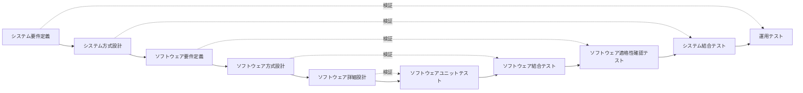

# 12-4 統合・テスト

作ったものが**要求どおりに動くことを確かめる**工程を扱う。

テストで押さえるべき考え方は2つある。ひとつは**「何を根拠にテストケースを作るか」**で、仕様から作るのがブラックボックステスト、コードの構造から作るのがホワイトボックステストである。もうひとつは**「いつ終わらせるか」**で、テストを完全に尽くすことは不可能なので、網羅基準や信頼度成長モデルで打ち切りを判断する。

ネットワークスペシャリスト午前IIでは問24前後から、午前Iでは問16前後から出題される。16年で9問。

## 目次

- [1. テスト工程とV字モデル](#1-テスト工程とv字モデル)
- [2. ブラックボックステスト](#2-ブラックボックステスト)
- [3. ホワイトボックステストと網羅基準](#3-ホワイトボックステストと網羅基準)
- [4. テストの終了判定](#4-テストの終了判定)

---

## 1. テスト工程とV字モデル

テストは**対応する設計工程の内容を検証する**ように組まれている。これを図にしたものが**V字モデル**である。



**テスト要求事項を定義するアクティビティと対応するテスト**の組合せが出題されている。

| 設計のアクティビティ | 対応するテスト |
| --- | --- |
| **システム方式設計** | **システム結合テスト** |
| **ソフトウェア方式設計** | **ソフトウェア結合テスト** |
| **ソフトウェア詳細設計** | **ソフトウェアユニットテスト** |

対応関係には理屈がある。**各設計工程で決めたことを、対応するテストで確かめる**のである。詳細設計はモジュール内部の作りを決めるのでユニットテストで検証し、ソフトウェア方式設計はモジュール間の分担を決めるのでソフトウェア結合テストで検証し、システム方式設計はハードウェアを含むシステム構成を決めるのでシステム結合テストで検証する。

重要なのは、**テストの要求事項（何を確かめるか）は、対応する設計工程のときに決めておく**という点である。テスト段階になってから考えるのでは遅い。設計時に「これをどう検証するか」を同時に考えることで、検証できない曖昧な設計を防げる。

**運用テスト**はシステム要件定義に対応し、実際の業務環境で利用者が行う最終確認である（→ [12-5 導入・受入れ支援](12-5-導入-受け入れ支援.md)）。

> **出題** テスト要求事項の定義: H28午前II問24

---

## 2. ブラックボックステスト

**ブラックボックステスト**は、**プログラムの内部構造を見ず、仕様だけを根拠に**テストケースを作る方法である。

> **機能仕様から同値クラスや限界値を識別し、テストデータを作成する。**

> **プログラムがどのような機能を果たすのかを仕様書で調べて、テストケースを設計する。**

### 2.1 同値分割と限界値分析

| 技法 | 考え方 |
| --- | --- |
| **同値分割** | 入力を「同じ結果になるはずのグループ（同値クラス）」に分け、**各グループから代表値を1つ選ぶ** |
| **限界値分析（境界値分析）** | 同値クラスの**境界とその前後**を選ぶ |

たとえば「18歳以上65歳未満が対象」という仕様なら、

- 同値クラスは「18未満」「18以上65未満」「65以上」の3つ。代表値として 10、30、70 を選ぶ。
- 限界値は境界の 17, 18, 64, 65 を選ぶ。

**限界値を重視するのは、そこに誤りが集中するから**である。`>=` と `>` の書き間違い、ループの繰返し回数が1回ずれる（オフバイワンエラー）といった誤りは、まさに境界でしか表に出ない。真ん中の値をいくら試しても見つからない。限られた回数のテストで誤りを見つける確率を最大化する、という発想である。

### 2.2 誤答との区別

テストデータの作成方法として誤りとされるものを確認する。

| 記述 | 誤りの理由 |
| --- | --- |
| 稼働中のシステムから実データを無作為に抽出する | 無作為では**境界値や異常値が含まれる保証がない**。実データは正常系に偏る |
| 実データのうち使用頻度が高いものを重点的に抽出する | 頻度の高いデータは既に正しく動いている可能性が高い。**稀なケースこそ誤りが潜む** |
| 業務で発生するデータの発生頻度を分析して作成する | 同上。性能テストには有効だが機能の検証には向かない |
| プログラムの流れ図から、分岐条件に基づいて作成する | これは**ホワイトボックステスト**の方法 |

**「仕様から作る」のがブラックボックス、「コードから作る」のがホワイトボックス**という区別が、そのまま判別の基準になる。

> **出題** ブラックボックステスト: H21午前II問24、H23午前I問16、H26午前I問16

---

## 3. ホワイトボックステストと網羅基準

**ホワイトボックステスト**は、**プログラムの内部構造（制御の流れ）を根拠に**テストケースを作る。どこまで通したかの基準を**網羅基準（カバレッジ）**という。

| 網羅基準 | 満たす条件 | 強さ |
| --- | --- | --- |
| **命令網羅** | すべての命令を**少なくとも1回**実行する | 弱い |
| **判定条件網羅（分岐網羅）** | すべての判定の**真・偽の両方**を1回以上通る | 中 |
| **条件網羅** | 判定を構成する**個々の条件**が、それぞれ真・偽の両方をとる | 中 |
| 判定条件／条件網羅 | 判定条件網羅と条件網羅の両方を満たす | 強い |
| 複数条件網羅 | 個々の条件の**すべての組合せ**を網羅する | 最強 |

### 3.1 判定条件網羅と条件網羅の違い

この2つは紛らわしいので、例で確認する。判定が `if (A かつ B)` だとする。

**判定条件網羅（分岐網羅）**は、**判定全体の結果**が真・偽の両方になればよい。

| | A | B | A かつ B |
| --- | --- | --- | --- |
| ケース1 | 真 | 真 | **真** |
| ケース2 | 真 | 偽 | **偽** |

2ケースで達成できる。ただし**Bだけが偽のケースしか試しておらず、Aが偽のケースは一度も通っていない**。

**条件網羅**は、**個々の条件**がそれぞれ真・偽の両方をとればよい。

| | A | B | A かつ B |
| --- | --- | --- | --- |
| ケース1 | 真 | 偽 | 偽 |
| ケース2 | 偽 | 真 | 偽 |

A も B も真偽の両方をとっている。しかし**判定全体が真になるケースがない**ので、判定条件網羅は満たしていない。

このように**条件網羅は判定条件網羅を含まない**。両方を満たすには、通常もう1ケース必要になる。「分岐網羅を満たし、かつ条件網羅を満たすテストデータの組」を選ぶ設問では、**両方の表を実際に書いて確認する**のが確実である。

### 3.2 最小テストケース数を求める

流れ図が与えられて「命令網羅で実施する場合の最小テストケース数」を問う形式も出る。

考え方は、**すべての処理ブロックを通るための最小の経路の組合せを数える**ことである。分岐が直列に並んでいる場合、各分岐でどちらを通るかを組み合わせれば、少ないケース数で全命令を通せることが多い。「分岐の数だけケースが必要」とは限らない点に注意する。

判定条件網羅でも同様に、**各判定の真・偽を1回ずつ通れば足りる**ので、分岐が複数あっても真偽をうまく組み合わせれば2ケースで済む場合がある。

> **出題** 分岐網羅と条件網羅: H25午前I問17 ｜ 命令網羅: R3午前I問16 ｜ 判定条件網羅: R4午前I問16

---

## 4. テストの終了判定

テストは有限の時間で打ち切らねばならない。「もう十分だ」と判断する根拠が必要になる。

### 4.1 エラー埋込み法

**エラー埋込み法（バグ埋込み法、error seeding）**は、**わざと既知の誤りを埋め込んでおき、それがどれだけ見つかるかで、潜在的な誤りの総数を推定する**手法である。

記号を次のように定める。

| 記号 | 意味 |
| --- | --- |
| $S$ | 埋め込んだエラー数 |
| $m$ | 埋め込んだエラーのうち**発見された**数 |
| $T$ | 埋め込みを含まない、テスト開始前の**潜在エラー数** |
| $n$ | 発見された**総**エラー数 |

このとき成り立つ関係は、

$$ \frac{m}{S} = \frac{n - m}{T} $$

**左辺が「埋め込みエラーの発見率」、右辺が「本来のエラーの発見率」**である。発見された総数 $n$ のうち $m$ が埋め込み分なので、**本来のエラーの発見数は $n - m$** になる。

この式が成り立つ前提は、**埋め込んだエラーと本来のエラーが同じ確率で見つかる**ことである。「埋め込みエラーの8割を発見できた。ならば本来のエラーも8割見つかっているはずだ」と推論して、$T$ を逆算する。前提が強すぎるという批判はあるが、**テストの網羅性を客観的な数値で見積もる**数少ない手段として使われる。

誤答として出される式は、分子と分母を入れ替えたり、$n-m$ を $n$ にしたりしたものである。**「発見率どうしが等しい」という意味から式を立て直せる**ようにしておけば間違えない。

### 4.2 信頼度成長モデル

テストを続けると、**発見される累積バグ数は最初は急激に増え、やがて頭打ちになる**。この曲線を数式で表したものが**ソフトウェア信頼度成長モデル**で、代表的なものが**ゴンペルツ曲線**とロジスティック曲線である。

```
累積バグ発見数
  │                    ＿＿＿＿＿＿  ← 収束
  │              ／
  │        ／
  │   ／
  │／
  └──────────────────────→ テスト期間
```

**S字型（最初ゆるやか → 急増 → 収束）**の曲線になる。テスト初期は環境構築などで発見が進まず、中盤に集中的に見つかり、終盤は見つからなくなる、という実際の経過を表している。

実測値をこの曲線に当てはめ、**カーブが寝てきたら「バグが収束した」と判定する**根拠にする。逆に、予定期間を過ぎてもまだ右肩上がりなら、品質が十分でないと判断できる。

試験では**曲線の形**を選ばせる形式で出題される。**右上がりで、上に凸になって収束していくS字型**を選べばよい。直線や右下がり、収束しないものは誤りである。

> **出題** エラー埋込み法: H26午前II問24 ｜ ゴンペルツ曲線: R6午前I問17

---

## この章のまとめ

- V字モデルでは**設計工程とテスト工程が対応する**。**システム方式設計↔システム結合テスト、ソフトウェア方式設計↔ソフトウェア結合テスト、ソフトウェア詳細設計↔ユニットテスト**。テスト要求事項は対応する設計時に決める。
- **ブラックボックステストは仕様から、ホワイトボックステストはコードの構造から**テストケースを作る。実データの無作為抽出や頻度分析は適切な方法ではない。
- **同値分割で代表値、限界値分析で境界とその前後**を選ぶ。誤りは境界に集中するため。
- **判定条件網羅（判定全体の真偽）と条件網羅（個々の条件の真偽）は互いを含まない**。両方を満たすには追加のケースが要る。
- **エラー埋込み法は $\dfrac{m}{S} = \dfrac{n-m}{T}$**。埋め込みエラーの発見率と本来のエラーの発見率が等しいと仮定する。
- **ゴンペルツ曲線はS字型に収束する累積バグ発見数の曲線**で、テスト終了の判定根拠に使う。
