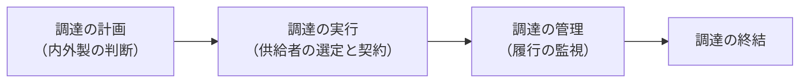

# 14-10 プロジェクトの調達

プロジェクトに必要なものを**外部から取得する**ための管理を扱う。

調達が独立した領域になっているのは、**組織の外とのやり取りには契約が伴う**からである。社内であれば口頭の依頼で動くこともあるが、外部との取引では、何を・いつまでに・いくらで・どういう品質でという条件を文書で確定しなければならない。曖昧なまま進めれば、認識の食い違いが紛争になる。

H21〜R7の午前I・午前IIでは**この小分類からの直接の出題は見当たらなかった**。ただし、調達プロセスやRFI・RFPの流れ、契約形態の選択は [18-3 調達計画及び実施](../18-system-planning/18-3-調達計画及び実施.md) で繰り返し出題されている。本章は**プロジェクトマネジメントの観点から見た調達**を整理する。

## 目次

- [1. 調達マネジメントの流れ](#1-調達マネジメントの流れ)
- [2. 契約形態の選択](#2-契約形態の選択)
- [3. 調達に伴うリスク](#3-調達に伴うリスク)

---

## 1. 調達マネジメントの流れ

最初の判断が**内外製分析（Make or Buy）**である。自社で作るか、外部から調達するかを決める。

| 判断材料 | 内製が有利な場合 | 外製が有利な場合 |
| --- | --- | --- |
| コスト | 長期的に繰り返し使う | 一時的な需要 |
| 技術 | 中核となる技術（自社に蓄積したい） | 専門性が高く社内にない技術 |
| 期間 | 時間に余裕がある | 急ぐ |
| 統制 | 仕様が変わりやすい | 仕様が確定している |

**中核技術を外注すると、長期的に自社に知見が残らない**という問題がある。短期的なコストだけで判断すべきではない、というのが内外製分析の要点である。

調達先の選定プロセス（RFI、RFP、提案評価、契約締結）は [18-3 調達計画及び実施](../18-system-planning/18-3-調達計画及び実施.md) で詳しく扱う。

---

## 2. 契約形態の選択

契約形態は、**リスクを発注者と受注者のどちらが負うか**で決まる。

| 契約形態 | 内容 | リスクの所在 |
| --- | --- | --- |
| **請負契約** | **仕事の完成**に対して対価を支払う。受注者は完成責任を負う | **受注者** |
| **準委任契約** | **業務の遂行**に対して対価を支払う。完成責任は負わない | **発注者** |
| 派遣契約 | 労働者を派遣先の指揮命令下で働かせる | 発注者（派遣先） |

**工程によって適した契約形態が異なる**。

| 工程 | 適した契約 | 理由 |
| --- | --- | --- |
| 要件定義 | **準委任** | **何を作るかがまだ決まっていない**ので、完成責任を負わせられない |
| 設計・実装・テスト | **請負** | 仕様が確定しているので、成果物を定義できる |
| 運用テスト支援 | 準委任 | 発注者側の作業を支援する性質 |

**要件定義を請負契約にすると不合理が生じる**。完成すべきものが決まっていない段階で「完成責任」を課すことになり、受注者はリスクを価格に織り込まざるをえない。この考え方は「情報システム・モデル取引・契約書」にも反映されている（→ [18-3 調達計画及び実施](../18-system-planning/18-3-調達計画及び実施.md)）。

著作権の帰属も契約形態で変わるため、契約時に明記する必要がある（→ [13-2 知的財産適用管理](../13-software-development-management/13-2-知的財産適用管理.md)）。

---

## 3. 調達に伴うリスク

外部に依存することで、自分では制御できないリスクが生まれる。

| リスク | 内容 | 対応の例 |
| --- | --- | --- |
| 納期遅延 | 供給者が期日に間に合わない | 中間成果物の確認、進捗報告の義務付け |
| 品質不良 | 期待する水準に達しない | 受入基準の明確化、段階的な検収 |
| 供給者の経営破綻 | 事業継続できなくなる | **複数購買**、代替供給者の確保 |
| 情報漏えい | 委託先から情報が流出する | 秘密保持契約、委託先の監査（→ [11-2 情報セキュリティ管理](../11-security/11-2-情報セキュリティ管理.md)） |

**コンティンジェンシープラン（緊急時対応計画）**を用意しておくことも調達リスクへの対応になる。たとえば組込み機器のハードウェア製造を外部に委託する場合、委託先が供給できなくなったときに**代替の調達先に切り替える手順**をあらかじめ定めておく、といった準備である（→ [18-3 調達計画及び実施](../18-system-planning/18-3-調達計画及び実施.md)）。

これは [14-8 プロジェクトのリスク](14-8-プロジェクトのリスク.md) のリスク対応でいえば、**発生してしまった場合に備える**という位置づけになる。回避も軽減も転嫁もできないリスクに対して、「起きたらこうする」を決めておくわけである。

---

## この章のまとめ

- 調達は**内外製分析（Make or Buy）**から始まる。**中核技術を外注すると自社に知見が残らない**ので、短期的なコストだけで判断しない。
- 契約形態は**リスクを誰が負うか**で決まる。**請負は完成責任を受注者が負い、準委任は負わない**。
- **要件定義には準委任が適する**。何を作るかが決まっていない段階で完成責任を課すのは不合理だから。
- 調達リスクには**複数購買やコンティンジェンシープラン**で備える。
