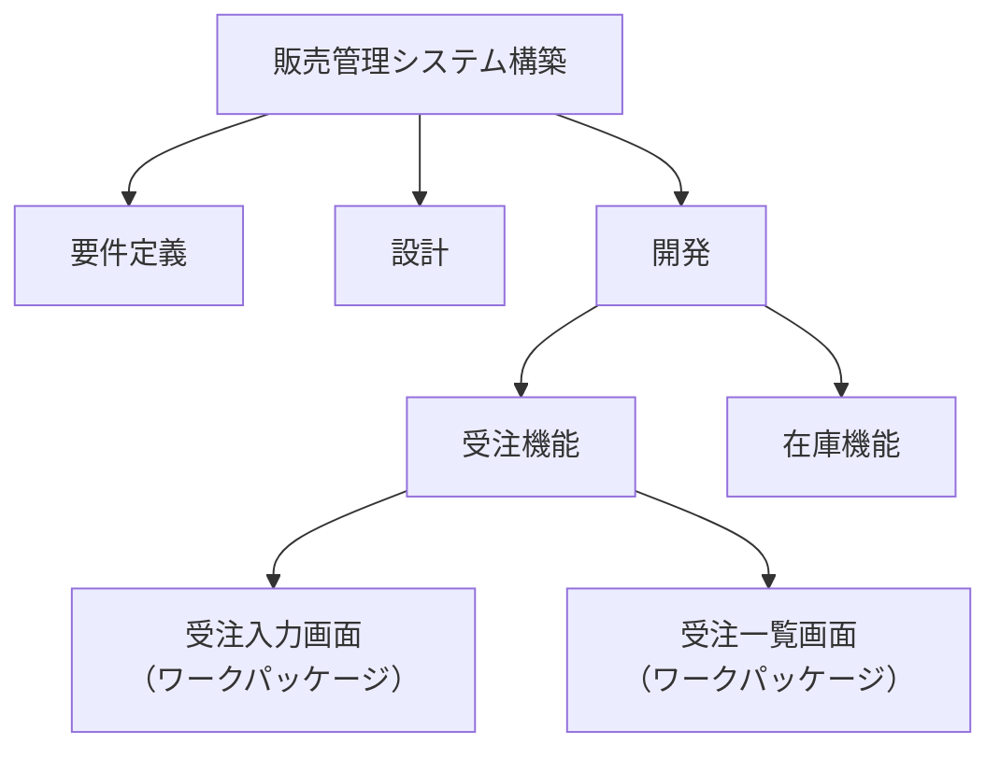

# 14-4 プロジェクトのスコープ

プロジェクトで**何を作り、何を作らないか**を定め、その範囲を守る管理を扱う。

スコープマネジメントが重要なのは、**範囲が曖昧なプロジェクトは必ず膨らむ**からである。「ついでにこれも」という要望は、ひとつひとつは小さくても積み重なれば期間も費用も破綻させる。範囲を文書で確定し、変更には手続きを求めることが、プロジェクトを完了させる前提になる。

午前Iの問18前後から出題される。16年で1問。

## 目次

- [1. スコープの2種類](#1-スコープの2種類)
- [2. WBS](#2-wbs)
- [3. ワークパッケージ](#3-ワークパッケージ)
- [4. スコープクリープ](#4-スコープクリープ)

---

## 1. スコープの2種類

| 種類 | 定めるもの |
| --- | --- |
| **プロダクトスコープ** | **成果物**の特性と機能。「何を作るか」 |
| **プロジェクトスコープ** | 成果物を生み出すために**実行する作業**。「何をするか」 |

両者は別物である。たとえば「システムを作る」はプロダクトスコープだが、「利用者教育を行う」「旧システムからデータを移行する」はプロジェクトスコープに含まれる作業であって、成果物そのものではない。

スコープを定義する際には、**含まれるもの（In Scope）と含まれないもの（Out of Scope）の両方を明記する**ことが実務上きわめて重要になる。「含まれないこと」を書かないと、後から「当然入っていると思っていた」という主張を否定できない。

スコープを記した文書が**プロジェクトスコープ記述書**で、プロジェクトの目標、成果物、要求事項及び境界を記す（→ [14-2 プロジェクトの統合](14-2-プロジェクトの統合.md)）。

---

## 2. WBS

**WBS（Work Breakdown Structure、作業分解構成図）**は、**プロジェクトで実行する作業を階層構造で記したもの**である。



WBSを作る目的は3つある。

- **作業の抜け漏れを防ぐ**。大きな塊のままでは見落としが生じるが、分解すれば気づける。
- **見積りの精度を上げる**。「システム構築に何人月か」は答えにくいが、「受注入力画面の実装に何人日か」なら答えられる。
- **責任の割当てを可能にする**。分解した単位ごとに担当を決められる。

WBSで作られない作業はスコープ外である、という原則（**WBSに含まれないものは作らない**）が、スコープの統制を支えている。

---

## 3. ワークパッケージ

**ワークパッケージ**は、**WBSの最下位の要素**である。

> WBSの構成要素であるワークパッケージに関する記述のうち、適切なものはどれか。

答えは、

> **ワークパッケージは、更にアクティビティに分解される。**

階層の関係を整理する。

```
WBS の階層（成果物の分解）
  └─ ワークパッケージ（WBSの最下位）
       └─ アクティビティ（実行する作業の単位）← スケジュール作成の基礎になる
```

**WBSは成果物を分解したもので、ワークパッケージはその最小単位**である。これをさらに「設計する」「実装する」「テストする」といった**アクティビティ（実行可能な作業）**に分解して、はじめて所要日数の見積りや順序付けができるようになる（→ [14-6 プロジェクトの時間](14-6-プロジェクトの時間.md)）。

誤答として並ぶ記述を確認する。

| 記述 | 誤りの理由 |
| --- | --- |
| ワークパッケージは、**OBSのチームに担当する人員を割り当てたもの**である | OBS（組織分解構成図）は組織の分解であり、WBSとは別の構造。両者を対応付けた表はRAM（責任分担マトリックス）と呼ばれる |
| ワークパッケージは、**関連のある要素成果物をまとめたもの**である | **逆**。まとめたものではなく、分解した結果の最小単位である |
| ワークパッケージは、**一つ上位の要素成果物と1対1に対応する** | 1対1とは限らない。1つの上位要素が複数のワークパッケージに分解されるのが普通である |

**「分解した最小単位」であって「まとめたもの」ではない**という点が、この設問の核心である。

> **出題** WBSとワークパッケージ: H22午前I問18

---

## 4. スコープクリープ

**スコープクリープ**とは、**正式な変更管理を経ないまま、スコープが少しずつ拡大していく現象**である。

起きる仕組みは次のとおりである。

1. 利用者から「ここも直せますか」という小さな要望が来る
2. 開発者が「これくらいなら」と引き受ける
3. 記録も承認もされないので、誰も全体量の増加を把握していない
4. 気づいたときには期間も工数も大幅に超過している

厄介なのは、**ひとつひとつは合理的で、断る理由がないように見える**ことである。だからこそ、**「正式な変更管理プロセスを通す」という手続きを例外なく適用する**ことが唯一の歯止めになる（→ [14-2 プロジェクトの統合](14-2-プロジェクトの統合.md)）。

変更を禁じるのではない。**変更の影響（期間・費用・品質）を明示し、それを引き受けるかどうかを決める権限のある者が判断する**ようにすることが目的である。影響を見せたうえで「それでもやる」と決まるなら、それは正当な意思決定であり、スコープクリープではない。

---

## この章のまとめ

- スコープには**プロダクトスコープ（何を作るか）とプロジェクトスコープ（何をするか）**がある。**含まれないものも明記する**。
- **WBSは成果物を階層的に分解したもの**。抜け漏れの防止、見積り精度の向上、責任の割当てを可能にする。
- **ワークパッケージはWBSの最下位要素で、さらにアクティビティに分解される**。「まとめたもの」ではなく「分解した結果」である。
- **スコープクリープは、小さな変更を手続きなしに受け入れた積み重ねで起きる**。変更を禁じるのではなく、影響を明示して権限者が判断する仕組みが歯止めになる。
