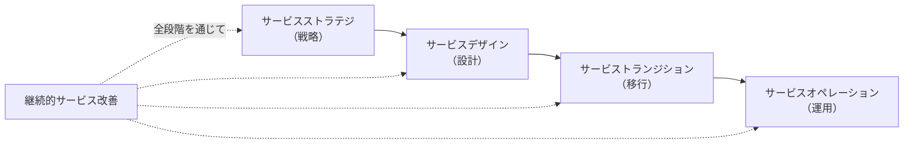

# 15-1 サービスマネジメント

ITサービスを**継続的に提供し、改善していく**ための枠組みを扱う。

分野14のプロジェクトマネジメントが**有期の活動**を扱うのに対し、サービスマネジメントは**終わりのない活動**を扱う。システムは作って終わりではなく、そこから何年も動かし続ける。障害に対応し、変更を取り込み、性能を保ち、利用者を支える──この継続的な営みを体系化したものがITサービスマネジメントである。

午前Iの問20前後から出題される。16年で4問。

## 目次

- [1. ITサービスマネジメントとは](#1-itサービスマネジメントとは)
- [2. ITILのサービスライフサイクル](#2-itilのサービスライフサイクル)
- [3. SLAとサービスレベル管理](#3-slaとサービスレベル管理)

---

## 1. ITサービスマネジメントとは

**ITサービスマネジメント（ITSM）**は、ITを「システム」ではなく**「サービス」として管理する**考え方である。

この視点の転換が重要である。「サーバが動いている」ことと「利用者が業務を遂行できている」ことは別である。サーバが正常でもネットワークが遅ければ業務は止まる。システムの稼働ではなく、**利用者にとっての価値**を基準に管理するのがサービスマネジメントの立場になる。

主な標準は2つある。

| 標準 | 性格 |
| --- | --- |
| **ITIL** | 実践の集成（ベストプラクティス集）。**認証の対象ではない** |
| **JIS Q 20000**（ISO/IEC 20000） | **要求事項を定めた規格**。認証の対象になる |

**ITILは「こうするとうまくいく」という事例集、JIS Q 20000 は「こうしなければならない」という規格**という違いがある。

---

## 2. ITILのサービスライフサイクル

ITIL 2011 edition では、サービスの一生を5つの段階で表す。

| 段階 | 内容 |
| --- | --- |
| **サービスストラテジ** | **ITサービス及びITサービスマネジメントに対する全体的な戦略を確立する** |
| **サービスデザイン** | **事業要件を取り入れ、事業が求める品質・信頼性・柔軟性に応えるサービスと、それを支えるプラクティス及び管理ツールを作り出す** |
| **サービストランジション** | **サービス及びサービス変更を運用に利用できるようにするために、前の段階の成果を受け取り、事業のニーズを満たすかどうかをテストし、本番環境に展開する** |
| **サービスオペレーション** | **顧客とサービス提供者にとっての価値を確保できるように、ITサービスを効果的かつ効率的に提供しサポートする** |
| **継続的サービス改善** | **ITサービスマネジメントプロセスとITサービスに対する改善の管理を責務とし、効率性・有効性・費用対効果を向上させるために、サービス提供者のパフォーマンスを継続的に測定して改善を加える** |

**順序は「戦略 → 設計 → 移行 → 運用」**で、継続的サービス改善がすべての段階にかかる。

段階名と説明の対応は、**キーワードで紐付ける**と覚えやすい。

| キーワード | 段階 |
| --- | --- |
| **全体的な戦略** | サービスストラテジ |
| **作り出す** | サービスデザイン |
| **本番環境に展開する** | サービストランジション |
| **提供しサポートする** | サービスオペレーション |
| **継続的に測定して改善** | 継続的サービス改善 |

**「トランジション（移行）」が運用の前に入る**のが見落としやすい点である。設計したものをそのまま運用に放り込むのではなく、テストして展開するという段階を明示的に置いている。[12-5 導入・受入れ支援](../12-system-development/12-5-導入-受け入れ支援.md) で見た移行の慎重さが、サービスのライフサイクルにも組み込まれている。

> **出題** ITILのサービスライフサイクル: H30午前I問20

---

## 3. SLAとサービスレベル管理

### 3.1 SLAとは

**SLA（Service Level Agreement、サービスレベル合意書）**に記載する内容は、

> **サービス及びサービス目標を特定した、サービス提供者と顧客との間の合意事項**

である。

誤答との区別を押さえる。

| 記述 | 実際は何か |
| --- | --- |
| サービス提供者が提供する**全てのサービスの特徴、構成要素、料金** | **サービスカタログ** |
| **サービスデスクなどの内部グループ**とサービス提供者との間の合意事項 | **OLA**（運用レベル合意書）。組織内部の合意 |
| 利用者から出されたITサービスに対する**業務要件** | 要件であって合意ではない |

**SLAは「提供者と顧客」の間、OLAは「組織内部」の合意**という区別がある。顧客に99.9%の可用性を約束する（SLA）なら、それを支える内部の各チームとも相応の合意（OLA）が要る、という入れ子の関係になっている。

### 3.2 SLA策定の方針

> SLAを策定する際の方針のうち、適切なものはどれか。

答えは、

> **顧客の要望とコストとの兼ね合いで、サービスレベルを設定する。**

サービスレベルを上げれば必ずコストが上がる。可用性を99%から99.9%にするには冗長構成が要り、99.99%にするなら遠隔地にもう一式必要になる。**要望をそのまま飲むのではなく、コストとの釣り合いで決める**のが実務的な方針である。

誤答として並ぶ3つは、いずれも**現実的でない方針**である。

| 記述 | なぜ不適切か |
| --- | --- |
| **考えられる全ての項目に対し、サービスレベルを設定する** | 項目が多すぎれば測定も管理もできなくなる。**重要な項目に絞る** |
| **サービスレベルを設定する全ての項目に対し、ペナルティとしての補償を設定する** | すべてに補償を付ければ提供者のリスクが過大になり、価格に転嫁される。結局は顧客の負担になる |
| **将来にわたって変更が不要なサービスレベルを設定する** | 事業環境は変わるので、**定期的に見直す**のが前提である |

3つの誤答に共通するのは、**「完璧を目指そうとしている」**ことである。SLAは理想を書く文書ではなく、**合意可能で、測定可能で、見直し可能な水準**を定める文書である。

### 3.3 サービスレベル管理

> サービスマネジメントにおける**サービスレベル管理**の活動はどれか。

答えは、

> **提供するサービス及びサービスレベル目標を決定し、サービス提供者が顧客との間で合意文書を交わす。**

誤答は、いずれも**別のプロセス**の活動である。

| 記述 | プロセス |
| --- | --- |
| 現在の資源の調整と最適化を行い、将来の資源要件に関する予測を記載した計画を作成する | **容量・能力管理**（キャパシティ管理 → [4-2 システムの評価指標](../04-system-components/4-2-システムの評価指標.md)） |
| サービスの提供に必要な予算に応じて、適切な資金を確保する | **予算業務及び会計業務** |
| 災害や障害で事業が中断しても、要求されたサービス機能を合意された期間内に確実に復旧できるよう、事業影響度の評価や復旧優先順位を明確にする | **サービス継続管理**（→ [15-2 サービスマネジメントシステムの計画及び運用](15-2-サービスマネジメントシステムの計画及び運用.md)） |

**「目標を決めて合意文書を交わす」のがサービスレベル管理**であり、他のプロセスは具体的な資源・資金・継続性を扱う。サービスレベル管理は、それらのプロセスが目指すべき**目標値を定める役割**を担っていると理解するとよい。

サービスレベルの測定・レビューは [15-3 パフォーマンス評価及び改善](15-3-パフォーマンス評価及び改善.md) で扱う。

> **出題** SLAの策定方針: H23午前I問20 ｜ SLAの記載内容: H26午前I問20 ｜ サービスレベル管理: R6午前I問20

---

## この章のまとめ

- ITサービスマネジメントは、**システムの稼働ではなく利用者にとっての価値**を基準に管理する。**ITILは事例集、JIS Q 20000 は規格**。
- ITILのライフサイクルは**戦略 → 設計 → 移行 → 運用**、これに継続的サービス改善が全段階でかかる。「本番環境に展開する」のがトランジション。
- **SLAは提供者と顧客の合意、OLAは組織内部の合意**。サービスカタログは料金や構成を載せた別物。
- SLAは**顧客の要望とコストの兼ね合い**で設定する。全項目に設定することも、全項目に補償を付けることも、変更不要にすることも現実的でない。
- **サービスレベル管理は目標を決めて合意する**プロセス。資源は容量・能力管理、資金は予算業務、復旧はサービス継続管理が担う。
