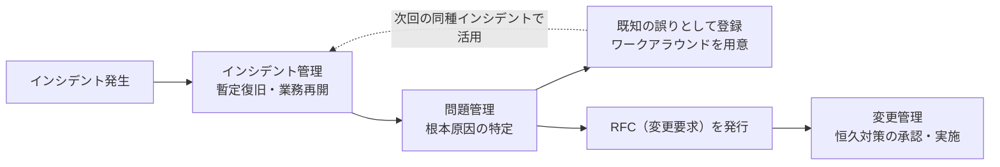

# 15-2 サービスマネジメントシステムの計画及び運用

ITサービスを支える**個々の管理プロセス**を扱う。インシデント管理、問題管理、変更管理、構成管理、可用性管理、容量・能力管理、サービス継続管理などが対象になる。

これらのプロセスは独立しているようでいて、**互いに連携して1つの流れを作る**。障害が起きればインシデント管理が暫定復旧し、問題管理が根本原因を突き止め、変更管理が恒久対策を承認し、構成管理が結果を記録する。本章ではこの連携を軸に整理する。

午前Iの問20・問21前後から出題される。16年で8問と、分野15のなかで最も出題が多い。

## 目次

- [1. インシデント管理と問題管理](#1-インシデント管理と問題管理)
- [2. 変更管理とリリース管理](#2-変更管理とリリース管理)
- [3. 構成管理](#3-構成管理)
- [4. 可用性管理](#4-可用性管理)
- [5. 容量・能力管理とサービス継続管理](#5-容量能力管理とサービス継続管理)

---

## 1. インシデント管理と問題管理

**最も混同されやすい2つのプロセス**である。**目的がまったく違う**ことを押さえる。

| プロセス | 目的 | 時間軸 |
| --- | --- | --- |
| **インシデント管理** | **インシデントの解決とサービスの復旧** | **いますぐ** |
| **問題管理** | **未知の根本原因を特定し、恒久的な解決策を策定する** | じっくり |

### 1.1 インシデント管理

**インシデント**とは、サービスの中断や品質低下を引き起こす（または引き起こしうる）出来事である。

> ITサービスマネジメントにおける**インシデント管理の主な活動**はどれか。

答えは **インシデントの解決とサービスの復旧**である。

重要なのは、**インシデント管理は原因究明を目的としない**ことである。目の前で業務が止まっているとき、優先すべきは**一刻も早く業務を再開させる**ことである。原因が分からなくても、再起動や予備系への切替えで復旧するなら、それでよい。「なぜ起きたか」は後から問題管理が調べる。

この割り切りは、**目的が違えば最適な行動も違う**という認識に基づいている。復旧を急げば原因の痕跡が消えることもあるが、それでも業務の再開が優先される場面は多い。

インシデント管理が行う具体的な活動の例として、

> **利用者からの障害報告を受けて、既知の誤りに該当するかどうかを照合する。**

がある。既知の誤りであれば、問題管理が用意した**ワークアラウンド（暫定回避策）**をすぐ適用でき、復旧が速い。

誤答として並ぶ活動との区別を押さえる。

| 記述 | プロセス |
| --- | --- |
| サービスデスクに対する顧客満足度を評価し、改善の機会を特定するためにレビューする | **サービスレベル管理／継続的改善**（→ [15-3 パフォーマンス評価及び改善](15-3-パフォーマンス評価及び改善.md)） |
| ディスクの空き容量がしきい値に近づいたので、対策を検討する | **容量・能力管理** |
| プログラムを変更した場合の影響度を調査する | **変更管理** |
| インシデントの**根本原因の究明** | **問題管理** |
| インシデントの**トレンド分析と予防措置** | **問題管理**（予防的な側面） |

### 1.2 問題管理

> ITサービスマネジメントにおける**問題管理プロセス**において実施することはどれか。

答えは、

> **インシデントの発生後に未知の根本原因を特定し、恒久的な解決策を策定する。**

**「未知の」「根本原因」「恒久的」**がキーワードになる。

誤答と対比すると役割分担がはっきりする。

| 記述 | プロセス |
| --- | --- |
| インシデント発生後に**暫定的にサービスを復旧**させ、業務を継続する | **インシデント管理** |
| インシデントの発生を記録し、関係する部署に状況を連絡する | **インシデント管理** |
| インシデントの発生に備えて、復旧のための設計をする | サービス継続管理 |

### 1.3 2つのプロセスの連携

> ITILにおいて、**問題管理でエラーの根本原因を識別した後にRFCを出す対象となるプロセス**はどれか。

答えは **変更管理**である。

流れに必然性がある。問題管理は原因を**特定する**ところまでが役割で、**システムを実際に変更する権限は持たない**。恒久対策には変更が必要なので、**RFC（変更要求）を変更管理に出して承認を得る**。無断で本番環境を変えれば、それ自体が新たな障害の原因になるからである。

> **出題** 問題管理とRFC: H21午前I問21 ｜ インシデント管理: H24午前I問20 ｜ 問題管理プロセス: H27午前I問20 ｜ インシデント及びサービス要求管理: R1午前I問20

---

## 2. 変更管理とリリース管理

| プロセス | 役割 |
| --- | --- |
| **変更管理** | 変更要求を受け付け、**影響を評価し、承認・却下を決める** |
| **リリース管理及び展開管理** | 承認された変更を**本番環境に展開する** |

**変更管理が「決める」、リリース管理が「実行する」**という分担である。

### 2.1 変更要求の扱い

> ITサービスマネジメントの変更管理プロセスにおける**変更要求の扱い**のうち、適切なものはどれか。

答えは、

> **変更要求を漏れなく管理するために、承認されなかった変更要求も記録した。**

**却下したものも記録する**ことに意味がある。理由は3つある。

- **同じ要求が繰り返し出されたときに、過去の判断を参照できる**
- **却下の理由が残るので、判断の一貫性を保てる**
- **要求の傾向が見える**。同種の却下が続くなら、サービス設計そのものに問題がある可能性を示す

誤答として並ぶ記述は、いずれも**手続きを省略する**ものであり、変更管理の目的に反する。

| 記述 | なぜ不適切か |
| --- | --- |
| **緊急の変更要求**に対応するため、影響範囲のアセスメントを実施せずに実装した | 緊急変更にも**簡略化された手続き**が定められているべきで、無手順で実施してはならない |
| **顧客からの変更要求**だったので、他より無条件に優先して実装した | 優先順位は**影響と緊急度**で決めるべきで、依頼元で決めるものではない |
| **法改正への対応**だったので、変更に要するコストは見積もらずに実装した | 対応が必須であっても、コストの把握は必要である |

**「例外を認めない」のではなく、「例外にも手続きがある」**というのが変更管理の立場である。緊急時には緊急変更の手順を用意しておき、それに従う。手続きを飛ばした変更は、何が変わったか誰も把握できない状態を生む。

この考え方は [13-4 構成管理・変更管理](../13-software-development-management/13-4-構成管理-変更管理.md) のソフトウェア開発における変更管理と共通している。

> **出題** 変更管理プロセス: H23午前I問21

---

## 3. 構成管理

**構成管理**は、サービスを構成する要素（**構成品目、CI**）とその関係を把握し、記録するプロセスである。記録先を**CMDB（構成管理データベース）**という。

構成管理が他のプロセスの土台になるのは、**「いま何がどうなっているか」が分からなければ、どのプロセスも機能しない**からである。

- 変更管理で影響範囲を評価するには、**何と何がつながっているか**を知る必要がある
- インシデント管理で原因を切り分けるには、**どの構成品目が関係するか**を知る必要がある
- 可用性管理で冗長性を評価するには、**どこが単一障害点か**を知る必要がある

CMDBが実態と食い違っていれば、これらの判断はすべて誤る。構成管理は地味だが、サービスマネジメント全体の精度を決める。

---

## 4. 可用性管理

**可用性管理**は、合意したサービス可用性を達成できるようにするプロセスである。

### 4.1 可用性管理のKPI

> ITサービスマネジメントの**可用性管理のKPI**として用いるものはどれか。

答えは **サービスの中断回数**である。

誤答との区別を確認する。

| 記述 | どのプロセスの指標か |
| --- | --- |
| 災害を想定した復旧テストの回数 | **サービス継続管理** |
| **サービスの中断回数** | **可用性管理** |
| 性能不足に起因するインシデントの数 | **容量・能力管理** |
| 目標を達成できなかったSLAの項目数 | **サービスレベル管理**（→ [15-1 サービスマネジメント](15-1-サービスマネジメント.md)） |

**「中断」が可用性、「性能」が容量・能力、「災害」がサービス継続、「SLA項目」がサービスレベル管理**と紐付ける。

### 4.2 信頼性と保守性の指標

> ITIL 2011 edition では、可用性管理におけるKPIの例として**「保守性を表す指標値」**の短縮を挙げている。保守性を表す指標に該当するものはどれか。

答えは **平均サービス回復時間（MTRS）**である。

可用性を支える要素は2つに分かれる。

| 要素 | 意味 | 指標 |
| --- | --- | --- |
| **信頼性** | **壊れにくさ** | **MTBF**（平均故障間隔）、**MTBSI**（平均サービス・インシデント間隔）、一定期間内での中断の数 |
| **保守性** | **直りやすさ** | **MTRS**（平均サービス回復時間） |

**「壊れにくさ」が信頼性、「直りやすさ」が保守性**という区別である。誤答に並ぶ「一定期間内での中断の数」「平均故障間隔」「平均サービス・インシデント間隔」は、いずれも**どれだけ壊れないか**を測る信頼性の指標であり、保守性ではない。

この関係は [4-2 システムの評価指標](../04-system-components/4-2-システムの評価指標.md) で見た「稼働率 = MTBF / (MTBF + MTTR)」と同じ構造である。可用性を上げる手は**壊れにくくする（信頼性）**か**早く直す（保守性）**かの2つしかない。

> **出題** 可用性管理のKPI: H24午前I問21 ｜ 保守性を表す指標: R4午前I問20

---

## 5. 容量・能力管理とサービス継続管理

### 5.1 容量・能力管理

**容量・能力管理（キャパシティ管理）**は、**現在の資源の調整と最適化を行い、将来の資源要件に関する予測を記載した計画を作成する**プロセスである。

「ディスクの空き容量がしきい値に近づいたので対策を検討する」といった活動がこれにあたる。考え方は [4-2 システムの評価指標](../04-system-components/4-2-システムの評価指標.md) のキャパシティプランニングと同じで、**足りなくなってからでは遅いので、傾向を監視して先回りする**ことが要点になる。

### 5.2 サービス継続管理

**サービス継続管理**は、**災害や障害などで事業が中断しても、要求されたサービス機能を合意された期間内に確実に復旧できるように、事業影響度の評価や復旧優先順位を明確にする**プロセスである。

2つの目標値が中心になる。

| 指標 | 意味 |
| --- | --- |
| **RTO**（目標復旧時間） | **いつまでに**復旧させるか |
| **RPO**（目標復旧時点） | **どの時点のデータまで**戻せればよいか |

> **目標復旧時点（RPO）を24時間に定めている**のはどれか。

答えは、

> **障害発生時点の24時間前の業務データの復旧を保証する。**

**RPOは「時点」であって「時間の長さ」ではない**点が決め手である。誤答と並べると違いがはっきりする。

| 記述 | 実際は何か |
| --- | --- |
| 業務アプリケーションをリリースするための中断時間は24時間以内とする | 変更による計画停止の話 |
| 業務データの復旧は、障害発生時点から24時間以内に完了させる | **RTO**（復旧に要する時間） |
| **障害発生時点の24時間前の業務データの復旧を保証する** | **RPO**（どこまで戻れるか） |
| 中断したITサービスを24時間以内に復旧させる | **RTO** |

**RPOはバックアップの間隔を決める**。RPOが24時間なら1日1回のバックアップで足りるが、RPOを1時間にするなら1時間ごとの取得かレプリケーションが要る（→ [9-5 データベース応用](../09-database/9-5-データベース応用.md)）。つまり**RPOが投資額を直接決める**関係にある。

組織全体の事業継続計画（BCP）との関係は [11-2 情報セキュリティ管理](../11-security/11-2-情報セキュリティ管理.md) で扱う。

> **出題** 目標復旧時点（RPO）: H26午前I問21

---

## この章のまとめ

- **インシデント管理は「いますぐ復旧」、問題管理は「じっくり根本原因」**。インシデント管理は原因究明を目的としない。
- **問題管理は原因を特定したらRFCを変更管理に出す**。自分でシステムを変更する権限はもたない。
- 変更管理では**承認されなかった変更要求も記録する**。緊急でも顧客要求でも法改正対応でも、手続きを飛ばさない。
- **構成管理（CMDB）は他のすべてのプロセスの土台**。実態と食い違えば判断がすべて誤る。
- KPIは**中断回数＝可用性、性能＝容量・能力、災害＝サービス継続、SLA項目＝サービスレベル管理**。**保守性の指標はMTRS（回復時間）**、MTBFは信頼性の指標。
- **RPOは「どの時点まで戻れるか」、RTOは「いつまでに戻すか」**。RPOがバックアップ間隔と投資額を決める。
