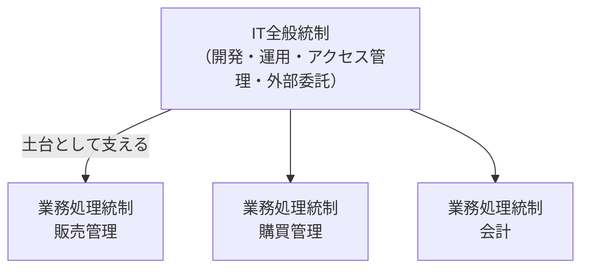

# 16-2 内部統制

組織が**自ら業務の適正を確保する仕組み**を扱う。

[16-1 システム監査](16-1-システム監査.md) が「第三者が点検する」活動だったのに対し、内部統制は「組織自身が組み込んでおく」仕組みである。監査はあくまで年に数回の点検であり、日常の業務が常に適正に行われることを保証するのは内部統制の役割になる。**監査は内部統制が機能しているかを確かめる**という関係にある。

午前Iの問22前後から出題される。16年で2問。

## 目次

- [1. 内部統制の目的と基本的要素](#1-内部統制の目的と基本的要素)
- [2. ITへの対応](#2-itへの対応)
- [3. IT全般統制とIT業務処理統制](#3-it全般統制とit業務処理統制)

---

## 1. 内部統制の目的と基本的要素

金融庁の「財務報告に係る内部統制の評価及び監査に関する実施基準」では、内部統制を**4つの目的**と**6つの基本的要素**で整理する。

### 1.1 4つの目的

| 目的 | 内容 |
| --- | --- |
| 業務の有効性及び効率性 | 事業活動の目的が達成されること |
| **財務報告の信頼性** | 財務諸表が適正に作成されること |
| 事業活動に関わる法令等の遵守 | コンプライアンス |
| 資産の保全 | 資産が適正に取得・使用・処分されること |

### 1.2 6つの基本的要素

| 要素 | 内容 |
| --- | --- |
| 統制環境 | 組織の気風。経営者の姿勢、倫理観 |
| リスクの評価と対応 | 目的の達成を阻害するリスクを識別し対応する |
| **統制活動** | 命令・指示が適切に実行されることを確保する方針と手続 |
| 情報と伝達 | 必要な情報が適切に伝わる |
| モニタリング | 内部統制が有効に機能しているかを継続的に評価する |
| **ITへの対応** | **ITに対して適切に対応する** |

**「ITへの対応」が基本的要素のひとつに含まれている**のが、日本の内部統制の枠組みの特徴である。業務の大半がITに依存している以上、ITを抜きに統制は語れないという認識が反映されている。

---

## 2. ITへの対応

> 金融庁の「財務報告に係る内部統制の評価及び監査に関する実施基準」における**「ITへの対応」**に関する記述のうち、適切なものはどれか。

答えは、

> **ITの統制は、ITに係る全般統制及びITに係る業務処理統制から成る。**

誤答として並ぶ記述が、それぞれ典型的な誤解を示している。

| 記述 | なぜ誤りか |
| --- | --- |
| **IT環境とは、企業内部に限られた範囲でのITの利用状況**である | IT環境には、**社会や取引先を含む企業外部のITの利用状況**も含まれる。EDIやクラウドサービスの利用は企業の枠を越える |
| ITの利用によって統制活動を**自動化している場合、当該統制活動は有効であると評価される** | **自動化していれば有効とは限らない**。設定が誤っていれば自動的に誤った処理を繰り返す |
| ITを利用せず**手作業だけで内部統制を運用している場合、直ちに内部統制の不備となる** | **手作業でも適切に運用されていれば不備ではない**。規模や特性に応じた対応が認められる |

2つ目と3つ目の誤答は対になっている。**「自動化＝善、手作業＝悪」という単純な評価をしない**のがこの基準の立場である。重要なのは**統制が目的を達成しているかどうか**であり、手段がITかどうかではない。

> **出題** 内部統制とITへの対応: H28午前I問22

---

## 3. IT全般統制とIT業務処理統制

ITに係る統制は、**適用される範囲**で2つに分かれる。

| 分類 | 対象 | 例 |
| --- | --- | --- |
| **IT全般統制** | **業務処理統制が有効に機能する環境を保証する**。複数の業務処理統制に**共通して影響する** | システムの開発・保守の管理、**システムの運用管理**、**アクセス管理**、外部委託の管理 |
| **IT業務処理統制** | **個々の業務処理が正確に行われることを確保する**。**特定の業務プロセスに組み込まれる** | **入力データの正当性チェック**、エラーデータの修正と再処理、マスタデータの維持管理、承認手続 |

### 3.1 判別の方法

> 情報システムに対する統制をITに係る全般統制とITに係る業務処理統制に分けたとき、**ITに係る業務処理統制に該当するもの**はどれか。

答えは、

> **販売管理システムにおける入力データの正当性チェック機能。**

判別の基準は、**「特定の業務の処理そのものに組み込まれているか」**である。

| 記述 | 分類 | 理由 |
| --- | --- | --- |
| サーバ室への入退室を制限・記録するための入退室管理システム | **全般統制** | 特定の業務ではなく、**すべてのシステムに共通**する環境の統制 |
| システム開発業務を適切に委託するために定めた選定手続 | **全般統制** | 開発・委託の管理であり、業務処理そのものではない |
| **販売管理システムにおける入力データの正当性チェック機能** | **業務処理統制** | **販売管理という特定の業務の処理に組み込まれている** |
| 不正アクセスを防止するためのファイアウォールの運用管理 | **全般統制** | すべてのシステムに共通する環境の統制 |

**「〜システムにおける」と特定の業務名が付いていれば業務処理統制**、入退室・ファイアウォール・開発委託のように**業務を問わず共通するものは全般統制**、と判別できる。

### 3.2 両者の関係

**全般統制が土台で、業務処理統制がその上に載る**という関係にある。この構造には重要な含意がある。

**全般統制が機能していなければ、業務処理統制も信頼できない**。たとえば販売管理システムに完璧な入力チェック機能があっても、**プログラムを誰でも無断で変更できる**状態（全般統制の不備）なら、そのチェック機能が今日も有効である保証はない。

したがって監査では、**まず全般統制を評価し、それが有効である前提で業務処理統制を評価する**という順序をとる。全般統制に重大な不備があれば、業務処理統制をいくら調べても結論は出せない。

> **出題** IT業務処理統制: R6午前I問22

---

## この章のまとめ

- 内部統制の目的は**業務の有効性・効率性、財務報告の信頼性、法令等の遵守、資産の保全**の4つ。基本的要素に**「ITへの対応」**が含まれる。
- **IT環境には企業外部のITの利用状況も含まれる**。**自動化していれば有効とは限らず、手作業でも直ちに不備とはならない**。
- ITの統制は**IT全般統制（環境、共通）とIT業務処理統制（特定業務の処理に組込み）**から成る。
- 判別は、**「〜システムにおける」と特定業務に紐づくなら業務処理統制、入退室・ファイアウォール・開発委託など業務を問わないなら全般統制**。
- **全般統制が土台で、それが機能していなければ業務処理統制も信頼できない**。
