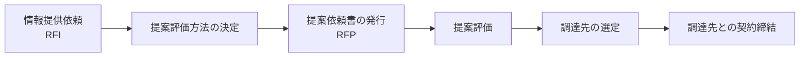

# 18-3 調達計画及び実施

情報システムやサービスを**外部から調達する**手続きを扱う。

調達の手続きが形式化されているのは、**選定の公正さと、合意内容の明確さ**を確保するためである。「なんとなく付き合いのあるベンダに頼む」のでは、条件を比較できず、後から「こんなはずではなかった」となっても根拠がない。RFIからRFPへ、提案評価から契約へという段取りは、この2点を担保するためのものである。

午前Iの問24・問25前後から出題される。**16年で11問**と、分野18のなかで最も出題が多い。

## 目次

- [1. 調達の流れ](#1-調達の流れ)
- [2. RFIとRFP](#2-rfiとrfp)
- [3. 契約形態とモデル取引・契約書](#3-契約形態とモデル取引契約書)
- [4. 多段階契約とLOI](#4-多段階契約とloi)
- [5. 調達に関するその他の論点](#5-調達に関するその他の論点)

---

## 1. 調達の流れ

> 「提案評価方法の決定」に始まる調達プロセスを、**調達先との契約締結、調達先の選定、提案依頼書（RFP）の発行、提案評価**に分類して順番に並べたとき、**c に入るもの**はどれか。

順序は、

**提案評価方法の決定 → 提案依頼書（RFP）の発行 → 提案評価 → 調達先の選定 → 調達先との契約締結**

である。したがって `c`（3番目）は **調達先の選定**になる。

**「提案評価方法を先に決める」**のがこの流れの要点である。提案を受け取ってから評価基準を作れば、特定のベンダに有利な基準になりかねない。**先に基準を決めておくからこそ、公正な比較ができる**。

> **出題** 調達プロセスの流れ: H23午前I問25

---

## 2. RFIとRFP

**3回以上出題されている**最重要テーマである。2つの違いを正確に押さえる。

| 文書 | 目的 | タイミング |
| --- | --- | --- |
| **RFI**（情報提供依頼書） | **調達者から供給者候補に対して、システム化の目的や業務内容などを示し、情報の提供を依頼する** | 調達の**初期**。何が実現可能かを知る |
| **RFP**（提案依頼書） | **調達者から供給者候補に対して、対象システムや調達条件などを示し、提案書の提出を依頼する** | 要件が固まった後。**提案を受ける** |

RFIについては、次の説明も出題されている。

> **ユーザ要件を実現するために、現在の状況において利用可能な技術・製品、ベンダにおける導入実績など実現手段に関する情報提供をベンダに依頼する文書。**

**RFIは「情報をください」、RFPは「提案をください」**という違いである。

RFIを先に出す理由は、**調達者側が市場を知らないまま要件を書くと、実現不可能な要求や、逆に技術の可能性を活かせない要求になる**からである。まず「いまどんな技術があり、どんな実績があるか」を集め、それを踏まえて要件を固めてからRFPを出す。

誤答として並ぶ文書との区別を押さえる。

| 記述 | 実際は何か |
| --- | --- |
| **システム化の目的や業務内容などを示し、情報の提供を依頼する** | **RFI** |
| 対象システムや調達条件などを示し、**提案書の提出を依頼する** | **RFP** |
| 契約内容で取り決めた内容に関して、**変更を要請する** | 変更要求（RFC → [15-2 サービスマネジメントシステムの計画及び運用](../15-service-management/15-2-サービスマネジメントシステムの計画及び運用.md)） |
| 双方の役割分担などを確認し、**契約の締結を要請する** | 契約交渉 |
| サービスの内容、品質などに関する保証範囲やペナルティを契約としてまとめた文書 | **SLA**（→ [15-1 サービスマネジメント](../15-service-management/15-1-サービスマネジメント.md)） |
| 技術的要件やサービスレベル要件を提示し、効果的な実現策の提案を依頼する文書 | **RFP** |
| 業務処理の概要、入出力情報の一覧、データフローなどをまとめた文書 | 要件定義書 |

> **出題** RFI: H21午前I問25、H24午前I問25、H27午前I問24、R3午前I問24、R5午前I問25

---

## 3. 契約形態とモデル取引・契約書

**「情報システム・モデル取引・契約書」**は、経済産業省が示すひな形で、**工程ごとに適切な契約形態**を整理している。

### 3.1 工程と契約形態の対応

| 工程 | 適切な契約形態 | 理由 |
| --- | --- | --- |
| システム化計画 | 準委任型 | 何を作るか未定 |
| **要件定義** | **準委任型** | **何を作るかを決める工程**（→ [18-2 要件定義](18-2-要件定義.md)） |
| システム外部設計 | 準委任型または請負型 | 要件が固まりつつある |
| **システム内部設計** | **請負型** | 仕様が確定している |
| **ソフトウェア設計・プログラミング・ソフトウェアテスト** | **請負型** | 成果物が明確 |
| **システム結合** | **請負型** | 同上 |
| システムテスト | 準委任型または請負型 | — |
| **運用テスト（導入・受入支援）** | **準委任型** | **ユーザ側の作業を支援する性質** |

### 3.2 請負型が適切なフェーズ

> 「情報システム・モデル取引・契約書」によれば、ユーザ（取得者）とベンダ（供給者）間で**請負型の契約が適切である**とされるフェーズはどれか。

答えは **システム内部設計フェーズからシステム結合フェーズまで**である。

**仕様が確定していて、成果物を定義できる範囲**が請負型になる。前後の工程は、何を作るか（前）あるいはユーザ側の判断（後）に依存するため、完成責任を負わせられない。

### 3.3 準委任型が適切なフェーズ

> ベンダーX社に対して、要件定義フェーズから運用テストフェーズまでを委託したい。「情報システム・モデル取引・契約書＜第二版＞」に照らし、a〜dの契約形態のうち、**準委任型が適切である**とされるものはどれか。
>
> | 要件定義 | システム外部設計 | システム内部設計 | ソフトウェア設計、プログラミング、ソフトウェアテスト | システム結合 | システムテスト | 運用テスト |
> | --- | --- | --- | --- | --- | --- | --- |
> | **a** | 準委任型または請負型 | **b** | 請負型 | **c** | 準委任型または請負型 | **d** |

表の空欄を埋める。

| 記号 | フェーズ | 契約形態 |
| --- | --- | --- |
| **a** | 要件定義 | **準委任型** |
| b | システム内部設計 | 請負型 |
| c | システム結合 | 請負型 |
| **d** | 運用テスト | **準委任型** |

したがって準委任型が適切なのは **a と d** である。

**両端が準委任、中央が請負**という形になる。入口（何を作るか決める）と出口（ユーザが受け入れる）はユーザ主導なので準委任、中間の製造工程はベンダが成果物に責任をもてるので請負、という配置である。

> **出題** モデル取引・契約書と請負型: H26午前I問25 ｜ 準委任型契約: R7午前I問25

---

## 4. 多段階契約とLOI

### 4.1 多段階契約

**多段階契約**とは、**工程ごとに個別契約を締結する**方式である。

> 「情報システム・モデル取引・契約書」によれば、情報システムの開発において**多段階契約の考え方を採用する目的**はどれか。

答えは、

> **開発段階において、前工程の遂行の結果、後工程の見積前提条件に変更が生じた場合に対応できるようにするため。**

一括契約では、**要件が固まっていない段階で全工程の価格と期間を決めなければならない**。前提が外れたときの調整が難しく、ベンダはリスクを価格に織り込み、ユーザは変更に高い対価を払うことになる。

多段階契約なら、**各工程の開始時点で、その時点の情報に基づいて見積れる**。要件定義の結果を踏まえて設計以降の契約を結べるので、双方にとって合理的になる。

### 4.2 LOI

**LOI（Letter of Intent、基本合意書）**は、本契約の締結前に、**交渉の基本的な方向性について合意した文書**である。

多段階契約では、個別契約の締結までに時間がかかることがある。その間に作業を止めると納期に影響するため、LOIを交わして**先行して作業を開始する**ことがある。ただしLOIは本契約ではないので、**どこまでが合意済みで、どこからが未確定かを明確にしておく**必要がある。

### 4.3 レベニューシェア契約

**レベニューシェア契約**は、**システムが生み出す収益を発注者と受注者で分配する**契約形態である。

| | 通常の請負契約 | レベニューシェア契約 |
| --- | --- | --- |
| 対価 | 作業に対して固定額 | **収益に応じて変動** |
| 受注者のリスク | 低い | **高い**（収益が出なければ報酬も少ない） |
| 受注者のインセンティブ | 期日内に仕様どおり作る | **システムを成功させる** |

**受注者が成果に対する責任を共有する**のが特徴である。発注者は初期投資を抑えられ、受注者は成功すれば大きな報酬を得られる。一方、**受注者はシステムが使われなければ回収できない**というリスクを負う。

この形態が成り立つのは、**システムの成否が収益に直結する事業**（ECサイト、課金サービスなど）に限られる。社内業務システムのように収益を直接測れない場合には適用できない。

> **出題** LOI（多段階契約）: H29午前I問24 ｜ レベニューシェア契約: R3午前I問25

---

## 5. 調達に関するその他の論点

### 5.1 コンティンジェンシープラン

> 組込み機器のハードウェアの製造を外部に委託する場合の**コンティンジェンシープラン**の記述として適切なものはどれか。

答えは、

> **部品調達のリスクが顕在化したときに備えて、対処するための計画を策定する。**

**コンティンジェンシープランは「起きてしまったときにどうするか」の計画**である。リスクを減らす活動ではない。

誤答と並べると違いがはっきりする。

| 記述 | リスク対応の分類（→ [14-8 プロジェクトのリスク](../14-project-management/14-8-プロジェクトのリスク.md)） |
| --- | --- |
| 実績のある外注先の利用によって、リスクの発生確率を低減する | **軽減** |
| 製造品質が担保されていることを確認できるように委託先と契約する | **軽減／転嫁** |
| 複数の会社の見積りを比較検討して、委託先を選定する | 調達の通常の手続き |
| **リスクが顕在化したときに備えて、対処するための計画を策定する** | **コンティンジェンシープラン** |

**「顕在化したときに備えて」という条件節があるかどうか**が判別の決め手になる。発生前に手を打つのが軽減、発生後の行動を決めておくのがコンティンジェンシープランである。

### 5.2 グリーン調達とCSR調達

調達では価格と品質だけでなく、社会的な観点も評価される。

| 観点 | 内容 |
| --- | --- |
| グリーン調達 | 環境負荷の小さい製品・サービスを優先して調達する |
| CSR調達 | 取引先の人権・労働環境・法令遵守の状況も評価して調達する |

これらは**サプライチェーン全体に責任を負う**という考え方に基づく。自社が法令を守っていても、委託先が問題を起こせば自社の責任を問われる。[13-2 知的財産適用管理](../13-software-development-management/13-2-知的財産適用管理.md) や [11-2 情報セキュリティ管理](../11-security/11-2-情報セキュリティ管理.md) で見た委託先管理も、同じ発想の延長にある。

> **出題** コンティンジェンシープラン: R6午前I問25

---

## この章のまとめ

- 調達の順序は**提案評価方法の決定 → RFP発行 → 提案評価 → 調達先の選定 → 契約締結**。**評価方法を先に決める**ことが公正さを担保する。
- **RFIは「情報をください」、RFPは「提案をください」**。RFIを先に出すのは、市場を知らずに要件を書く誤りを避けるため。
- 契約形態は**両端が準委任（要件定義・運用テスト）、中央が請負（内部設計〜システム結合）**。
- **多段階契約は、前工程の結果を踏まえて後工程を見積れる**ようにする方式。LOIは本契約前の基本合意。
- **レベニューシェア契約は収益を分配する**。受注者が成果責任を共有する代わりにリスクも負う。
- **コンティンジェンシープランは「顕在化したときに備える」計画**。発生確率を下げる軽減策とは別物である。
