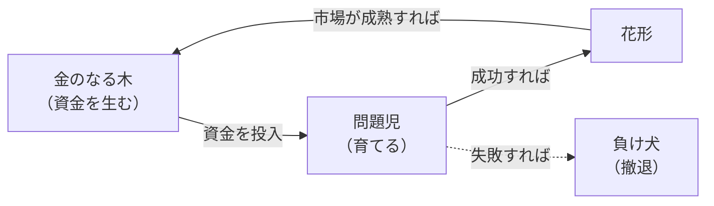
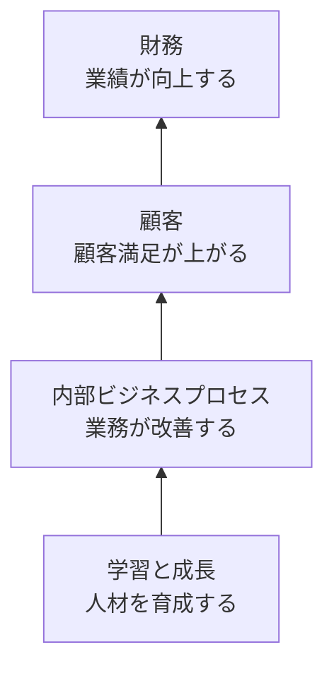

# 19-1 経営戦略手法

企業が**どこで、どう戦うか**を決めるための分析手法と戦略論を扱う。

経営戦略の手法は数が多いが、**何を分析するための道具か**で整理すると覚えやすい。外部環境を見るもの（ファイブフォース、PEST）、自社の資源配分を決めるもの（PPM、アンゾフ）、他社と比べるもの（ベンチマーキング）、戦略を測るもの（バランススコアカード）という具合である。

午前Iの問26前後から出題される。**16年で15問**と、ストラテジ系のなかで出題が多い。**PPMは5回**出題されている最頻出テーマである。

## 目次

- [1. 競争環境の分析](#1-競争環境の分析)
- [2. 競争地位別の戦略](#2-競争地位別の戦略)
- [3. 成長戦略](#3-成長戦略)
- [4. PPM](#4-ppm)
- [5. バランススコアカード](#5-バランススコアカード)
- [6. ベンチマーキング](#6-ベンチマーキング)
- [7. 製造業のビジネスモデル](#7-製造業のビジネスモデル)

---

## 1. 競争環境の分析

### 1.1 ファイブフォース分析

> 企業が属する業界の競争状態と収益構造を、**「新規参入の脅威」「供給者の支配力」「買い手の交渉力」「代替製品・サービスの脅威」「既存競合者同士の敵対関係」**の要素に分類して分析するフレームワークはどれか。

答えは **ファイブフォース分析**である。

5つの力は、**業界の収益性を決める要因**として整理されている。

| 力 | 収益性を下げる場合 |
| --- | --- |
| 新規参入の脅威 | 参入障壁が低く、競争相手が増えやすい |
| 供給者（売り手）の支配力 | 仕入先が強く、原価を下げられない |
| 買い手の交渉力 | 顧客が強く、値上げできない |
| 代替製品・サービスの脅威 | 別の手段で代替されうる |
| 既存競合者同士の敵対関係 | 価格競争が激しい |

**「業界が儲かるかどうかは、企業の努力より業界構造で決まる部分が大きい」**というのがこの分析の前提にある。だから戦略の第一歩は、**どの業界で戦うか**を選ぶことになる。

誤答として並ぶ手法との区別を押さえる。

| 手法 | 分析対象 |
| --- | --- |
| **ファイブフォース分析** | **業界の競争構造** |
| PEST分析 | マクロ環境（政治、経済、社会、技術） |
| VRIO分析 | 自社の経営資源（価値、希少性、模倣困難性、組織） |
| バリューチェーン分析 | 自社の活動のどこで価値が生まれるか |
| SWOT分析 | **自社の強みと弱み、市場における機会と脅威**を分類ごとに列挙して環境分析を行う |
| 3C分析 | 顧客（Customer）、競合（Competitor）、自社（Company） |

> **出題** ファイブフォース分析: R6午前I問26

---

## 2. 競争地位別の戦略

市場での地位に応じて、取るべき戦略が変わる。

| 地位 | 戦略 |
| --- | --- |
| **リーダ** | **利潤、名声の維持・向上と最適市場シェアの確保を目標として、市場内の全ての顧客をターゲットにした全方位戦略をとる** |
| **チャレンジャ** | **上位企業の市場シェアを奪うことを目標に、製品、サービス、販売促進、流通チャネルなどのあらゆる面での差別化戦略をとる** |
| **フォロワ** | **目標とする企業の戦略を観察し、迅速に模倣することで、開発や広告のコストを抑制し、市場での存続を図る** |
| **ニッチャ** | **潜在的な需要がありながら、大手企業が参入してこないような専門特化した市場に、限られた経営資源を集中する** |

> 企業の競争戦略における**フォロワ戦略**はどれか。

答えは **目標とする企業の戦略を観察し、迅速に模倣することで、開発や広告のコストを抑制し、市場での存続を図る**である。

**フォロワの「模倣」は怠慢ではなく合理的な戦略**である。新しい市場を切り開くには、需要の有無を確かめる調査費、認知を広げる広告費、失敗のリスクをすべて負わなければならない。後から追随すれば、**市場が成立することが証明された後に、低コストで参入できる**。

4つの戦略は、**経営資源の量と市場での地位**から導かれる。資源が豊富で地位も高いリーダは全方位で守り、資源はあるが地位が低いチャレンジャは差別化で攻め、資源が少ないフォロワは模倣でコストを抑え、資源が限られるニッチャは一点に集中する。

> **出題** フォロワ戦略: H24午前I問26

---

## 3. 成長戦略

### 3.1 アンゾフの成長マトリクス

> **アンゾフが提唱する成長マトリクス**を説明したものはどれか。

答えは、

> **製品と市場の視点から、事業拡大の方向性を市場浸透・製品開発・市場開拓・多角化に分けて、戦略を検討する。**

**「製品」と「市場」をそれぞれ既存・新規で分けた2×2のマトリクス**である。

| | 既存市場 | 新規市場 |
| --- | --- | --- |
| **既存製品** | **市場浸透**（既存製品を既存市場でもっと売る） | **市場開拓**（既存製品を新しい市場へ） |
| **新規製品** | **製品開発**（新製品を既存市場へ） | **多角化**（新製品を新市場へ） |

**右下の多角化が最もリスクが高い**。製品も市場も未知だからである。左上の市場浸透が最も確実だが、成長の余地は限られる。この配置が、成長戦略を選ぶときの判断材料になる。

誤答との区別も押さえる。「強みと弱み、機会と脅威を列挙する」はSWOT分析、「市場占有率と市場成長率から資源配分を決める」はPPM、「導入期・成長期・成熟期・衰退期に応じて計画する」はプロダクトライフサイクル（→ [19-2 マーケティング](19-2-マーケティング.md)）である。

### 3.2 M&Aと垂直統合

> 多角化戦略のうち、**M&Aによる垂直統合**に該当するものはどれか。

答えは **製鉄メーカによる鉄鉱石採掘会社の買収・合併**である。

| 統合の種類 | 内容 | 例 |
| --- | --- | --- |
| **垂直統合** | **同じ製品の、サプライチェーン上の上流または下流を取り込む** | **製鉄メーカが鉄鉱石採掘会社を買収**（原材料側＝上流への統合） |
| 水平統合 | 同じ段階の同業他社を取り込む | 自動車メーカが軽自動車メーカを買収 |
| 多角化（非関連） | 異なる事業分野へ進出する | 電機メーカが不動産会社を買収、銀行が保険会社を買収 |

**判別は「同じ製品の流れの中で、川上か川下か」**である。鉄鉱石は鉄の原材料なので、製鉄メーカにとって川上にあたる。自動車メーカと軽自動車メーカは同じ段階（水平）、電機と不動産は無関係（非関連多角化）である。

垂直統合の狙いは、**原材料の安定確保や流通の掌握によって、サプライチェーン上の交渉力を高める**ことにある。[1. 競争環境の分析](#1-競争環境の分析) のファイブフォースでいえば、「供給者の支配力」や「買い手の交渉力」を自社に取り込む動きになる。

> **出題** アンゾフの成長マトリクス: H28午前I問27 ｜ M&Aと垂直統合: H27午前I問26

---

## 4. PPM

**PPM（プロダクトポートフォリオマネジメント）**は**5回出題されている**最頻出テーマである。

> **市場成長率と相対的市場シェアから、市場と企業との関係を分析し、自社製品や事業についての最適な資源配分方針を求めるための手法**はどれか。

答えは **PPM**である。

### 4.1 2つの軸と4つの象限

マトリクスの軸は、**縦が市場成長率、横が市場占有率（相対的市場シェア）**である。

| | 市場占有率：高 | 市場占有率：低 |
| --- | --- | --- |
| **市場成長率：高** | **花形（star）** | **問題児（question mark）** |
| **市場成長率：低** | **金のなる木（cash cow）** | **負け犬（dog）** |

各象限の性質を押さえる。

| 象限 | 説明 |
| --- | --- |
| **花形** | **市場成長率、市場占有率ともに高い**。成長に伴う投資も必要とするので、**資金創出効果は大きいとは限らない** |
| **金のなる木** | **市場成長率は低いが、市場占有率は高い**。**資金創出効果が大きく、企業の支柱となる資金源** |
| **問題児** | **市場成長率は高いが、市場占有率が低い**。長期的な将来性は見込めるが、**資金創出効果の大きさは分からない** |
| **負け犬** | **市場成長率、市場占有率ともに低い**。資金創出効果は小さく、資金流出量も少ない |

### 4.2 なぜこの2軸なのか

**市場成長率は「資金の必要量」、市場占有率は「資金の創出量」**を表している、と考えると各象限の性質が導ける。

- 成長市場では、シェアを保つだけでも設備投資や広告が要る → **資金が出ていく**
- 占有率が高ければ、規模の経済とシェアに応じた売上で **資金が入ってくる**

この見方から、

- **花形**：入ってくるが出ていくので、差し引きは大きくない
- **金のなる木**：入ってくるのに出ていかないので、**余剰資金が生まれる**
- **問題児**：出ていくのに入ってこない。投資して花形にするか、撤退するかの判断が要る
- **負け犬**：どちらも小さい。撤退が検討される

### 4.3 投資の流れ

> PPMにおいて、**投資用の資金源として位置付けられる事業**はどれか。

答えは **市場成長率が低く、相対的市場占有率が高い事業**、すなわち**金のなる木**である。

**金のなる木で稼いだ資金を問題児に投じ、花形に育てる**というのがPPMの基本的な資源配分の考え方である。すべての事業を同じ基準で評価せず、**役割を分けて全体として循環させる**ところに、この手法の意義がある。

> **出題** PPMの花形: R1午前I問26 ｜ PPMマトリックス: R3午前I問26 ｜ PPMの金のなる木: R4午前I問26 ｜ PPM: R7午前I問26

---

## 5. バランススコアカード

**バランススコアカード（BSC）**は、財務指標だけでは捉えきれない企業の業績を、**4つの視点**から体系的に評価する手法である。

> バランススコアカードの四つの視点とは、財務、学習と成長、内部ビジネスプロセスと、もう一つはどれか。

答えは **顧客**である。

| 視点 | 問い |
| --- | --- |
| **財務** | 株主にどう見られるべきか |
| **顧客** | 顧客にどう見られるべきか |
| **内部ビジネスプロセス** | どの業務プロセスに秀でるべきか |
| **学習と成長** | どう改善し、能力を高めるべきか |

### 5.1 戦略マップ

> バランススコアカードで使われる**戦略マップ**の説明はどれか。

答えは、

> **財務、顧客、内部ビジネスプロセス、学習と成長という四つの視点を基に、課題、施策、目標の因果関係を表現したもの。**

**「因果関係を表現したもの」**が決め手である。4つの視点は独立していない。**学習と成長 → 内部ビジネスプロセス → 顧客 → 財務**という方向に因果が流れる。

この因果を可視化すると、**「なぜこの施策をやるのか」が財務成果まで一本の線でつながる**。研修への投資が、どう業績につながるのかを説明できるようになる。逆に、どこにもつながらない施策は見直しの対象になる。

誤答として並ぶものとの区別を押さえる。「二つの要素をX軸・Y軸として市場でのポジションを表現する」はポジショニングマップ、「市場の魅力度と自社の優位性の2軸で分類する」はビジネススクリーン（GEマトリクス）、「どの顧客層にどの経営資源でどの製品を提供するかを表現する」はビジネスモデルの記述である。

IT投資評価への応用と、視点ごとのKPIの判別は [17-1 情報システム戦略](../17-system-strategy/17-1-情報システム戦略.md) で扱う。

> **出題** バランススコアカードの四つの視点: R3午前I問29 ｜ 戦略マップ: R5午前I問26

---

## 6. ベンチマーキング

> **ベンチマーキング**を説明したものはどれか。

答えは、

> **優れた業績を上げている企業などとの比較分析を行い、結果を自社の経営改革に活用する。**

**「比較して学ぶ」**のがベンチマーキングである。比較対象は同業他社に限らない。物流の効率を学ぶために異業種の優良企業を参照する、といった使い方もある。

重要なのは、**数値を比べるだけでは意味がない**ことである。「他社の在庫回転率が自社の2倍だった」という事実から、**なぜそうなのか、どういう仕組みの違いによるのか**を分析して初めて、自社の改革に活かせる。

誤答として並ぶ経営手法との区別を押さえる。

| 記述 | 実際は何か |
| --- | --- |
| 企業内に散在している知識を共有化し、全体の問題解決力を高めていく経営 | **ナレッジマネジメント** |
| 組織の階層をできるだけ少なくしたフラット型の組織構造による経営 | フラット型組織（→ [22-1 経営・組織論](../22-corporate-activities/22-1-経営-組織論.md)） |
| **優れた業績を上げている企業などとの比較分析を行い、自社の経営改革に活用する** | **ベンチマーキング** |
| 他社にはまねのできない、企業独自のノウハウや技術などの強みを核とした経営 | **コアコンピタンス経営**（→ [20-1 技術開発戦略の立案](../20-technology-strategy-management/20-1-技術開発戦略の立案.md)） |

> **出題** ベンチマーキング: H28午前I問26

---

## 7. 製造業のビジネスモデル

半導体・電子機器産業を題材に、**どの機能を自社でもち、どの機能を外に出すか**によるビジネスモデルの違いが繰り返し問われる。

| モデル | 設計 | 製造 | ブランド |
| --- | --- | --- | --- |
| **垂直統合型（IDM）** | 自社 | 自社 | 自社 |
| **ファブレス** | **自社** | **もたない** | 自社 |
| **ファウンドリ** | — | **自社（受託専門）** | — |
| **EMS** | — | **自社（受託専門）** | — |
| **OEM** | 相手先または自社 | 自社 | **相手先** |
| **ODM** | **自社** | 自社 | 相手先 |

### 7.1 ファブレスとファウンドリ

> **半導体ファブレス企業**の説明として適切なものはどれか。

答えは **製品の企画、設計及び開発は行うが、半導体製造の工場は所有しない**である。

> 半導体メーカが行っている**ファウンドリサービス**の説明として適切なものはどれか。

答えは **他社からの製造委託を受けて、半導体製品の製造を行う**である。

> 半導体産業において、ファブレス企業と比較した**ファウンドリ企業のビジネスモデルの特徴**として適切なものはどれか。

答えは **複数の企業から生産だけを専門に請け負い、多くの製品を低コストで生産する**である。

**ファブレスとファウンドリは対になっている**。

| | ファブレス | ファウンドリ |
| --- | --- | --- |
| もつもの | **設計能力・ブランド** | **生産設備** |
| もたないもの | **工場** | 設計・ブランド |
| 強み | 設備投資を抑え、設計と市場開拓に注力できる | **複数社から受託して設備を高稼働させ、低コストで量産できる** |

この分業が成立するのは、**半導体の製造設備が極めて高価**だからである。最先端の工場は数千億円規模になり、1社の需要だけでは稼働率を保てない。**複数社の生産を集約すれば設備を遊ばせずに済む**ので、ファウンドリ専業が成り立つ。一方、設計側は巨額の設備投資から解放され、製品開発に資源を集中できる。

### 7.2 EMS

> **EMS（Electronics Manufacturing Services）**の説明として適切なものはどれか。

答えは **生産設備をもつ企業が、他社からの委託を受けて電子機器を製造する**である。

**EMSは電子機器全般の受託製造**で、ファウンドリ（半導体製造に特化）より広い範囲を扱う。部品調達から組立、検査、場合によっては設計支援や物流まで請け負う。

誤答との区別を押さえる。「設計だけを受託し製造は相手先で行う」は設計受託、「外部調達した製品に付加価値を加えて自社ブランドで販売する」はファブレスや商社に近い形態、「ソフトウェア開発だけを外部委託しハードウェアは自社で設計製造する」は通常の自社製造である。

> **出題** ファブレス企業: H29午前I問25 ｜ ファウンドリサービス: R1午前I問25 ｜ ファウンドリ企業: R4午前I問27 ｜ EMS: R6午前I問24

---

## この章のまとめ

- **ファイブフォース分析は業界の競争構造**を5つの力で分析する。PEST（マクロ環境）、VRIO（自社資源）、SWOT（強み弱み機会脅威）とは対象が違う。
- 競争地位別戦略は**リーダ（全方位）、チャレンジャ（差別化）、フォロワ（模倣）、ニッチャ（集中）**。
- **アンゾフの成長マトリクスは製品と市場の2軸**。多角化が最もリスクが高い。**垂直統合は同じ製品の川上・川下を取り込む**。
- PPMは**縦が市場成長率、横が市場占有率**。**金のなる木が資金源**で、そこから問題児に投じて花形に育てる。
- **BSCの4視点は財務・顧客・内部ビジネスプロセス・学習と成長**。**戦略マップは4視点の因果関係を表現する**。
- **ベンチマーキングは優良企業と比較分析して自社の改革に活かす**。数値を比べるだけでなく、違いの理由まで分析する。
- **ファブレスは工場をもたず設計に注力、ファウンドリは製造を専門に受託**。**EMSは電子機器全般の受託製造**。
