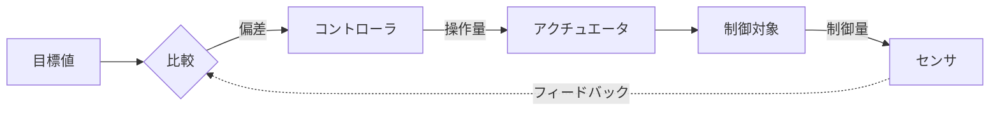

# 21-5 産業機器

**産業の現場で使われる機器**に組み込まれた情報技術を扱う。工場の制御機器、医療機器、建設機械、社会インフラの設備などが対象になる。

産業機器が民生機器と決定的に違うのは、**止まったときの影響の大きさ**である。家電が壊れても不便なだけだが、プラントの制御装置が誤動作すれば人命に関わり、社会インフラが止まれば広範囲に影響が及ぶ。この違いが、求められる信頼性と安全性の水準を決めている。

午前Iの問27前後から出題される。16年で1問。

出題が少ない分野のため、本章では過去問で問われた内容に加えて、産業機器の特徴とIoT応用の整理を補っている。

## 目次

- [1. 産業機器の分類と制御](#1-産業機器の分類と制御)
- [2. 産業用ネットワーク](#2-産業用ネットワーク)
- [3. IoTがもたらす効果の4段階](#3-iotがもたらす効果の4段階)
- [4. 産業機器のセキュリティ](#4-産業機器のセキュリティ)

---

## 1. 産業機器の分類と制御

| 分類 | 例 |
| --- | --- |
| 製造設備 | NC工作機械、産業用ロボット、搬送装置（→ [21-2 エンジニアリングシステム](21-2-エンジニアリングシステム.md)） |
| 計測・制御機器 | PLC（プログラマブルロジックコントローラ）、センサ、アクチュエータ |
| 医療機器 | 診断装置、治療装置、生体情報モニタ |
| 建設・農業機械 | 建設機械の自動制御、農機の自動運転 |
| 社会インフラ | 電力、ガス、水道、交通の制御設備 |

### 1.1 フィードバック制御

産業機器の制御の基本は**フィードバック制御**である。[6-1 ハードウェア](../06-hardware/6-1-ハードウェア.md) で見たとおり、コントローラが**与えられた目標量とセンサから得られた制御量を比較し、制御量を目標量に一致させるように操作量を出力する**。

このループが成立するには、**センサが正しく測り、コントローラが正しく判断し、アクチュエータが正しく動く**必要がある。どれか1つでも異常があれば、制御は誤った方向に進む。産業機器の信頼性要求が高いのは、この連鎖の各要素が致命的だからである。

### 1.2 安全性の設計

産業機器では、**故障したときに危険な側へ倒れない**設計が必須になる。[4-1 システムの構成](../04-system-components/4-1-システムの構成.md) で見たフェールセーフがそのまま適用される。

| 設計 | 産業機器での例 |
| --- | --- |
| **フェールセーフ** | 制御装置が停止したら、機械も安全な位置で停止する |
| **フールプルーフ** | 安全カバーを開けると動作しないインタロック |
| **フォールトトレランス** | 制御系を二重化し、一方が故障しても継続する |

**機能安全**という考え方も重要になる。危険を完全に排除できない場合に、**安全機能によってリスクを許容可能な水準まで下げる**という発想である。国際規格 IEC 61508 が体系化している。

---

## 2. 産業用ネットワーク

工場やプラントでは、オフィスとは異なる要件のネットワークが使われる。

| 要件 | 理由 |
| --- | --- |
| **リアルタイム性** | 制御周期内に確実に届かなければならない |
| **決定性** | 遅延の上限が保証されていること。平均が速いだけでは不十分 |
| **ノイズ耐性** | モータやインバータからの強い電磁ノイズがある |
| **長期の供給** | 設備の寿命が10年以上あり、機器の供給が続く必要がある |

**オフィス用のイーサネットがそのまま使えない**のは、2番目の決定性による。[10-2 データ通信と制御](../10-network/10-2-データ通信と制御.md) で見たCSMA/CDは、衝突時にランダム時間待つため**最悪の遅延が保証されない**。制御では「平均1ミリ秒だが、まれに100ミリ秒かかる」では使えない。

この要求に応えるのが、トークンパッシング（→ [10-2](../10-network/10-2-データ通信と制御.md)）のような決定性のあるアクセス制御や、産業用に拡張されたイーサネット（TSN など）である。[10-1 ネットワーク方式](../10-network/10-1-ネットワーク方式.md) で見た**ローカル5G**も、工場内の無線化を低遅延で実現する手段として位置づけられる。

近年は**OT（制御技術）とIT（情報技術）の融合**が進み、制御ネットワークと情報系ネットワークが接続されるようになった。これが次に述べるIoTの効果を可能にする一方、セキュリティ上の新しいリスクも生んでいる。

---

## 3. IoTがもたらす効果の4段階

> IoTがもたらす効果を**「監視」「制御」「最適化」「自律化」**の4段階に分類すると、IoTによって工場の機械の監視や制御などを行っているシステムにおいて、**「自律化」の段階に達している例**はどれか。

答えは、

> **クラウドサービスを介して、機械同士が互いの状態を常時監視・分析し、人手を介すことなく目標に合わせた協調動作を自動で行う。**

4段階は、**人の関与がどれだけ減るか**という軸で並んでいる。

| 段階 | 内容 | 人の関与 |
| --- | --- | --- |
| **監視** | **センサでデータを集めて蓄積する** | 人が見て判断する |
| **制御** | **遠隔から操作命令を送る** | 人が判断して操作する |
| **最適化** | 収集データを分析して、より良い設定を導く | 人が分析結果を見て判断する |
| **自律化** | **機械が自ら判断し、人手を介さず協調動作する** | **人が介在しない** |

設問の各選択肢を段階に当てはめる。

| 記述 | 段階 |
| --- | --- |
| 機械の温度や振動データをセンサで集めて、クラウド上のサーバに蓄積する | **監視** |
| 保守員が遠隔地からインターネット経由で、電源のオン・オフなどの操作命令を送信する | **制御** |
| 常時収集されている稼働情報を基に、故障検知時に保守員が故障部位を分析して特定する | **最適化**（分析はするが、判断は人） |
| **機械同士が互いの状態を常時監視・分析し、人手を介すことなく協調動作を自動で行う** | **自律化** |

**「人手を介すことなく」という記述が自律化の決め手**である。他の3つはいずれも、最終的な判断や操作を人が行っている。

この4段階は、[21-1 ビジネスシステム](21-1-ビジネスシステム.md) で見た **Society 5.0** の「サイバー空間とフィジカル空間の融合」が、産業の現場でどう実現されるかを段階的に示したものだと見ることができる。自律化の段階に至って、人を介さないループが完成する。

自律化を支える技術が、**エッジでの推論**（→ [4-1 システムの構成](../04-system-components/4-1-システムの構成.md) のエッジAI）である。機械が自ら判断するには、クラウドとの往復を待たずに現場で推論する必要がある。

> **出題** IoTの自律化: H30午前I問27

---

## 4. 産業機器のセキュリティ

制御システムがネットワークにつながることで、従来は想定されなかった脅威が現実になった。

| 従来の前提 | 現在の状況 |
| --- | --- |
| 制御ネットワークは外部から隔離されている | 情報系ネットワークやクラウドと接続される |
| 専用のプロトコルなので攻撃者は理解できない | 仕様が公開され、汎用技術が使われる |
| 攻撃する動機がない | 社会インフラを標的とした攻撃が実在する |

**制御システムへの攻撃が深刻なのは、被害が物理世界に及ぶ**からである。情報システムへの攻撃は情報の漏えいや業務の停止にとどまるが、制御システムが乗っ取られれば、設備の破壊や人身事故につながりうる。

対策の難しさもある。

- **止められない**：24時間稼働が前提で、パッチ適用のための停止が難しい
- **古い機器が残る**：設備の寿命が10年以上あり、更新が追いつかない
- **可用性が最優先**：情報システムでは「疑わしければ遮断」が選べるが、制御では遮断そのものが事故になりうる

このため、**ネットワークの分離（→ [11-4 情報セキュリティ対策](../11-security/11-4-情報セキュリティ対策.md)）と、接続点での厳格な制御**が基本的な対策になる。[11-2 情報セキュリティ管理](../11-security/11-2-情報セキュリティ管理.md) で見たPSIRT（自社製品の脆弱性に対応する社内機能）が重視されるのも、産業機器を供給する企業にとって、製品の脆弱性が顧客の設備の危険に直結するからである。

---

## この章のまとめ

- 産業機器は**止まったときの影響が大きい**ため、民生機器より高い信頼性と安全性が求められる。**フェールセーフ、インタロック、二重化**が基本になる。
- 産業用ネットワークでは**決定性（遅延の上限が保証されること）**が重要。平均が速いだけでは制御に使えない。
- IoTの効果は**監視 → 制御 → 最適化 → 自律化**の4段階。**「人手を介すことなく」が自律化の決め手**になる。
- 制御システムのセキュリティは、**被害が物理世界に及ぶ**こと、**止められず古い機器が残る**ことで難しくなる。ネットワーク分離と接続点の制御が基本対策になる。
